[Longhorn](https://longhorn.io/) is cloud-native distributed block storage for Kubernetes that is easy to deploy and upgrade, 100 percent open source and persistent. Longhorn’s built-in incremental snapshot and backup features keep volume data safe, while its intuitive UI makes scheduling backups of persistent volumes easy to manage. Using Longhorn, you get maximum granularity and control, and can easily create a disaster recovery volume in another Kubernetes cluster and fail over to it in the event of an emergency.

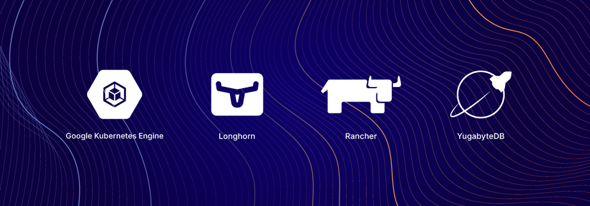
Cloud Native Infrastructure Stack: Computing, deployment, administration, storage and database.

YugabyteDB is a cloud-native, distributed SQL database that [runs in Kubernetes environments](https://blog.yugabyte.com/understanding-how-yugabyte-db-runs-on-kubernetes/), so it can interoperate with Longhorn and many other CNCF projects. If you’re not familiar with YugabyteDB, it is an open source, [high-performance distributed SQL database](https://blog.yugabyte.com/what-is-distributed-sql/) built on a scalable and fault-tolerant design inspired by Google Spanner. Yugabyte’s SQL API (YSQL) is PostgreSQL wire compatible.

If you are an engineer looking for a way to easily start your application development on top of a 100 percent cloud-native infrastructure, this article is for you. We’ll give you step-by-step instructions on how to deploy a completely cloud-native infrastructure stack that consists of Google Kubernetes Engine, Rancher enterprise Kubernetes management tooling, Longhorn distributed block storage and a YugabyteDB distributed SQL database.

## Why Longhorn and YugabyteDB?

YugabyteDB is deployed as a StatefulSet on Kubernetes and requires persistent storage. Longhorn can be used for backing YugabyteDB local disks, allowing the provisioning of large-scale persistent volumes. Here are a few benefits to using Longhorn and YugabyteDB together:

- There’s no need to manage the local disks – they are managed by Longhorn.
- Longhorn and YugabyteDB can provision large-sized persistent volumes.
- Both Longhorn and YugabyteDB support multi-cloud deployments, helping organizations avoid cloud lock-in.

Additionally, Longhorn can do synchronous replication inside a geographic region. In a scenario where YugabyteDB is deployed across regions and a node in any one region fails, YugabyteDB would have to rebuild this node with data from another region, which would incur cross-region traffic. This could prove to be more expensive and yield lower recovery performance. With Longhorn and YugabyteDB working together, you can rebuild the node seamlessly because Longhorn replicates locally inside the region. This means YugabyteDB does not end up having to copy data from another region, which ends up being less expensive and higher in performance. In this deployment setup, YugabyteDB would only need to do a cross-region node rebuild if the entire region failed.

## Prerequisites

Below is the environment that we’ll use to run a YugabyteDB cluster on top of a Google Kubernetes cluster with Longhorn.

1. YugabyteDB (Using Helm Charts) - [version 2.1.2](https://docs.yugabyte.com/latest/quick-start/install/#kubernetes)
2. Rancher (Using Docker Run) - [version 2.4](https://rancher.com/docs/rancher/v2.x/en/overview/)
3. Longhorn (Using Rancher UI) - [version 0.8.0](https://longhorn.io/docs/)
4. A [Google Cloud Platform](https://cloud.google.com/gcp/) account

## Setting Up a Kubernetes Cluster and Rancher on Google Cloud Platform

Rancher is open source enterprise platform for managing Kubernetes. Rancher makes it easy to run Kubernetes everywhere, meet IT requirements and empower DevOps teams.

Rancher requires a Linux host with 64-bit Ubuntu 16.04 or 18.04 (or another [supported Linux distribution](https://rancher.com/support-maintenance-terms/all-supported-versions/)), and at least 4GB of memory. Install a [supported version of Docker](https://rancher.com/support-maintenance-terms/all-supported-versions/) on the host.

The steps required to set up a Kubernetes Cluster on GCP with Rancher include:

- Create a Service Account with the required IAM roles in GCP
- Create a VM instance running Ubuntu 18.04
- Install Rancher on the VM instance
- Generate a Service Account private key
- Set up the GKE cluster through the Rancher UI

## Creating a Service Account with the Required IAM Roles and a VM Instance Running Ubuntu

The first thing we need to do is create a *Service Account* attached to a GCP project. To do this, go to *IAM & admin > Service accounts*.

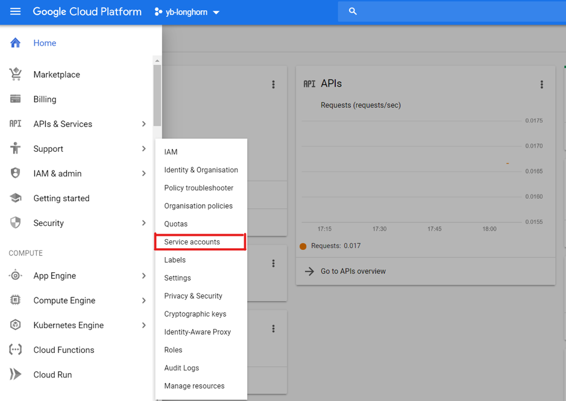

Select *Create New Service Account*, give it a name and click *create*.

Next, we need to add the required roles to the Service Account to be able to set up the Kubernetes cluster using Rancher. Add the roles shown below and create the *Service Account*.

Once the roles have been added, click *Continue* and *Done*.

Now we now have to create a Ubuntu VM instance that is hosted on the GCP. To do this, go to *Compute Engine > VM Instances > Create New Instance*.

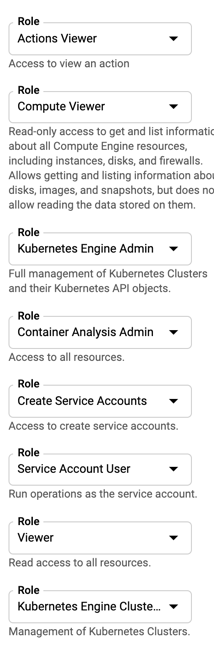

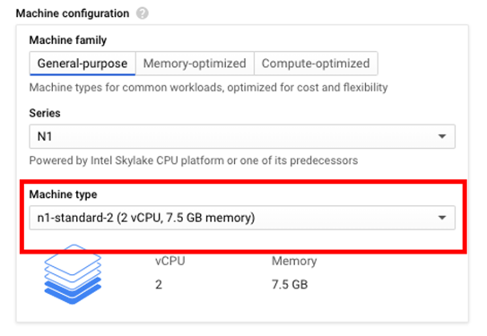

For the purposes of this demo, I’ve selected an *n1-standard-2* machine type. To select the Ubuntu image, click *Boot Disk > Change* and choose *Ubuntu* under Operating System and *Ubuntu 18.04 LTS* under *Version*.

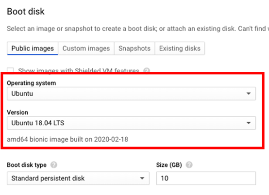

Make sure to check *Firewall > Allow HTTPS traffic*.

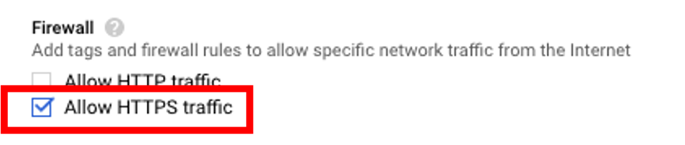

Creating the VM instance with the above settings may take a few minutes. Once created, connect to the VM using SSH. With a terminal connected to the VM, the next step is to install Rancher by executing the following command.

```
$ sudo docker run -d --restart=unless-stopped -p 80:80 -p 443:443 rancher/rancher
```

**Note:** If Docker is not found, follow [these instructions](https://www.digitalocean.com/community/tutorials/how-to-install-and-use-docker-on-ubuntu-18-04) to get it installed on your Ubuntu VM.

## Installing Longhorn

To access the Rancher server UI and create a login, open a browser and go to the IP address where it was installed.

For example: *https://<external-ip>/login*

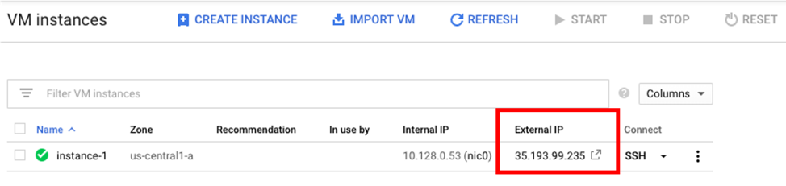

Note: If you run into any issues attempting to access the Rancher UI, try to load the page using Chrome Incognito mode or disable the browser cache, more info here.

Follow the prompts to create a new account.

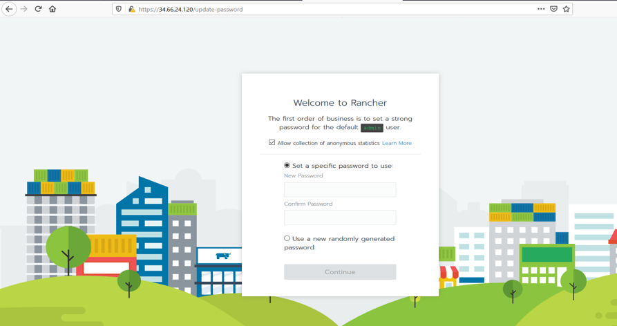

Once you’ve created the account, go to *https://<external-ip>/g/clusters* and click on *Add Cluster* to create a GKE cluster.

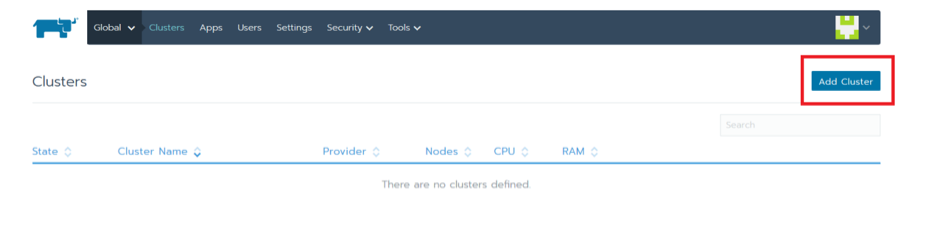

Select *GKE* and give the cluster a name.

We now have to add the private key from the GCP service account that we created earlier. This can be found under *IAM & admin > Service Accounts > Create Key*.

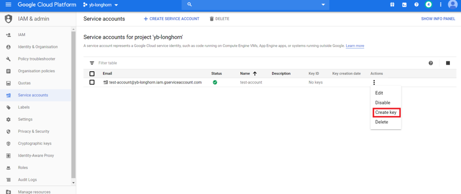

This will generate a JSON file that contains the details of the private key.

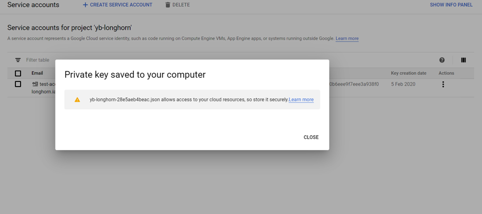

Copy the contents of the JSON file into the Service Account section in the Rancher UI and click Next.

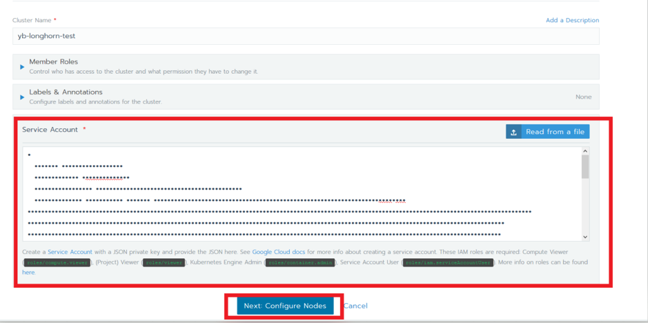

For the purposes of this tutorial, I have selected an *n1-standard-4* machine type, turned on Node Pool Autoscaling and set the max node count to 24. Click *Create*.

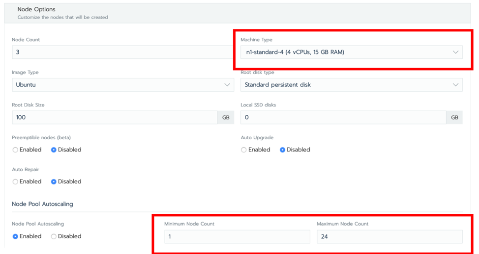

Verify that the cluster has been created by ensuring that the status of the cluster is set to *Active*. Be patient – this will take several minutes.

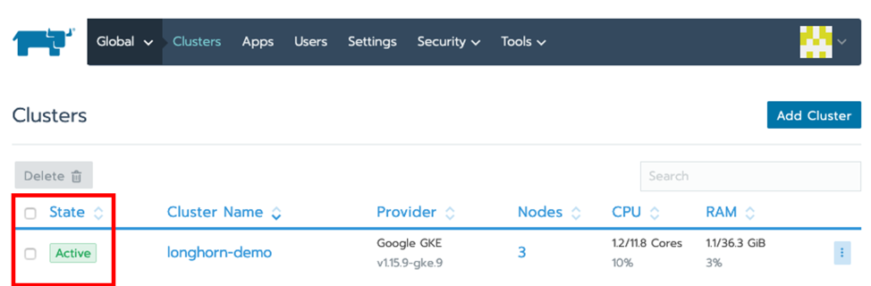

The cluster should also be accessible from the GCP project by going to *Kubernetes Engine > Clusters*.

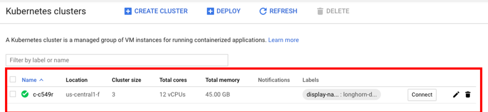

## Installing Longhorn on GKE

With Rancher installed, we can use its UI to install and set up Longhorn on the GKE Cluster.

Click on the cluster, in this case *longhorn-demo*, and then select *System*.

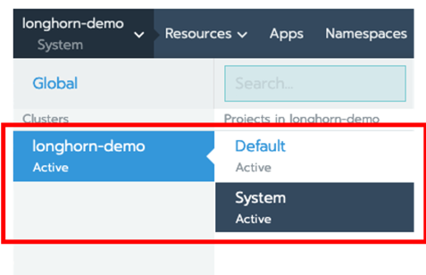

Next click on *Apps > Launch*, search for *Longhorn* and click on tile.

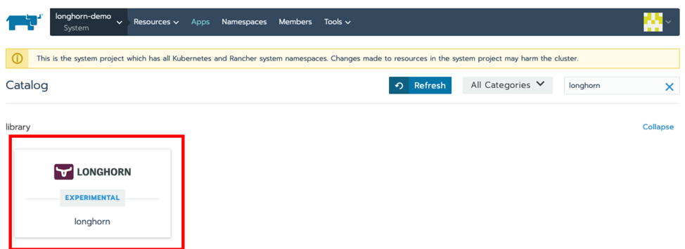

Give the deployment a name, stick with the defaults and click on Launch. Once installed, you can access the Longhorn UI by clicking on the */index.html* link.

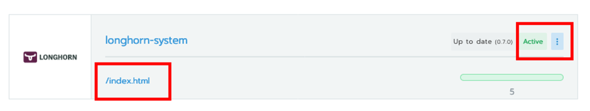

Verify that Longhorn is installed and that the GKE cluster nodes are visible.

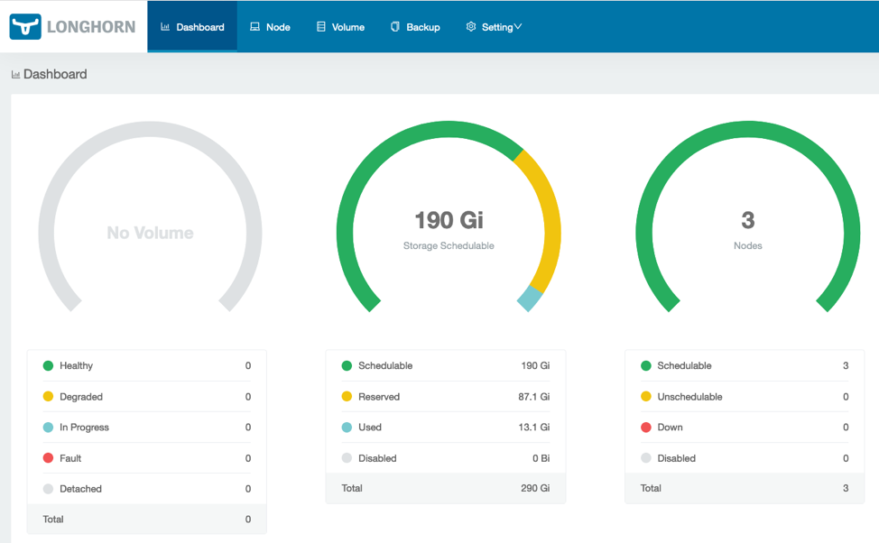

## Installing YugabyteDB on the GKE Cluster using Helm

The next step is to install YugabyteDB on the GKE cluster. This can be done by completing the steps [here](https://docs.yugabyte.com/latest/deploy/kubernetes/helm-chart/), which are summarized below:

### Verify and upgrade Helm

First, check to see if Helm is installed by using the Helm version command:

```
$ helm version

Client: &version.Version{SemVer:"v2.14.1", GitCommit:"5270352a09c7e8b6e8c9593002a73535276507c0", GitTreeState:"clean"}

Error: could not find tiller
```

If you run into issues associated with Tiller, such as the error above, you can initialize Helm with the upgrade option:

```
$ helm init --upgrade --wait

$HELM_HOME has been configured at /home/jimmy/.helm.

Tiller (the Helm server-side component) has been installed into your Kubernetes Cluster.

Please note: by default, Tiller is deployed with an insecure 'allow unauthenticated users' policy.

To prevent this, run `helm init` with the --tiller-tls-verify flag.

For more information on securing your installation see: https://docs.helm.sh/using_helm/#securing-your-helm-installation
```

You should now be able to install YugabyteDB using a [Helm chart](https://docs.yugabyte.com/latest/deploy/kubernetes/oss/helm-chart/).

### Create a service account

Before you can create the cluster, you need to have a service account that has been granted the *cluster-admin* role. Use the following command to create a *yugabyte-helm* service account granted with the ClusterRole of *cluster-admin*.

```
$ kubectl create -f
https://raw.githubusercontent.com/yugabyte/charts/master/stable/yugabyte/yugabyte-rbac.yaml

serviceaccount/yugabyte-helm created

clusterrolebinding.rbac.authorization.k8s.io/yugabyte-helm created
```

### Initialize Helm

```
$ helm init --service-account yugabyte-helm --upgrade --wait

$HELM_HOME has been configured at /home/jimmy/.helm.

Tiller (the Helm server-side component) has been upgraded to the current version.
```

### Create a namespace

```
$ kubectl create namespace yb-demo

namespace/yb-demo created
```

### Add the charts repository

```
$ helm repo add yugabytedb https://charts.yugabyte.com

"yugabytedb" has been added to your repositories
```

### Fetch updates from the repository

```
$ helm repo update

Hang tight while we grab the latest from your chart repositories...

...Skip local chart repository

...Successfully got an update from the "yugabytedb" chart repository

...Successfully got an update from the "stable" chart repository

Update Complete.
```

### Install YugabyteDB

To install YugabyteDB, we’ll use a Helm chart and will expose the master UI endpoint and YSQL, Yugabyte’s SQL API, using LoadBalancer. Additionally, we will use the Helm resource options for low resource environments and specify the Longhorn storage class. This will take awhile, so again, please be patient! You can find detailed [Helm instructions](https://docs.yugabyte.com/latest/deploy/kubernetes/gke/helm-chart/) in the Docs.

```
$ helm install yugabytedb/yugabyte --set resource.master.requests.cpu=0.1,resource.master.requests.memory=0.2Gi,resource.tserver.requests.cpu=0.1,resource.tserver.requests.memory=0.2Gi,storage.master.storageClass=longhorn,storage.tserver.storageClass=longhorn  --namespace yb-demo --name yb-demo --timeout 1200 --wait
```

To check the status of the YugabyteDB cluster, execute the command below:

```
$ helm status yb-demo
```

You can also verify that all the components are installed and communicating by visiting GKE’s *Services & Ingress* and *Workloads* pages.

You can view the YugabyteDB install in the administrative UI by visiting the endpoint for the *yb-master-ui* service on port 7000.

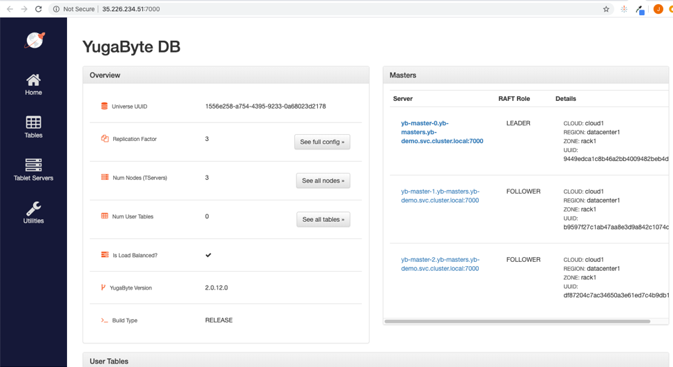

You can also log into the PostgreSQL compatible shell by executing:

```
kubectl exec -n yb-demo -it yb-tserver-0 /home/yugabyte/bin/ysqlsh -- -h yb-tserver-0.yb-tservers.yb-demo

ysqlsh (11.2-YB-2.0.12.0-b0)

Type "help" for help.

yugabyte=#
```

Now you’re ready to start creating database objects and manipulating data.

## Managing YugabyteDB Volumes Using Longhorn

Next, reload the Longhorn dashboard page to verify that the YugabyteDB volumes are correctly set up. The number of volumes should now be visible.

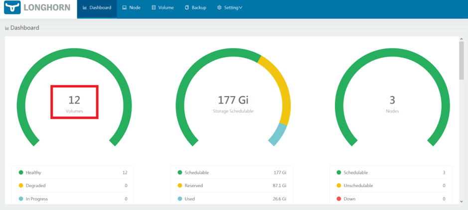

To manage the volumes, click on *Volume*. The individual volumes should be visible.

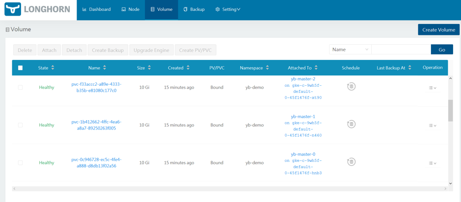

The volumes can now be managed by selecting them and choosing the required operations.

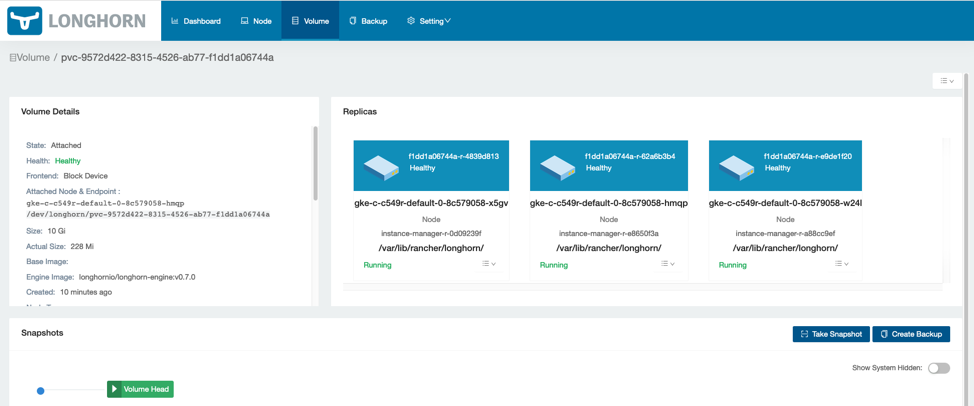

That’s it! You now have YugabyteDB running on GKE with Longhorn as a distributed block store.

See Longhorn and YugabyteDB in action! Register for our upcoming Master Class on April 22, [Getting Started with Longhorn Distributed Block Storage and Cloud-Native Distributed SQL](https://info.rancher.com/getting-started-with-distributed-storage-and-distributed-sql-databases-on-kubernetes).
