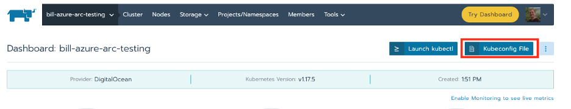
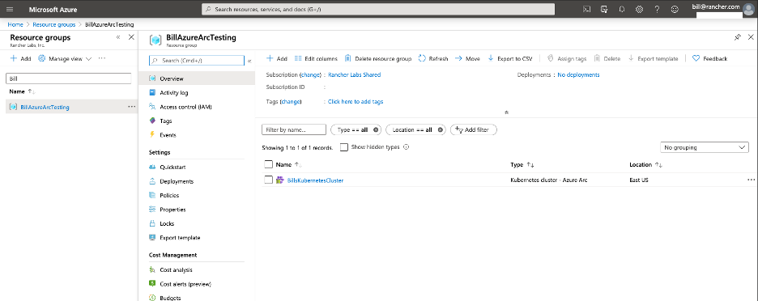
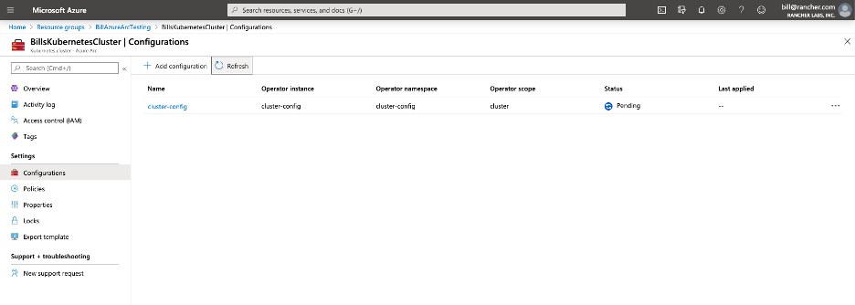
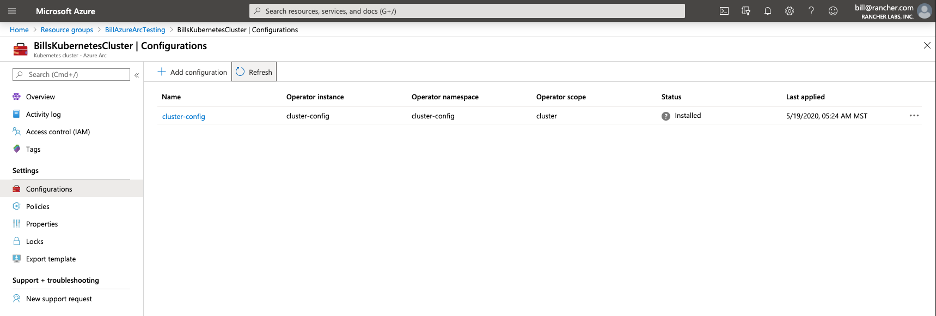
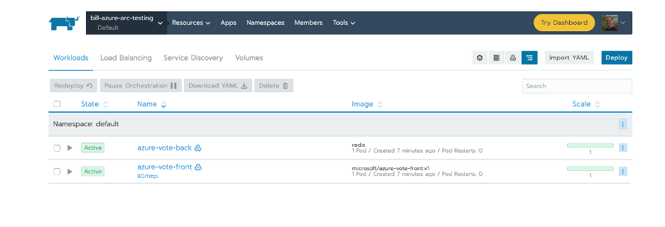
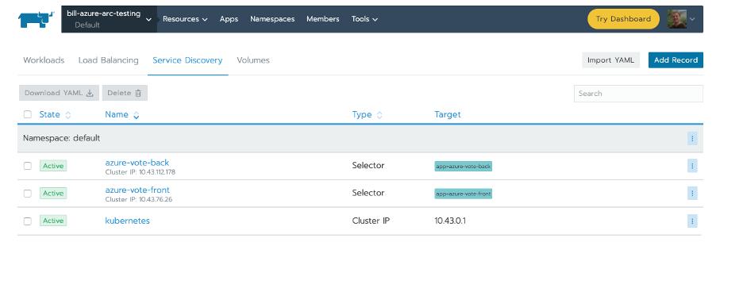
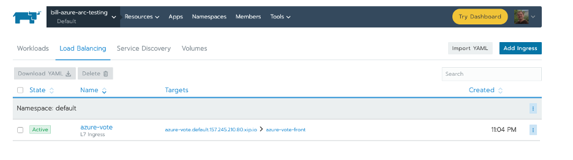
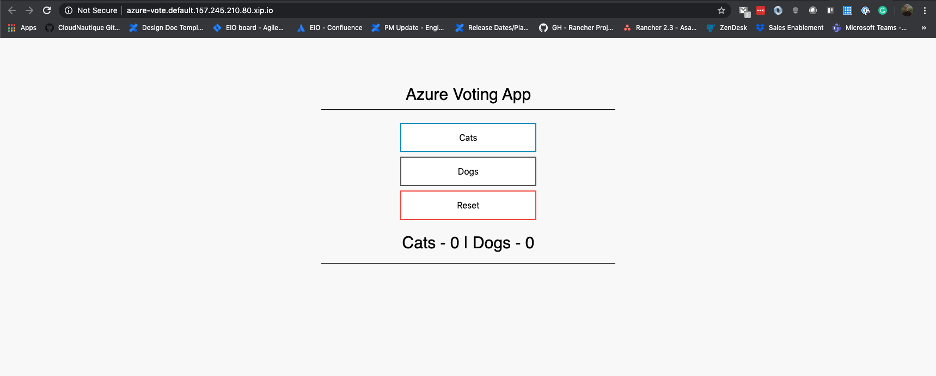

The promise of Kubernetes is to empower your organization to quickly deliver applications and services to your customers. Delivering fast cycle time and innovation requires developers and operators to collaborate effectively to ensure safety while moving fast. The GitOps methodology has taken hold in the Kubernetes ecosystem to deliver on this promise.

What is GitOps? GitOps provides a mechanism to safely deploy Kubernetes manifests stored in a Git repository. By using Git as the source of truth, operators and developers can see what changes were made, conduct code reviews and automate testing. The agent in GitOps tooling is responsible for monitoring changes in the repository and safely applying updates to the Kubernetes cluster.

The challenge in today’s multi-cluster organizations with on-premise, edge and multi-cloud Kubernetes deployments is how do you ensure clusters have the right applications installed?

Microsoft announced a public preview of [Microsoft Azure Arc enabled Kubernetes](https://azure.microsoft.com/blog/azure-arc-enabled-kubernetes-preview-and-new-ecosystem-partners) (Azure Arc) to manage Kubernetes anywhere. Azure Arc brings servers, Kubernetes clusters and Azure services under a single pane of glass in the Azure portal. As part of the management capabilities of Azure Arc, you can apply policy to configure GitOps deployments on all clusters.

In this walkthrough, we will leverage Azure Arc enabled Kubernetes GitOps-driven deployments to deploy applications to our Rancher RKE clusters. Rancher makes it easy to deploy Kubernetes to bare metal or VMs on-premise or in any cloud.

## Rancher Prerequisites

You will need to have a Kubernetes cluster provisioned in Rancher in order to follow along. If you need to provision a Rancher management server, check the [Rancher quickstart guide](https://rancher.com/docs/rancher/v2.x/en/quick-start-guide/). To provision a cluster follow the [Rancher docs](https://rancher.com/docs/rancher/v2.x/en/cluster-provisioning/#launching-kubernetes-with-rancher).

You will need to configure and install the Azure CLI and Helm3 to add a cluster into the Azure portal.

## Azure CLI Configuration:

To install the Azure CLI, follow the [official documentation](https://docs.microsoft.com/en-us/cli/azure/install-azure-cli?view=azure-cli-latest).

Once the CLI is installed, you will need to enable the feature flags for Azure Arc:

`az feature register --namespace Microsoft.Kubernetes --name previewAccess`
`az feature register --namespace Microsoft.KubernetesConfiguration --name sourceControlConfiguration`

Verify feature flags are available:

`az feature list -o table | grep Kubernetes`

Register the providers:

`az provider register --namespace Microsoft.Kubernetes`

Registering is still ongoing; this can take several minutes. You can monitor using `az provider show -n Microsoft.Kubernetes`
`az provider register --namespace Microsoft.KubernetesConfiguration`

Registering is still ongoing; this also can take several minutes. You can monitor using `az provider show -n Microsoft.KubernetesConfiguration`

Verify the providers have been registered:

`az provider show -n Microsoft.Kubernetes -o table`
`az provider show -n Microsoft.KubernetesConfiguration -o table`

Both command outputs should show as ‘Registered’. This command can take up to 10 minutes to complete.

You’ll also need to install the following Azure CLI extensions.

- Connectedk8s: 0.1.3+
- k8sconfiguration : 0.1.7+

If you need to install the extensions for the first time use the following commands:

`az extension add --name connectedk8s`
`az extension add --name k8sconfiguration`

If you have used these extensions before, you can update to newer versions with the following commands:

`az extension update --name connectedk8s`
`az extension update --name k8sconfiguration`

## Helm 3 Setup

Azure Arc enabled Kubernetes uses standard Helm charts to install the Azure Arc agents. In order to register your cluster you will need to install and configure Helm on your system.
To Install Helm 3 follow the [official project documentation](https://helm.sh/docs/intro/install/).

To finish your Helm installation you will need to get a [Kubeconfig file](https://rancher.com/docs/rancher/v2.x/en/cluster-admin/cluster-access/kubectl/#accessing-clusters-with-kubectl-from-your-workstation) from Rancher.



## Create an Azure Resource Group

In this step, we will create a resource group for us to contain our Kubernetes clusters. The resource group will be the scope we apply our GitOps policy. The policy will enable the automatic deployment of our GitOps applications.

In order to proceed you will need ‘Read’ and ‘Write’ permissions on ‘Microsoft.Kubernetes/connectedClusters’ resource type.

Login with the Azure CLI:

`az login`

Create a new resource group to house the connected cluster resource. You must supply a region to store metadata for your cluster. Currently available regions:

- East US
- West Europe

`az group create --name RancherAzureArcTesting -l EastUS -o table`

Output should look like:

```
Location    Name
----------  -------------------
eastus      RancherAzureArcTesting
```

## Create Custom GitOps Policy in Azure Portal

We will need to create a custom policy in Azure before assigning it to our resource group. Microsoft has plans to make this a built-in policy in the future. For now, follow these steps to create the policy:

1. In the Azure portal, navigate to Policy, and in the Authoring section of the sidebar, select Definitions.
2. Select + Policy definition.
3. Set the Definition location to your subscription or management group. This will determine the broadest scope where the policy definition can be used.
4. Give the policy a Name and Description.
5. Under category, choose Create new, and write Ensure GitOps on Cluster.
6. In the Policy rule edit box, copy/paste the contents of the [example policy](https://github.com/cloudnautique/arc-k8s-demo/blob/master/policy/Ensure-GitOps-configuration-for-Kubernetes-cluster.json).
7. Save.

## Assign Policy to Resource Group

Assigning the new policy to our resource group enforces our GitOps policy on all Kubernetes clusters attached.

1. In the Azure portal, navigate to the created resource group, and select ‘Policies’ in the navigation sidebar.
2. Select ‘Assign policy’ from the top nav.
3. Leave the default scope of the resource group.
4. Click the ‘…’ icon for ‘Policy definition’.
5. Select our ‘Ensure GitOps on Cluster’ policy.
6. Give the policy assignment a Name and Description that you can use to identify it easily.
7. Ensure that Policy enforcement is set to Enabled.
8. Click Next.
9. Set parameter values that will be used during creation
   a. Configuration resource name: ‘cluster-config’
   b. Operator instance name: ‘cluster-config’
   c. Operator namespace: ‘cluster-config’
   d. Operator scope: cluster
   e. Repository Url: ‘https://github.com/cloudnautique/arc-k8s-demo’
   f. Enable Helm: ‘false;
10. Click Next.
11. Enable Create a remediation task.
12. Assure that Create a managed identity is checked, and that the identity will have Contributor permissions. See this doc and the comment in this doc for more information on the permissions you need.
13. Review + create

The above policy will deploy source from ‘https://github.com/cloudnautique/arc-k8s-demo’ that will set up three namespaces, an application and a config map. The GitOps deployment is driven by a policy json file describing how the manifests are applied.

## Connect Our Cluster to Azure Arc

Now that our Azure resource group and policy has been created we are ready to attach our cluster. When we connect our cluster we will be able to view it in the Azure portal, and see the state of our policy enforcement.

**\*Note:** Ensure that you have properly configured your Kubeconfig file. The next step will use Helm 3 to deploy the Azure Arc agents into the `azure-arc` namespace on the cluster.\*

`az connectedk8s connect --name RancherKubernetesCluster --resource-group RancherAzureArcTesting`

Verify:

`az connectedk8s list -g RancherAzureArcTesting -o table`

Also, you should now be able to see pods and deployments on your cluster with the following commands:
`kubectl -n azure-arc get deploy,po`

Output:

```
NAME                                        READY   UP-TO-DATE   AVAILABLE   AGE
deployment.apps/cluster-metadata-operator   1/1     1            1           2m50s
deployment.apps/clusteridentityoperator     1/1     1            1           2m50s
deployment.apps/config-agent                1/1     1            1           2m50s
deployment.apps/controller-manager          1/1     1            1           2m50s
deployment.apps/flux-logs-agent             1/1     1            1           2m50s
deployment.apps/metrics-agent               1/1     1            1           2m50s
deployment.apps/resource-sync-agent         1/1     1            1           2m50s

NAME                                             READY   STATUS    RESTARTS   AGE
pod/cluster-metadata-operator-5959f77f6d-n8jc6   2/2     Running   0          2m50s
pod/clusteridentityoperator-5649f66cf8-5p768     3/3     Running   0          2m50s
pod/config-agent-dcf745b57-84v64                 3/3     Running   0          2m50s
pod/controller-manager-98947d4f6-hndmw           3/3     Running   0          2m50s
pod/flux-logs-agent-6989466ff6-ksm2n             2/2     Running   0          2m50s
pod/metrics-agent-bb65d876-6569k                 2/2     Running   0          2m50s
pod/resource-sync-agent-75f6885587-b5hpg         3/3     Running   0          2m50s
```

You should now also see the Kubernetes cluster appear in your Azure portal:



## GitOps!

Now that our cluster is available in the Azure portal, we can navigate to the cluster and view the policy section. At first we will see that compliance has not started; usually this takes 5 minutes. It will trigger the creation of a configuration called ‘cluster-config’, which can be viewed on the Kubernetes cluster ‘configurations’ section in the portal.



**\*Note:** Initially the configuration has ‘Pending’ status, meaning that code hasn’t been deployed. The config checks every 30seconds by default.\*

Once the configuration has been applied, the Azure portal is updated:



Using Kubectl verify the configuration has been applied to the cluster. There are new namespaces:

```
[wmaxwell@Bills-MBP azure-arc-kubernetes-preview]kubectl get ns
NAME              STATUS   AGE
azure-arc         Active   63m
cattle-system     Active   8h
cluster-config    Active   38s
default           Active   8h
ingress-nginx     Active   8h
itops             Active   14s
kube-node-lease   Active   8h
kube-public       Active   8h
kube-system       Active   8h
security-scan     Active   8h
team-a            Active   14s
team-b            Active   14s
```

If you explore in the Rancher UI, you can also see the cluster apps were deployed into the default namespace.



Along with both services



And the Ingress that exposes the Azure voting app



From the Rancher UI you can click into the app by clicking the azure-vote link in the targets. The link will take you to the page below.



## Conclusion

This is really powerful! As more clusters are added to this resource group, they will have a baseline configuration applied to them. With Azure Arc enabled Kubernetes GitOps policy enablement, organizations can now scale application delivery on Kubernetes clusters provisioned with Rancher. Operations teams can define policies to automatically lay out namespaces for clusters. Application teams can bring new clusters online and have their applications automatically deployed. Security teams can ensure Kubernetes policy resources are in place on all clusters.

Find out more about [Azure Arc](https://azure.microsoft.com/en-us/services/azure-arc/).
Find out more about [Rancher](https://rancher.com/products/rancher/2.4).
