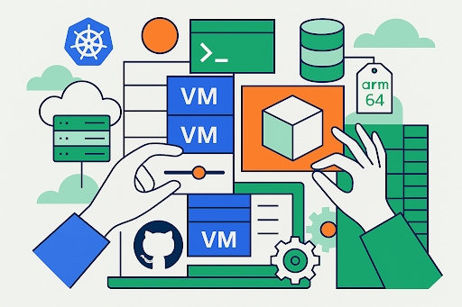

As organizations move beyond traditional hypervisors, Harvester continues to lead the way as an open source, Kubernetes-native virtualization solution. With the release of [**Harvester 1.5**](https://github.com/harvester/harvester), users now have greater flexibility and ecosystem alignment than ever before—with **General Availability (GA) for ARM64** and support for **CSI-compatible storage** backends.

[Harvester](https://harvesterhci.io/) is part of a growing shift toward cloud-native infrastructure that unifies VMs and containers under the Kubernetes API. Version 1.5 strengthens its role as a lightweight, flexible foundation for running virtual machines in a declarative, GitOps-friendly model with a powerful admin friendly UI.

## **ARM64 Now Generally Available**

Harvester 1.5 brings **full GA support for** [**ARM64**](https://developer.arm.com/documentation/102374/latest/), unlocking more cost- and power-efficient deployment options across edge, lab, and datacenter environments.

*Harvester now supports ARM-native virtualization, enabling organizations to run it directly on a wide range of ARM-based devices—no emulation required. Combined with its bare-metal architecture and lightweight footprint, Harvester opens up new possibilities for DevOps teams, including:*

- *Lightweight edge clusters*
- *Power-constrained or air-gapped environments*
- *ARM-based instances on major cloud providers*
- *Lab and test infrastructure for ARM development*

[Get started with Harvester 1.5](https://github.com/harvester/harvester)

## **Bring Your Own CSI Storage**

A major update in Harvester 1.5 is support for the provisioning of root volumes and data volumes using **external CSI (Container Storage Interface) drivers**, giving users full control over their storage stack. Previously, Harvester deployments were coupled with Longhorn as the only storage option.

With this update, Harvester now supports any CSI-compliant backend—opening the door to:

- Enterprise SAN/NAS integrations
- Ceph, OpenEBS, and other open source storage stacks
- Hardware-optimized or zone-aware storage backends
- Existing infrastructure investments

This gives infrastructure teams and platform engineers more freedom to align Harvester with their performance, compliance, and operational needs.

## **Watch The 3rd Party Storage Support**

[embed]https://www.youtube.com/watch?v=tDK3lmKU9qI[/embed]

[**What’s New in Harvester 1.5 – CSI Support**](https://youtu.be/tDK3lmKU9qI?feature=shared) Vicente Cheng walks through how Harvester now supports provisioning VM volumes using external CSI drivers—unlocking greater flexibility for storage integration

## **Open Source Virtualization for Kubernetes-First Teams**

Harvester continues to embrace an open and modular approach to HCI. Unlike legacy hyperconverged platforms, Harvester is:

- **100% open source**
- **Built on CNCF-native components** like KubeVirt, Longhorn, and Helm
- **Integrated with Rancher** for lifecycle and fleet management
- Designed for **modern platform teams** who want VMs and containers in one control plane

Harvester also includes features like secure boot, PXE install, and Fleet-based provisioning—giving you the freedom to treat VMs like first-class cloud-native resources.

🛠 Explore Harvester features in the docs

To see the full roadmap or contribute, visit the [Harvester GitHub](https://github.com/harvester/harvester)

## **Try Harvester 1.5 Today**

Harvester is built for operators who want to simplify their virtualization footprint without giving up control. Whether you’re modernizing on bare metal or building a unified platform with Rancher, Harvester gives you the open source HCI layer designed for the Kubernetes era.

- Install Harvester
- Read the Docs
- Join the Community

**Get  258% ROI  on Enterprise Virtualization**

See how organizations are reducing cost and complexity across hybrid infrastructure.

 ▶ **Watch the IDC Webinar: 258% ROI with SUSE Virtualization** [Watch Now](https://www.suse.com/c/idc-study-reveals-suse-rancher-prime-delivers-3-4m-in-annual-benefits/)
