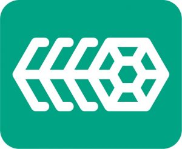

Cloud platforms are not new -- they have been around for a few years. And containers have been around even longer. Together, they have changed the way we think about software. Since the creation of these technologies, we have focused on platforms and apps. And who could blame anyone? Containers and Kubernetes let us do things that were unheard of only a few years ago.

What about the software that runs the infrastructure to support all these advancements? Over the same time, we have seen advancements -- some in open source but the most with proprietary solutions. Sure, there is nothing wrong with running open source on top of a proprietary solution. These systems have become very good at what they do: running virtual machines but not container or container platforms, for that matter.

The vast majority of this infrastructure software is proprietary. This means you need two different skill sets to manage each of these -- one proprietary, one Kubernetes. This is a lot to put on one team; it’s almost unbearable to put on one individual. What if there was an open infrastructure that used the same concepts and management plane as Kubernetes? We could lower the learning curve by managing our clusters the same way we can manage our host. We trust Kubernetes to manage clusters -- why not our hosts?

## Harvester: Built on Open Cloud Native Technology

Harvester is a simple, elegant, and light hyperconverged infrastructure (HCI) solution built for running virtual machines and Kubernetes clusters on bare metal servers. With Harvester reaching General Availability, we can now manage our host with the same concepts and management plane as our clusters. Harvester is a modern infrastructure for a modern platform. Completely open source, this solution is built on Kubernetes and incorporates other cloud native solutions, including Longhorn and Kubevirt, and leveraging all of these technologies transparently to deliver a modern hypervisor. This gives Harvester endless possibilities with all the other projects that integrate with Kubernetes.

This means operators and infrastructure engineers can leverage their existing skill sets and will find in Harvester a familiar HCI experience. Harvester easily integrates into cloud native environments, and offers enterprise-grade, turnkey features without costly overhead of the proprietary alternatives -- saving both time and money.

## A Platform for the Edge

Harvester's small footprint means it is a great choice for the unique demands of hardware at the edge. Harvester gives operators the ability to deploy and manage VMs and Kubernetes clusters on a single platform. And because it integrates into Rancher, Harvester clusters can be managed centrally using all the great tooling Rancher provides. Edge applications will also benefit from readily available enterprise-grade storage, without costly and specialized storage hardware required. This enables operators to keep compute and storage as close to the user as possible, without sacrificing management and security. Kubernetes is quickly becoming a standard for edge deployments, so an HCI that also speaks this language is beneficial.

Harvester is a great solution for data centers, which come in all shapes and sizes. Harvester’s fully integrated approach means you can use high-density hardware with low-cost local storage. This saves on equipment costs and the amount of rack space required. A Harvester cluster can be as small as three servers, or an entire rack. Yet it can run just as well in branch or small-office server rooms. And all of these locations can be centrally managed through Rancher.

## A Platform for Modernizing Applications

Harvester isn’t just a platform for building cloud native applications but one that you can use to take applications from VMs to clusters. It allows operators to run VMs alongside clusters, giving developers the opportunity to start decomposing these monoliths to cloud native applications. With most applications, this takes months and sometimes years. With Harvester, there isn’t a rush. VMs and clusters live side by side with ease. It offers all of this in one platform with one management plane.

As cloud native technologies continue their trajectory as keys to digital transformation, next-gen HCI solutions need to offer functionality and simplicity with the capability to manage containerized and non-containerized workloads, storage and network requirements across any environment.

## Conclusion

What’s unique about Harvester? You can use it to manage multiple clusters hosted on VMs or a Kubernetes distribution. It’s 100 percent open source and leverages proven technologies – so why not give it a try to simplify your infrastructure stack?  You’ll get a feature-rich operational experience in a single management platform, with the support of the open-source community behind it. We have seen the evolution of Harvester, from a fledgling open-source project to a full-on enterprise-ready HCI solution.

We hope you take a moment to [download](https://github.com/harvester/harvester/releases) and give Harvester a try.

### JOIN US at the Harvester Global Online Meetup – January  19 at 10am PT. Our product team will be on hand to answer your questions. [Register here.](https://www.crowdcast.io/e/global-online-meetup-harvester?utm_source=rancher&utm_medium=blog&utm_campaign=GOM_Harvester)
