I mentioned about a month back that I was using [Harvester in my home lab](https://www.phillipsj.net/posts/harvester-running-in-the-home-lab/). I didn’t go into much detail, so this post will bring some more depth. We will cover what Harvester does, as well as my hardware, installation, setup and how to deploy your first virtual machine. Let’s get started.

## **What is Harvester?**

[](https://media1-production-mightynetworks.imgix.net/asset/26851095/Harvester-Sticker-mockup.PNG?ixlib=rails-0.3.0&fm=jpg&q=75&auto=format)

[Harvester](https://harvesterhci.io/) is [Rancher’s](https://rancher.com/) open source answer to a hyperconverged infrastructure platform. Like most things Rancher is involved with, it is built on Kubernetes using tools like [KubeVirt](https://kubevirt.io/) and [Longhorn](https://rancher.com/products/longhorn/). KubeVirt is an exciting project that leverages [KVM](https://www.linux-kvm.org/page/Main_Page) and [libvirt](https://libvirt.org/) to run virtual machines inside Kubernetes; this allows you to run both containers and VMs in your cluster. It reduces operational overhead and provides consistency. This combination of tried and tested technologies provides an open source solution in this space.

It is also designed to be used with bare metal, making it an excellent option for a home lab.

## **Hardware**

If you check the [hardware requirements](https://docs.harvesterhci.io/v0.2/#hardware-requirements), you will notice they focus more on business usage. So far, my personal experience says that you want at least a 4 core/8 thread CPU, 16GB of RAM, and a large SSD, preferably an NVMe drive. Anything less resource-wise doesn’t leave enough capacity for running many containers or VMs. I will install it on an Intel NUC [8i5BEK](https://www.intel.com/content/www/us/en/products/sku/126148/intel-nuc-kit-nuc8i5beh/specifications.html), which has an [Intel Core i5-8259U](https://www.intel.com/content/www/us/en/products/sku/135935/intel-core-i58259u-processor-6m-cache-up-to-3-80-ghz/specifications.html). As far as RAM, it has 32GB of RAM and a 512GB NVMe drive. It can handle running Harvester without any issues. Of course, this is just my experience; your experience may differ.

## **Installation**

Harvester ships as an ISO, which you can download on the [GitHub Releases](https://github.com/harvester/harvester/releases) page. You can pull it quickly using wget.

```
$ wget https://releases.rancher.com/harvester/v0.2.0/harvester-amd64.iso
```

Once you have it downloaded, you will need to create a bootable USB. I typically use [Balena Etcher](https://www.balena.io/etcher/) since it is cross-platform and intuitive. Once you have a bootable USB, place it in the machine you want to use and boot the drive. This screen should greet you:

[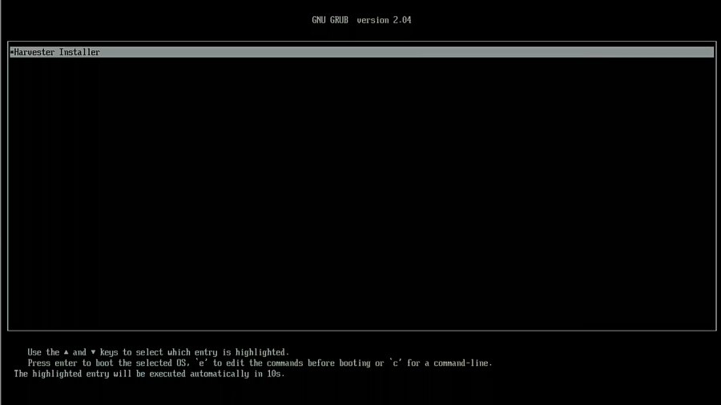](https://media1-production-mightynetworks.imgix.net/asset/26686187/1627004471872.png?ixlib=rails-0.3.0&fm=jpg&q=75&auto=format)

Select “New Cluster”:

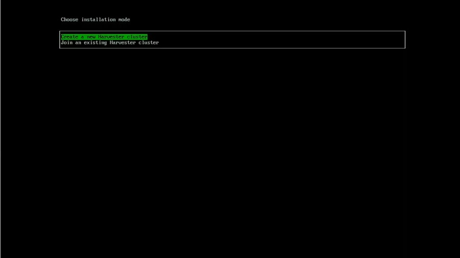

Select the drive you want to use.

Enter your hostname, select your network interface, and make sure you use automatic DHCP.

[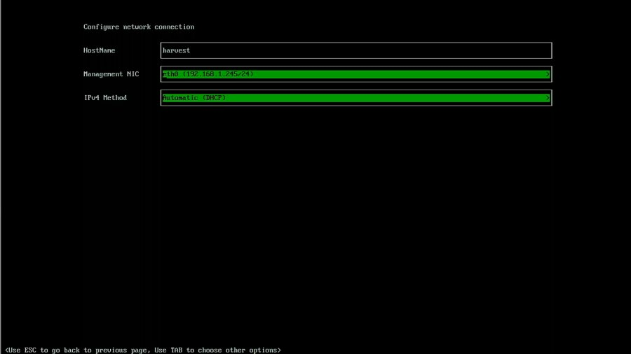](https://media1-production-mightynetworks.imgix.net/asset/26686190/1627004472178.png?ixlib=rails-0.3.0&fm=jpg&q=75&auto=format)

You will then be prompted to enter your cluster token. This can be any phrase you want; I recommend using your password manager to generate one.

[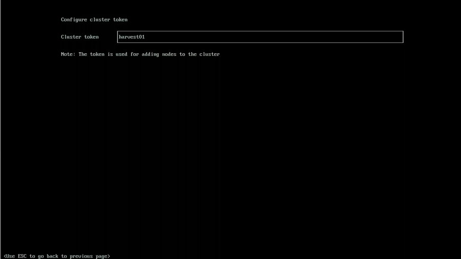](https://media1-production-mightynetworks.imgix.net/asset/26686188/1627004471939.png?ixlib=rails-0.3.0&fm=jpg&q=75&auto=format)

Set a password to use, and remember that the default user name is `rancher`.

[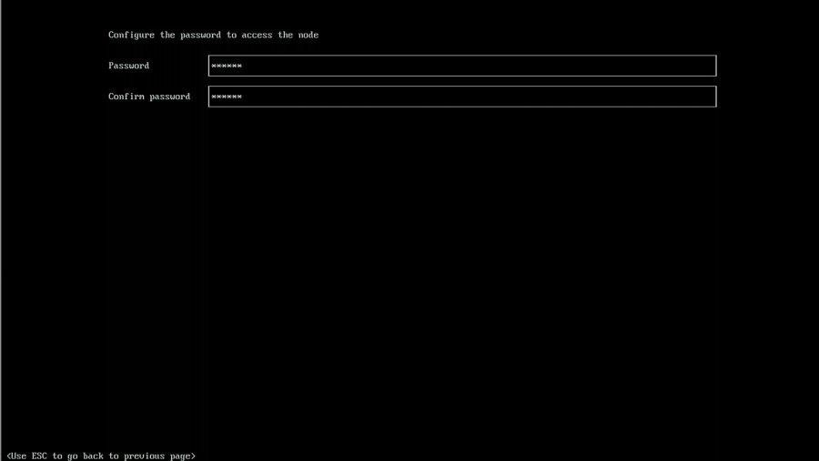](https://media1-production-mightynetworks.imgix.net/asset/26686195/1627004472533.png?ixlib=rails-0.3.0&fm=jpg&q=75&auto=format)

The following several options are attractive, especially if you want to leverage your SSH keys used in GitHub. Since this is a home lab, I left the SSH keys, proxy and cloud-init setup blank. In an enterprise environment, this would be really useful. Now you will see the final screen before installation. Verify that everything is configured to your desires before proceeding.

[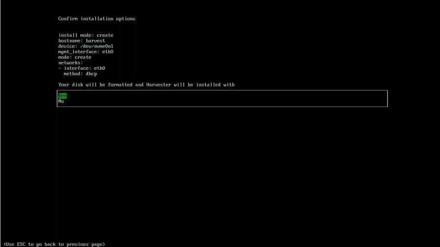](https://media1-production-mightynetworks.imgix.net/asset/26686196/1627004472556.png?ixlib=rails-0.3.0&fm=jpg&q=75&auto=format)

If it all looks great, proceed with the installation. It will take a few minutes to complete; when it does, you will need to reboot.

After the reboot, the system will startup, and you will see a screen letting you know the URL for Harvester and the system’s status. Wait until it reports that Harvester is ready before trying to connect.

[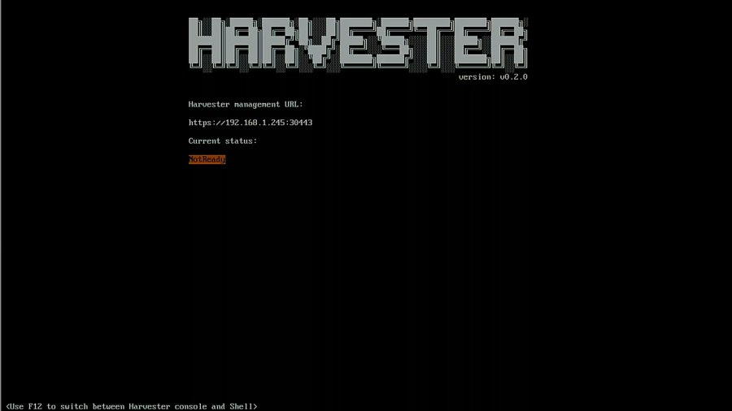](https://media1-production-mightynetworks.imgix.net/asset/26686191/1627004472297.png?ixlib=rails-0.3.0&fm=jpg&q=75&auto=format)

[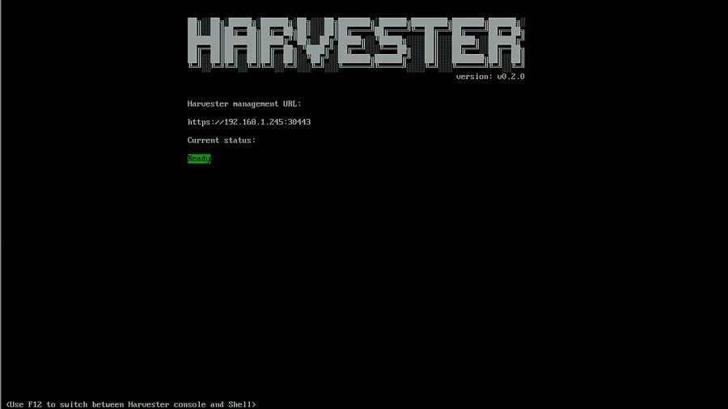](https://media1-production-mightynetworks.imgix.net/asset/26686192/1627004472097.png?ixlib=rails-0.3.0&fm=jpg&q=75&auto=format)

Great! It is now reporting that it is up and running, so it’s now time to set up Harvester.

## **Initial Setup**

We can navigate to the URL listed once the OS boots. Mine is [https://harvest:30443](https://harvest:30443/). It uses a self-signed certificate by default, so you will see a warning in your browser. Just click on "advanced" to proceed, and accept it. Set a password for the default **admin** account.

Now you should see the dashboard and the health of the system.

[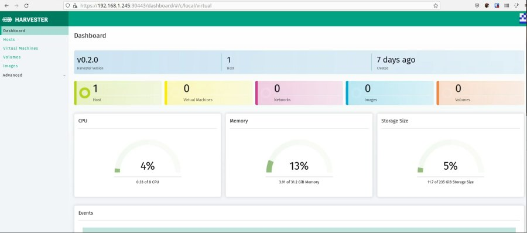](https://media1-production-mightynetworks.imgix.net/asset/26686197/1627004472586.png?ixlib=rails-0.3.0&fm=jpg&q=75&auto=format)

I like to disable the default account and add my own account for authentication. Probably not necessary for a home lab, but a good habit to get into. First, you need to navigate to it.

[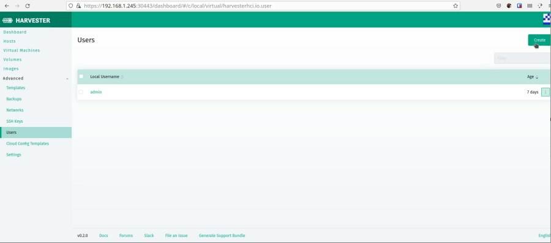](https://media1-production-mightynetworks.imgix.net/asset/26686193/1627004472469.png?ixlib=rails-0.3.0&fm=jpg&q=75&auto=format)

[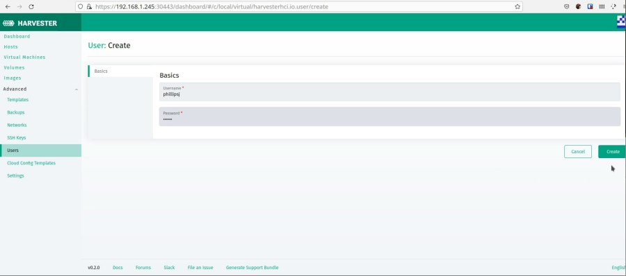](https://media1-production-mightynetworks.imgix.net/asset/26686189/1627004471960.png?ixlib=rails-0.3.0&fm=jpg&q=75&auto=format)

Now log out and back in with your new account. Once that's finished, we can create our first VM.

## **Deploying Your First VM**

Harvester has native support for qcow2 images and can import those from a URL. Let’s grab the URL for openSUSE Leap 15.3 JeOS image.

```
https://download.opensuse.org/distribution/leap/15.3/appliances/openSUSE-Leap-15.3-JeOS.x86_64-kvm-and-xen.qcow2
```

The JeOS image for openSUSE is roughly 225MB, which is a perfect size for downloading and creating VMs quickly. Let’s make the image in Harvester.

[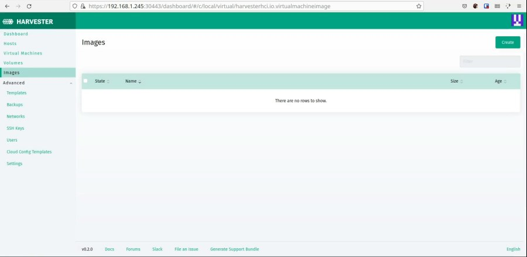](https://media1-production-mightynetworks.imgix.net/asset/26686194/1627004472509.png?ixlib=rails-0.3.0&fm=jpg&q=75&auto=format)

Create a new image, and add the URL above as the image URL.

You should now see it listed.

Now we can create a VM using that image. Navigate to the VM screen.

Once we've made our way to the VM screen, we'll create a new VM.

[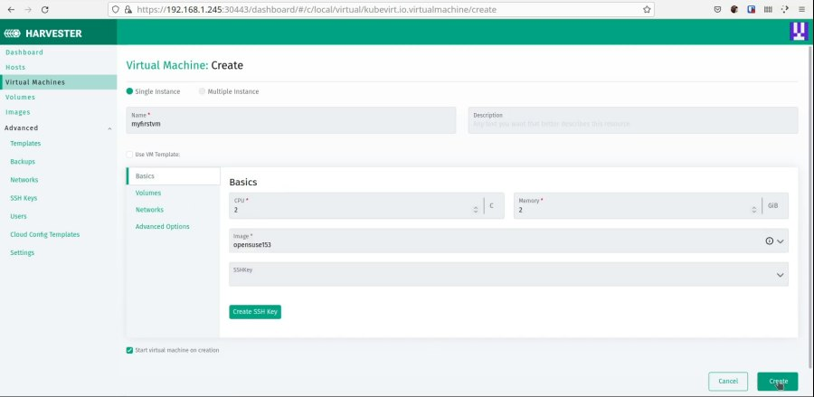](https://media1-production-mightynetworks.imgix.net/asset/26686198/1627004472608.png?ixlib=rails-0.3.0&fm=jpg&q=75&auto=format)

When that is complete, the VM will show up in the list. Wait until it has been started, then you can start using it.

## **Wrapping Up**

In this article, I wanted to show you how to set up VMs with Harvester, even starting from scratch! There are plenty of features to explore and plenty more on the roadmap. This project is still early in its life, so now is a great time to jump in and get involved with its direction.
