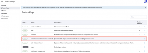
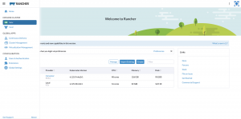

Ten months have elapsed since we launched Harvester v1.1 back in October of last year. Harvester has since become an integral part of the Rancher platform, experiencing substantial growth within the community while gathering valuable user feedback along the way.
Our dedicated team has been hard at work incorporating this feedback into our development process, and today, I am thrilled to introduce Harvester v1.2.0!
With this latest release, Harvester v1.2.0 expands its capabilities, providing a comprehensive infrastructure solution for your on-premises workloads. Whether you are managing virtual machines (VMs), cloud-native workloads, or anything in between, Harvester offers a unified interface that delivers unmatched flexibility in the market.
Let's dive into some of the standout features accompanying the Harvester v1.2.0 release:

## **BareMetal Cloud Native Workload Support (Experimental)**

From the outset, our vision centred on supporting users in their on-premises Kubernetes deployments. Although Harvester initially focused on virtualization technology, we swiftly recognized the evolving landscape where Kubernetes and its ecosystem were driving the commoditization of virtualization.
This realization prompted us to pivot our mission toward developing HCI software that both streamlines traditional [virtual machine management](https://www.suse.com/c/the-total-virtual-machine-management-guide/) whilst empowers users to accelerate their journey towards a modern cloud-native infrastructure. To achieve this, we enhanced Harvester's capabilities, ensuring robust support for Kubernetes clusters running on VMs created by Harvester, complete with built-in CSI and Cloud Provider integration.
Our community embraced this direction, as it effectively addressed critical Kubernetes challenges like resource isolation and multi-tenancy. However, as Harvester's popularity soared, we began receiving requests to support Kubernetes operations in edge locations. In these scenarios, small teams often manage local clusters, emphasizing minimal overhead and the seamless coexistence of container workloads alongside virtual machines. Many environments hosting specialized VM workloads sought the possibility of running container workloads directly on the Harvester host or bare-metal cluster.
After careful consideration, we realized this concept deviated slightly from our original target. Nevertheless, thanks to Kubernetes' foundational role in Harvester, we found a way to extend our scope and accommodate these demands.
With the introduction of Harvester v1.2.0, we proudly unveil the BareMetal Cloud-Native Workload Support feature. Initially launched as an experimental offering, this feature empowers Harvester v1.2.0 to collaborate seamlessly with Rancher v2.7.6 and later versions, enabling direct container workload operations on the Harvester host (bare metal) cluster. You can learn more about activating this feature in our [Harvester documentation](https://docs.harvesterhci.io/v1.2/rancher/index#harvester-baremetal-container-workload-support-experimental).
Once enabled, users can effortlessly integrate Harvester host clusters with other Kubernetes clusters, facilitating seamless interaction between deployed container workloads and Harvester's virtual machine workloads. Please be aware that there are currently some limitations which we've detailed [here](https://docs.harvesterhci.io/v1.2/rancher/index#key-features).

*Image 1: Feature flag enabled in Rancher UI*

## **Rancher Manager vcluster Add-On (Experimental)**

Since the inception of Harvester the need to integrate with Rancher Manager for users was evident. There was no need to duplicate features like authentication, authorization, or CI/CD, as Rancher Manager already excelled in these areas. Additionally, Rancher Manager's expertise in multi-cluster management could efficiently oversee multiple Harvester clusters.
However, a new challenge arose: we needed to accomodate users who didn't require a centrally managed Rancher server. Some users managed operations across different sites and teams and had no interest in a unified Rancher server overseeing all Harvester clusters, while others still needed Rancher Manager's functionalities.
The current Harvester iteration includes an embedded Rancher Manager for internal cluster management, prompting the Harvester engineering team to explore how to maximize its use. After collaborative consultations with the Rancher engineering team, it became evident that deploying workloads on the local cluster would not be feasible due to the Harvester BareMetal cluster's role as the local cluster for the embedded Rancher.
As a solution, we turned to a relatively new open-source initiative called vcluster to facilitate Rancher Manager's deployment on top of the Harvester host cluster. There are two advantages created for users with this solution. Firstly there is the reduced overhead and improvement in operational efficiency when compared to traditional booting the workload as a virtual machine, and secondly the deployment experience mirrors that of a Helm chart commonly aligned with cloud-native container workloads.
The Rancher Manager add-on operates on top of the Harvester cluster and has the potential to govern it. It grants full access within the Rancher Manager add-on essentially gives administrative rights over both the Harvester cluster and Rancher Manager. Operators can now take this utility consolidation into consideration when defining roles and permissions within Rancher Manager.
You can enable the Rancher Manager cluster add-on [here](https://docs.harvesterhci.io/v1.2/advanced/addons/rancher-vcluster).

*Image 2: Rancher vcluster add on in Harvester*

*Image 3: Rancher Manager integrated with Harvester clusters*

## **Third-Party Storage for Non-Root Disks in Harvester**

Harvester, as HCI software, prioritizes storage as a core element. However, we've noticed that many customers already have central storage appliances in their data centers. They appreciate Harvester but find it challenging to retrofit their existing servers with SSD/NVMe drives without fully utilizing their storage appliances. This has been a significant concern for our customers.
The good news is that Harvester's Kubernetes foundation allows us to support alternative storage solutions, provided they are Kubernetes-compatible through the Container Storage Interface (CSI).
With Harvester 1.2.0, users can now seamlessly integrate their own CSI drivers with their storage appliances, as detailed [here](https://docs.harvesterhci.io/v1.2/advanced/csidriver). We are actively collaborating with multiple storage vendors for certification, so stay tuned for upcoming announcements!
It's important to note that, currently, third-party storage support is limited to non-root disks, typically those not originating from images. This limitation exists because Harvester still relies on Longhorn for VM image management, which enables essential features like image uploads and quick VM creation from existing images, enhancing the overall Harvester user experience. Our future steps involve exploring ways to integrate Longhorn with storage appliances for image management.

## **Enhanced Cloud Provider and Load Balancer Support**

From the outset, we recognized the importance of load balancing in Harvester. Many virtualization providers lacked the ability to seamlessly integrate load balancing within the Kubernetes Cloud Provider driver. We believed that this feature would greatly benefit users, even in on-premises deployments. Consequently, we integrated a Cloud Provider driver into Harvester's guest clusters from the beginning.
Over the past year, we've received substantial feedback on our initial Cloud Provider implementation. Two primary requirements stood out: users wanted load balancing services customized for each guest cluster, rather than a Harvester-wide IP pool, and they also desired load balancing services for their VMs.
Harvester 1.2.0 introduces our new load balancing service, offering users the ability to:

- Designate IP pools for each guest cluster network (pending confirmation for those using VLAN networks).
- Configure Load Balancer-as-a-Service for their VMs, enabling integration with multiple LB providers.

To delve into the details of this service and learn how to deploy it, visit this [link](https://docs.harvesterhci.io/v1.2/rancher/cloud-provider). Additionally, please review the [backward compatibility notice](https://docs.harvesterhci.io/v1.2/rancher/cloud-provider#backward-compatibility-notice) before proceeding with the upgrade of your Kubernetes cluster.

## **Hardware Management – Out of Band IPMI Integration and Error Detection**

As Harvester operates directly on bare metal servers, comprehensive server management is crucial. Operators require real-time insights into hardware functionality, immediate alerts for potential hardware errors, and advanced notification if a disk replacement is needed in the near future.
In version 1.2.0, we're introducing an enhanced bare metal hardware management feature. We've integrated out-of-band connection for Harvester to IPMI endpoint servers, enabling Harvester to directly retrieve hardware error information and promptly notify administrators. Additionally, in this release, Harvester gains node lifecycle management capabilities.
To enable this feature, please refer to the instructions provided [here](https://docs.harvesterhci.io/v1.2/advanced/addons/seeder).
Furthermore, Harvester v1.2.0 brings several highly requested features:

- **New Installation Method:** We've introduced a streamlined installation process for users working with bare metal cloud providers, detailed [here](https://docs.harvesterhci.io/v1.2/install/install-binaries-mode).
- **SRIOV VF Support:** Enhance network performance with SRIOV VF support, described [here](https://docs.harvesterhci.io/v1.2/advanced/addons/pcidevices#sriov-network-devices).
- **Footprint Reduction Options:** Users can now choose to enable or disable logging and monitoring components to customize their Harvester installation, as outlined [here](https://docs.harvesterhci.io/v1.2/advanced/addons).
- **Increased Pod Limitation:** We've increased the pod limitation for Harvester nodes to 200, allowing better utilization of computing resources provided by bare metal servers.
- **Emulated TPM 2.0:** Improved support for Windows virtual machines with added [Emulated TPM 2.0](https://docs.harvesterhci.io/v1.2/vm/index/#tpm-device) support.

We invite you to start exploring and using [Harvester v1.2.0](https://github.com/harvester/harvester/releases/tag/v1.2.0). You can share your feedback with us through our [Slack channel](https://rancher-users.slack.com/archives/C01GKHKAG0K) or [GitHub](https://github.com/harvester/harvester).
**Note:** If you're using USB for installation, please follow the instructions [here](https://docs.harvesterhci.io/v1.2/install/usb-install) and use the USB-specific ISO for Harvester v1.2.0 installation.
