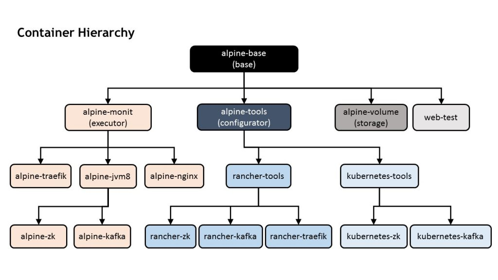

One of the great things about microservices is that they allow
engineering to decouple software development from application lifecycle.
Every microservice:

- can be written in its own language, be it Go, Java, or Python
- can be contained and isolated form others
- can be scaled horizontally across additional nodes and instances
- is owned by a single team, rather than being a shared responsibility
  among many teams
- communicates with other microservices through an API a message bus
- must support a common service level agreement to be consumed by
  other microservices, and conversely, to consume other microservices

These are all very cool features, and most of them help to decouple
various software dependencies from each other. But what is the
operations point of view? While the cool aspects of microservices
bulleted above are great for development teams, they pose some new
challenges for DevOps teams. Namely:

**Scalability:** Traditionally, monolithic applications and systems
scaled vertically, with low dynamism in mind. Now, we need horizontal
architectures to support massive dynamism – we need infrastructure as
code (IaC). If our application is not a monolith, then our
infrastructure cannot be, either.

**Orchestration:** Containers are incredibly dynamic, but they need
resources – CPU, memory, storage (SDS) and networking (SDN) when
executed. Operations and DevOps teams need a new piece of software that
knows which resources are available to run tasks fairly (if sharing
resources with other teams), and efficiently.

**System Discovery:** To merge dynamism and orchestration, you need a
system discovery service. With microservices and containers, one can
implement still use a configuration management database (CMDB), but with
massive dynamism in mind. A good system has to be aware of every
container deployment change, able to get or receive information from
every container (metadata, labels), and provide a method for making this
info available.

There are many tools in the ecosystem one can choose. However, the scope
of this article is not to do a deep dive into these tools, but to
provide an overview of how to reduce dependencies between microservices
and your tooling.

### Scenario 1: Rancher + Cattle

Consider the following scenario, where a team is using
[Rancher](https://rancher.com/rancher). Rancher is facilitating
infrastructure as code, and using Cattle for orchestration, and Rancher
discovery (metadata, DNS, and API) for managing system discovery. Assume
that the DevOps team is familiar with this stack, but must begin
building functionality for the application to run. Let’s look at the
dependency points they’ll need to consider:

1. **The IaC tool shouldn’t affect the development or deployment of
   microservices.** This layer is responsible for providing, booting,
   and enabling communication between servers (VMs or bare metal).
   Microservices need servers to run, but it doesn’t matter how those
   servers were provided. We should be able to change our IaC method
   without affecting microservices development or deployment paths.
2. **Microservice deployments are dependent on orchestration.** The
   development path for microservices could be the same, but the
   deployment path is tightly coupled to the orchestration service, due
   to deployment syntax and format. There’s no easy way to avoid this
   dependency, but it can be minimized by using different orchestration
   templates for specific microservice deployments.
3. **Microservice developments could be dependent on system
   discovery.** It depends on the development path.

Points (1) and (2) are relatively clear, but let’s take a closer look
at (3). Due to the massive dynamism in microservices architectures, when
one microservice is deployed, it must be able to retrieve its
configuration easily. It also needs to know where its peers and
collaborating microservices are, and how they communicate (which IP, and
via which port, etc). The natural conclusion is that for each
microservice, you also define logic coupling it with service discovery.
But what happens if you decide to use another orchestrator or tool for
system discovery? Consider a second system scenario:

### Scenario 2: Rancher + Kubernetes + etcd

In the second scenario, the team is still using Rancher to facilitate
Infrastructure as Code. However, this team has instead decided to use
[Kubernetes](http://kubernetes.io) for orchestration and system
discovery (using [etcd](https://coreos.com/etcd/)). The team would have
to create Kubernetes deployment files for microservices (Point 2,
above), and refactor all the microservices to talk with Kubernetes
instead of Rancher metadata (Point 3). The solution is to decouple
services from configuration. This is easier said than done, but here is
one possible way to do it:

- Define a container hierarchy
- Separate containers into two categories: executors and configurators
- Create generic images based on functionality
- Create application images from the generic executor images;
  similarly, create config-apps images from the generic configurator
  images
- Define logic for running multiple images in a
  collaborative/accumulative mode

Here’s an example with specific products to clarify these steps:

In the image above, we’ve used:

- **[base: alpine](https://github.com/rawmind0/alpine-base)** Built
  from [Alpine Linux](https://alpinelinux.org/), with some extra
  packages: OpenSSL, curl, and bash. This has the smallest OS
  footprint with package manager, based in
  [uClib](https://uclibc.org/), and it’s ideal for containerized
  microservices that don’t need
  [glibc](https://www.gnu.org/software/libc/).
- **[executor: monit](https://github.com/rawmind0/alpine-monit).**
  Built from the base above, with monitoring installed under
  /opt/monit. It’s written in C with static dependencies, a small 2 MB
  footprint, and cool features.
- **[configurator: confd](https://github.com/rawmind0/alpine-tools).**
  Built from the base above, with confd and useful system tools under
  /opt/tools. It’s written in Golang with static dependencies, and
  provides an indirect path for system discovery, due to supporting
  different backends like Rancher, etcd, and
  [Consul](https://www.consul.io/).

The main idea is to keep microservices development decoupled from system
discovery; this way, they can run on their own, or complemented by
another tool that provides dynamic configuration. If you’d like to test
out another tool for system discovery (such as etcd, ZooKeeper, or
Consul), then all you’ll have to do is develop a new branch for the
configurator tool. You won’t need to develop another version of the
microservice. By avoiding reconfiguring the microservice itself, you’ll
be able to reuse more code, collaborate more easily, and have a more
dynamic system. You’ll also get more control, quality, and speed during
both development and deployment. To learn more about hierarchy, images,
and build I’ve used here, you can access **[this
repo](https://github.com/rawmind0/docker-alpine)** on GitHub. Within are
additional examples using Kafka and Zookeeper packages; these service
containers can run alone (for dev/test use cases), or with Rancher and
Kubernetes for dynamic configuration with Cattle or Kubernetes/etcd.
**Zookeeper (repo [here](https://github.com/rawmind0/alpine-zk),** 67
MB)

- With Cattle
  ([here](https://github.com/rawmind0/alpine-zk/tree/master/rancher))
- With Kubernetes
  ([here](https://github.com/rawmind0/alpine-zk/tree/master/k8s))

**Kafka (repo [here](https://github.com/rawmind0/alpine-kafka),** 115
MB)

- Cattle
  ([here](https://github.com/rawmind0/alpine-kafka/tree/master/rancher))
- Kubernetes
  ([here](https://github.com/rawmind0/alpine-kafka/tree/master/k8s))

### Conclusion

Orchestration engines and system discovery services can result in
“hidden” microservice dependencies if not carefully decoupled from
microservices themselves. This decoupling makes it easier to develop,
test and deploy microservices across infrastructure stacks without
refactoring, and in turn allows users to build wider, more open systems
with better service agreements. *Raul Sanchez Liebana
([@rawmindNet](https://twitter.com/rawmindNet)) is a DevOps engineer at
Rancher*.
