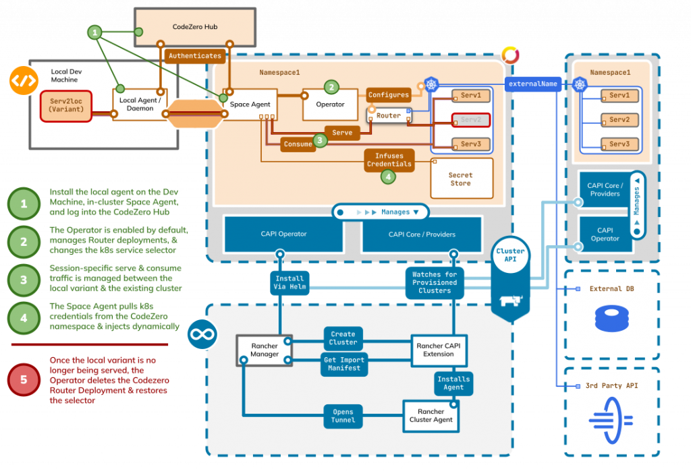

> **Guest author: Reed Clayton, CodeZero Technologies Inc.**  
> Experienced Kubernetes and microservices practitioner leads as Co-Founder & CEO, transforming how companies manage the SDLC, underlying cloud infrastructure, security and remote hosting environments. His two decades of startup experience and multiple successful exits have been driven by a passion for solving complex developer productivity challenges in the Pacific Northwest tech community. Recently securing seed funding from Ballistic Ventures, Reed combines technical innovation with entrepreneurial expertise to bridge local development with cloud infrastructure. An avid pilot of single-engine aircraft, he brings the same precision and adaptability from aviation to navigating the dynamic challenges of building transformative technologies.

 

 

Today’s enterprise development teams face the familiar challenges of lengthy deployment cycles for testing, complex environment management, credential & security concerns, and the constant struggle to maintain consistency between local development and production environments. Add to that the expansion of responsibilities, the introduction of new technologies like containers, and the constant need to switch between tools slowing development cycles affecting customer satisfaction and competitive advantage.. 

Yet, a critical challenge remains, bridging the operational gap between local development environments and complex enterprise Kubernetes deployments.

This is where [CodeZero](http://codezero.io) steps in. CodeZero is a secure, real-time network overlay platform built to streamline Kubernetes development. It enables developers to run local services in their Rancher Desktop environment while seamlessly connecting to live remote services running in shared staging or production-like clusters. Instead of replicating full environments or waiting for slow deployment cycles, developers can iterate quickly and test changes against actual infrastructure with real traffic flows.

More than just a proxy or a development utility, CodeZero introduces a new category of development tooling through its [**Teamspaces**](http://codezero.io) model. Teamspaces allow individual developers or teams to selectively intercept and test microservices locally while leaving the rest of the cluster untouched—reducing cognitive overhead, avoiding environment drift, and eliminating the need for fragile mocks or costly resource duplication.

Combined with the enterprise-grade security, governance, and multi-cluster capabilities of SUSE Rancher Prime, the integration with CodeZero empowers organizations to:

- Accelerate development cycles without compromising security
- Improve developer experience and productivity
- Lower infrastructure costs through reduced test environment sprawl
- Align developer workflows with production realities

In this blog, we explore how the SUSE Rancher + CodeZero integration closes the gap between development and production, delivering faster iteration, improved control, and a future-ready cloud-native experience for enterprise teams.

## **The Current State of Development Workflows**

To understand the need for a new development model, we must first examine the limitations of current practices. Developers and platform teams alike face recurring friction in trying to replicate or access realistic environments. Does this sound familiar?

### **Scenario 1: Microservices Development**

Consider a large enterprise with dozens of microservices managed through SUSE Rancher Prime. Traditionally, developers working on one of these particular services must choose one of three strategies: run all dependent services locally (resource intensive), deploy to a shared development environment (slow iteration cycles), or mock all dependencies (unrealistically burdensome testing).

### **Scenario 2: Platform Engineering Management**

SUSE Rancher Prime is designed to address the diverse needs of both DevOps and platform engineering teams to build and maintain hosting infrastructure and clusters. However, developers are left with challenges, often related to security requirements, or testing against production-like loads and systems, whether they be volumes, traffic, or configurations. 

**CodeZero: Reimagining Development Environments**

With the CodeZero integration, developers are able to run services locally in their Rancher Desktop environment while consuming running versions of remote services from the staging environment in real time. Traffic that meets specified conditions flows to the local variant, while other traffic flows through the default service variants running in the cluster as configured. At the same time, this frees Ops teams from the burden of maintaining parity across various environments, allowing platform engineers to focus on high-value activities like ensuring operational stability, while developers gain self-service capabilities necessary for delivering change.

CodeZero is a network overlay layer that creates a secure portal for developers to access pre-prod environments to test and QA locally. Unlike traditional development approaches that require full environment replication, CodeZero introduces a network layer that transforms VMs/Kubernetes clusters into Teamspaces, enhancing collaborative development.

Teamspaces, the platform's core innovation, enables developers to consume remote services from a Service Catalog and seamlessly serve local variants, creating a hybrid development experience where local code changes can interact with real production-like infrastructure within the cluster, and without the overhead of full environment provisioning or mocking environments.

## **Looking Forward: The Future of Enterprise Development**

The integration of CodeZero with SUSE's Rancher ecosystem represents more than just a technical enhancement—it's a paradigm shift toward truly modern enterprise development practices. By combining:

- **Rancher Desktop's** local Kubernetes excellence
- **Rancher Prime's** enterprise-grade management and security
- **CodeZero's** innovative development environment (Teamspaces)

Organizations can achieve a development experience that is simultaneously more secure, more productive, and more cost-effective than traditional approaches.

## **How CodeZero Fits in the Rancher Ecosystem**

Whether you’re a single developer coding and testing locally, or an enterprise team managing multiple clusters across a variety of cloud or on-prem environments, CodeZero can extend and enrich your capabilities, efficiency, and experience. The burden of configuring, maintaining, and replicating test infrastructure disappears, and in its place will simply be writing, building, testing, and deploying code.

**Local Development**

Rancher Desktop is an already proven development tool built around k3s, a light and certified Kubernetes distribution built for IoT & Edge computing, allowing developers to spin up environments locally, and diagnose and troubleshoot issues repeatably. With CodeZero, developers are empowered to select rays of traffic to serve from their local machine to remote resources, and enjoy the compounding benefits of rapid code iteration. Make changes locally and test against already running hosted services.

There’s no need for bloated redundancies, complex networking rules, brittle security practices, or obtrusive policies.

**Distributed Testing & Debugging**

SUSE Rancher Prime serves enterprise needs by enabling Zero Trust container security, an Application Collection providing minimal, hardened images with signatures and SBOMs, and full-stack, multi-cluster, multi-cloud Kubernetes operations management.

CodeZero's security model compliments SUSE Rancher Prime perfectly by eliminating the need for locally held secrets—injecting credentials automatically, preventing leaks even for developers with production access.

And by leveraging SUSE Application Collection, a workflow emerges where platform engineers are able to configure and provision trusted applications to secure hosting environments. Using CodeZero, developers are able to test and iterate locally before deployment, and ensure the entire development-to-production pipeline maintains enterprise security standards.

SUSE Rancher Prime brings together cluster life cycle management, virtualization, security, governance, observability, workload management, and automation to seamlessly build, manage, and scale your k8s environment with confidence. CodeZero's overlay network technology extends this unified experience to the development layer, enabling seamless access to built clusters and collaboration across environments of any configuration.

## **Driving Measurable Value Across the SDLC**

### **Reduced Infrastructure Costs**

By eliminating the need to replicate full environments for every developer, enterprises avoid spiraling cloud bills and reduce environment sprawl. Developers can test against real infrastructure without requiring dedicated compute resources for each developer.

### **Accelerated Time-to-Market**

With CodeZero and SUSE Rancher Prime, testing cycles shrink from weeks to hours. CodeZero's ability to eliminate deployment cycles for testing could further accelerate development velocity, potentially reducing development cycles by 50% or more.

### **Boost Developer Productivity**

CodeZero' gives developers the freedom to focus on building, not fighting infrastructure. By replacing duplicate services with secure workflows can lead to a 10x increase in productivity. Combined with Rancher's proven enterprise capabilities, this integration could transform how enterprises approach cloud-native development, and adopt and utilize Kubernetes managed microservices.

**Strengthen Security and Compliance**Through Rancher Prime’s integrated security (SUSE Security, KubeWarden, and SUSE Application Collection) and CodeZero’s credential-injection model, sensitive data never leaves enterprise control. This reduces the attack surface and simplifies compliance audits thus helping teams meet CIS, FIPS, and regulatory benchmarks without slowing down development velocity.

**Shorten Feedback Loops Across the SDLC**From ideation through deployment, the joint solution streamlines every phase of the lifecycle. Developers get instant feedback locally, QA teams validate against real traffic flows, and Ops teams focus on scaling production instead of maintaining fragile test environments. The result is higher software quality, reduced rework, and a faster path to business outcomes.

## **Ready to learn more?**

As enterprises continue to embrace cloud-native development practices, the need for seamless integration between local development and production environments will only grow. The synergy between CodeZero and SUSE Rancher Prime presents a compelling opportunity to lead this transformation—from local development through production operations. For enterprises, it represents the promise of finally bridging the gap between developer productivity and enterprise requirements.

The question isn't whether these technologies can work together—the research clearly shows they can. The question is whether the industry is ready to embrace this level of integration and transformation in enterprise development practices.

The future of enterprise Kubernetes development is here. It's time to bridge the gap.

*Want to learn more about how CodeZero and SUSE Rancher can transform your development workflow?*

- Request a demo from SUSE
