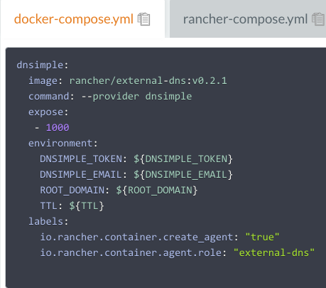
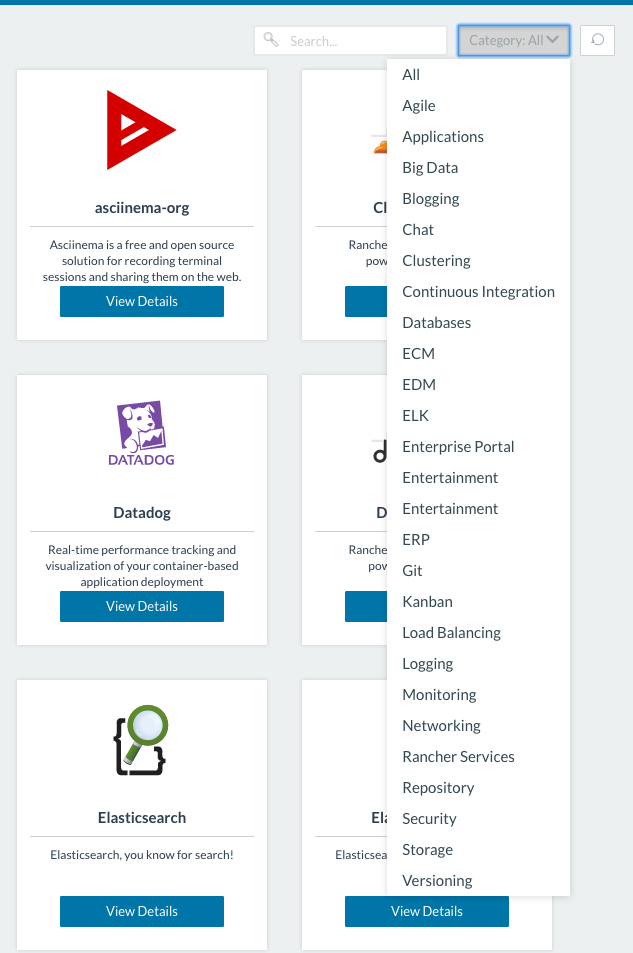

Rancher Labs has been developing open source projects for about two
years now. We have a ton of GitHub repositories under our hood, and
our number keeps growing. The number of external contributions to our
projects keeps growing, too; Rancher has become more well-known over the
past year, and structural changes to our code base have made it easier
to contribute. So what are these structural changes? I would highlight 3
major ones:

1. Moving key Rancher features into separate microservices projects
   (Metadata, DNS, Rancher compose, etc.)
2. Dockerizing microservices orchestration
3. Cataloging Dockerized application templates, and enabling them for
   deployment through the Rancher catalog

Item 2 acts as a bridge from 1 to 3. In this article, I will go over
each item in more detail.

## Moving key Rancher features to microservices

It is well-known that monolithic systems come with certain
disadvantages:

- Their code bases are not easy to understand and modify
- Their features are hard to test in isolation
- They have longer test and release cycles.

But even if your code base is pluggable and well-structured, the last
two challenges note above persist. Moving code into microservices helps
to overcome these challenges, and creates a lower threshold for external
committers: if you are new to open source development and willing to
start contributing, smaller projects are simply easier to grasp. In
addition, if you look at the project pull request history for Rancher
External DNS, you might see something interesting: 
The majority of commits came from people with knowledge of
different service providers. From a contributor’s point of view, having
and bringing in specific service provider expertise reduces the pressure
associated with making initial contributions to the project. And of
course, the project benefits from getting all these provider extensions.

## Dockerizing microservices

Let’s say as a contributor, you’ve created this new cool
DNSimple provider plug-in. It was released with an external-dns service,
and now you want to try it in Rancher. To adopt the changes, you
don’t have to wait for the next Rancher release, nor do you have to
change the Rancher code base. All you have to do is:

- fetch the last released image from the [external-dns dockerhub
  repo](https://hub.docker.com/r/rancher/external-dns/tags/)
- create a docker-compose template with your service’s deployment
  details

- Register your image in [Rancher catalog
  repo](https://github.com/rancher/rancher-catalog) (more on how to
  deploy it from Rancher catalog, in the next section).

## Deploying the service through Rancher catalog

At Rancher, we want to provide an easy way for users to describe and
deploy their Docker-based applications. The Rancher catalog makes this
possible. By selecting an entry from the catalog, and answering several
questions, you can launch your service through the Rancher platform.

All the services are grouped by category, so it is easy to search for a
specific functionality:

## 

Pick your newly added DNSimple service, fill in the fields and hit
Launch: 
That’s it! Your service gets deployed in Rancher, and can be discovered
and used by any other application. The catalog enables easy upgrades for
microservices. Once the new service image is available and its template
is published to the catalog, Rancher will get a notification, and
your service can be upgraded to the latest version in a rolling fashion.
The beauty of this is that you don’t have to update or upgrade Rancher
when a new version of a microservice gets released. Besides providing a
simple way of defining, deploying and upgrading microservices, the
Rancher Catalog acts as a shared template library. If you are interested
building an Elasticsearch microservice, using GlusterFS, or dockerizing
DroneCI, check out their corresponding catalog items. And if you want to
share your application, you can submit it to our [Community catalog
repo](https://github.com/rancher/community-catalog).

## How microservices benefit Rancher as an orchestration platform

We’ve seen the single service implementation and deployment flow; let’s
look at the bigger picture now. Any container orchestration platform
should be easily extendable, especially when it comes to implementing a
specific service provider extension. Building and deploying this
extension shouldn’t be tightly coupled to the core platform, either.
Moving out the code to its own microservice repo, dockerizing the
service, and allowing it to deploy it using catalog, makes everything
easier to maintain and support (as pictured below): 
We are planning to move the rest of Rancher’s key services to their own
microservices. This will allow users to integrate the system service
plugins of their choice with just a couple of clicks.

## Learning from our community

Moving our key services – Metadata, Internal DNS – into dockerized
microservices written in Go has helped with the release management, and
driven more external commits. We’ve taken things one step further and
developed an application catalog where users can share their
applications’ templates in docker-compose format. This has taught us
more about best DevOps best practices from within our community, made us
more familiar with their use cases, and helped us improve our
microservices implementations. Working on an open source project is
always a two-way street – making your code easier to understand and
manage helps the community contribute to and enhance the project. **We
have an awesome community, and appreciate every single contribution**.
We will continue improving contributors’ experience and learning from
them.

*Alena Prokharchyk is a principal software engineer at Rancher Labs.*
*If you have any questions or feedback, please contact me on twitter
[@lemonjet](https://twitter.com/lemonjet), or on GitHub
([alena1108](https://github.com/alena1108)).*
