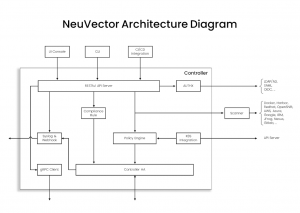
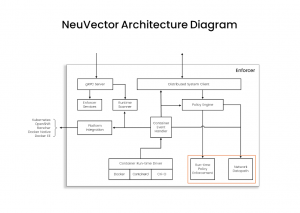
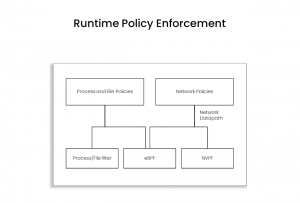

## **Extended Berkeley Packet Filter**

There’s been a lot of recent interest in [eBPF](https://ebpf.io/) (extended Berkeley Packet Filter) and its application for container security solutions. Let’s examine eBPF's features and benefits and how NeuVector utilizes them to enhance its [full-lifecycle container security solution](https://www.suse.com/products/neuvector/).

eBPF enables products to run sandboxed programs in a privileged context, such as the operating system kernel, potentially enhancing the performance\* of such security products (for certain use cases) and increasing visibility into core kernel processes and syscall activity. Because of its programmability and widespread support in modern operating system kernels, teams developing security applications have created their own security features based on eBPF capabilities. However, it is important to realize that using eBPF technology is only a means to an end, and all product implementations of security features are not equal. Each will have its strengths and weaknesses, depending on how the code has been implemented and what features are exposed.

*\*Code runs at kernel ring 0, but due to limitations on eBPF code itself (i.e., no loops, etc.), what can be done there is limited (purposefully, for security and performance reasons), so in many cases, data processing will also need to run in user space (ring 3).*

## **Evaluating security products using eBPF**

When evaluating container security solutions, it’s important to go beyond the statement ‘a security solution built on eBPF' because all solutions are not created equally. Here are some of the issues to consider:

- **Detection accuracy**: *False positives and negatives* - Security solutions must be able to detect known attacks such as SQL injection and cross-site scripting, as well as zero-day attacks. The solution should not have a high false positive rate and, equally important, can’t miss zero-day attacks. As a new technology, it will continue to be tested through [bypass attempts](https://www.form3.tech/blog/engineering/bypassing-ebpf-tools) and [attacks.](https://github.com/Vali-Cyber/ebpf-attacks)
- **Attack detection**: *Noise vs. exploits* - eBPF provides low-level syscall and process event monitoring, which can trigger an overwhelming number of triggered events being reported. Although it allows for easy programming at the kernel level, there is still significant complexity and a deep understanding of the kernel is required to identify security events accurately. Separating out the most critical ones and combining or correlating several events to identify a possible exploit can be a challenge if not filtered properly. For these reasons, eBPF is typically used for observability rather than real-time attack prevention.
- **Functional breadth**: *Network inspection* - Many security best practices and compliance regulations require application layer segmentation, DLP, and WAF protections, in addition to general network threat detection. The best security practice for ‘defense in depth’ requires technology that goes beyond the scope of eBPF.
- **Performance and scalability: The solution scales to high connection rates without impacting application responsiveness when performing advanced network inspection**. While kernel-level code is generally very efficient, actual security features often require some code to run in user space, reducing performance gains. Also, specific implementations of security features may not be designed for scalability.
- **Extensibility of features:** The solution may need to be extended to provide advanced security features over time, such as deep packet inspection, support for new protocols, advanced DNS monitoring for egress connections etc.
- **Enterprise readiness:** Security solutions require user/role access controls, SIEMs and other event processing systems integrations, and other integration modules.
- **Support for non-eBPF-based architectures: The security features should still provide protection if eBPF is not present (e.g., older kernel versions)**.
- **Additional pipeline security controls**: A complete container security solution will provide run-time security, pipeline scanning, admission controls and runtime scanning.

## **NeuVector architecture**

[NeuVector](https://www.suse.com/products/neuvector/) is a cloud native security solution delivered as microservices (containers) and follows a similar architecture to Kubernetes (control plane, data plane, console, etc.). The main containers in a NeuVector deployment are the controller, enforcer, scanner and manager. The controller is the brains of the solution and the integration point to enterprise services such as SSO, SIEM/syslog, and the scanner and manager. It also manages security policies, including run-time security for the enforcer.

### **Controller architecture**

### **Enforcer architecture**

The Enforcer deploys as a daemoSet and handles all the run-time security observability and protection (blocking) functions. The primary runtime security controls for containers and hosts, highlighted in red, include process, file and network security.

If we look closer at the run-time security architecture for process, file and network protections, we can see that NeuVector utilizes several sources to monitor and protect containers and hosts.

The NeuVector Packet Filter (NVPF) and the Process/File filter provide the basis for network, process, and file security. These utilize native Linux tools for kernel event and socket monitoring to determine if unauthorized or suspicious activities occur, as well as block processes and file access if desired. However, in both cases, NeuVector utilizes eBPF (if it is available) to collect additional kernel activities to feed its run-time policy enforcement engine.

## **NeuVector Packet Filter (NVPF)**

The NVPF is based on technology developed by the NeuVector team to inspect packets and protect connections in a container environment such as Kubernetes and docker. It implements layer seven deep packet inspection (DPI) to effectively deliver next-generation firewall (NGFW) protections to containerized workloads, including ingress and egress connections from a cluster. These protections include application protocol-based segmentation, data loss prevention (DLP), and web application firewall (WAF). Inspection and protection are also supported in service-mesh encrypted environments. The technology developed is based on several SUSE/NeuVector [patents](https://patents.justia.com/assignee/neuvector-inc) describing the team's innovations. While the patents are owned by SUSE, the NeuVector technology and source code are open source and users are able to freely benefit from these innovations as governed by the Apache v2 source code license. In addition, SUSE contributes these patents to the [Open Innovation Network](https://openinventionnetwork.com/) (OIN) members, a group of over 4,000 technology vendors who cross-license their patents.

## **How NeuVector uses eBPF**

NeuVector utilizes eBPF for some of its process and file monitoring functions. While NeuVector does not require eBPF to be present to monitor and prevent unauthorized process and file activity in containers and hosts, it benefits from the increased efficiency of eBPF.

## **Going forward - NeuVector expanded use of eBPF**

NeuVector continually evaluates new capabilities provided by eBPF and plans to expand its use to support different use cases or to make existing functions more efficient. For example, although NeuVector already inspects encrypted traffic in service mesh (e.g., istio) based deployments, eBPF potentially expands the support for use cases. If you have ideas and suggestions, please feel free to contribute to the NeuVector open source [community project](https://github.com/neuvector/neuvector).
