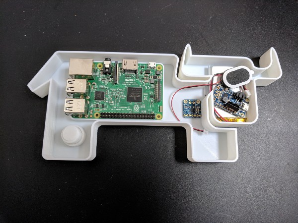
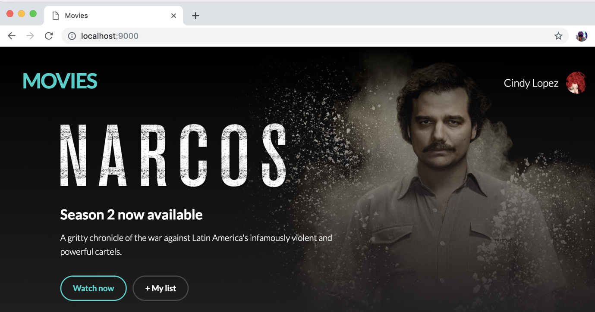

What an amazing first week! I’ve been marketing open source technologies for over 15 years. During that time, I’ve been involved in many new product releases. Nothing comes close to the response we’ve had from k3s – <http://k3s.io>.
Judging by the incredible feedback (including over [4,500 GitHub stars in one week](https://star-history.t9t.io/)), the release of k3s appears to have landed at exactly the right time. Many telcos, utility companies, banks, hotels and manufacturers have been asking us to build a micro Kubernetes distribution that’s easy to install and runs on remote, resource-constrained hardware commonly used in edge and IoT use cases. k3s offers particularly strong ARM support for this purpose.
> I like the way [@rancher\_labs](https://twitter.com/Rancher_Labs?ref_src=twsrc%5Etfw) has taken a fresh look at Kubernetes by removing, not adding, features to focus on running in low-resource computing environments such a retail stores and telco facilities. <https://t.co/wAih5qq8Mi>
>
> — Kelsey Hightower (@kelseyhightower) [February 27, 2019](https://twitter.com/kelseyhightower/status/1100565940939436034?ref_src=twsrc%5Etfw)

It’s obviously not the first project to attempt to put Kubernetes on small devices, but k3s is the first one to be designed for production environments and is fully certified by the CNCF.
k3s also isn’t locked into a single-vendor platform eco-system. There’s no dependency on obscure installer software, separate configuration management tools or costly enterprise operating systems. It runs on any Linux OS, on any hardware, anywhere.
In time, we will make k3s available from within our eponymous container management platform and eventually offer it as a commercially supported product. But for now, we just want to see folks getting value from k3s and contributing back to its development – whether as code contributions or, as below, blogging about interesting use cases.

## Raspberry Pi

Our very own Mark Abrams was the first to start experimenting with k3s, perhaps predictably using the ubiquitous Raspberry Pi. In his Medium blog, Mark explains how to create a base image for running a k3s cluster in a very natty ‘Cattle Cluster’ device – [read the blog](https://medium.com/@mabrams_46032/kubernetes-on-raspberry-pi-c246c72f362f).

#### Unplugged Pi case for a 'Cattle cluster'

## ParkBee

Scott Crooks was the first community member to blog about his experience with k3s. His company, [ParkBee](https://parkbee.com/), is taking its first steps towards running containerized workloads in at their many edge locations. ParkBee runs a parking permit app that I’m very familiar with in west London called RingGo.
According to Scott, ParkBee uses Kubernetes for their deployments in Amazon Web Services (AWS). Whilst this works for their cloud-based services, edge deployments were not so straight-forward. Their goal is to have a Kubernetes cluster comprised of edge Kubernetes nodes at each of their locations, with the Kubernetes master nodes present in AWS. k3s could be the solution they’re looking for – [read the full blog](https://medium.com/parkbee-tech/life-on-the-edge-a-first-look-at-ranchers-lightweight-kubernetes-distro-k3s-15a3aab1f0fb).

## Okteto

Ramiro Berrelleza, the CEO and founder of [Okteto](https://okteto.com/), was intrigued by k3s’ claims of being a fully compliant, production-grade Kubernetes that runs from a 40MB binary. He expected the initial release to be rough around the edges. Instead, he used docker-compose to launch k3s within 30secs. Impressed, Ramiro then tried k3s out on his company’s own development platform using a sample movies app as an example workload. It just worked – [read the full blog](https://medium.com/okteto/lightweight-kubernetes-development-with-k3s-and-okteto-4be08de516a).

### Get started with our online tutorial

If you want a little tuition before diving into k3s, Rancher support engineer Sebastiaan van Steenis, aka [SuperSeb](https://github.com/superseb "Github handle for SuperSeb"), has put together an awesome [online tutorial on katacoda](https://katacoda.com/superseb/scenarios/k3s)

### Signup for the k3s online meetup – March 13th

To learn more about k3s and its future roadmap, Rancher founders Shannon Williams and Darren Shepherdinvite you to join them at the inaugural k3s online meetup on March 13. It’ll last about an hour with plenty of time for Q&A. We’re expecting a big crowd so [book your spot today](https://more.suse.com/fy21-global-event-rancher-meetup-k3s-lightweight-kubernetes "Sign up for k3s online meetup").
