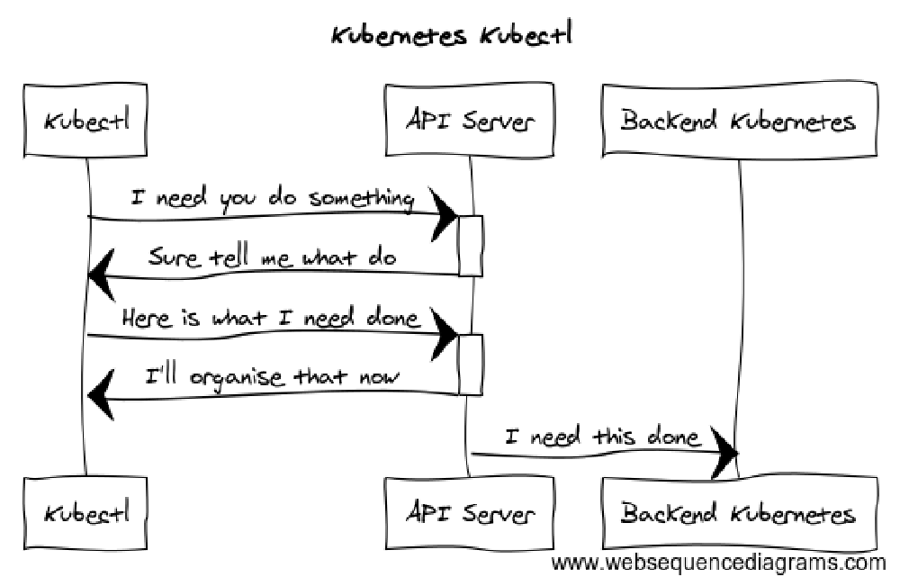

## Introduction

The mechanism for interacting with Kubernetes on a daily basis is typically through a command line tool called`kubectl`.

`kubectl` is primarily used to communicate with Kubernetes API servers to create, update, delete workloads within Kubernetes.

The objective of this tutorial is to provide an overview of some of the common commands that you can utilise, as well as provide a good starting point in managing Kubernetes.

We will cover how to install `kubectl` on your machine, communicate with your Kubernetes environment, and perform some common actions. The majority of common `kubectl` commands provide a specific operation or action to perform, like create, delete, etc. This method usually involves interpreting a file (either YAML or JSON) that describes the object within Kubernetes (a POD, Service, resource,etc). These files are used as templates, as well as ongoing documentation of the environment, and help retain Kubernetes’ focus on declarative configuration. The operations given on the command line are passed to the API Server which, in-turn, communicates with the backend services within Kubernetes as necessary.



We will go over some of the most common `kubectl` commands and provide a few examples. For more detail about each command, including all the supported flags and subcommands, check out the `kubectl`  [reference documentation](https://kubernetes.io/docs/reference/generated/kubectl/kubectl-commands/).

## Installing kubectl

Detailed instructions for installing `kubectl` can be found by following this link: <https://kubernetes.io/docs/tasks/tools/install-kubectl/>

`kubectl` is a standalone program and, as such, requires no complex installation process.

`kubectl` is a single file that needs to be located within your operating systems `PATH`. There are numerous ways of obtaining the `kubectl` binary, such as through your operating system’s native package managers or via `curl`. This table shows a few examples of how to install `kubectl` for various operating system:

| Operating system | Command |
| --- | --- |
| Linux | `stable=$(curl -s https://storage.googleapis.com/kubernetes-release/release/stable.txt)` `curl -LO https://storage.googleapis.com/kubernetes-release/release/${stable}/bin/linux/amd64/kubectl` `chmod +x ./kubectl` `sudo mv ./kubectl /usr/local/bin/kubectl` |
| macOS | `brew install kubernetes-cli` |
| Windows | https://dl.k8s.io/release/v1.24.4/bin/windows/amd64/kubectl.exe |

> ****Note****  
> The best version of `kubectl` for Windows will change over time as new versions are released. To find the best current binary, follow  
> this link to [find the latest stable release](https://storage.googleapis.com/kubernetes-release/release/stable.txt) and adjust the above URL as necessary.

The version of `kubectl` used in the environment needs to be maintained and aligned with the version of the Kubernetes server. You can

view the version of the `kubectl` client being used by typing:

```
kubectl version --short
```

```
Client Version: v1.24.4
Server Version: v1.24.3
```

`kubectl` maintains compatibility with one release in each direction. Above the client version is one step ahead of the server version. This provides support for features and commands that are available in `Server Version: v1.24.3`. If the Client version was more than one version behind the server version, you may run into errors or incompatibility when trying to access feautres available in the relative server version.

## kubectl Syntax

`kubectl` has a syntax to use as follows:

```
kubectl [command] [TYPE] [NAME] [flags]
```

- **Command**: refers to want you want to perform (create, delete, etc.)
- **Type**: refers to the resource type you are performing a command against (Pod, Service, etc.)
- **Name**: the case-sensitive name of the object. If you don’t specify a name, it is possible to get

  information about all of the resources your command matches (Pods, for example)
- **Flags**: these are optional but are useful when looking for specific resources. For example,

  `--namespace` allows you to specify a particular namespace to perform an operation in.

## kubeconfig

In order to access your Kubernetes cluster, `kubectl` uses a configuration file. The default `kubectl` configuration file is located at `~/.kube/config` and is referred to as the `kubeconfig` file.

`kubeconfig` files organize information about clusters, users, namespaces, and authentication mechanisms. The `kubectl` command uses these files to find the information it needs to choose a cluster and communicate with it.

The loading order follows these rules:

1. If the`--kubeconfig` flag is set, then only the given file is loaded. The flag may only be set once and no merging takes place.
2. If the`$KUBECONFIG` environment variable is set, then it is parsed as a list of filesystem paths according to the normal path delimiting rules for your system.
3. Otherwise, the`${HOME}/.kube/config` file is used and no merging takes place.

If you see a message similar to the following,`kubectl` is not configured correctly or is not able to connect to a Kubernetes cluster.

```
The connection to the server <server-name: port> was refused - did you specify the right host or port?
```

The configuration file can be created in a number of ways, depending on the Kubernetes distribution you are utilising.

Below are a subset of distributions and their locations.

| Kubernetes distribution | Kubeconfig access |
| --- | --- |
| Kubeadm, Minikube | /etc/kubernetes/admin.conf |
| Rancher | Rancher UI (as shown below) |
| Rancher RKE | `kube_config_xx.xml` file created during RKE installation |
| Amazon | https://docs.aws.amazon.com/eks/latest/userguide/create-kubeconfig.html |
| Google | https://cloud.google.com/kubernetes-engine/docs/how-to/cluster-access-for-kubectl |
| Microsoft | https://docs.microsoft.com/azure/aks/control-kubeconfig-access |

### RKE

When you create a Kubernetes cluster with RKE, RKE creates a`kube_config_rancher-cluster.yml` file in the local directory that contains credentials to connect to your new cluster with tools like`kubectl`.

You can copy this file to`$HOME/.kube/config` or, if you are working with multiple Kubernetes clusters, set the`KUBECONFIG` environmental variable to the path of the`kube_config_rancher-cluster.yml`, as shown here:

```
export KUBECONFIG=$(pwd)/kube_config_rancher-cluster.yml
```

###

### Rancher-Managed Kubernetes Clusters

Within Rancher, you can download a`kubeconfig` file through the web UI and use it to connect to your Kubernetes environment with`kubectl`.

From the Rancher UI, click on the cluster you would like to connect to via`kubectl`. On the top right-hand side of the page, click the **Kubeconfig File** button:


Click on the button for a detailed look at your config file as well as directions to place in`~/.kube/config`.


Upon copying your configuration to`~/.kube/config`, you will be able to run`kubectl` commands without having to specify the`–-kube-config` file location:


## Examples of Some Basic Commands

The following highlights a number of commands that are used in a typical environment. We will go through a number of scenarios from an overview of the cluster through to exploring what is currently running in your Kubernetes enviornment.

These will help you familiarize yourself with the commands for`kubectl` and the typical output.

### Managing the kubectl Configuration

The`kubectl` command includes a few different commands to help view and manage its own configuration. These can be useful during initial set up or when the set of clusters you need to work with changes.

To view the current configuration, type:

```
kubectl config view
```

```
apiVersion: v1
clusters:
- cluster:
    certificate-authority-data: DATA+OMITTED
    server: https://www.<yoururl>.com/k8s/clusters/<cluster>
  name: gcpcluster
- cluster:
    certificate-authority-data: DATA+OMITTED
    server: https://10.240.0.41:6443
  name: gcpcluster-k8s-1
- cluster:
    certificate-authority-data: DATA+OMITTED
    server: https://10.240.0.42:6443
  name: gcpcluster-k8s-2
- cluster:
    certificate-authority-data: DATA+OMITTED
    server: https://10.240.0.43:6443
  name: gcpcluster-k8s-3
contexts:
- context:
    cluster: gcpcluster
    namespace: rancher
    user: user-qkvpz
  name: gcpcluster
```

The output summarizes your configured clusters and contexts. The`clusters` key contains a list of each of your available clusters along with relevant connection and validation details.

The`contexts` key combines a user, cluster, and optionally a namespace to form a unique identity and usage context for interacting with a cluster.

To get a more succinct summary of each of your available contexts, you can type:

```
kubectl config get-contexts
```

```
CURRENT   NAME               CLUSTER            AUTHINFO     NAMESPACE
*         gcpcluster         gcpcluster         user-qkvpz
          gcpcluster-k8s-1   gcpcluster-k8s-1   user-qkvpz
          gcpcluster-k8s-2   gcpcluster-k8s-2   user-qkvpz
          gcpcluster-k8s-3   gcpcluster-k8s-3   user-qkvpz
```

The output displays the details of each of the defined contexts as well as the currently selected context, indicated by the asterisk (\*).

To quickly just check on the current context being used, type:

```
kubectl config current-context
```

```
mycluster
```

While we won’t cover it in this summary, you can also define your clusters and contexts using

`kubectl set-cluster`,

`kubectl set-credentials`, and

`kubectl set-context` with a variety of flags.

To change the context you wish to connect with, use the`use-context` command:

```
kubectl config use-context gcpcluster-k8s-1
```

```
Switched to context "gcpcluster-k8s-1"
```

### Checking the Status of Cluster Components

After selecting the appropriate context for your cluster, you can check on the status of the core master components using the`get componentstatuses` (abbreviated to`get cs`) command:

```
kubectl get cs
```

```
NAME                 STATUS    MESSAGE              ERROR
scheduler            Healthy   ok
controller-manager   Healthy   ok
etcd-0               Healthy   {"health": "true"}
etcd-2               Healthy   {"health": "true"}
etcd-1               Healthy   {"health": "true"}
```

The output shows the status of the scheduler, controller-manager, and etcd nodes as well as the most recent messages and errors collected from each service. This is a good first diagnostic check to run if your cluster seems to be operating incorrectly.

Additional connection and service information information can be collected using the`cluster-info` command:

```
kubectl cluster-info
```

```
Kubernetes master is running at https://www.<yoururl>.com/k8s/clusters/<cluster>
KubeDNS is running at https://www.<yoururl>.com/k8s/clusters/<cluster>/api/v1/namespaces/kube-system/services/kube-dns:dns/proxy

To further debug and diagnose cluster problems, use 'kubectl cluster-info dump'.
```

Here, the output is showing the endpoint for our Kubernetes master as well as the KubeDNS service endpoint.

To see information about each of the individual nodes that are members of your cluster, use the`get nodes` command:

```
kubectl get nodes -o wide
```

```
NAME    STATUS   ROLES                      AGE   VERSION   INTERNAL-IP   EXTERNAL-IP    OS-IMAGE                               KERNEL-VERSION           CONTAINER-RUNTIME
k8s-1   Ready    controlplane,etcd,worker   34d   v1.23.10   <IP>          <none>        SUSE Linux Enterprise Server 15 SP2   5.3.18-24.67-default    docker://20.10.6-ce
k8s-2   Ready    controlplane,etcd,worker   34d   v1.23.10   <IP>          <none>        SUSE Linux Enterprise Server 15 SP2   5.3.18-24.67-default    docker://20.10.6-ce
k8s-3   Ready    controlplane,etcd,worker   34d   v1.23.10   <IP>          <none>        SUSE Linux Enterprise Server 15 SP2   5.3.18-24.67-default    docker://20.10.6-ce
```

This lists the status, roles, connection information, and version numbers of the core software running on each of the nodes. If you need to perform maintenance on your cluster nodes or log in to debug an issue, this command can help provide the information you need.

### Viewing Resource and Event Information

To get an overview of the namespaces available within a cluster, use the`get namespaces` command:

```
kubectl get namespaces
```

```
NAME                STATUS   AGE
cattle-prometheus   Active   7d9h
cattle-system       Active   34d
default             Active   34d
ingress-nginx       Active   34d
kube-public         Active   34d
kube-system         Active   34d
rancher             Active   34d
```

This shows the namespace partitions defined within the current cluster.

To get an overview of all of the resources running on your cluster, across all namespaces, issue the following command:

```
kubectl get all --all-namespaces
```

```
NAMESPACE       NAME                                          READY   STATUS      RESTARTS   AGE
cattle-system   pod/cattle-cluster-agent-6bdd6c94c9-lwkxf     1/1     Running     13         6d20h
cattle-system   pod/cattle-node-agent-4rss2                   1/1     Running     16         9d
cattle-system   pod/cattle-node-agent-dh57m                   1/1     Running     16         9d
cattle-system   pod/cattle-node-agent-n4tnd                   1/1     Running     16         9d
```

The output displays the namespace each resource is deployed in as well as the resource name prefixed by the resource type (`pod` in the examples shown above). Afterwards, information about the ready and running statuses of each resource helps determine if the processes are operating healthily.

To view the events associated with your resources, use the`get events` command:

```
kubectl get events --all-namespaces
```

```
NAMESPACE       LAST SEEN   TYPE      REASON                   KIND                      MESSAGE
cattle-system   9m31s       Normal    BackOff                  Pod                       Back-off pulling image "miguelgt/k8s-demo:v2"
cattle-system   24m         Warning   Failed                   Pod                       Error: ImagePullBackOff
cattle-system   14m         Normal    BackOff                  Pod                       Back-off pulling image "miguelgt/k8s-demo:v2"
cattle-system   9m30s       Warning   Failed                   Pod                       Error: ImagePullBackOff
```

This lists the most recent events logged by your resources, including the event message and the reason it was triggered.

### Walking Through an Example

To give a more concrete demonstration of a workflow you might engage in while using`kubectl`, we’ll walk through a quick scenario of deploying a container to a cluster into a non-default namespace.

By default, if you deploy to a cluster without specifying a namespace,`kubectl` will place the resources within a namespace called`default`. If you want to deploy to a different namespace, you need to specify the desired alternative.

While we can provide the namespace for the creation command, if we’re going to be working with the namespace for more than a few commands, it’s often easier to alter your current context. Changing the namespace associated with your context will automatically apply the namespace specification to any further commands until the context is changed.

To alter your current context’s namespace use the`set-context` command with the`--current` and`--namespace` flags:

```
kubectl config set-context --current --namespace=rancher
```

```
Context "mycluster" modified.
```

This will alter the current context to automatically apply future actions to the`rancher` namespace.

Next, we can create a deployment called`nginx` which runs a container based off of the default`nginx` container image. Because we altered our context, this should be run within the`rancher` namespace:

```
kubectl create deploy nginx --image=nginx
```

```
deployment.apps/nginx created
```

You can check that the deployment succeeded by listing the currently deployed pods:

```
kubectl get pods
```

```
NAME                   READY   STATUS    RESTARTS   AGE
nginx-5c7588df-k5wks   1/1     Running   0          9s
```

Here, we can see that the Nginx deployment is up and running correctly. The`READY` column lists one out of one containers ready and the`STATUS` is`running` rather than listing a failure condition.

While we’ve verified that the pod is running, we don’t have any information about which namespace it was deployed to. However, we can alter the output slightly by adding the `--all-namespaces` flag:

```
kubectl get pod --all-namespaces
```

```
NAMESPACE       NAME                                      READY   STATUS      RESTARTS   AGE
rancher         nginx-5c7588df-k5wks                      1/1     Running     0          40s
```

This displays the pods running in each namespace and additionally adds a`NAMESPACE` column that lists the namespace each resource is deployed to. Here, we see that the Nginx pod was correctly deployed to our`rancher` namespace instead of the usual`default` namespace.

This indicates that our context manipulation and our deployment both worked as expected.

If you followed along, you can clean up the deployed resources by typing:

```
kubectl delete deployment nginx
```

## Additional Reference Information

While discussing each of these in depth is out of scope for this guide, we’ve listed some additional commands that are useful as you get started below.

### Pod

| Description | Command |
| --- | --- |
| List all pods | `kubectl get pods` |
| List pods for all namespace | `kubectl get pods --all-namespaces` |
| List all critical pods | `kubectl get -n kube-system pods -a` |
| List pods with more information | `kubectl get pod -o wide` |
| List pods and output to YAML | `kubectl get pod -o yaml` |
| Get pod info | `kubectl describe pod/<pod name>` |
| List all pods with labels | `kubectl get pods --show-labels` |
| List running pods | `kubectl get pods --field-selector=status.phase=Running --all-namespaces` |
| Watch pods | `kubectl get pods -n <namespace> --watch` |
| List pods and containers | `kubectl get pods --all-namespaces -o='custom-columns=PODS:.metadata.name,CONTAINERS:.spec.containers[*].name'` |
| List pods, containers and images | `kubectl get pods --all-namespaces -o='custom-columns=PODS:.metadata.name,CONTAINERS:.spec.containers[*].name,Images:.spec.containers[*].image'` |
| Scale out Deployment | `kubectl scale --replicas=3 ds <name>` |

### Resources Deletion

| Description | Command |
| --- | --- |
| Delete pod | `kubectl delete pod/<pod-name> -n <my-namespace>` |
| Delete by file | `kubectl delete -f <nameofyaml>.yaml` |
| Delete pod by force | `kubectl delete pod/<pod-name> --grace-period=0 --force` |
| Delete pods by labels | `kubectl delete pod -l <key>=<label>` |
| Delete deployments by labels | `kubectl delete deployment -l <key>=<label>` |
| Delete all resources filtered by labels | `kubectl delete pods,services -l <key>=<label>` |
| Delete resources under a namespace | `kubectl -n <namespace> delete po,svc --all` |

### Service

| Description | Command |
| --- | --- |
| List all services | `kubectl get services --all-namespaces` |
| List service endpoints | `kubectl get endpoints --all-namespaces` |
| Get service detail in YAML | `kubectl get service <servicename> -n <namespace> -o yaml` |
| Get service cluster ip | `kubectl get service <servicename> -n <namespace> -o go-template='{{.spec.clusterIP}}'` |
| Get service cluster port | `kubectl get service <servicename> -n <namespace> -o go-template='{{(index .spec.ports 0).port}}` |

### Events & Metrics

| Description | Command |
| --- | --- |
| View all events | `kubectl get events --all-namespaces` |
| List Events sorted by timestamp | `kubectl get events --sort-by=.metadata.creationTimestamp` |

### Namespace & Security

| Name | Command |
| --- | --- |
| List authenticated contexts | `kubectl config get-contexts` |
| Load context from config file | `kubectl get cs --kubeconfig <kubeconfig file>.yml` |
| Switch context | `kubectl config use-context <cluster-name>` |
| Delete the specified context | `kubectl config delete-context <cluster-name>` |
| List all namespaces defined | `kubectl get namespaces` |
| Set namespace preference | `kubectl config set-context $(kubectl config current-context) --namespace=<ns1>` |
| List certificates | `kubectl get csr --all-namespaces` |

### Intermediate Commands

| Name | Command |
| --- | --- |
| Run curl test temporarily | `kubectl run --rm mytest --image=yauritux/busybox-curl -it` |
| Run wget test temporarily | `kubectl run --rm mytest --image=busybox -it` |
| Run nginx deployment with 2 replicas | `kubectl run my-nginx --image=nginx --replicas=2 --port=80` |
| Set namespace preference | `kubectl config set-context $(kubectl config current-context) --namespace=<ns1>` |
| List everything | `kubectl get all --all-namespaces` |
| Get all services | `kubectl get service --all-namespaces` |
| Show nodes with labels | `kubectl get nodes --show-labels` |
| Validate YAML file with dry run | `kubectl create --dry-run --validate -f <YAML File>` |
| kubectl run shell command | `kubectl exec -it <podname> -- ls -l /etc/hosts` |
| Get system conf via configmap | `kubectl -n kube-system get cm kubeadm-config -o yaml` |
| Get deployment YAML | `kubectl -n <namespace> get deployment <deploymentname> -o yaml` |
| Explain resource | `kubectl explain <resource>` |
| Open a bash terminal in a pod | `kubectl exec -it <pod> -n <namespace> sh` |
| Check pod environment variables | `kubectl exec <pod> -n <namespace> env` |
| Get pods sorted by restart count | `kubectl get pods --sort-by='.status.containerStatuses[0].restartCount' --all-namespaces` |
| List all container images | `kubectl get pods –all-namespaces -o jsonpath=“{..image}” | tr -s ‘[[:space:]]’ ‘\n’ | sort | uniq -d` |

## Additional Resources

Use the following for further reading and some more advanced uses:

- [Official overview of kubectl](https://kubernetes.io/docs/reference/kubectl/overview/)
- [Official command documentation for kubectl](https://kubernetes.io/docs/reference/kubectl/kubectl/)
- [Official kubectl cheatsheet](https://kubernetes.io/docs/reference/kubectl/cheatsheet/)
- [Rancher documentation on accessing clusters with kubectl](https://docs.ranchermanager.rancher.io/how-to-guides/new-user-guides/manage-clusters/access-clusters/use-kubectl-and-kubeconfig)
- [kubectl configuration commands](https://kubernetes.io/docs/reference/generated/kubectl/kubectl-commands#config)
- [Organizing clusters with kubeconfig files](https://kubernetes.io/docs/concepts/configuration/organize-cluster-access-kubeconfig/)
