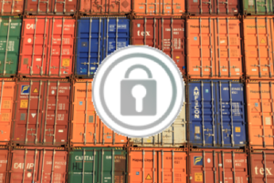
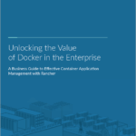

*Fei Huang is
Co-Founder and CEO of [NeuVector](http://neuvector.com/)*. Managing
containers requires a broad scope from application development, test,
and system OS preparation, and as a result, securing containers can be a
broad topic with many separate areas. Taking a layered security approach
works just as well for containers as it does for any IT infrastructure.
There are many precautions that should be taken before running
containers in production.\* These include:

- Hardening, scanning and signing images
- Implementing access controls through management tools
- Enable/switch settings to only use secured communication protocols
- Use your own digital signatures
- Securing the host, platforms and Docker by hardening, scanning and
  locking down versions

**\*[Download](http://neuvector.com/container-security-checklist/)** “15
Tips for Container Security” for a more detailed explanation

But at the end of the day, containers need to run in a production
environment where constant vigilance is required to keep them secure. No
matter how many precautions and controls have been put in place prior to
running in production, there is always the risk that a hacker may get
through or a malware might try to spread from an internal network. With
the breaking of applications into microservices, internal
‘[east-west](http://neuvector.com/blog/securing-east-west-traffic-in-container-based-data-center/)‘
traffic increases dramatically and it becomes more difficult to monitor
and secure traffic. Recent examples include the [ransomware
attacks](http://neuvector.com/blog/protect-against-elasticsearch-ransomware-attacks/)
which can exploit thousands of MongoDB or ElasticSearch servers, include
containers, with very simple attack scripts. It’s often reported that
some serious data leakage or damage also has happened from an internal
malicious laptop or desktop.

#### What is ‘Run-Time Container Security’?

Run-time container security focuses on monitoring and securing
containers running in a production environment. This includes container
and host processes, system calls, and most importantly, network
connections. In order to monitor and secure containers during run-time,

1. Get real-time visibility into network connections.
2. Characterize application behavior – develop a baseline.
3. Monitor for violations or any suspicious activities.
4. Automatically scan all running containers for vulnerabilities.
5. Enforce or block without impacting applications and services.
6. Ensure the security service auto-scales with application containers

#### Why is it Important?

Containers can be deployed in seconds and many architectures assume
containers can scale up or down automatically to meet demand. This makes
it extremely difficult to monitor and secure containers using
traditional tools such as host security, firewalls, and VM security. An
unauthorized network connection often provides the first indicator that
an attack is coming, or a hacker is attempting to find the next
vulnerable attack point. But to separate authorized from unauthorized
connections in a dynamic container environment is extremely difficult.
Security veterans understand that no matter how many precautions have
been taken before run-time, hackers will eventually find a way in, or
mistakes will lead to vulnerable systems. Here are a few requirements
for successfully securing containers during run-time:

1. The security policy must scale as containers scale up or down,
   without manual intervention
2. Monitoring must be integrated with or compatible with overlay
   networks and orchestration services such as load balancers and name
   services to avoid blind spots
3. Network inspection should be able to accurately identify and
   separate authorized from unauthorized connections
4. Security event logs must be persisted even when containers are
   killed and no longer visible.

#### Encryption for Containers

 A
business guide to effective container app management -
Encryption can be an important layer of a run-time security strategy.
Encryption can protect against stealing of secrets or sensitive data
during transmission. But it can’t protect against application attacks or
other break outs from a container or host. Security architects should
evaluate the trade-offs between performance, manageability, and security
to determine which, if any connections should be encrypted. Even if
network connections are encrypted between hosts or containers, all
communication should be monitored at the network layer to determine if
unauthorized connections are being attempted.

#### Getting Started with Run-Time Container Security

You can try to start doing the actions above manually or with a few open
source tools. Here’s some ideas to get you started:

- Carefully configure VPC’s and security groups if you use AWS/ECS
- Run the CIS Docker Benchmark and Docker Bench test tool
- Deploy and configure monitoring tools like Prometheus or Splunk for
  example
- Try to configure the network using tools from Kubernetes or
  Weaveworks for basic network policies
- Load and configure container network plugins from Calico, Flannel or
  Tigera for example
- If needed, use and configure SECCOMP, AppArmor, or SELinux
- Adopt the new LinuxKit which has Wireguard, Landlock, Mirage and
  other tools built-in
- Run tcpdump and Wireshark on a container to diagnose network
  connections and view suspicious activity

But often you’ll find that there’s too much glue you have to script to
get everything working together. The good news is that there is a
developing ecosystem of container security vendors, my company NeuVector
included, which can provide solutions for the various tasks above. It’s
best to get started evaluating your options now before your containers
actually go into production. But if that ship has sailed make sure a
security solution will layer nicely on a container deployment already
running in production without disrupting it. Here are 10 important
capabilities to look for in run-time security tools:

1. Discovery and visualization of containers, network connections, and
   system services
2. Auto-creation and adapting whitelist security policies to decrease
   manual configuration and increase accuracy
3. Ability to segment applications based on layer 7 (application
   protocol), not just layer 3 or 4 network policies
4. Threat protection against common attacks such as DDoS and DNS
   attacks
5. Ability to block suspicious connections without affecting running
   containers, but also the ability to completely quarantine a
   container
6. Host security to detect and prevent attacks against the host or
   Docker daemon
7. Vulnerability scanning of new containers starting to run
8. Integration with container management and orchestration systems to
   increase accuracy and scalability, and improve visualization and
   reporting
9. Compatible and agnostic to virtual networking such as overlay
   networks
10. Forensic capture of violations logs, attacks, and packet captures
    for suspicious containers

Today, containers are being deployed to production more frequently for
enterprise business applications. Often these deployments have
inadequate pre-production security controls, and non-existent run-time
security capabilities. It is not necessary to take this level of risk to
important business critical applications when container security tools
can be deployed as easily as application containers, using the same
orchestration tools as well. *Fei Huang is Co-Founder and CEO of
NeuVector. He has over 20 years of experience in enterprise security,
virtualization, cloud and embedded software. He has held engineering
management positions at VMware, CloudVolumes, and Trend Micro and was
the co-founder of DLP security company Provilla. Fei holds several
patents for security, virtualization and software architecture.*
