\*[Quentin Hamard](https://www.linkedin.com/in/quentinhamard?) is one of
the founders of Octoperf, and is based in Marseille, France. \*
[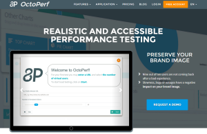](http://octoperf.com)[Octoperf](https://octoperf.com) is a
full-stack cloud load testing SaaS platform. It allows developers to
test the design performance limits of mobile apps and websites in a
realistic virtual environment. As a startup, we are attempting to use
containers to change the load testing paradigm, and deliver a
platfrom that can run on any cloud, for a fraction of the cost of
existing approaches. In this article, I want to explain how we achieved
affordability and portability by leveraging Docker containers with
Rancher as our container management platform. The elimination of the
development costs associated with having to tightly integrate
with multiple cloud architectures and platforms was critical to building
a flexible product at a price point that would be compelling to
development teams of any size. We started developing our product late in
2014. The objective was to release a product quickly without
compromising the product quality. To make that happen, we had to rely on
open-source technologies that we knew well to get things done in our
target timeframe. We made some mistakes along the way and in this
article I’ll walk through those, and show how we learned from them and
eventually delivered the platform we had envisioned. Octoperf is the
evidence of our resiliency and commitment to excellence. Docker and
Rancher paved the way to our success. Let’s start with some of the
things we didn’t get right the first time.

## **Round 1 - Lessons Learned About What Not to Do**

[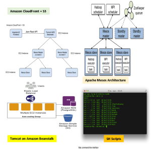](https://cdn.rancher.com/wp-content/uploads/2016/02/18040204/Octo1.png)
We tried multiple options and methods under our initial premise of
being quick to market with a high-quality product. We tried one
approach, then another and before we knew it, the iteration wars were in
full swing. I’ll highlight a few of the approaches we tried below:
Amazon CloudFront + S3 Front End with Tomcat on Amazon Beanstalk Back
End – our first approach was to try using the full AWS
stack to build out our platfrom. However, as we quickly realized, with
this approach we were tied to Amazon and would have had to develop a new
instance of Octoperf for each cloud structure our customers might be
using. We were not portable, and we were not cost effective. Apache
Mesos Cluster – Our next approach was to try using Apache
Mesos. Mesos seemed like a good solution, but in the end, it had two
major challenges. First, the setup was complex and required a ton of
continual fine tuning, and second, it required a large management
infrastructure, which was expensive and had to be implemented on
every cloud we wanted to support. Mesos was close to what we were
trying to do, but the overhead and cost didn’t work for a company of
our size.

SH Scripts – We tried using SH scripts to launch services
like Apache Mesos, Singularity, but we found these scripts were
unmaintainable in the long run and were painful to write, read and test.
The attempt to develop and maintain these scripts was costly. If you’ve
seen the movie “Hellraiser,” you know the effect that can have on you.
The bottom line here is that it is a royal mess to deal with. Having a
few scripts is manageable. Once you get into the dozens of scripts
needed to run services, Jmeter, and the lot, it’s like having
acupuncture done on your entire scalp and face … yeah, painful.
Developer Environment - With our initial
AWS/Mesos/Scripting appraoch, we had a huge problem creating developer
environments for our team. Our scripts were based on [Amazon
metadata](http://docs.aws.amazon.com/AWSEC2/latest/UserGuide/ec2-instance-metadata.html)
available on the EC2 instance. Mesos and other tools were installed by
hand on an Amazon AMI. Soon we realized that just setting up the
development was painful. It required setting up the whole stack on the
developer machine which was hours of work. It was so painful that we
were sometimes doing tests in the production environment, a definite
poor practice. Thanks to our over 3000 unit tests covering almost any
part of the app, the small regression we faced could be fixed quickly.
However, even in those conditions, it was unacceptable to be unable to
setup a development environment within minutes. This wasn’t manageable
in the long run and had to find out a way to run our entire stack on our
local machines within minutes.

It was time to rethink our basic assumptions and premises.

### **Reboot**

 We had to redefine
our entire approach. Our new design criteria had to consider
affordability and portability to meet our clients’ needs. These
criteria included:

- On-premise load testing - be able to load test
  applications behind firewalls, as well as hybrid cloud load testing
  by mixing cloud and on-premise machines.
- Multi-cloud provider support - be able to support
  multiple cloud providers to address global diversity and to take
  advantage of cost-saving opportunities when available.

It was time to sit back and think about a new architecture which will
solve the issues listed above AND help us to quickly develop those
valuable features. We needed:

- A portable environment – The
  development environment should be easy to setup.
- A cloud provider agnostic architecture - We want to be
  able to deploy the infrastructure on any cloud provider with ease.
- A simple and coherent system - Managing
  a multi-region Mesos cluster for our purpose was overkill. SH
  scripts should be eliminated as much as possible.
- An all-in-one solution - We don’t have enough time to
  take the best technology in each field and glue them together. We
  need a solution which covers all our Docker clustering needs.

## **Round 2 - A Docker and Rancher Driven Architecture**

Our new architecture has been entirely moved to Docker containers,
managed by a Docker cluster orchestration tool.
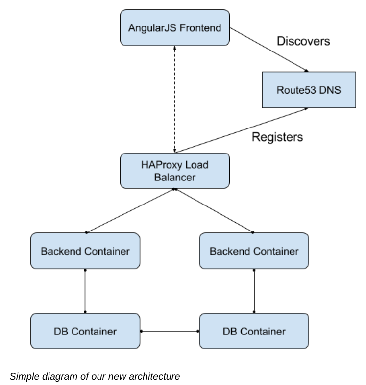 The diagram gives a
high-level overview of how our system is designed now. Backend and DB
containers can be scaled horizontally across as many hosts as needed. We
solved many of the limitations of our first architecture:

- Provider agnostic - we rely on a Docker orchestration
  tool which is cloud vendor independent.
- On-premise capability - the new infrastructure treats
  a Docker host in the cloud the same as an on premise machine,
- Multi cloud-provider support - we start devices using
  Rancher’s support for Docker-machine which makes the perfect bridge
  between all the cloud providers and us. Many cloud options are
  supported! (Amazon, DigitalOcean and more)

### **JMeter test execution**

Previously, we were running JMeter instances with SH scripts on Mesos
slaves. Now, we packed our JMeter setup in a Docker container. We
schedule the JMeter Docker containers on
[Rancher](https://rancher.com/), which then executes them
on the wanted cloud provider in the desired region.

### **Docker**

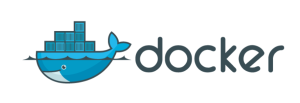 Why Docker? The
answer seems quite obvious now that you understand all the issues we
faced. Docker allows to you create **portable apps** that run anywhere
under the same conditions. Docker opens up an entirely new world which
also comes with its own challenges. It’s not as simple as putting all of
our apps into Docker containers. However, thanks to the [Awesome
Docker](http://veggiemonk.github.io/awesome-docker/)
curated list, we could quickly have an overview of the existing
technologies around Docker that could meet our needs such as being able
to cluster Docker containers.

### **Docker Container Orchestration**

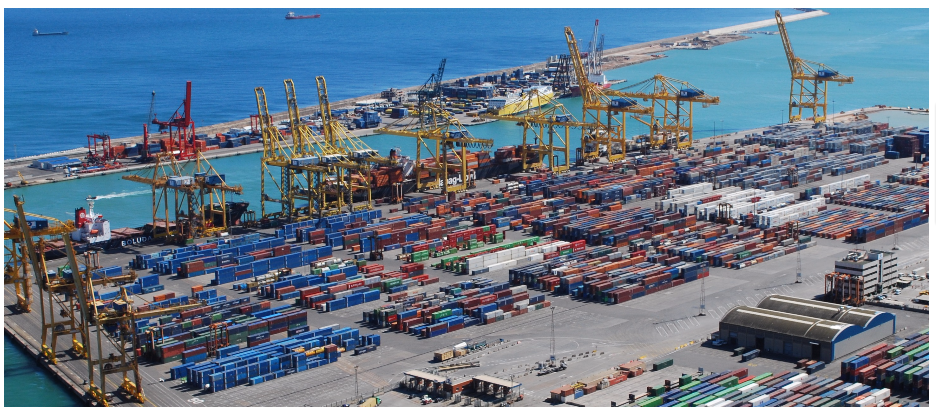 Why orchestration? Simply because
it’s not safe to put your entire app on a single machine. Also, a single
instance may not be enough to execute the workload. We should be able to
scale the app horizontally by simply adding more machines. Clustering
Docker containers is essential. Clustering means running an ensemble of
containers on a cluster of machines. There are some tools which allow
you to run Docker containers on a cluster like [Docker
swarm](https://docs.docker.com/swarm/). Being able to
manage a cluster of Docker hosts from a single place is mandatory. We
have chosen to go with [Rancher](https://rancher.com/). Its
Web UI gives you an instant overview of your entire Docker host cluster
and the containers being
run.
There are many other tools, mostly in command-line, to form Docker
clusters. We have looked at [CoreOS](https://coreos.com/),
[Weave](http://weave.works/) and many more. Either we
found the configuration too complicated, or it required us to integrate
many technologies together to have all the features we needed. Rancher
just made it so easy to deploy and manage our containers anywhere.

### **Docker Container Networking**

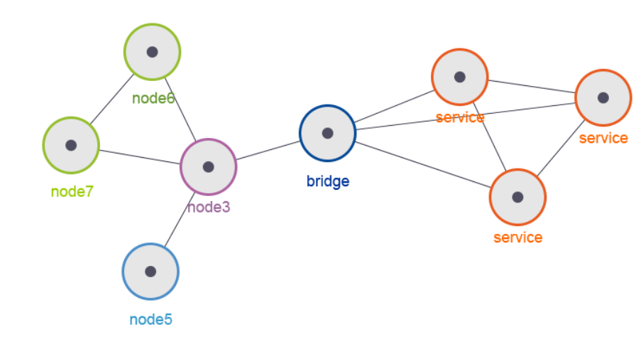 Once you start
thinking with a cluster, another issue comes up. How can containers
communicate with each other? We needed cross-container networking. This
network needs to be independent of the cluster layout. Rancher has been
incredibly helpful here. It has a built-in Docker container networking
system based on IPSec tunneling. This allows you to have cross-host /
cross-provider communication between Docker containers as if they were
on the same local area network.

### **Service discovery**

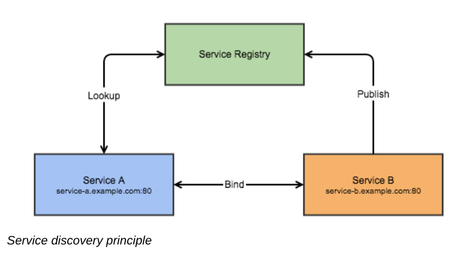 Well, now that your
containers are able to run on a variety of hardware and communicate with
each other, how can they discover each other without messing with the
configuration on each deployment? Rancher includes a global, DNS-based
service discovery function that allows containers to automatically
register themselves as services, as well as services to dynamically
discover each other over the network. Service discovery is an essential
feature when running services that need to communicate with each other
on a cluster of machines. Of course, you could hard-code the service IPs
/ hostnames, but that’s the opposite of flexibility and resilience.
Services in a cluster are moving parts that should be independent of the
location where they run.

### **Data Persistence**

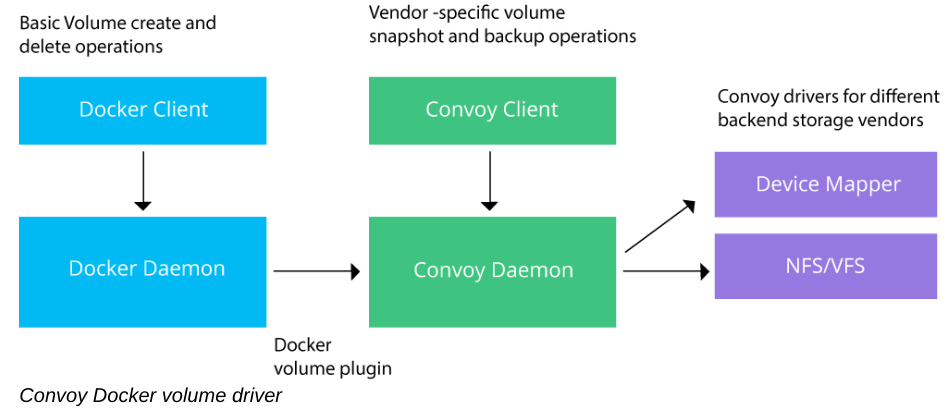 Running databases
with Docker containers can be difficult. Databases require persistence.
The problem with Docker containers is that the data within the container
is lost when the container is removed. You can map a directory within a
container to a local folder on the docker host, using [docker
volumes](https://docs.docker.com/engine/userguide/dockervolumes/).
What happens when the machine dies? Isn’t my container supposed to be
cluster agnostic? We need that the data tied to the container keeps
moving with it in the Docker cluster. You start to feel the issue with
running databases on Docker. Fortunately, there is a solution to this
problem; volume drivers.
Rancher [Convoy](https://github.com/rancher/convoy) is the
one we use.
[Flocker](https://github.com/ClusterHQ/flocker) is another
alternative. We use Convoy to map the container volume to an [Amazon
EBS volume](https://aws.amazon.com/ebs/). Therefore, when
the machine hosting the database dies, the container is relocated to
another host. The EBS volume, which is independent of the machine, is
then linked again to the container

### **Load Balancing**

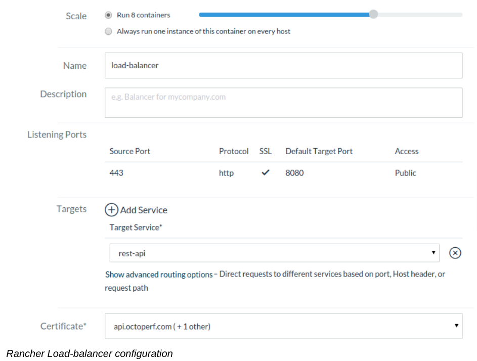 So our application
is now scaled horizontally. The next challenge was centered on how to
make our frontend discover our load-balancers when scaling them. Rancher
has a built-in [Route53 DNS update
service](https://rancher.com/introducing-rancher-service-discovery-integration-with-amazon-route53/).
This service updates Route53 DNS entries for each service. When you
scale the load-balancer, the newly scaled ones will be added
automatically in the Route53 DNS entries. What about setting up an SSL
Termination? It’s also dead-simple with Rancher’s built-in SSL
certificate management. If we would have to setup
[HAProxy](http://www.haproxy.org/) with SSL termination
manually, it would probably take us a week or two and have been a mess.

### **Monitoring**

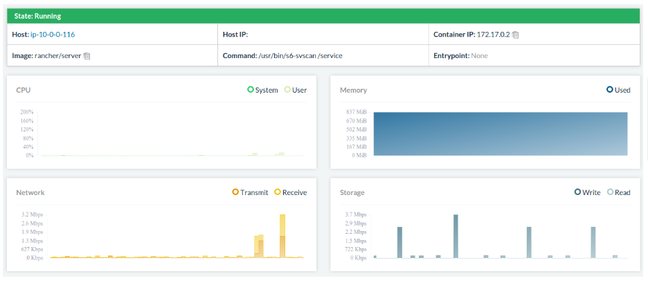 Once you have a few containers
running, you need to have at least a basic monitoring solution to get a
quick overview of the resources used by each container.
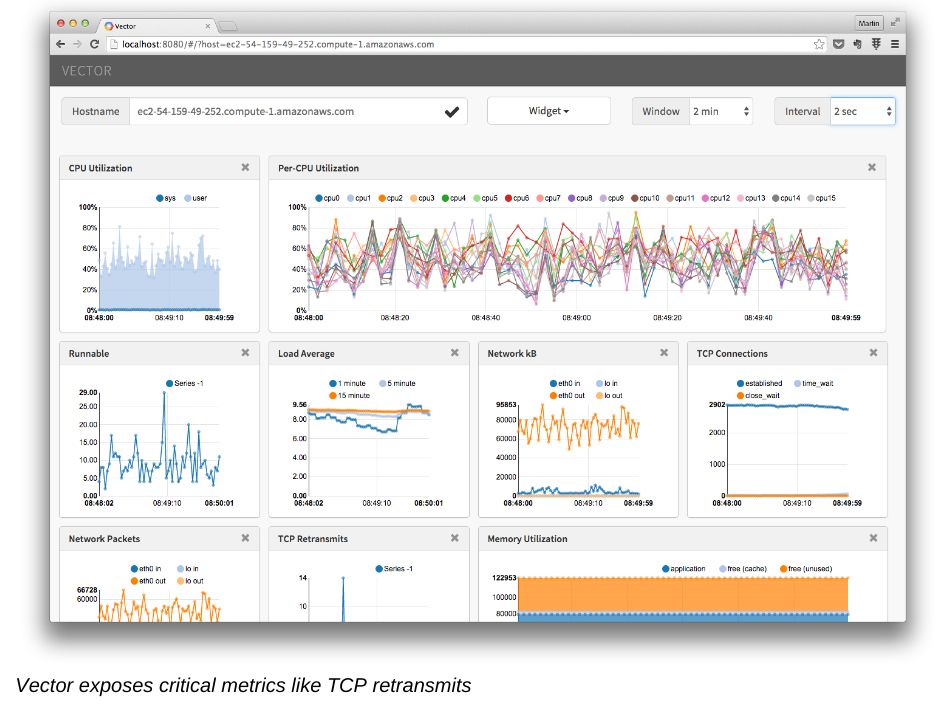Rancher has a
built-in basic monitoring solution which exposes CPU, memory and network
metrics in the UI. More precise monitoring can be achieved by setting up
[Netflix Vector](https://github.com/Netflix/vector) on
Docker hosts, which is what we did.

### **Cost Considerations**

With Docker and Rancher, we are able to get rid of many EC2 machines and
use existing machines more efficiently. Month-to-month Amazon prices
have shown an almost **70% decrease in infrastructure cost**. EC2
machines have hourly usage costs that come with [Elastic Block Store
monthly costs](https://aws.amazon.com/ebs/pricing/) (per
GB), and network communication costs. That doesn’t include the
maintenance cost to keep the EC2 fleet running smoothly.

### **Future Evolutions**

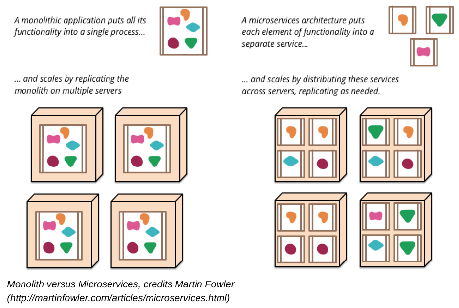 We plan to move to a
[microservice
architecture](http://martinfowler.com/articles/microservices.html),
which will naturally lead us to a tool like
[Hystrix](https://github.com/Netflix/Hystrix) for
fault-tolerance and resilience. Circuit-breakers avoid cascading
failures and allow resiliency in distributed systems where failures are
inevitable. We’ll cover our migration to microservices in future posts.

### **Final Words**

This process has helped us deliver a fantastic platform for our
customers quickly, inexpensively and with unprecedented portability.
Docker and Rancher makes it possible for a startup to build a scalable,
high performance platform in a way that would have been nearly
impossible in the past. I can’t thank companies like
[Netflix](https://netflix.com/),
[Pivotal](https://pivotal.io/) and
[Rancher](https://rancher.com/) enough for the time they
invest in open-source technologies. Octoperf would not exist without the
open-source community.
