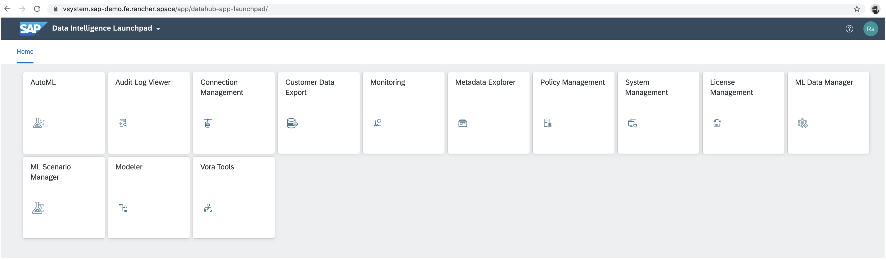
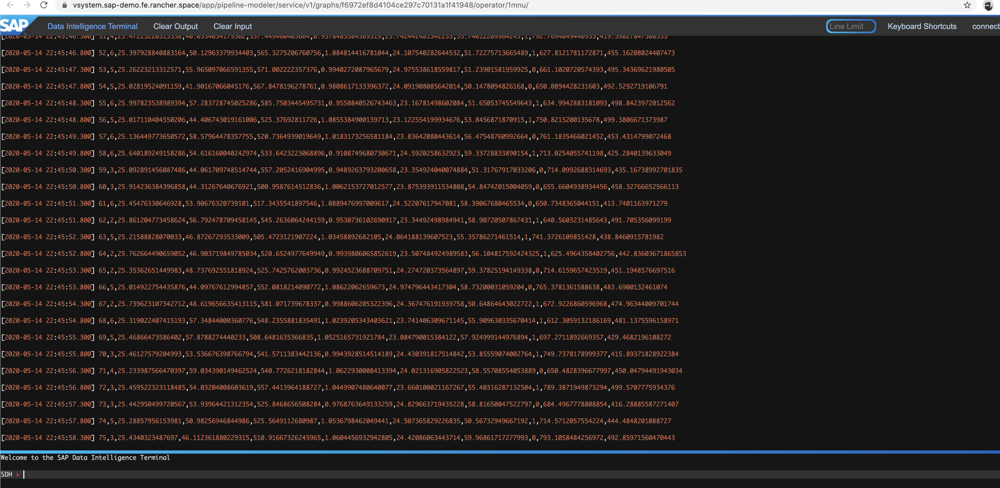
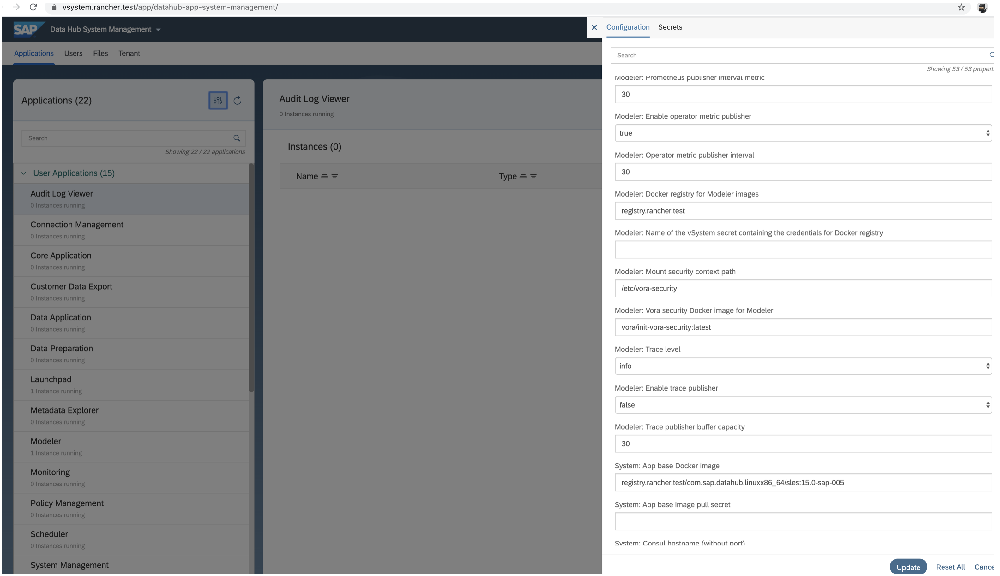
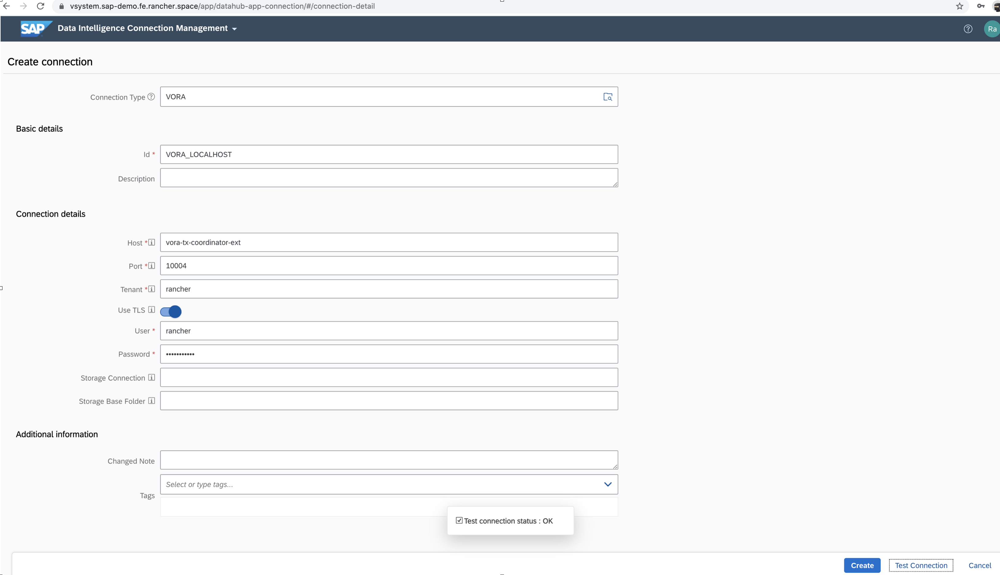
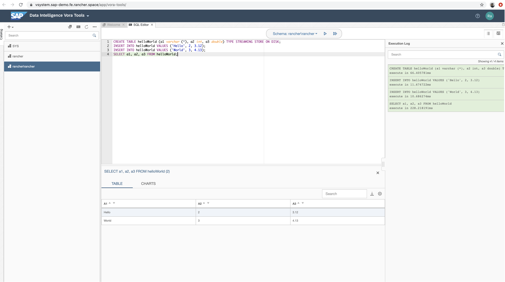
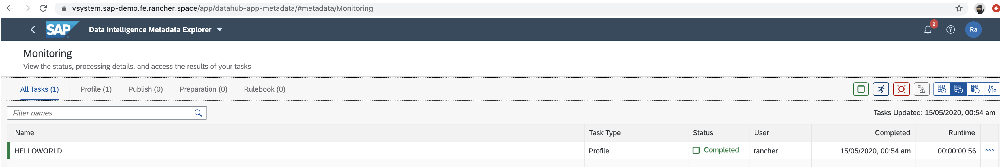
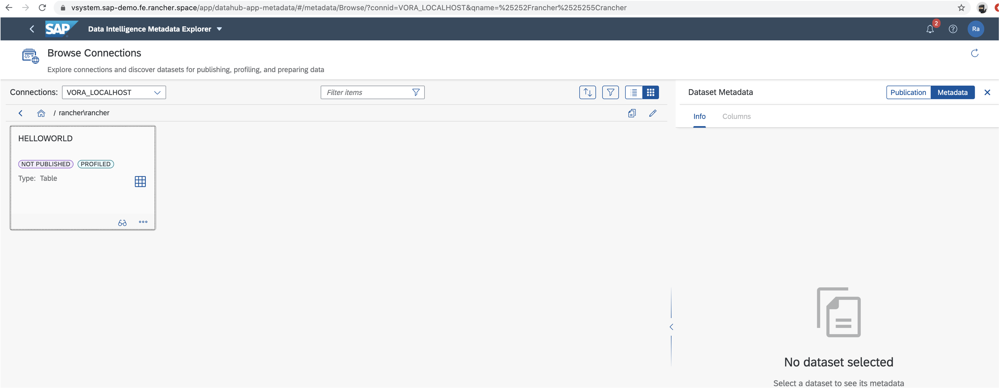
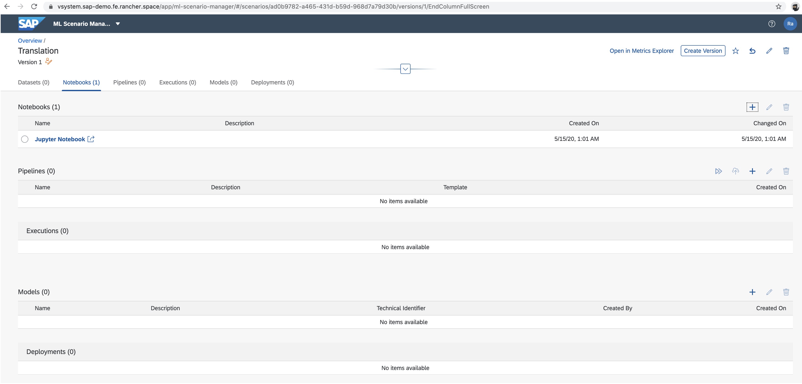
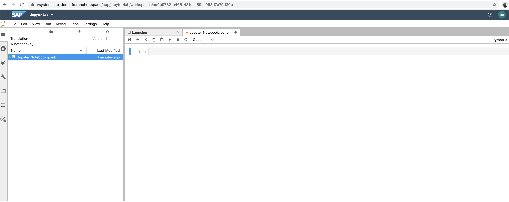

Read our free white paper: How to Build a Kubernetes Strategy[Download Now](https://more.suse.com/fy21-global-web-landing-page-how-to-build-enterprise-kubernetes-strategy)

Rancher and SAP have been working on a dedicated verification of [SAP Data Intelligence 3](https://www.sap.com/products/data-intelligence.html) (SAP DI) on [Rancher Kubernetes Engine](https://rancher.com/docs/rke/latest/en/) (RKE) cluster and [Longhorn](https://longhorn.io) storage platform. This blog will guide you on how to properly install SAP DI on an RKE cluster.

Learn more about at [Installation Guide for SAP Data Intelligence](https://help.sap.com/viewer/a8d90a56d61a49718ebcb5f65014bbe7/3.0.latest/en-US/9f866d8ef9a94c30947f12e73eaf0dd9.html).

## Install an RKE Cluster

First, we need to install an RKE cluster where we’ll install SAP DI.

### Node Requirements

- [RKE node requirements](https://rancher.com/docs/rke/latest/en/os/)
- NFS support is required to install SAP Data Intelligence on a Kubernetes cluster. Each node of the K8s cluster must be able to export and mount NFS V4 volumes.
  - Kernel modules nfsd and nfsv4 must be loaded.
  - System utilities mount.nfs, mount.nfs4, umount.nfs and unmount.nfsv4 must be present on the nodes:
  - If the kernel of your nodes supports the NFS modules, SAP Data Intelligence will load the necessary modules automatically. For this, the rpcbind daemon must be running in the nodes.
  - If you have configured your Kubernetes nodes for NFS, you can disable the NFS module loading using the SLCB by choosing Advanced Installation for Installation Mode, and choose Disable Loading NFS Modules for Loading NFS Modules.

### Deploy RKE Cluster

You can deploy your RKE cluster in two ways:

- Standalone: using [RKE CLI](https://rancher.com/docs/rke/latest/en/installation/) or [RKE Terraform Provider](https://github.com/rancher/terraform-provider-rke)
- Managed: using [Rancher](https://rancher.com/docs/rancher/v2.x/en/cluster-provisioning/rke-clusters/) to deploy it

**Note**: At the moment, SAP DI supports Kubernetes versions up to 1.15.X (check [SAP PAM](https://apps.support.sap.com/sap%28bD1lbiZjPTAwMQ==%29/support/pam/pam.html#ts=11&s=SAP%20DATA%20INTELLIGENCE%203&o=most_viewed%7Cdesc&st=l&rpp=20&page=1&pvnr=73554900100900004388&pt=g%7Cd) for K8s version update). Be sure to specify the correct `kubernetes_version` on your RKE deployment. Learn more in the [SAP Note 2871970](https://launchpad.support.sap.com/#/notes/2871970) (SAP S-user required).

#### RKE Cluster Architecture for Production

In addition to using one of the above methods to install an RKE cluster, we recommend the following best practices for creating the production-ready Kubernetes clusters that will run your apps and services.

- Nodes should have one of the following roles configurations:
  - Separated planes roles:
  - etcd
  - control plane
  - worker
  - Mix overlapped planes roles:
  - etcd and control plane
  - worker (the worker role should not be used or added on nodes with the etcd or control plane role)
- RKE cluster should have one of the following nodes configurations:
  - Separated planes nodes:
  - 3 x etcd
  - 2 x control plane
  - 3 x worker
  - Mix overlapped planes nodes:
  - 3 x etcd and control plane
  - 3 x worker
- If needed, increase etcd nodes count (recommended odd values) for higher node fault toleration and spread them across (availability) zones to provide even better fault tolerance.
- Enable etcd snapshots. Verify that snapshots are being created, and run a disaster recovery scenario to verify the snapshots are valid. The state of your cluster is stored in etcd, and losing etcd data means losing your cluster. Make sure you configure etcd Recurring Snapshots for your cluster(s) and make sure the snapshots are stored externally (off the node). You can find more information at [recurring snapshots](https://rancher.com/docs/rancher/v2.x/en/backups/backups/ha-backups/#option-a-recurring-snapshots).

#### Example

We used RKE v1.1.1 to deploy a test RKE cluster. [RKE install details are here.](https://rancher.com/docs/rke/latest/en/installation/)

We’ve deployed our RKE cluster on an AWS infrastructure with the following properties:

- using Kubernetes overlapped planes (etcd, control and worker)
- on 3 `m5.2xlarge` AWS instances:
  - 8 CPUs,
  - 32GB RAM
  - 100GB storage
- using ami-06d9c6325dbcc4e62, ubuntu 18.04
- using 3 public elastic ips (one per node)
- using route53 subdomain wildcard pointing to public elastic ips `*.sap-demo.fe.rancher.space`
  - Docker registry: `registry.sap-demo.fe.rancher.space`
  - SAP DI vsystem: `vsystem.sap-demo.fe.rancher.space`

Once you’ve deployed your infrastructure, `cluster.yaml` file has been created and RKE is up.

```
cat << EOF > cluster.yaml
nodes:
  - address: <ELASTIC_IP_1>
    internal_address: <INTERNAL_IP_1>
    ssh_key_path: <AWS_KEY_FILE>
    user: ubuntu
    role:
      - controlplane
      - etcd
      - worker
    ssh_key_path: <AWS_KEY_FILE>
  - address: <ELASTIC_IP_2>
    internal_address: <INTERNAL_IP_2>
    user: ubuntu
    role:
      - controlplane
      - etcd
      - worker
    ssh_key_path: <AWS_KEY_FILE>
  - address: <ELASTIC_IP_3>
    internal_address: <INTERNAL_IP_3>
    user: ubuntu
    role:
      - controlplane
      - etcd
      - worker
    ssh_key_path: <AWS_KEY_FILE>
kubernetes_version = "v1.15.11-rancher1-3"
EOF
rke up --config cluster.yaml
```

Once RKE finishes cluster deployment, kubeconfig will be generated on the current directory.

**Note**: Don’t use this example in a production environment. Overlapped planes are not recommended for production environments. Get more information about [provisioning Kubernetes in a production cluster](https://rancher.com/docs/rancher/v2.x/en/cluster-provisioning/production/).

## SAP DI Prerequisites

Take care of the following SAP DI [prerequisites](https://help.sap.com/viewer/a8d90a56d61a49718ebcb5f65014bbe7/3.0.latest/en-US/c22b0ff1253a4687ba99fe6795d98e89.html) before install.

There are a couple of optional features that will require S3 compatible storage:

- [Checkpoint Store Configuration](https://help.sap.com/viewer/a8d90a56d61a49718ebcb5f65014bbe7/3.0.latest/en-US/abfa9c73f7704de2907ea7ff65e7a20a.html)
- [Configure Connection to DI\_DATA\_LAKE](https://help.sap.com/viewer/a8d90a56d61a49718ebcb5f65014bbe7/3.0.latest/en-US/c20c0251b3654103818e35ee28a8493c.html)

### RKE storageClass

You need to define a default storageClass on your RKE cluster for SAP DI to work properly. SAP DI services should be able to generate a PersistentVolume PV and a PVC on your RKE cluster.

SAP DI installation has been tested on two distinct default storageClasses:

- [Longhorn](https://longhorn.io) v1.0.0 for production environments:
  - [Install](https://longhorn.io/docs/1.0.0/deploy/install/)
  - [Best Practices](https://longhorn.io/docs/1.0.0/best-practices/)
- `local_path` storageClass, for testing or ephemeral environments (not supported for production):
  - Install `kubectl apply -f https://raw.githubusercontent.com/rancher/local-path-provisioner/master/deploy/local-path-storage.yaml`
  - Set as default `kubectl patch storageclass local-path -p '{"metadata": {"annotations":{"storageclass.kubernetes.io/is-default-class":"true"}}}'`

### S3 storage

If you are planning to use any optional features that require S3 compatible storage, we tested these S3 backends successfully:

- [AWS S3](https://aws.amazon.com/s3/) backend as cloud storage solution.
- [MinIO](https://min.io/) S3 backend as on premise storage solution. ([How to install MinIO](https://docs.min.io/docs/deploy-minio-on-kubernetes.html)).

More info at [storage infrastructure requirements](https://launchpad.support.sap.com/#/notes/2693555) (SAP S-user required).

### TLS Certificates

To manage TLS certificates for the installation, we’ve decided to install cert-manager into the RKE cluster. TLS certificates are required to access container registry and SAP DI portal once installed.

```
kubectl -n cert-manager apply -f https://github.com/jetstack/cert-manager/releases/download/v0.14.3/cert-manager.crds.yaml
helm repo add jetstack https://charts.jetstack.io
helm install --name cert-manager --namespace cert-manager --version v0.14.3 jetstack/cert-manager
```

Learn more about [using self-signed certs](https://help.sap.com/viewer/a8d90a56d61a49718ebcb5f65014bbe7/3.0.latest/en-US/39e8e391d5984e919725e601f089db74.html).

### Container Registry

SAP DI requires a container registry in order to mirror SAP Docker images. You need at least 60GB of free storage to fit all the Docker images. If you already have one Docker registry up and running, please jump to the next section.

#### Issuer

To automate the TLS management, we’ll deploy a cert-manager issuer using letsencrypt integration. That allows Kubernetes to manage letsencrypt certificates automatically. This can be replaced by other kinds of certificates.

```
# Create issuer acme on kube-system
cat << EOF > docker-registry-issuer.yaml
apiVersion: cert-manager.io/v1alpha2
kind: Issuer
metadata:
  name: letsencrypt-prod
  labels:
    app: "docker-registry"
spec:
  acme:
    server: https://acme-v02.api.letsencrypt.org/directory
    email: test@sap.io
    privateKeySecretRef:
      name: letsencrypt-prod-key
    solvers:
    - http01:
        ingress:
          class: nginx

kubectl -n kube-system apply -f docker-registry-issuer.yaml
```

#### Docker Registry

Install docker-registry from helm chart, exposing and securizing it by ingress `registry.sap-demo.fe.rancher.space`

```
# Install docker-registry
helm install docker-registry stable/docker-registry --namespace default  
--set ingress.enabled=true 
--set ingress.hosts[0]=registry.sap-demo.fe.rancher.space 
--set ingress.annotations.nginx\.ingress\.kubernetes\.io/proxy-body-size="0" 
--set ingress.annotations.cert-manager\.io/issuer=letsencrypt-prod 
--set ingress.annotations.cert-manager\.io/issuer-kind=Issuer 
--set ingress.tls[0].secretName=tls-docker-registry-letsencrypt,ingress.tls[0].hosts[0]=registry.sap-demo.fe.rancher.space
```

## Install SAP DI

See the full [SAP DI installing guide](https://help.sap.com/viewer/a8d90a56d61a49718ebcb5f65014bbe7/3.0.latest/en-US/0400621a63a348ab904972c8128d4d26.html) for details.

### Generate stack.xml from SAP Maintenance Planner

Follow [this](https://help.sap.com/viewer/a8d90a56d61a49718ebcb5f65014bbe7/3.0.latest/en-US/7e4847e241c340b3a3c50a5db11b46e2.html) procedure to install SL Container Bridge.

There are 3 installation options available:

- `SAP DATA INTELLIGENCE 3 - DI - Platform`
- `SAP DATA INTELLIGENCE 3 - DI - Platform extended`
- `SAP DATA INTELLIGENCE 3 - DI - Platform full Bridge`

Once the installation option is selected, save the generated MP*Stack*\*.xml file.

Note: We chose `SAP DATA INTELLIGENCE 3 - DI - Platform full Bridge` for the example.

### Deploy SAP SL Container Bridge

SAP SL Container Bridge (SLCB) is required to install SAP DI. Download SLCB software:

```
# downloaded proper version from SAP https://launchpad.support.sap.com/#/softwarecenter/search/SLCB
mv SLCB01_<PL>-70003322.EXE /usr/local/bin/slcb
```

Once you’ve downloaded SLCB, deploy it on your RKE cluster. RKE cluster kubeconfig file is required:

```
export KUBECONFIG=<KUBECONFIG_FILE>
slcb init
# select advance config and set nodePort on installation
```

Note: If you are doing an airgap installation, please follow [these instructions](https://help.sap.com/viewer/a8d90a56d61a49718ebcb5f65014bbe7/3.0.latest/en-US/6a64f00a5ad643c79236b4a5fa09b79e.html).

### Deploy SAP DI

Once SLCB is deployed, it’s time to deploy SAP DI. To do that, you need a generated `MP_Stack_*.xml` file and Kubernetes `slcbridgebase-service` service information:

```
# Get slcbridgebase-service info, NODE_IP:NODE_PORT
kubectl -n sap-slcbridge get service slcbridgebase-service
# Execute slcb with proper arguments
slcb execute --useStackXML software/MP_Stack_2000913929_20200513_.xml --url https://NODE_IP:NODE_PORT/docs/index.html
# Choose option `3: - SAP DATA INTELLIGENCE 3 - DI - Platform full Bridge`
```

Note: As an option, SLCB could be executed from MP in web mode following [these instructions](https://help.sap.com/viewer/a8d90a56d61a49718ebcb5f65014bbe7/3.0.latest/en-US/7e4847e241c340b3a3c50a5db11b46e2.html). Service `slcbridgebase-service` should be exposed to the internet.

Installation parameters (used as example):

- namespace: `sap`
- docker-registry: `registry.sap-demo.fe.rancher.space`
- SAP s user: `sXXXXXXXXX`
- system password: `XXXXXXXX`
- tenant: `rancher`
- user: `rancher`
- pass: `XXXXXXXX`

### Check SAP DI Deployment

Once SLCB execution is finished, check that everything is running on the SAP DI namespace:

```
kubectl -n sap get all
NAME                                                                  READY   STATUS      RESTARTS   AGE
pod/auditlog-668f6b84f6-rwt29                                         2/2     Running     0          7m4s
pod/axino-service-02e00cde77282688e99304-7fdfff5579-lwjfn             2/2     Running     0          2m44s
pod/datahub-app-database-4d39c65296aa257d23a3fd-69fc6fbd4c-bm4b7      2/2     Running     0          3m14s
pod/datahub.post-actions.validations.validate-secrets-migratiosrtdg   0/1     Completed   0          59s
pod/datahub.post-actions.validations.validate-vflow-xmdhk             1/1     Running     0          56s
pod/datahub.post-actions.validations.validate-vsystem-xhkws           0/1     Completed   0          62s
pod/datahub.voracluster-start-fd7052-94007e-kjxml                     0/1     Completed   0          5m26s
pod/datahub.vsystem-import-cert-connman-a12456-7283f8-xcxhb           0/1     Completed   0          3m8s
pod/datahub.vsystem-start-f7c2f5-109b76-zjwnk                         0/1     Completed   0          2m53s
pod/diagnostics-elasticsearch-0                                       2/2     Running     0          8m31s
pod/diagnostics-fluentd-cfl6g                                         1/1     Running     0          8m31s
pod/diagnostics-fluentd-fhv7q                                         1/1     Running     0          8m31s
pod/diagnostics-fluentd-jsw42                                         1/1     Running     0          8m31s
pod/diagnostics-grafana-7cbc8d768c-6c74g                              2/2     Running     0          8m31s
pod/diagnostics-kibana-7d96b5fc8c-cd6gc                               2/2     Running     0          8m31s
pod/diagnostics-prometheus-kube-state-metrics-5fc759cf-8c9w4          1/1     Running     0          8m31s
pod/diagnostics-prometheus-node-exporter-b8glf                        1/1     Running     0          8m31s
pod/diagnostics-prometheus-node-exporter-bn2zt                        1/1     Running     0          8m31s
pod/diagnostics-prometheus-node-exporter-xsm9p                        1/1     Running     0          8m31s
pod/diagnostics-prometheus-pushgateway-7d9b696765-mh787               2/2     Running     0          8m31s
pod/diagnostics-prometheus-server-0                                   1/1     Running     0          8m31s
pod/hana-0                                                            2/2     Running     0          8m22s
pod/internal-comm-secret-gen-xfkbr                                    0/1     Completed   0          6m4s
pod/pipeline-modeler-84f240cee31f78c4331c50-6887885545-qfdx8          1/2     Running     0          29s
pod/solution-reconcile-automl-3.0.19-h884g                            0/1     Completed   0          4m16s
pod/solution-reconcile-code-server-3.0.19-s84lp                       0/1     Completed   0          4m32s
pod/solution-reconcile-data-tools-ui-3.0.19-d8f5d                     0/1     Completed   0          4m26s
pod/solution-reconcile-dsp-content-solution-pa-3.0.19-2fvf4           0/1     Completed   0          4m32s
pod/solution-reconcile-dsp-git-server-3.0.19-ff9z5                    0/1     Completed   0          4m22s
pod/solution-reconcile-installer-certificates-3.0.19-bhznp            0/1     Completed   0          4m21s
pod/solution-reconcile-installer-configuration-3.0.19-92nfl           0/1     Completed   0          4m16s
pod/solution-reconcile-jupyter-3.0.19-8dmd8                           0/1     Completed   0          4m30s
pod/solution-reconcile-license-manager-3.0.19-khdfl                   0/1     Completed   0          4m30s
pod/solution-reconcile-metrics-explorer-3.0.19-2kpv9                  0/1     Completed   0          4m28s
pod/solution-reconcile-ml-api-3.0.19-c9nrk                            0/1     Completed   0          4m18s
pod/solution-reconcile-ml-deployment-api-3.0.19-7xpp6                 0/1     Completed   0          4m22s
pod/solution-reconcile-ml-deployment-api-tenant-handler-3.0.19zrj74   0/1     Completed   0          4m27s
pod/solution-reconcile-ml-dm-api-3.0.19-bfwgd                         0/1     Completed   0          4m32s
pod/solution-reconcile-ml-dm-app-3.0.19-whdf4                         0/1     Completed   0          4m15s
pod/solution-reconcile-ml-scenario-manager-3.0.19-mx5nf               0/1     Completed   0          4m21s
pod/solution-reconcile-ml-tracking-3.0.19-tsjhq                       0/1     Completed   0          4m32s
pod/solution-reconcile-resourceplan-service-3.0.19-pddv6              0/1     Completed   0          4m20s
pod/solution-reconcile-training-service-3.0.19-vrsn7                  0/1     Completed   0          4m32s
pod/solution-reconcile-vora-tools-3.0.19-cnsb8                        0/1     Completed   0          4m23s
pod/solution-reconcile-vrelease-appmanagement-3.0.19-xhpq9            0/1     Completed   0          4m30s
pod/solution-reconcile-vrelease-delivery-di-3.0.19-pzxf6              0/1     Completed   0          4m16s
pod/solution-reconcile-vrelease-diagnostics-3.0.19-mz56b              0/1     Completed   0          4m21s
pod/solution-reconcile-vsolution-app-base-3.0.19-fmml5                0/1     Completed   0          4m23s
pod/solution-reconcile-vsolution-app-base-db-3.0.19-cq52t             0/1     Completed   0          4m24s
pod/solution-reconcile-vsolution-app-data-3.0.19-svq4z                0/1     Completed   0          4m26s
pod/solution-reconcile-vsolution-dh-flowagent-3.0.19-ntlnx            0/1     Completed   0          4m33s
pod/solution-reconcile-vsolution-dsp-core-operators-3.0.19-bx2vx      0/1     Completed   0          4m26s
pod/solution-reconcile-vsolution-shared-ui-3.0.19-bprsp               0/1     Completed   0          4m30s
pod/solution-reconcile-vsolution-vsystem-ui-3.0.19-vjx7d              0/1     Completed   0          4m26s
pod/spark-master-5d4567d976-bj27f                                     1/1     Running     0          8m28s
pod/spark-worker-0                                                    2/2     Running     0          8m28s
pod/spark-worker-1                                                    2/2     Running     0          8m18s
pod/storagegateway-665c66599c-vlslw                                   2/2     Running     0          6m53s
pod/strategy-reconcile-sdi-rancher-extension-strategy-3.0.19-d2lzm    0/1     Completed   0          3m42s
pod/strategy-reconcile-sdi-system-extension-strategy-3.0.19-5xf8m     0/1     Completed   0          3m51s
pod/strategy-reconcile-strat-rancher-3.0.19-3.0.19-7lzgb              0/1     Completed   0          3m49s
pod/strategy-reconcile-strat-system-3.0.19-3.0.19-6xxwj               0/1     Completed   0          4m3s
pod/tenant-reconcile-rancher-3.0.19-wg5mc                             0/1     Completed   0          3m37s
pod/tenant-reconcile-system-3.0.19-hjlr8                              0/1     Completed   0          3m42s
pod/uaa-69f5f554b6-5xvsn                                              2/2     Running     0          6m41s
pod/vflow-build-vrep-vflow-dockerfiles-com-sap-sles-basetxf4j         1/1     Running     0          21s
pod/vora-catalog-9c8dc9698-sw95m                                      2/2     Running     0          2m36s
pod/vora-config-init-knpdg                                            0/2     Completed   0          3m36s
pod/vora-deployment-operator-5d86445f77-n5ss7                         1/1     Running     0          5m38s
pod/vora-disk-0                                                       2/2     Running     0          2m36s
pod/vora-dlog-0                                                       2/2     Running     0          5m37s
pod/vora-dlog-admin-vmdnp                                             0/2     Completed   0          4m36s
pod/vora-landscape-84b9945bc6-rnvmd                                   2/2     Running     0          2m36s
pod/vora-nats-streaming-594779b867-4gh6z                              1/1     Running     0          6m4s
pod/vora-relational-79969dbd8f-ct2c7                                  2/2     Running     0          2m36s
pod/vora-security-operator-79dc4546d-7zdhf                            1/1     Running     0          9m35s
pod/vora-textanalysis-68dbf78ff5-kh5zx                                1/1     Running     0          9m46s
pod/vora-tx-broker-9f87bc658-qg6pn                                    2/2     Running     0          2m36s
pod/vora-tx-coordinator-7bb7d8dd95-vd925                              2/2     Running     0          2m36s
pod/voraadapter-5945e67c3b994f63be463c-5ffb75bfb4-dzc68               2/2     Running     0          3m9s
pod/voraadapter-b314f02c87f2ce620db952-74b45f6c44-68r25               2/2     Running     0          2m43s
pod/vsystem-796cf899d-c5kfg                                           2/2     Running     1          6m4s
pod/vsystem-module-loader-72fbr                                       1/1     Running     0          6m4s
pod/vsystem-module-loader-bgh8m                                       1/1     Running     0          6m4s
pod/vsystem-module-loader-xlvx2                                       1/1     Running     0          6m4s
pod/vsystem-vrep-0                                                    2/2     Running     0          6m4s

NAME                                                      TYPE        CLUSTER-IP      EXTERNAL-IP   PORT(S)                                                AGE
service/app-svc-pipeline-modeler-84f240cee31f78c4331c50   ClusterIP   10.43.16.248    <none>        8090/TCP                                               29s
service/auditlog                                          ClusterIP   10.43.96.131    <none>        3030/TCP                                               7m4s
service/axino-911b92c395d64f1e84ad03                      ClusterIP   10.43.104.18    <none>        6090/TCP                                               2m44s
service/datahub-app-db-ecfb1cadeef44090be9d86             ClusterIP   10.43.177.249   <none>        3000/TCP                                               3m14s
service/diagnostics-elasticsearch                         ClusterIP   10.43.45.202    <none>        9200/TCP                                               8m31s
service/diagnostics-elasticsearch-discovery               ClusterIP   None            <none>        9300/TCP                                               8m31s
service/diagnostics-grafana                               ClusterIP   10.43.115.112   <none>        80/TCP                                                 8m31s
service/diagnostics-kibana                                ClusterIP   10.43.60.29     <none>        80/TCP                                                 8m31s
service/diagnostics-prometheus-kube-state-metrics         ClusterIP   10.43.88.199    <none>        8080/TCP                                               8m31s
service/diagnostics-prometheus-node-exporter              ClusterIP   10.43.101.42    <none>        9100/TCP                                               8m31s
service/diagnostics-prometheus-pushgateway                ClusterIP   10.43.176.63    <none>        80/TCP                                                 8m31s
service/diagnostics-prometheus-server                     ClusterIP   10.43.160.10    <none>        9090/TCP                                               8m31s
service/hana-service                                      ClusterIP   10.43.80.232    <none>        30017/TCP                                              8m22s
service/hana-service-metrics                              ClusterIP   10.43.132.213   <none>        9103/TCP                                               8m22s
service/nats-streaming                                    ClusterIP   10.43.208.229   <none>        8222/TCP,4222/TCP                                      6m4s
service/spark-master-24                                   ClusterIP   10.43.82.12     <none>        7077/TCP,6066/TCP,8080/TCP                             8m28s
service/spark-workers                                     ClusterIP   10.43.11.215    <none>        8081/TCP                                               8m28s
service/storagegateway                                    ClusterIP   10.43.130.210   <none>        14000/TCP                                              6m53s
service/storagegateway-hazelcast                          ClusterIP   None            <none>        5701/TCP                                               6m53s
service/uaa                                               ClusterIP   10.43.130.144   <none>        8080/TCP                                               6m41s
service/vora-catalog                                      ClusterIP   10.43.154.31    <none>        10002/TCP                                              2m36s
service/vora-dlog                                         ClusterIP   10.43.77.6      <none>        8700/TCP                                               5m37s
service/vora-prometheus-pushgateway                       ClusterIP   10.43.59.201    <none>        80/TCP                                                 8m31s
service/vora-textanalysis                                 ClusterIP   10.43.66.139    <none>        10002/TCP                                              9m46s
service/vora-tx-coordinator                               ClusterIP   10.43.22.225    <none>        10002/TCP                                              2m36s
service/vora-tx-coordinator-ext                           ClusterIP   10.43.26.8      <none>        10004/TCP,30115/TCP                                    2m36s
service/voraadapter-8e24c0d37ff84eedb6845f                ClusterIP   10.43.212.168   <none>        8080/TCP                                               2m43s
service/voraadapter-9e59e082a782489080c834                ClusterIP   10.43.82.121    <none>        8080/TCP                                               3m9s
service/vsystem                                           ClusterIP   10.43.11.216    <none>        8797/TCP,8125/TCP,8791/TCP                             6m4s
service/vsystem-auth                                      ClusterIP   10.43.199.56    <none>        2884/TCP                                               6m4s
service/vsystem-internal                                  ClusterIP   10.43.123.42    <none>        8796/TCP                                               6m4s
service/vsystem-scheduler-internal                        ClusterIP   10.43.151.190   <none>        7243/TCP                                               6m4s
service/vsystem-vrep                                      ClusterIP   10.43.75.159    <none>        8737/TCP,8738/TCP,8736/TCP,2049/TCP,111/TCP,8125/TCP   6m4s

NAME                                                  DESIRED   CURRENT   READY   UP-TO-DATE   AVAILABLE   NODE SELECTOR   AGE
daemonset.apps/diagnostics-fluentd                    3         3         3       3            3           <none>          8m31s
daemonset.apps/diagnostics-prometheus-node-exporter   3         3         3       3            3           <none>          8m31s
daemonset.apps/vsystem-module-loader                  3         3         3       3            3           <none>          6m4s

NAME                                                          READY   UP-TO-DATE   AVAILABLE   AGE
deployment.apps/auditlog                                      1/1     1            1           7m4s
deployment.apps/axino-service-02e00cde77282688e99304          1/1     1            1           2m44s
deployment.apps/datahub-app-database-4d39c65296aa257d23a3fd   1/1     1            1           3m14s
deployment.apps/diagnostics-grafana                           1/1     1            1           8m31s
deployment.apps/diagnostics-kibana                            1/1     1            1           8m31s
deployment.apps/diagnostics-prometheus-kube-state-metrics     1/1     1            1           8m31s
deployment.apps/diagnostics-prometheus-pushgateway            1/1     1            1           8m31s
deployment.apps/pipeline-modeler-84f240cee31f78c4331c50       0/1     1            0           29s
deployment.apps/spark-master                                  1/1     1            1           8m28s
deployment.apps/storagegateway                                1/1     1            1           6m53s
deployment.apps/uaa                                           1/1     1            1           6m41s
deployment.apps/vora-catalog                                  1/1     1            1           2m36s
deployment.apps/vora-deployment-operator                      1/1     1            1           5m38s
deployment.apps/vora-landscape                                1/1     1            1           2m36s
deployment.apps/vora-nats-streaming                           1/1     1            1           6m4s
deployment.apps/vora-relational                               1/1     1            1           2m36s
deployment.apps/vora-security-operator                        1/1     1            1           9m35s
deployment.apps/vora-textanalysis                             1/1     1            1           9m46s
deployment.apps/vora-tx-broker                                1/1     1            1           2m36s
deployment.apps/vora-tx-coordinator                           1/1     1            1           2m36s
deployment.apps/voraadapter-5945e67c3b994f63be463c            1/1     1            1           3m9s
deployment.apps/voraadapter-b314f02c87f2ce620db952            1/1     1            1           2m43s
deployment.apps/vsystem                                       1/1     1            1           6m4s

NAME                                                                     DESIRED   CURRENT   READY   AGE
replicaset.apps/auditlog-668f6b84f6                                      1         1         1       7m4s
replicaset.apps/axino-service-02e00cde77282688e99304-7fdfff5579          1         1         1       2m44s
replicaset.apps/datahub-app-database-4d39c65296aa257d23a3fd-69fc6fbd4c   1         1         1       3m14s
replicaset.apps/diagnostics-grafana-7cbc8d768c                           1         1         1       8m31s
replicaset.apps/diagnostics-kibana-7d96b5fc8c                            1         1         1       8m31s
replicaset.apps/diagnostics-prometheus-kube-state-metrics-5fc759cf       1         1         1       8m31s
replicaset.apps/diagnostics-prometheus-pushgateway-7d9b696765            1         1         1       8m31s
replicaset.apps/pipeline-modeler-84f240cee31f78c4331c50-6887885545       1         1         0       29s
replicaset.apps/spark-master-5d4567d976                                  1         1         1       8m28s
replicaset.apps/storagegateway-665c66599c                                1         1         1       6m53s
replicaset.apps/uaa-69f5f554b6                                           1         1         1       6m41s
replicaset.apps/vora-catalog-9c8dc9698                                   1         1         1       2m36s
replicaset.apps/vora-deployment-operator-5d86445f77                      1         1         1       5m38s
replicaset.apps/vora-landscape-84b9945bc6                                1         1         1       2m36s
replicaset.apps/vora-nats-streaming-594779b867                           1         1         1       6m4s
replicaset.apps/vora-relational-79969dbd8f                               1         1         1       2m36s
replicaset.apps/vora-security-operator-79dc4546d                         1         1         1       9m35s
replicaset.apps/vora-textanalysis-68dbf78ff5                             1         1         1       9m46s
replicaset.apps/vora-tx-broker-9f87bc658                                 1         1         1       2m36s
replicaset.apps/vora-tx-coordinator-7bb7d8dd95                           1         1         1       2m36s
replicaset.apps/voraadapter-5945e67c3b994f63be463c-5ffb75bfb4            1         1         1       3m9s
replicaset.apps/voraadapter-b314f02c87f2ce620db952-74b45f6c44            1         1         1       2m43s
replicaset.apps/vsystem-796cf899d                                        1         1         1       6m4s

NAME                                             READY   AGE
statefulset.apps/diagnostics-elasticsearch       1/1     8m31s
statefulset.apps/diagnostics-prometheus-server   1/1     8m31s
statefulset.apps/hana                            1/1     8m22s
statefulset.apps/spark-worker                    2/2     8m28s
statefulset.apps/vora-disk                       1/1     2m36s
statefulset.apps/vora-dlog                       1/1     5m37s
statefulset.apps/vsystem-vrep                    1/1     6m4s

NAME                                                   REFERENCE                  TARGETS         MINPODS   MAXPODS   REPLICAS   AGE
horizontalpodautoscaler.autoscaling/spark-worker-hpa   StatefulSet/spark-worker   <unknown>/50%   2         10        2          8m28s

NAME                                                                    COMPLETIONS   DURATION   AGE
job.batch/datahub.post-actions.validations.validate-secrets-migration   1/1           2s         59s
job.batch/datahub.post-actions.validations.validate-vflow               0/1           56s        56s
job.batch/datahub.post-actions.validations.validate-vsystem             1/1           2s         62s
job.batch/datahub.voracluster-start-fd7052-94007e                       1/1           2s         5m26s
job.batch/datahub.vsystem-import-cert-connman-a12456-7283f8             1/1           2s         3m8s
job.batch/datahub.vsystem-start-f7c2f5-109b76                           1/1           2s         2m53s
job.batch/internal-comm-secret-gen                                      1/1           6s         6m4s
job.batch/solution-reconcile-automl-3.0.19                              1/1           2s         4m16s
job.batch/solution-reconcile-code-server-3.0.19                         1/1           2s         4m32s
job.batch/solution-reconcile-data-tools-ui-3.0.19                       1/1           4s         4m26s
job.batch/solution-reconcile-dsp-content-solution-pa-3.0.19             1/1           4s         4m32s
job.batch/solution-reconcile-dsp-git-server-3.0.19                      1/1           3s         4m22s
job.batch/solution-reconcile-installer-certificates-3.0.19              1/1           6s         4m21s
job.batch/solution-reconcile-installer-configuration-3.0.19             1/1           3s         4m16s
job.batch/solution-reconcile-jupyter-3.0.19                             1/1           3s         4m30s
job.batch/solution-reconcile-license-manager-3.0.19                     1/1           3s         4m30s
job.batch/solution-reconcile-metrics-explorer-3.0.19                    1/1           3s         4m28s
job.batch/solution-reconcile-ml-api-3.0.19                              1/1           1s         4m18s
job.batch/solution-reconcile-ml-deployment-api-3.0.19                   1/1           4s         4m22s
job.batch/solution-reconcile-ml-deployment-api-tenant-handler-3.0.19    1/1           2s         4m27s
job.batch/solution-reconcile-ml-dm-api-3.0.19                           1/1           2s         4m32s
job.batch/solution-reconcile-ml-dm-app-3.0.19                           1/1           1s         4m15s
job.batch/solution-reconcile-ml-scenario-manager-3.0.19                 1/1           6s         4m21s
job.batch/solution-reconcile-ml-tracking-3.0.19                         1/1           2s         4m32s
job.batch/solution-reconcile-resourceplan-service-3.0.19                1/1           4s         4m20s
job.batch/solution-reconcile-training-service-3.0.19                    1/1           4s         4m32s
job.batch/solution-reconcile-vora-tools-3.0.19                          1/1           1s         4m23s
job.batch/solution-reconcile-vrelease-appmanagement-3.0.19              1/1           2s         4m30s
job.batch/solution-reconcile-vrelease-delivery-di-3.0.19                1/1           23s        4m16s
job.batch/solution-reconcile-vrelease-diagnostics-3.0.19                1/1           1s         4m21s
job.batch/solution-reconcile-vsolution-app-base-3.0.19                  1/1           3s         4m23s
job.batch/solution-reconcile-vsolution-app-base-db-3.0.19               1/1           4s         4m24s
job.batch/solution-reconcile-vsolution-app-data-3.0.19                  1/1           4s         4m26s
job.batch/solution-reconcile-vsolution-dh-flowagent-3.0.19              1/1           3s         4m33s
job.batch/solution-reconcile-vsolution-dsp-core-operators-3.0.19        1/1           5s         4m26s
job.batch/solution-reconcile-vsolution-shared-ui-3.0.19                 1/1           3s         4m30s
job.batch/solution-reconcile-vsolution-vsystem-ui-3.0.19                1/1           5s         4m26s
job.batch/strategy-reconcile-sdi-rancher-extension-strategy-3.0.19      1/1           1s         3m42s
job.batch/strategy-reconcile-sdi-system-extension-strategy-3.0.19       1/1           2s         3m51s
job.batch/strategy-reconcile-strat-rancher-3.0.19-3.0.19                1/1           1s         3m49s
job.batch/strategy-reconcile-strat-system-3.0.19-3.0.19                 1/1           2s         4m3s
job.batch/tenant-reconcile-rancher-3.0.19                               1/1           29s        3m37s
job.batch/tenant-reconcile-system-3.0.19                                1/1           3s         3m42s
job.batch/vora-config-init                                              1/1           18s        3m36s
job.batch/vora-dlog-admin                                               1/1           18s        4m36s

NAME                               SCHEDULE    SUSPEND   ACTIVE   LAST SCHEDULE   AGE
cronjob.batch/auditlog-retention   0 0 * * *   False     0        <none>          7m4s
```

## Post Installation

Now that our SAP DI deployment is up and running, let’s check that installation and all provided web portals are working properly. Find more information at [Post-Installation Configuration of SAP DI](https://help.sap.com/viewer/a8d90a56d61a49718ebcb5f65014bbe7/3.0.latest/en-US/4c472c40595b450283a6ce039f71cfc6.html).

### Expose SAP System Management

By default, the SAP DI System Management portal is not exposed. In the example, we are using Ingress to expose and secure it. Learn more at [Expose SAP DI System Management](https://help.sap.com/viewer/a8d90a56d61a49718ebcb5f65014bbe7/3.0.latest/en-US/cdc6e33e338d497e99f594568da986b5.html).

- In order to automate the TLS management, we’ve deployed a cert-manager issuer using letsencrypt integration. That means that Kubernetes will manage letsencrypt certificates automatically. This can be replaced by other kinds of certificates.

```
# Create issuer acme on sap namespace
cat << EOF > sap-di-vsystem-issuer.yaml
apiVersion: cert-manager.io/v1alpha2
kind: Issuer
metadata:
  name: letsencrypt-prod
  labels:
    app: "sap-di-vsystem"
spec:
  acme:
    server: https://acme-v02.api.letsencrypt.org/directory
    email: test@sap.io
    privateKeySecretRef:
      name: letsencrypt-prod-key
    solvers:
    - http01:
        ingress:
          class: nginx
EOF
kubectl -n sap apply -f sap-di-vsystem-issuer.yaml
```

- Create vsystem ingress rule using cert-manager issuer and FQDN, `vsystem.sap-demo.fe.rancher.space`

```
# Create vsystem ingress
cat << EOF > sap-di-vsystem-ingress.yaml
apiVersion: extensions/v1beta1
kind: Ingress
metadata:
  annotations:
    kubernetes.io/ingress.class: nginx
    nginx.ingress.kubernetes.io/force-ssl-redirect: "true"
    nginx.ingress.kubernetes.io/secure-backends: "true"
    nginx.ingress.kubernetes.io/backend-protocol: HTTPS
    nginx.ingress.kubernetes.io/proxy-body-size: "0"
    nginx.ingress.kubernetes.io/proxy-buffer-size: 16k
    nginx.ingress.kubernetes.io/proxy-connect-timeout: "30"
    nginx.ingress.kubernetes.io/proxy-read-timeout: "1800"
    nginx.ingress.kubernetes.io/proxy-send-timeout: "1800"
    cert-manager.io/issuer: "letsencrypt-prod"
    cert-manager.io/issuer-kind: Issuer
  name: vsystem
spec:
  rules:
  - host: vsystem.sap-demo.fe.rancher.space
    http:
      paths:
      - backend:
          serviceName: vsystem
          servicePort: 8797
        path: /
  tls:
  - hosts:
    - vsystem.sap-demo.fe.rancher.space
    secretName: tls-vsystem-letsencrypt
EOF
kubectl -n sap apply -f sap-di-vsystem-ingress.yaml
```

Cert-manager issuer needs a few minutes to generate the TLS letsencrypt certificate. Once the TLS certificate is ready, vsystem service should be available at `https://vsystem.sap-demo.fe.rancher.space`

### Optional steps

- [Configure Container Registry for SAP DI Modeler](https://help.sap.com/viewer/a8d90a56d61a49718ebcb5f65014bbe7/3.0.latest/en-US/33455b0d888f40af8cae4cd61b5cb121.html)
- [Install Permanent License Keys](https://help.sap.com/viewer/a8d90a56d61a49718ebcb5f65014bbe7/3.0.latest/en-US/392dcc0199314c53a50b433b7abe9df5.html)
- [Schedule Persistent Volume Backups](https://help.sap.com/viewer/a8d90a56d61a49718ebcb5f65014bbe7/3.0.latest/en-US/39211850433145a1a21d933d78fa6d2f.html) (S3 compatible storage is required)
- [Configure Connection to DI\_DATA\_LAKE](https://help.sap.com/viewer/a8d90a56d61a49718ebcb5f65014bbe7/3.0.latest/en-US/c20c0251b3654103818e35ee28a8493c.html) (S3 compatible storage is required)
- [Enable GPU Support for Machine-Learning Workloads](https://help.sap.com/viewer/a8d90a56d61a49718ebcb5f65014bbe7/3.0.latest/en-US/415c7bf216a6478daa08d64d7ab6d293.html)

## Test Installation

- [Log on to SAP DI Launchpad](https://help.sap.com/viewer/a8d90a56d61a49718ebcb5f65014bbe7/3.0.latest/en-US/8e12370aa28943bdb0952ad9431d2c2c.html)



- [Define a pipeline](https://help.sap.com/viewer/a8d90a56d61a49718ebcb5f65014bbe7/3.0.latest/en-US/c910ec74f2684688a91ebc44f3f1aa2f.html)













- [Check your machine learning setup](https://help.sap.com/viewer/a8d90a56d61a49718ebcb5f65014bbe7/3.0.latest/en-US/0ae3a716f81242f1a67a5c28db0d9939.html)





More info at [Testing Your Installation](https://help.sap.com/viewer/a8d90a56d61a49718ebcb5f65014bbe7/3.0.latest/en-US/1551785f3d7e4d37af7fe99185f7acb6.html)

## Conclusion

Rancher and SAP have been working on RKE and Longhorn validation as a supported Kubernetes distribution and storage platform to deploy SAP DI in production.

### Partial Validation

Validation is not complete – it’s around 90 percent. The item that is not complete is:

- ML test pipeline: Run SAP ML test pipeline in the platform.

### More info

In this blog, we showed you how to install SAP DI software with common options. However, we did not cover all of them. Please refer to SAP documentation to learn more:

- [Prerequisites for installing SAP Data Intelligence 3](https://launchpad.support.sap.com/#/notes/2871970)
- [Installation Guide for SAP Data Intelligence](https://help.sap.com/viewer/a8d90a56d61a49718ebcb5f65014bbe7/3.0.latest/en-US/9f866d8ef9a94c30947f12e73eaf0dd9.html)
Read our free white paper: How to Build a Kubernetes Strategy[Download Now](https://more.suse.com/fy21-global-web-landing-page-how-to-build-enterprise-kubernetes-strategy)
