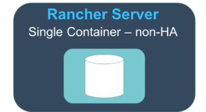
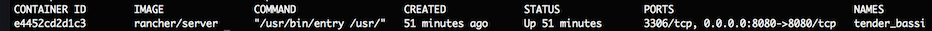
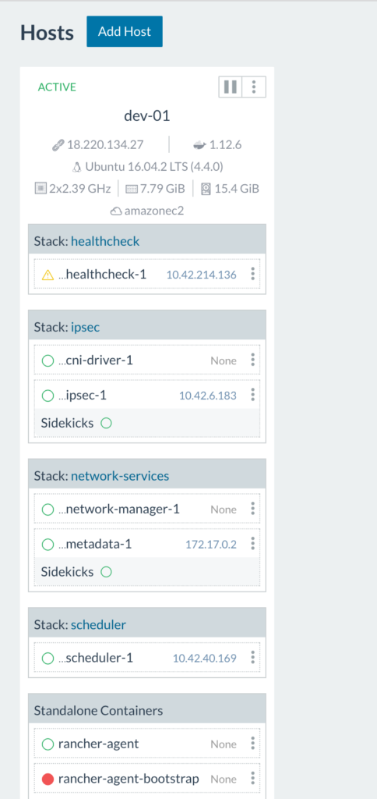
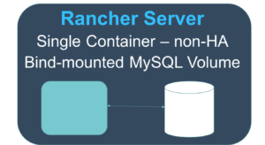
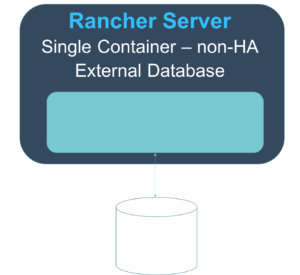
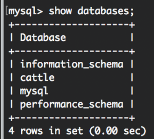
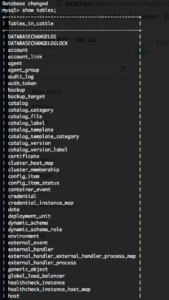
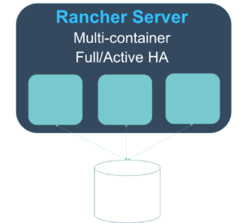

Update: This tutorial was updated for Rancher 2.x in 2019 [here](https://rancher.com/blog/2019/2019-01-10-migrating-single-node-2-1-x-to-high-availability/)

Any time an organization, team or developer adopts a new platform, there
are certain challenges during the setup and configuration process. Often
installations have to be restarted from scratch and workloads are lost.
This leaves adopters apprehensive about moving forward with new
technologies. The cost, risk and effort are too great in the business of
today. With Rancher, we’ve established a clear container installation and upgrade
path so no work is thrown away. Facilitating a smooth upgrade path is
key to mitigating against risk and increasing costs. This guide has two
goals:

1. Take you through the installation and upgrade process from a
   technical perspective.
2. Inform you of the different types of installations and their
   purpose.

With that in mind, we’re going to walk through the set-up of Rancher
Server in each of the following scenarios, with each step upgrading from
the previous one:

- Single Container (non-HA) - installation
- Single Container (non-HA)- Bind mounted MySQL volume
- Single Container (non-HA) - External database
- Full Active/Active HA - (upgrading to this from our previous set up)

A working knowledge of Docker is assumed. For this guide, you’ll need
one or two Linux virtual machines with the Docker engine installed and
an available MySQL database server. All virtual machines need to be able
to talk to each other, so be mindful of any restrictions you have in a
cloud environment (AWS, GCP, Digital Ocean etc.). [Detailed
documentation is located
here](https://rancher.com/docs/rancher/v1.6/en/installing-rancher/installing-server/#single-container).

## \*\*Single Container (non-HA) – Installation

\*\*

1. SSH into your Linux virtual machine
2. Verify your Docker
   installation with docker -v. You should see something resembling Docker
   version 1.12.x
3. Run sudo docker run -d --restart=unless-stopped -p
   8080:8080 rancher/server
4. Docker will pull the rancher/server
   container image and run it on port 8080
5. Run docker ps -a. You should
   see an output similar to this:
   
   (Note: remember the name or ID of the rancher/server container)
6. At this point, you should be able to go to http://<server\_ip>:8080 in
   your browser and see the Rancher UI.

You should see the Rancher UI with the welcome modal:  Since this is our initial set up, we need to add a host to our Rancher environment:

##### A Detailed Overview of Rancher's Architecture

This newly-updated, in-depth guidebook provides a detailed overview of the features and functionality of the new Rancher: an open-source enterprise Kubernetes platform.

[Get the eBook](https://more.suse.com/fy21-global-web-landing-page-rancher2-technical-architecture)

1. Click ‘Got it!’
2. Then click ‘Add a Host’. This first time you’ll see
   a Host Registration URL page: 
3. For this
   article, we’ll just go with whatever IP address we have. Click ‘Save’.
4. Now, click ‘Add a Host’ again. You’ll see this:  (note: the ports that have to been open for hosts to be able to communicate are 500 and
   4500.) From here you can decide how you want to add your hosts based on
   your infrastructure.
5. After adding your host(s) you should see something like this:
   

So, what’s going on here? The rancher-agent-bootstrap container runs once to get the rancher-agent up and running then stops (notice the red circle indicating a stopped container). As we can see above, the health check container is starting up. Once all infrastructure containers are up and running on the host you’ll see this:

Here we see all infrastructure containers (health check, scheduler, metadata, network
manager, IPsec, and cni-driver) are all up and running on the host.

> Tip:
> to view only user containers, uncheck ‘Show System’ in the top right
> corner of the Host view. Congratulations! You’ve set up a Rancher
> Server in a single container. Rancher is up and running and has a local
> MySQL database running inside of the container. You can add [items from
> the catalog](https://rancher.com/docs/rancher/v1.6/en/catalog/), deploy
> your own containers etc. As long as you don’t delete the rancher/server
> container, any changes you make to the environment will be preserved as
> we go to our next step.

## \*\*Single Container (non-HA) – Bind-mounted volume

\*\*

Now we’re going to take our existing Rancher server and upgrade it to
use a bind-mounted volume for the database. This way, should the
container die when we upgrade to a later version of Rancher, we don’t
lose the data for what we’ve built. In our next steps, we’re going to
stop the rancher-server container, externalize the data to the host,
then start a new instance of the container using the bind-mounted
volume. [Detailed documentation is located
here](https://rancher.com/docs/rancher/v1.6/en/upgrading/#single-container-bind-mount).

1. Let’s say our rancher/server container is named fantastic\_turtle.
2. Run docker stop fantastic\_turtle.
3. Run docker cp fantastic\_turtle:/var/lib/mysql <path on host> (Any
   path will do but using /opt/docker or something similar is not
   recommended). I use /data as it’s usually empty. This will copy the
   database files out of the container to the file system to /data. The
   export will put your database files at /data/mysql.
4. Verify the location by running ls -al /data You will see
   a mysql directory within the path.
5. Run sudo chown -R 102:105 /data. This will allow the mysql user
   within the container to access the files.
6. Run docker run -d -v /data/mysql:/var/lib/mysql -p 8080:8080   
   --restart=unless-stopped rancher/server:stable. Give it about 60
   seconds to start up.
7. Open the Rancher UI at http://<server\_ip>:8080. You should see
   the UI exactly as you left it. You’ll also notice your workloads
   that you were running have continued to run.
8. Let’s clean up the environment a bit. Run docker ps -a.
9. You’ll see 2 rancher/server Image containers. One will have a
   status of Exited (0) X minutes ago and one will have a status of Up
   X minutes. Copy the name of the container with exited status.
10. Run docker rm fantastic\_turtle.
11. Now our docker environment is clean with Rancher server running with
    the new container.

## \*\*Single Container (non-HA) - External database

\*\*

As we head toward an HA set up, we need have Rancher server running with
an external database. Currently, if anything happens to our host, we
could lose the data supporting the Rancher workloads. We’re going to
launch our Rancher server with an external database. We don’t want to
disturb our current set up or workloads so we’ll have to export our
data, import into a proper MySQL or MySQL compliant database and restart
our Rancher server that points to our external database with our data in
it.

1. SSH into our Rancher server host.
2. Run docker exec -it
   <container name> bash. This will give you a terminal session in
   your rancher/server container.
3. Run mysql -u root -p.
4. When prompted
   for a password, press [Enter].
5. You now have a mysql prompt.
   6.Run show databases. You’ll see this:
   
   This way we know we have the rancher/server database.
6. Run exit.
7. Run mysqldump -u root -p cattle > /var/lib/mysql/rancher-backup.sql
   When prompted for a password hit [Enter].
8. Exit the container.
   10.Run ls -al /data/mysql. You’ll see your rancher-backup.sql in the
   directory. We’ve exported the database! At this point, we can move the
   data to any MySQL compliant database running in our infrastructure as
   long as our rancher/server host can reach the MySQL database host. Also,
   keep in mind all this while your workloads that you have been running on
   the Rancher server and hosts are fine. Feel free to use them. We haven’t
   stopped the server yet, so of course they’re fine.
9. Move
   your rancher-backup.sqlto a target host running a MySQL database server.
10. Open a mysql session with your MySQL database server. Run mysql -u
    <user> -p.
11. Enter your decided or provided password.
12. 14. Run CREATE
    DATABASE IF NOT EXISTS cattle COLLATE = ‘utf8\_general\_ci’ CHARACTER
    SET = ‘utf8’;
13. Run GRANT ALL ON cattle.\* TO ‘cattle’@‘%’
    IDENTIFIED BY ‘cattle’; This creates our cattle user for
    the cattle database using the cattle password. (note: use a strong
    password for production)
14. Run GRANT ALL ON cattle.\* TO
    ‘cattle’@‘localhost’ IDENTIFIED BY ‘cattle’; This will allow us to
    run queries from the MySQL database host.
15. Find where you put your rancher-backup.sql file on the MySQL database host. From there, run mysql -u cattle -p cattle < rancher-backup.sql This says “hey mysql, using the cattle user import this file into the cattle
    database“. You can also use root if you prefer.
16. Let’s verify the
    import. Run mysql -u cattle -p to get a mysql session.
17. Once in, run use cattle; Then show tables; You should see something like this:
    

### Now we’re ready to bring up our Rancher server talking to our external

database.

1. Log into the host where Rancher server is running.
2. Run docker ps -a. Again, we see our rancher/server container is
   running:
3. Let’s stop our rancher/server. Again, our workloads will continue
   to run. Run docker stop <container name>’.
4. Now let’s bring it up using our external database. Run docker run
   -d --restart=unless-stopped -p 8080:8080 rancher/server --db-host
   <mysql host> --db-port 3306 --db-user cattle --db-pass cattle
   --db-name cattle. Give it about 60+ seconds for
   the rancher/server container to run.
5. Now open the Rancher UI at http://<server\_ip>:8080.

Congrats! You’re now running Rancher server with an external database
and your workloads are preserved.

## \*\*Rancher Server - Full Active/Active HA

\*\*

Now it’s time to configure our Rancher server for High Availability.
Running Rancher server in High Availability (HA) is as easy as running
Rancher server using an external database, exposing an additional port,
and adding in an additional argument to the command so that the servers
can find each other.
1. Be sure that port 9345 is open between the
Rancher server host and any other hosts we want to add to the cluster.
Also, be sure port 3306 is open between any Rancher server and the MySQL
server host.
2. Run docker stop <container name>.
3. Run docker run -d
--restart=unless-stopped -p 8080:8080 -p 9345:9345 rancher/server   
--db-host <mysql host> --db-port 3306 --db-user cattle --db-pass
cattle --db-name cattle --advertise-address <IP\_of\_the\_Node>
(\*note: Cloud provider users should use the internal/private IP
address). Give it 60+ seconds for the container to run. (note: if after
75 seconds you can’t view the Rancher UI, see the troubleshooting
section below)
4. Open the Rancher UI at http://<server\_ip>:8080.
You’ll see all your workloads and settings as you left them.
5. Click
on Admin then High Availability. You should see your single host you’ve
added. Let’s add another node to the cluster.
6. On another host, run
the same command but replacing the --advertise-address
<IP\_of\_the\_Node> with the IP address of the new host you’re adding
to the cluster. Give it 60+ seconds. Refresh your Rancher server UI.
7.
Click on Admin then High Availability. You should see both nodes have
been added to your cluster. 
8. Because we
recommend an odd number of Rancher server nodes, add either 1 or 3 more
nodes to the cluster using the same method. Congrats! You have a Rancher
server cluster configured for High Availability.

## **Troubleshooting & Tips**

During my time walking through these steps myself I ran into a few
issues. Below are some you might run into and how to deal with them.
Issue: Can’t view the Rancher UI after 75 seconds.
1. SSH into the
Rancher server host.
2. Confirm rancher/server is running. Run docker ps
–a. Given an output like this:

3. To view logs, run
`docker logs –t tender\_bassi` (in this case). If you see something
like this:  It’s Rancher being unable to reach the database server or authenticate with the credentials we’ve provided it in our start up command. Take a look at networking settings, username and password and access privileges in the MySQL
server.

*Tip: While you may be tempted to name your rancher/server
‘—name=rancher-server’ or something like it this is not recommended.
The reason for this is if you need to rollback to your prior container
version after an upgrade step, you’ll have clear distinction between
container versions.*

## **Conclusion**

So, what have we done? We’ve installed Rancher server as a single
container. We’ve upgraded the Rancher installation to a high
availability platform instance without impacting running workloads.
We’ve also established guidelines for different types of environments.
We hope this was helpful. Further details on upgrading are available
here <https://rancher.com/docs/rancher/v1.6/en/upgrading/>.
