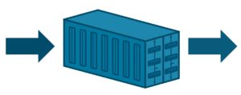

Docker
has been a source of excitement and experimentation among developers
since March 2013, when it was released into the world as an open source
project. As the platform has become more stable and achieved increased
acceptance from development teams, a conversation about when and how to
move from experimentation to the introduction of containers into a
continuous integration environment is inevitable. What form that
conversation takes will depend on the players involved and the risk to
the organization. What follows are five important considerations which
should be included in that discussion.

### Define the Container Support Infrastructure

When you only have a developer or two experimenting with containers, the
creation and storage of Docker images on local development workstations
is to be expected, and the stakes aren’t high. When the decision is made
to use containers in a production environment, however, important
decisions need to be made surrounding the creation and storage of Docker
images. Before embarking on any kind of production deployment journey,
ask and answer the following questions:

- What process will be followed when creating new images?

  - How will we ensure that images used are up-to-date and secure?
  - Who will be responsible for ensuring images are kept current,
    and that security updates are applied regularly?
- Where will our Docker images be stored?

  - Will they be publicly accessible on DockerHub?
  - Do they need to be kept in a private repository? If so, where
    will this be hosted?
- How will we handle the storage of secrets on each Docker image? This
  will include, but is not limited to:

  - Credentials to access other system resources
  - API keys for external systems such as monitoring
- Does our production environment need to change?

  - Can our current environment support a container-based approach
    effectively?
  - How will we manage our container deployments?
  - Will a container-based approach be cost-effective?

### Don’t Short-Circuit Your Continuous Integration Pipeline

 Free
eBook: Continuous Integration and Deployment with Docker and
Rancher Perhaps one of Docker’s best features is that a
container can reasonably be expected to function in the same manner,
whether deployed on a junior developer’s laptop or on a top-of-the-line
server at a state-of-the-art data center. Therefore, development teams
may be tempted to assume that localized testing is good enough, and that
there is limited value from a full continuous integration (CI) pipeline.
What the CI pipeline provides is stability and security. By running all
code changes through an automated set of tests and assurances, the team
can develop greater confidence that changes to the code have been
thoroughly tested.

### Follow a Deployment Process

In the age of DevOps and CI, we have the opportunity to deliver bug
fixes, updates and new features to customers faster and more efficiently
than ever. As developers, we live for solving problems and delivering
quality that people appreciate. It’s important, however, to define and
follow a process that ensures key steps aren’t forgotten in the thrill
of deployment. In an effort to maximize both uptime and delivery of new
functionality, the adoption of a process such as blue-green deployments
is imperative (for more information, I’d recommend Martin Fowler’s
description of [Blue Green
Deployment](https://martinfowler.com/bliki/BlueGreenDeployment.html)).
The premise as it relates to containers is to have both the old and new
containers in your production environment. Use of dynamic load balancing
to slowly and seamlessly shift production traffic from the old to the
new, whilst monitoring for potential problems, permits relatively easy
rollback should issues be observed in the new containers.

### Don’t Skimp on Integration Testing

Containers may run the same, independently of the host system, but as we
move containers from one environment to another, we run the risk of
breaking our external dependencies, whether they be connections to
third-party services, databases, or simply differences in the
configuration from one environment to another. For this reason, it is
imperative that we run integration tests whenever a new version of a
container is deployed to a new environment, or when changes to an
environment may affect the interactions of the containers within.
Integration tests should be run as part of your CI process, and again as
a final step in the deployment process. If you’re using the
aforementioned blue-green deployment model, you can run integration
tests against your new containers before configuring the proxy to
include the new containers, and again once the proxy has been directed
to point to the new containers.

### Ensure that Your Production Environment is Scalable

The ease with which containers can be created and destroyed is a
definite benefit of containers, until you have to manage those
containers in a production environment. Attempting to do this manually
with anything more than one or two containers would be next to
impossible. Consider this with a deployment containing multiple
different containers, scaled at different levels, and you face an
impossible task. []

When considering the inclusion of container technology as part of the DevOps
process and putting containers into production, I’m reminded of some
important life advice I received many years ago—“Don’t do dumb
things.” Container technology is amazing, and offers a great deal to
our processes and our delivery of new solutions, but it’s important that
we implement it carefully. *Mike Mackrory is a Global citizen who has
settled down in the Pacific Northwest – for now. By day he works as a
Senior Engineer on a Quality Engineering team and by night he writes,
consults on several web based projects and runs a marginally successful
eBay sticker business. When he’s not tapping on the keys, he can be
found hiking, fishing and exploring both the urban and the rural
landscape with his kids.*
