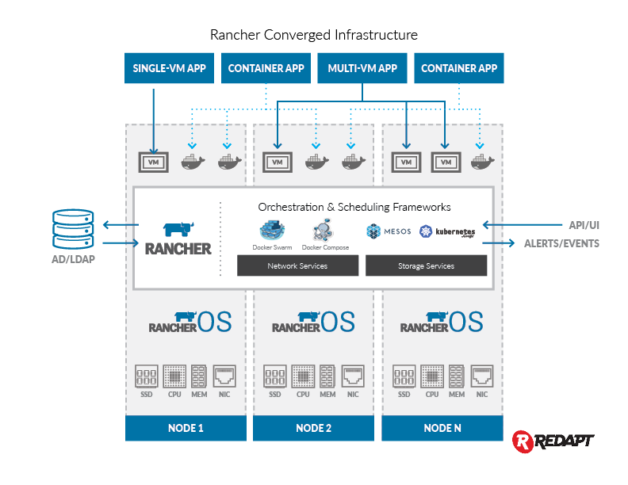
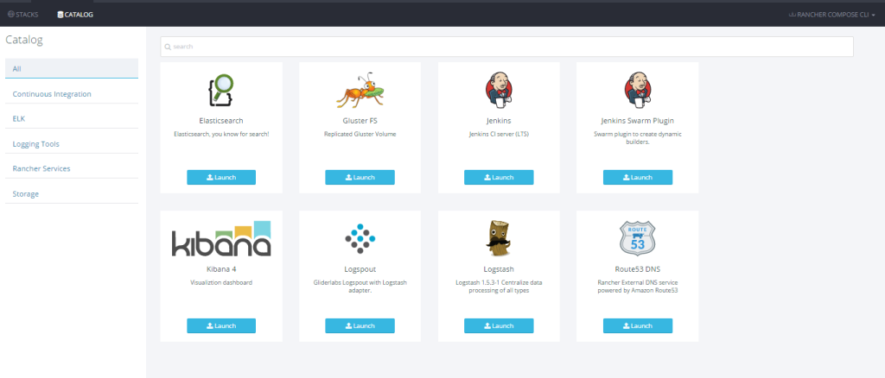

Hyper-Converged
Infrastructure is one of the greatest innovations in the modern data
center. I have been a big fan ever since I heard the analogy “[iPhone
for the data center](http://www.theregister.co.uk/2012/05/30/nutanix/)“
from Nutanix, the company who invented hyper-converged infrastructure.
In my previous roles as CEO of Cloud.com, creator of CloudStack, and CTO
of Citrix’s CloudPlatform Group, I helped many organizations transform
their data centers into infrastructure clouds. The biggest challenge was
always how to integrate a variety of technologies from multiple vendors
into a coherent and reliable cloud platform. Hyper-converged
infrastructure is an elegant solution to this complexity, that makes
infrastructure consumable by offering a simple turn-key experience.
Hyper-convergence hides the underlying complexity and makes the lives of
data center operators much better. Typically, hyper-converged
infrastructure is used to run virtual machines (VMs), the popular
workload running in data centers today. The nature of data center
workloads, however, are changing. In the last year, Docker containers
have become a significant type of workloads in data centers. Because of
this, we are beginning to see market demand for purpose-built and
optimized infrastructure solution for containers. Today, our team at
Rancher [announced a hyper-converged infrastructure platform for
containers](http://www.businesswire.com/news/home/20151111006591/en/Rancher-Labs-Redapt-Introduce-Hyper-Converged-Infrastructure-Platform),
powered by Rancher and Redapt. This is a turn-key solution to stand up a
complete container service platform in the data center. Organizations no
longer need to source hardware, deploy virtualization and cloud
platforms, and integrate separate container orchestration systems.

### Support for both VMs and Container Infrastructure

We designed the solution to support both VMs and containers, following
the approach used by Google to [run virtual machines in
containers](http://www.enterprisetech.com/2014/05/28/google-runs-software-containers/).
We have experimented with this approach in our
[RancherVM](https://rancher.com/introducing-ranchervm-package-and-run-virtual-machines-as-docker-containers/)
project since April and have received a lot of positive feedback from
users. A benefit of running VMs inside containers is the ability to
leverage the same tools to manage both VMs and containers. Because VMs
and containers in fact behave in similar ways, the Rancher CLI and UI we
have developed for Docker containers seamlessly applies to VMs. We use
[RancherOS](https://rancher.com/rancher-os/) as the base operating system
for the converged infrastructure platform. The RancherOS kernel has
builtin support for KVM. The following figure depicts how Rancher and
RancherOS work together to form the complete software stack for our
hyper-converged infrastructure solution.

### Containerized Storage Services

All hyper-converged infrastructure solutions include a distributed
storage implementation. By leveraging our [other major announcement
today, Persistent Storage
Services](https://rancher.com/how-rancher-storage-services-unleash-the-power-of-software-defined-storage/),
this hyper-converged infrastructure solution has the unique ability to
use multiple distributed storage implementations. Users have the freedom
to deploy the software storage platform that suits the needs of their
applications. This approach reduces failure domain and improve
reliability. Failure of a distributed storage deployment can only impact
the application that consumes that storage. Users can deploy open source
and commercial storage software, as long as the storage software is
packaged as Docker containers. We are incorporating Gluster and
NexentaEdge into our hyper-converged infrastructure platform, and plan
to support additional storage products in the future. 

### Access to the Docker Image Ecosystem

Successful hyper-converged infrastructure solutions often target popular
application workload, such as databases or virtual desktops. The Docker
ecosystem offers a rich set of applications that can run on the Rancher
hyper-converged infrastructure solution. DockerHub alone, for example,
contains hundreds of thousands of Docker images. In addition, Rancher
makes it easy to run not just single containers, but large application
clusters orchestrated by new container frameworks such as Compose,
Swarm, and Kubernetes. Rancher Labs has certified and packaged a set of
popular DevOps tools. With a single click, users can deploy, for
example, an entire ELK cluster on the hyper-converged infrastructure.

### Our Partnership with Redapt

We
have known and worked with Redapt team for many years. Back in 2011, my
team at Cloud.com collaborated with Redapt to build one of the largest
CloudStack-powered private clouds at the time, consisting of over 40,000
physical servers. We were deeply impressed by the technical skills, the
ability to innovate, and the professionalism of the Redapt team.
Creating a hyper-converged infrastructure solution requires close
collaboration between the hardware and software vendors. We are
fortunate to be able to work with Redapt again to bring to market the
industry’s first hyper-converged infrastructure for containers solution.

### Availability

Rancher and Redapt are working with early access customers now. We plan
to make the hyper-converged infrastructure solution generally available
in first half of 2016. Please request a demo if you would
like to speak with one of our engineers about converged infrastructure,
or register for our next online meetup, where we will be demonstrating
this new functionality. *Sheng Liang is the
CEO and co-founder of Rancher Labs. You can follow him on Twitter at
@shengliang.*
