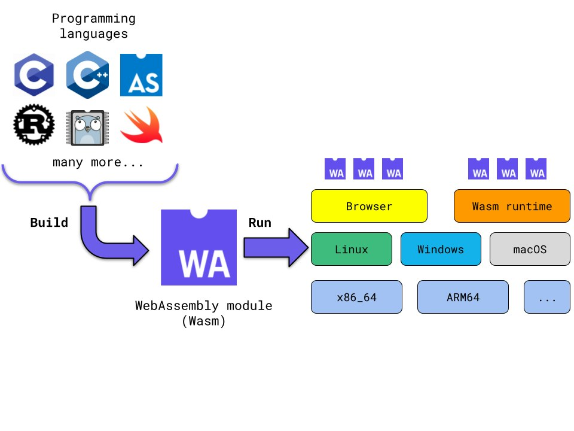

# Introducing Kubewarden, an Open Source Policy Engin

Security has always been a wide and complex topic. A [recent survey](https://security.stackrox.com/state-of-container-and-kubernetes-security-fall-2020.html) from StackRox about the state of containers and Kubernetes security provides some interesting data on these topics. In this blog post, I'll dive into some of the findings of that survey and introduce you to Kubewarden, an open source policy engine.

## Security Measures and Skills are Lacking

A staggering 66 percent of the survey participants do not feel confident enough in the security measures they have in place. Their companies are investing energy and resources in creating DevSecOps roles to address this problem, but unfortunately, this task is not progressing as smoothly as planned. 

Looking more into the survey, we discover that many companies are struggling with a [shortage of skills](https://www.suse.com/c/suse-partners-with-udacity-to-address-the-skills-gap-affecting-recent-college-graduates-src/). Not many professionals are proficient with both security and cloud native topics. Moreover, growing these competencies takes quite some time because there’s a steep learning path to master both of them.  

There are many other interesting data points in these survey results. However, I'd like to highlight one last metric: only 16 percent of participants implement security policies as code. 

This number surprised me because the trend of “Everything-as-Code" is nothing new -- in fact, it's quite the opposite. This well-established pattern is changing many parts of the IT industry and practices. As a matter of fact, some projects in the Kubernetes ecosystem are already addressing the topic of policy-as-code. 

I have advocated using some of these projects in the past, but I have to admit that I never spent too much time creating new policies from scratch. I embarked on this journey, and after some trial and error, I better understood StackRox’s survey participants' pain points. 

## Challenges with Writing Security Policies

Creating policy-as-code with the current policy frameworks requires a significant investment in time. There’s a reasonable amount of documentation, but most focus on simple policies. I personally found it difficult to write non-trivial ones. 

Policy as code is just a matter of writing validation logic that processes some input data. During this learning journey, I ended up many times in situations where I knew exactly how the validation logic should be written using a regular programming language, but I found myself mentally stuck: I didn’t know how to translate all of that in the domain-specific language imposed by the policy framework. 

Several times I found myself searching Google and Stack Overflow for how to write what I would consider trivial code using a regular programming language. That frustrated me; I wasn’t progressing as fast as I would have liked. 

With this first-hand experience, I reached out to customers and people from the field. It turns out that they face the same challenges. They see the benefits of having policies as codes but struggle to write them. 

Some companies are trying to address this topic by growing experts among their ranks. This is something that takes time and, worse of all, it doesn’t scale. These companies have only a handful of people who know how to write and review policies. They must deliver all the “policy as code” work. As a result, these DevSecOps folks are under high stress and represent a bottleneck. 

Other companies have outsourced the process of writing policies to external consultants. This approach has its own drawbacks. Writing these policies requires knowledge of internal processes and applications/infrastructure operational details. Explaining all that takes time; this must be done every time something changes. Finally, these companies have a hard time reviewing the policies provided by external consultants because they obviously lack the skills needed to understand them. Hence, they have to blindly trust these policies. 

## A Way Around the Security Policy Learning Curve

As I learned, the biggest obstacle for a policy author is the steep learning curve needed to write policies. It takes time to become comfortable with the coding paradigms that existing solutions impose -- especially because these paradigms differ from what developers are used to. 

Wouldn't it be great to be able to reuse existing knowledge? If only there were a way to write policy as code using a programming language of your choice. If that were possible, suddenly teams who want to write policies as code would be able to tap into their existing skills and significantly reduce the barrier to entry. 

These and more questions led to the Kubewarden project's creation. 

## Introducing Kubewarden: An Open Source Policy Engine for Kubernetes

Kubewarden is an open-source policy engine. It integrates with Kubernetes using the widely adopted Webhook Admission Control mechanism. The project provides a set of Kubernetes Custom Resources that simplify the process of enforcing policies on a cluster. So far, this sounds like an existing solution. Kubewarden differentiates itself in the way it creates, distributes and executes policies. 

For starters, Kubewarden policies can be written in almost any programming language. This is possible because Kubewarden leverages the power of WebAssembly. 

### How WebAssembly Works

If you're unfamiliar with WebAssembly, it's a portable binary execution format. To put it in layman's terms, WebAssembly is a compilation target for many programming languages. That means you can compile some source code and, instead of having a Linux/Windows/macOS executable or library, you have a so-called WebAssembly module. Then you can execute this binary artifact using a dedicated runtime on your chosen platform and operating system. 

This is summarized by the drawing below: 

 

WebAssembly started as a solution to expand the capabilities of modern web browsers. However, it's gone beyond the browser, with many interesting use cases emerging. 

## Creating, Building, and Running Kubewarden Security Policies

Kubewarden is one of these emerging use cases: its policies can be written in any programming language and compiled into a WebAssembly module.  

Kubewarden policies are truly portable binary artifacts. Thanks to the power of WebAssembly, you can build your policy on a macOS host powered by an Apple Silicon chip and then deploy the resulting artifact on top of a Kubernetes cluster made of x86\_64 Linux nodes. 

On top of being polyglot and portable, WebAssembly is also secure. WebAssembly was originally conceived as a way to enrich web applications. This can be a huge security risk when browsers have to run WebAssembly modules downloaded from the web on an end-user computer. That’s why, by design, WebAssembly modules are executed inside dedicated sandboxes. These sandboxes put tight constraints on the WebAssembly module execution by limiting access to the host memory, filesystem, devices, and more. Even though this sounds similar to how containers operate, the level of isolation and limits on WebAssembly programs is far more stringent. 

Going back to Kubewarden, all our policies are WebAssembly modules that are loaded and run by our policy server. Each policy lives inside its own sandbox without access to the host environment. The policy server receives the AdmissionReview requests originated by Kubernetes and then uses the relevant policies to evaluate them. 

## Distributing Security Policies with Kubewarden

So far, we covered creating, building and running Kubewarden policies. But what about policy distribution? Kubewarden has two solutions to this problem. 

The first approach consists of hosting the Kubewarden policy binary on a regular web server. This is a pretty straightforward approach that can work well in many circumstances. The other approach, which happens to be my favorite, leverages regular container registries as a way to store and distribute policies. 

Kubewarden policies can be pushed and pulled to/from container registries as OCI artifacts. If you are unfamiliar with the concept of OCI artifact, there’s nothing too new to learn about. This is just a way to increase the flexibility of regular container registries by allowing them to store other kinds of artifacts in addition to regular container images. Most container registries, like those from Amazon, Azure, Google and GitHub offer this ability out of the box. The same applies to many other self-hosted solutions. 

Everybody has one or more container registries in place to serve the container images consumed by Kubernetes. These registries are also secured with custom-made access rules. Storing Kubewarden policies allows you to reuse this infrastructure from an operational and security point of view. This is why it's my favorite distribution mechanism for Kubewarden policies.  

I hope this overview of Kubewarden sparked your interest. As a Kubernetes administrator, getting started with Kubewarden is just a Helm chart away. Visit our [documentation](https://docs.kubewarden.io/) and follow our quickstart guide. Finally, don’t forget to check out our [Policy Hub](https://hub.kubewarden.io/), where you can find ready-to-use Kubewarden policies.

If you are an aspiring policy author, go to our [documentation](https://docs.kubewarden.io/) and follow one of the step-by-step tutorials that guides you through the process of creating your first policy. Right now, we have policies written with Rust, Go, AssemblyScript and Swift. The WebAssembly ecosystem is growing daily, with more languages supported or underway.

Whether you are a Kubernetes administrator or a policy author, we look forward to knowing what you achieved with Kubewarden and what we can do to further smooth your security journey in the cloud native world. Let us know in the comments below.
