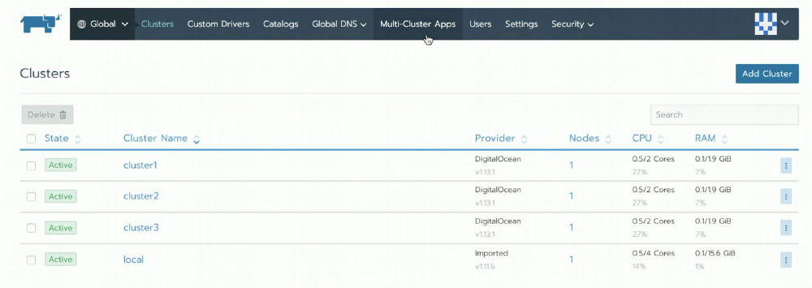
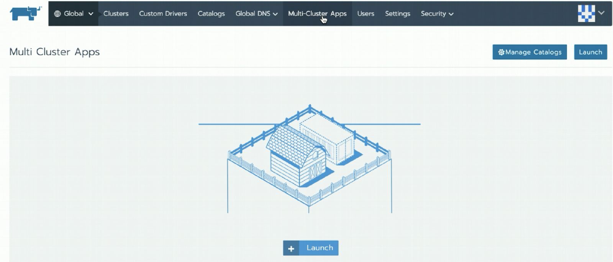
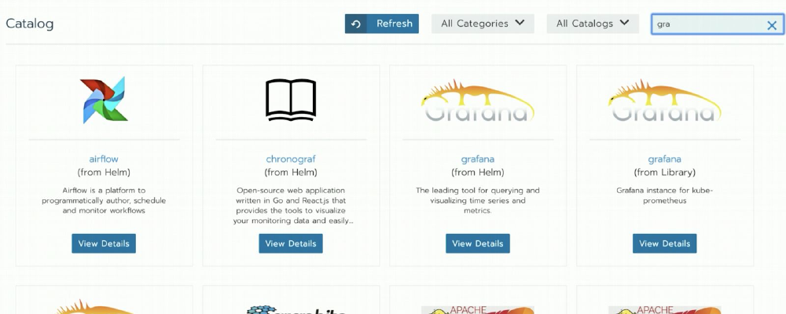
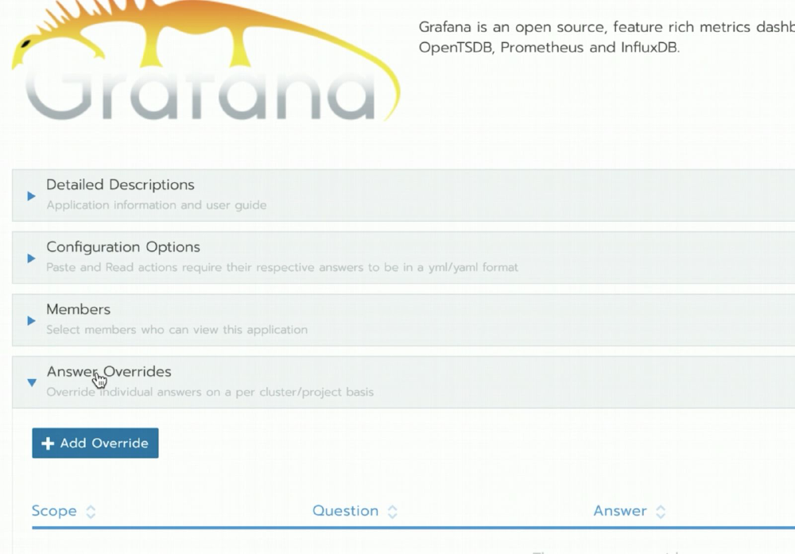
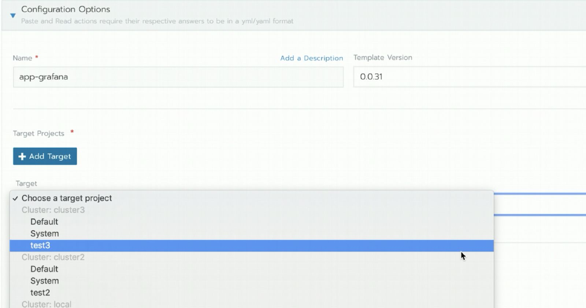
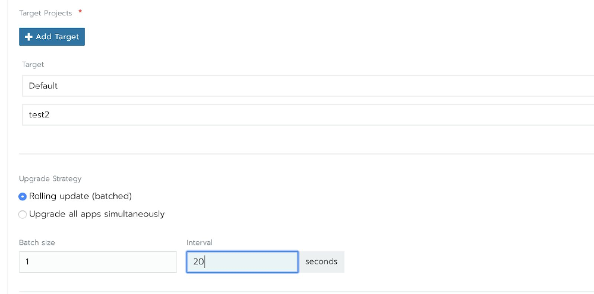
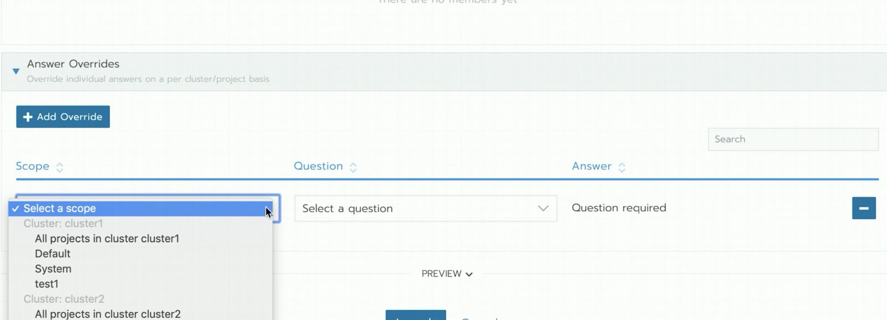
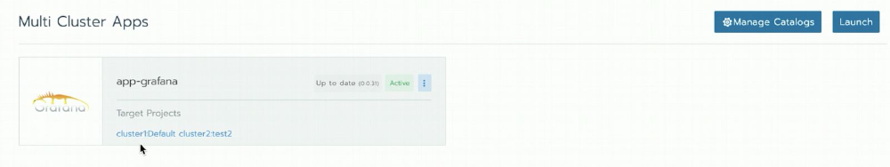
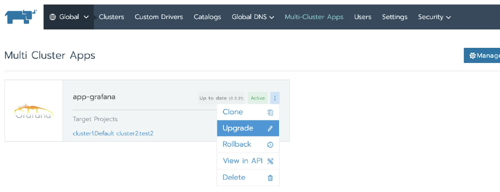

Test this feature in your lab or dev environment[Install Rancher 2.2 Preview 2](https://rancher.com/docs/rancher/v2.x/en/installation/server-tags/#helm-chart-repositories)

## Introduction

I’m excited to announce the release of Rancher 2.2 Preview 2, which contains a number of powerful features for day two operations on Kubernetes clusters.

Please visit our [release page](https://www.rancher.com/products) or the [release notes](https://github.com/rancher/rancher/releases/tag/v2.2.0-alpha6) to learn more about all of the features we shipped today.

In this article I introduce one of the features: multi-cluster applications. Read on to learn how this will dramatically reduce your workload and increase the reliability of multi-cluster operations.

## Overview

If you’ve been using Kubernetes and have two or more clusters, you are familiar with at least one of the following use cases:

- Applications have higher fault tolerance when deployed across multiple availability zones (AZs)
- In edge computing scenarios with hundreds of clusters, the same application needs to run on multiple clusters.

In the high reliability use case operators often mitigate the risks associated with running in a single AZ by pulling nodes from a multiple AZs into a single cluster. The problem with this approach is that even though it resists the failure of an AZ, it will not withstand a failure of the cluster itself. The likelihood of a cluster failure is higher than that of an AZ failure, and if the cluster fails, it might affect the applications running within it.

An alternate approach is to run a separate cluster in each AZ and run a copy of the application on each cluster. This process treats each Kubernetes cluster as its own availability zone, but manually maintaining applications on each cluster is both time consuming and prone to error.

The edge computing use case suffers from the same issue as the multi-AZ cluster: maintenance of the application is either manual, time-consuming, and prone to error, or else the operations team has created sophisticated scripts to handle deployments and upgrades. This additional process overhead moves the point of failure to a different location in the workflow. These scripts require support and maintenance, and they introduce a dependency on the person or people with the knowledge to not only codify the process, **but also to understand and manually execute the process if the scripts fail.**

Beginning with Rancher 2.2 Preview 2, available from the `2.2.0-alpha6` [release tag](https://github.com/rancher/rancher/releases/tag/v2.2.0-alpha6) and up, Rancher will simultaneously deploy and upgrade copies of the same application on any number of Kubernetes clusters.

This feature extends our powerful Application Catalog, built on top of the rock-solid Helm package manager for Kubernetes. Before today the Application Catalog features only applied to individual clusters. We’ve added an additional section at the Global level where those with the correct privileges can deploy apps to any cluster managed by Rancher.

For a full demonstration of this feature and other features released with Rancher 2.2 Preview 2, join us for the upcoming online meetup, where we’ll give a live demo of the features and answer any questions you have.

Read on for a quick introduction to how multi-cluster applications work in Rancher.

## Feature Quick Start

- When you log in to Rancher, you will see a list of all the clusters it manages. You will also see a new global menu item - **Multi-Cluster Apps**.

- After clicking **Multi-Cluster Apps**, you will see two buttons, **Manage Catalogs** and **Launch**. **Manage Catalogs** takes you to the **Catalogs** configuration screen where you can enable the main Helm repositories or add additional third-party Helm repositories.
- Click the **Launch** button to launch a new application.

- Rancher now shows a list of all the applications you can deploy. We will select Grafana.

- The next screen asks for configuration details. Choose the settings and the corresponding values using either the form or direct YAML input. The settings you choose here will be common across all the clusters to which Rancher will deploy this application.

- Under **Configuration Options** select the target clusters within the **Target Projects** dropdown. This list not only shows you the available clusters, but it also asks that you choose a specific Project within the destination cluster.

- Choose an upgrade strategy. For our demo, we will choose “Rolling Update” and provide a batch size of 1 and an interval of 20 seconds. When we do an upgrade in the future, this setting assures that Rancher will update the clusters one at a time, with a delay of 20 seconds between each.

- If you need to make adjustments to account for the differences between each cluster, you can do so in the **Answer Overrides** section.

- When you’re ready, click **Launch** at the bottom of the page. You will then see a page that shows all of the deployed multi-cluster apps for your installation. Each will show its current status and a list of the target clusters and projects.

- When an upgrade is available for the application, Rancher will show **Upgrade Available** as the application status.
- To initiate an upgrade, click on the hamburger menu (the menu with the three dots) in the Grafana box and choose **Upgrade**.

- Verify that the “Rolling Update” option is selected.
- Change some settings and click on the **Upgrade** button at the bottom of the page.

If you navigate to the Workloads tab of the target clusters, you’ll see one of them change its status to **Updating**. This cluster will update, then Rancher will pause for 20 seconds (or for the interval you chose) before continuing to the next cluster and updating its copy of the application.

## Conclusion

Multi-cluster applications will reduce the workload of operations teams and make it possible to deploy and upgrade applications quickly and reliably across all clusters.

To test these features in your lab or development environment, install [the latest alpha release](https://ranchermanager.docs.rancher.com/getting-started/installation-and-upgrade/resources/choose-a-rancher-version). If you have any feedback, please [open an issue on Github](https://github.com/rancher/rancher/issues), or join us in [the forums](https://forums.rancher.com/) or [on Slack](https://slack.rancher.io).

Test this feature in your lab or dev environment[Install Rancher 2.2 Preview 2](https://rancher.com/docs/rancher/v2.x/en/installation/server-tags/#helm-chart-repositories)
