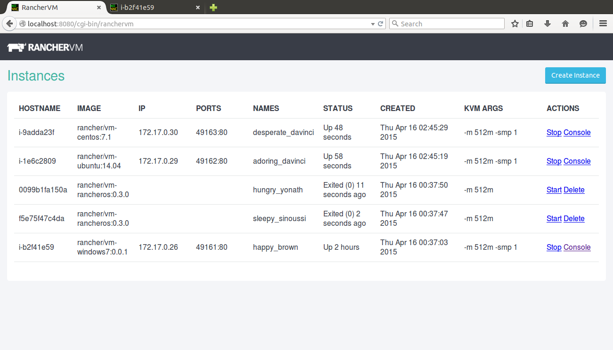
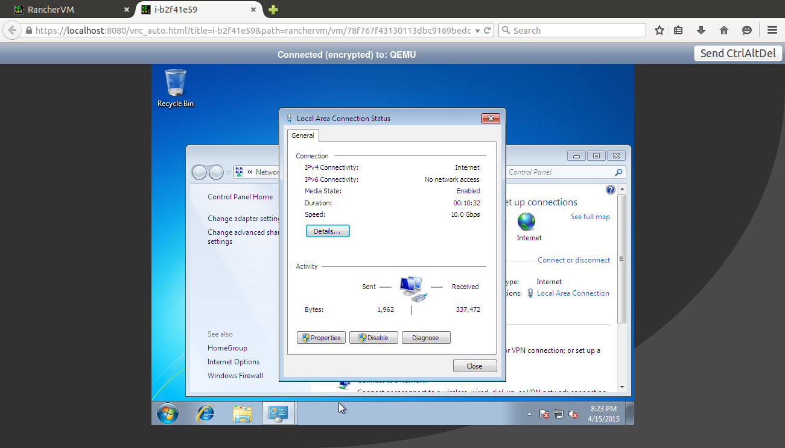

Expert Training in Kubernetes and RancherJoin our free online training sessions to learn more about Kubernetes, containers, and Rancher.[Sign up here](https://rancher.com/training/)

Virtual machines and containers are two of my favorite technologies. I
have always wondered about different ways they can work together. It has
become clear over time these two technologies compliment each other.
True there is overlap, but most people who are running containers today
run them on virtual machines, and for good reason. Virtual machines
provide the underlying computing resources and are typically managed by
the IT operations teams. Containers, on the other hand, are managed by
application developers and devops teams. I always thought this was a
good approach, and that for most use cases containers would reside
inside virtual machines. Then, a few months ago, a meeting with Jeremy
Huylebroeck of Orange Silicon Valley changed my thinking. Jeremy
mentioned it might make sense to run virtual machines *inside*
containers. At first the concept seemed odd. But the more I thought
about it the more I saw its merit. Interestingly numerous use cases for
**VM containers** started to appear in our conversations with Rancher
users. We have heard three common use cases for VM containers:

1. **Isolation and security**. The first reason one might want to run
   VM containers is to retain the isolation and security properties of
   virtual machines while still being able to package and distribute
   software as Docker containers. Despite the great deal of progress in
   container security, virtual machines are still better at isolating
   workloads. Compared with hundreds of Linux kernel interfaces,
   virtual machines have a smaller surface area (CPU, memory,
   networking and storage interfaces) to protect. It is thus not
   surprising that folks who want to host untrusted workloads (for
   example, managed hosting companies and continuous integration
   services) have expressed interest in continuing to use virtual
   machines.
2. **Docker on-boarding**. On-boarding existing workloads is always a
   challenge for organizations starting to adopt container
   technologies. This is a second interesting use case for VM
   containers, as they offer a useful transition path. For example,
   while we expect a future version of Windows to support Docker
   containers natively, VM containers can enable organizations to run
   existing Windows virtual machines on the same infrastructure built
   for Linux containers today. The same approach applies to other
   non-Linux operating systems and older version of Linux operating
   systems or application packages that have not yet been
   containerized.
3. **KVM management**. We have also seen a great deal of interest in
   better management tools for open source virtualization technologies
   like KVM. At its core, KVM is solid. It is reliable and efficient.
   However, KVM lacks the rich management tools in vSphere that IT
   operations teams love. KVM can benefit from Docker, which offers a
   superb experience for application developers and devops teams. If
   KVM runs inside Docker containers, the resulting VM container can
   retain the security, reliability, and efficiency of KVM, while
   offering the Docker management experience devops teams love. The
   ability to package virtual machines as Docker images and distribute
   them through Docker Hub is valuable. Powerful service discovery
   mechanisms developed for containers can now apply to virtual
   machines. Native container management systems like Rancher can now
   be used to manage virtual machine workloads at large scale.

Because of all of these use cases, I started experimenting with running
KVM inside Docker containers, and I have come up with an experimental
system called **RancherVM**. RancherVM allows you to package KVM images
inside Docker images and manage VM containers using the familiar Docker
commands. A VM container looks and feels like a regular container. It
can be created from Dockerfile, distributed using DockerHub, managed
using docker command line, and networked together using links and port
bindings. Inside each VM container, however, is a virtual machine
instance. You can package any QEMU/KVM image as RancherVM containers.
RancherVM accomplishes all this without introducing any performance
overhead against running KVM without containers.  RancherVM additionally comes with a
management container that provides a web UI for managing virtual
machines. The following command starts the RancherVM management
container on a server where Docker and KVM are installed:

```
docker run -v /var/run/docker.sock:/var/run/docker.sock -p 8080:80 -v /tmp/ranchervm:/ranchervm rancher/ranchervm
```

Once the management container is up, you can access a web-based virtual
machine management experience for VM containers at
`https://<kvmhost>:8080/`:
 The web-based UI allows you to perform basic life-cycle
operations for VM containers and access the VNC console for virtual
machines. VNC console access comes in handy when you need to perform
operations that cannot be performed with remote SSH or RDP, such as
troubleshooting a Windows VM’s network configuration:
 The web UI experience is attractive for users familiar
with VM management tools. A great benefit of RancherVM vs. traditional
VM management is we can now use the powerful Docker command lines to
manage virtual machines. The following command, for example, starts a
RancherOS VM:

```
docker run -e "RANCHER_VM=true" --cap-add NET_ADMIN -v /tmp/ranchervm:/ranchervm --device /dev/kvm:/dev/kvm --device /dev/net/tun:/dev/net/tun rancher/vm-rancheros
```

Other than some command-line options required to setup a Docker
container to host KVM, this is just a normal docker command used to
instantiate a container image called `rancher/vm-rancheros`. Additional
docker commands like `docker stop`, `docker ps`, `docker images`, and
`docker inspect` all work as expected. The following video shows the
live experience of using RancherVM.

Today we’re making RancherVM available on
[GitHub](http://github.com/rancherio/vm). I hope the initial release of
RancherVM gives you some ideas about building and using VM containers.
If you are interested, please check out the demo video, download the
software, and create some VM containers for yourself. If you have any
questions or issues, please file them as issues in GitHub and we’ll
respond as quickly as possible. On May 13th we will be hosting an online
meetup to demonstrate RancherVM, show a few use cases, and answer any
questions you might have. Please register to attend below.

Expert Training in Kubernetes and RancherJoin our free online training sessions to learn more about Kubernetes, containers, and Rancher.[Sign up here](https://rancher.com/training/)
