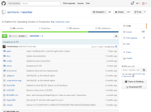

Today
we announced the [beta availability
of Rancher](https://rancher.com/press-release-rancher-labs-announces-beta-availability-of-rancher/),
our open source Docker infrastructure and management software. It is an
exciting day for our team, and a great opportunity to say thank you to
all the people who have worked on the open source Rancher project,
blogged and tweeted about using Rancher, and helped other new users on
our support groups. For the last seven months, Rancher has been an alpha
project, and throughout that time we’ve had a wonderful group of early
users and testers trying out the product, suggesting enhancements,
documenting bugs, and contributing code. We’ve added an enormous
number of new features, which we’ve been talking about here in this
blog as they appeared in the product, and documented lots of interesting
use cases for how you might use Rancher to manage Docker deployments. By
making Rancher available as a beta, we are indicating a new phase in the
development of Rancher. During alpha, we prioritized pace of development
and achieving minimum viability over stability and backward
compatibility. Now as we start the beta, we are focused on the
robustness of the platform, user experience and completeness of
features. Just this week we implemented new documentation websites
for [Rancher](https://rancher.com/docs/rancher/)and
[RancherOS](https://rancher.com/docs/os/) to provide more clarity on how
to use our projects. As always, Rancher

is open source software, and we hope you’ll take the time to [download
the Rancher beta from
GitHub](https://github.com/rancher/rancher#installation) and set up an
environment to test it out. As we go through beta we will continue to
introduce new features to Rancher, and we hope you’ll give us your
feedback on how you like the platform. Please submit
any [issues](https://github.com/rancher/rancher/issues)you encounter
to GitHub, and don’t hesitate to make suggestions or submit pull
requests. We are also running a [formal beta
program](https://info.rancher.com/beta) for anyone who needs additional
support with Rancher, and would like more input on the product
direction. Participants in the beta program receive:

- Implementation and configuration support for Rancher.
- Access to Rancher’s engineering team for troubleshooting and bug
  fixes throughout the beta.
- Road map discussions with Rancher’s product management team.
- Online training for employees on using Docker and Rancher.

In exchange for these benefits, we ask that participants work with our
team, to provide feedback on product functionality, suggestions for
enhancements, and document any issues they encounter. Anyone is welcome
to apply to the beta program, however at this point we will only be
accepting a small number of participants. I hope you’ll consider
[applying](https://info.rancher.com/beta). Thank you once again to
everyone who participated in the Rancher alpha program. Tomorrow, June
16th, we will be hosting an online
meetup to talk about
the latest features in Rancher, If you’re interested in getting a
closer look at Rancher, please register now by clicking
the button below.
