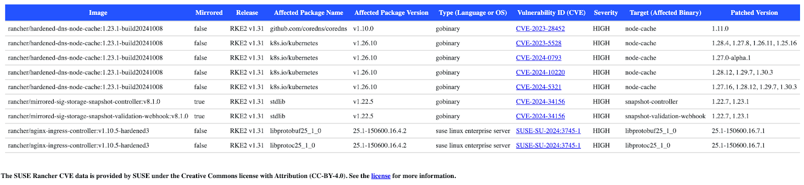

At SUSE, we’re always looking for ways to make it easier for customers to maintain secure, enterprise-grade environments. The **Rancher Security team** is excited to announce the public beta launch of the **Rancher CVE Portal**, available now at [**scans.rancher.com**](https://scans.rancher.com). This new resource is a significant step forward in providing clear, actionable visibility into vulnerabilities affecting Rancher and its associated dependencies.

The portal represents our commitment to security and transparency, offering customers and users an up-to-date, centralized source of critical and high-severity **Common Vulnerabilities and Exposures (CVEs)** for Rancher-related images. This has been a longstanding customer request, and we’re thrilled to deliver a solution that streamlines access to this critical information.

### **What is the Rancher CVE Portal?**

The **Rancher CVE Portal** provides a curated list of vulnerabilities for Rancher and related solutions, including but not limited to: **Rancher**, **RKE2**, **Longhorn** and **Harvester.**

The portal covers the latest stable versions, as well as development and head versions, for all supported release lines. CVEs are organized in tables by version, with raw CSV data also available for download.

This portal serves as the **single source of truth** for all internally identified critical and high-severity CVEs in our container images. Whether you're a customer managing production workloads or an open-source user evaluating vulnerabilities, the portal makes it easy to stay informed.

Additionally, the public repository used to build the site is available on [GitHub](https://github.com/rancher/scans), ensuring full transparency and alignment with our broader community practices.

### **Enterprise-Grade Security for SUSE® Rancher Prime Customers**

For **SUSE® Rancher Prime customers**, this portal is part of SUSE’s broader commitment to **secure software supply chains**. It’s not just about identifying vulnerabilities but ensuring they are addressed promptly and effectively:

- **Timely CVE Patching**: SUSE® Rancher Prime customers benefit from rapid response to critical and high-severity CVEs, with patches provided on a priority basis to keep your infrastructure secure.
- **Streamlined Updates**: Updates aligned with SUSE’s enterprise-grade release processes ensure minimal disruption to your operations.
- **Simplified Compliance**: Having a clear list of CVEs makes it easier for customers to meet regulatory requirements and demonstrate adherence to security best practices.

Prime customers also gain exclusive access to enhanced features in the future, with a roadmap of **premium tools and data integrations** designed to provide even greater visibility and control over security vulnerabilities.

This portal consolidates all relevant Rancher-related CVE information into one location, ensuring you can quickly find the vulnerabilities affecting your environment and take action.

### **CVE Portal in action**

Jane, a platform operator, is  responsible for ensuring her company’s Kubernetes workloads run securely and reliably. Every morning, Jane sifts through security updates and CVE reports to identify vulnerabilities that could impact their Rancher-managed clusters. This process is time-consuming and often feels like piecing together a puzzle from scatter sources. Then, Jane hears about the Rancher CVE Portal,  a centralized place where she can find up-to-date, actionable information on critical and high-severity vulnerabilities for Rancher related images. Jane quickly bookmarks the portal, excited by how it simplifies her workflow and helps her address security risks proactively.

---

John, the head of infrastructure, oversees a large team tasked with maintaining secure, enterprise-grade environments for his organization. He’s always looking for tools that enhance his team’s efficiency and give him confidence in the security posture of their systems. When John learns about the public beta launch of the CVE Portal, he immediately sees its value. With [scans.rancher.com](https://scans.rancher.com), John’s team can now access a single source of truth for Rancher-related vulnerabilities, eliminating the guesswork and helping them respond faster to emerging threads.

###

###

### **Next Steps for the CVE Portal**

The CVE portal is currently in **public beta**. Over the coming months, we’ll continue testing and gathering feedback from our users on the portal. Once the initial testing phase is complete, the portal will be moved to **stable release status**.

We’re also working on creating **Knowledge Base (KB) articles** that will provide detailed guidance on navigating the portal, interpreting the data, and leveraging it for operational decision-making.

The basic functionality of the CVE portal will remain free and open to all users, reflecting our commitment to the broader community. However, SUSE® Rancher Prime customers can expect **exclusive enhancements** as we expand the portal’s features in the future.

### **Your Feedback is Valued**

WE built this portal with you in mind,nand we want to ensure it meets your needs. If you have feedback on the portal, please share it with your SUSE contact. Your insights will help us make this tool even more valuable for your organization and others in the Rancher community.

### **Get Started Today**

Explore the Rancher CVE Portal at [**scans.rancher.com**](https://scans.rancher.com) and see how we’re making it easier to secure your Rancher workloads. If you’re a SUSE® Rancher Prime customer, rest assured that our engineering and security teams are already addressing vulnerabilities with timely patches and priority updates.

At SUSE, we’re dedicated to providing enterprise-ready solutions that empower our customers to operate with confidence. This CVE portal is just one of many ways we’re helping you build a secure, resilient future for your Kubernetes ecosystems. If you would like to know more about how we triage CVEs in our dependencies, please read our knowledge base article: [SUSE Rancher’s CVE Triage Workflow for Software Dependencies](https://www.suse.com/support/kb/doc/?id=000021574).

For more information on SUSE® Rancher Prime and our security solutions, contact your SUSE representative or visit [our website](https://www.suse.com).
