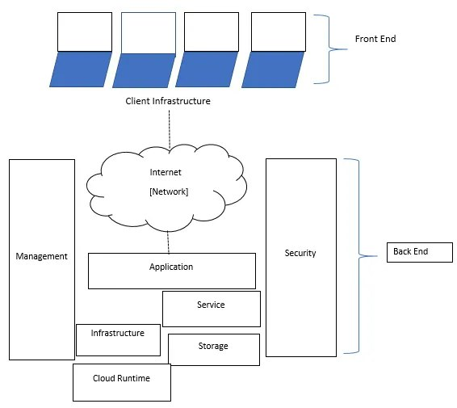

Today, it is crucial that an organization's application's scalability matches its growth tempo. If you want your client’s app to be robust and easy to scale, you have to make the right architectural decisions.

Cloud native applications are proven more efficient than their traditional counterparts and much easier to scale due to containerization and running in the cloud.

In this blog, we’ll talk about what cloud native applications are and what benefits this architecture brings to real projects.

## **What is Cloud Native Application Architecture?**

[Cloud native](https://www.suse.com/suse-defines/definition/cloud-native/) is an approach to building and running apps that use the cloud. In layman's terms, companies that use cloud native architecture are more likely to create new ideas, understand market trends and [respond faster to their customers’ requests](https://www.nutanix.com/theforecastbynutanix/technology/cloud-native-computing-what-it-is-and-why-businesses-need-it).
Cloud native applications are tied to the underlying infrastructure needed to support them. Today, this means deploying microservices through containers to dynamically provision resources according to user needs.
Each microservice can independently receive and transmit data through the service-level APIs. Although not required for an application to be considered "cloud native" due to modularity, portability, and granular resource management, microservices are a natural fit for running applications in the cloud.

## **Scheme of Cloud Native Application**

Cloud native application architecture consists of frontend and backend. 

- The client-side or frontend is the application interface available for the end-user. It has protocols and ports configured for user-database access and interaction. An example of this is a web browser.
- The server-side or backend refers to the cloud itself. It consists of resources providing cloud computing services. It includes everything you need, like data storage, security, and virtual machines.

All applications hosted on the backend cloud server are protected due to built-in engine security, traffic management, and protocols. These protocols are intermediaries, or middleware, for establishing successful communication with each other.

## **What Are the Core Design Principles of Cloud Native Architecture?**

To create and use cloud native applications, organizations need to rethink the approach to the development system and implement the fundamental principles of cloud native.

### **DevOps**

DevOps is a cultural framework and environment in which software is created, tested, and released faster, more frequently, and consistently. DevOps practices allow developers to shorten software development cycles without compromising on quality.

### **CI/CD**

Continuous integration (CI) is the automation of code change integration when numerous contributions are made to the same project. CI is considered one of the main best practices of DevOps culture because it allows developers to merge code more frequently into the central repository, where they are subject to builds and tests.

Continuous delivery (CD) is the process of constantly releasing updates, often through automated delivery. Continuous delivery makes the software release process reliable, and organizations can quickly deliver individual updates, features, or entire products.

### **Microservices**

Microservices are an architectural approach to developing an application as a collection of small services; each service implements a business opportunity, starts its process, and communicates through its own API.

Each microservice can be deployed, upgraded, scaled, and restarted independently of other services in the same application, usually as part of an automated system, allowing frequent updates to live applications without impacting customers.

### **Containerization**

Containerization is a software virtualization technique conducted at the operating system level and ensures the minimum use of resources required for the application’s launch.

Using virtualization at the operating system level, a single OS instance is dynamically partitioned into one or more isolated containers, each with a unique writeable file system and resource quota.

The low overhead of creating and deleting containers and the high packing density in a single VM make containers an ideal computational tool for deploying individual microservices.

## **Benefits of Cloud Native Architecture**

Cloud native applications are built and deployed quickly by small teams of experts on platforms that provide easy scalability and hardware decoupling. This approach provides organizations greater flexibility, resiliency, and portability in cloud environments.

### **Strong Competitive Advantage**

Cloud-based development is a transition to a new competitive environment with many convenient tools, no capital investment, and the ability to manage resources in minutes. Companies that can quickly create and deliver software to meet customer needs are more successful in the software age.

### **Increased Resilience**

Cloud native development allows you to focus on resilience tools. The rapidly evolving cloud landscape helps developers and architects design systems that remain interactive regardless of environment freezes.

### **Improved Flexibility**

Cloud systems allow you to quickly and efficiently manage the resources required to develop applications. Implementing a hybrid or multi-cloud environment will enable developers to use different infrastructures to meet business needs.

### **Streamlined Automation and Transformation**

The automation of IT management inside the enterprise is a springboard for the effective transformation of other departments and teams.

In addition, it eliminates the risk of disruption due to human error as employees focus on controlling routine tasks rather than performing them directly.

Automated real-time patches and updates across all stack levels eliminate downtime and the need for operational experts with “manual management” expertise.

## **Comparison: Cloud Native Architecture vs. Legacy Architecture**

The capabilities of the cloud allow both traditional monolithic applications and data operations to be transferred to it. However, many enterprises prefer to invest in a cloud native architecture from the start. Here is why:

### **Separation of Computation and Data Storage Improves Scalability**

Datacenter servers are usually connected to direct-attached storage (DAS), which an enterprise can use to store temporary files, images, documents, or other purposes.

Relying on this model is dangerous because its processing power needs can rise and fall in very different ways than storage needs. The cloud enables object storage such as AWS S3 or ADLS, which can be purchased, optimized, and managed separately from computing requirements.

This way, you can easily add thousands of new users or expand the app’s functionality.

### **Cloud Object Storage Gives Better Adaptability**

Cloud providers are under competitive pressure to improve and innovate in their storage services. Application architects who monitor closely and quickly adapt to these innovations will have an edge over competitors who have taken a wait-and-see attitude.

Alongside proprietary solutions, there are also many open source, cloud computing software projects like Rancher.

This container management platform provides users with a complete software stack that facilitates Kubernetes [cluster management](https://www.suse.com/c/understanding-cluster-management-for-kubernetes/) in a private or public cloud.

### **Cloud Native Architecture is More Reliable**

The obvious advantage for those companies that have adopted a native cloud approach is the focus on agility, automation, and simplification.

For complex IT or business functions, their survival depends on the level of elaboration of their services. On the other hand, you need error protection to improve user productivity through increased levels of automation, built-in predictive intelligence, or machine learning to help keep your environment running optimally.

### **Cloud Native Architecture Makes Inter-Cloud Migration Easy**

Every cloud provider has its cloud services (e.g., data warehousing, ETL, messaging) and provides a rich set of ready-made open source tools such as Spark, Kafka, MySQL, and many others.

While it sounds bold to say that using open source solutions makes it easy to move from one cloud to another, if cloud providers offer migration options, you won’t have to rewrite a significant part of the existing functionality.

Moreover, many IT architects see the future in the multi-cloud model, as many companies already deal with two or more cloud providers.

If your organization can skillfully use cloud services from different vendors, then the ability to determine the advantage of one cloud over another is good groundwork for the future justification of your decision.

## **Conclusion**

Cloud native application architecture provides many benefits. This approach automates and integrates the concepts of continuous delivery, microservices, and containers for enhanced quality and streamlined delivery.

Applications that are built as cloud native can offer virtually unlimited computing power on demand. That’s why more and more developers today are choosing to build and run their applications as cloud native.

####

#### **Want to make sure you don't miss any of the action? [Join the SUSE & Rancher Community](https://community.suse.com/share/kuN58om1vAuZuSiv?utm_source=manual) to get updates on new content coming your way!**
