## Introduction

Containers have become a popular way of packaging and delivering applications. Though the underlying technology had been available in the Linux kernel for many years, it did not gain the current widespread adoption until Docker came along and made this technology easy to use. Despite runtime isolation being one of the major advantages, containers working in isolation are often not very useful. Multiple containers need to interact with each other to provide various useful services. End users need a way to interact with the services provided inside these containers.

Networking is a crucial component in the container ecosystem. Some of the main responsibilities include providing connectivity between containers running on the same host as well as on different hosts — possibly belonging to the same cluster or pool of hosts — exposing the services provided within containers to either the end users or to other systems.

## Core Container Networking Demonstration

Before we jump in to understanding the various options provided by Docker, let’s explore the core technology that powers container networking. The Linux kernel has various features that have been developed to provide multi-tenancy on hosts. Namespaces provide functionality that offers different kinds of isolation, with network namespace being the one that provides network isolation.

It’s very easy to create network namespaces using the `ip` command in any Linux operating system. Let’s create two different network namespaces and name them after cities in the US as a demonstration:

```
ip netns add sfo
ip netns add nyc
ip netns list
```

```
nyc
sfo
```

Now, we can create a `veth` pair to connect these network namespaces. Think of a `veth` pair as a network cable with connectors at both ends.

```
ip link add veth-sfo type veth peer name veth-nyc
ip link list | grep veth
```

```
13: veth-nyc@veth-sfo: <BROADCAST,MULTICAST,M-DOWN> mtu 1500 qdisc noop state DOWN mode DEFAULT group default qlen 1000
14: veth-sfo@veth-nyc: <BROADCAST,MULTICAST,M-DOWN> mtu 1500 qdisc noop state DOWN mode DEFAULT group default qlen 1000
```

At this moment, the `veth` pair (cable) exists on the host network namespace. Now let’s move the two ends of the `veth` pair to their respective namespaces that we created earlier.

```
ip link set veth-sfo netns sfo
ip link set veth-nyc netns nyc
ip link list | grep veth
```

As you can see, the `veth` pair now doesn’t exist on the host network namespace.

Let’s verify the `veth` ends actually exist in the namespaces. We’ll start with the `sfo` namespace:

```
ip netns exec sfo ip link
```

```
1: lo: <LOOPBACK> mtu 65536 qdisc noop state DOWN mode DEFAULT group default qlen 1
    link/loopback 00:00:00:00:00:00 brd 00:00:00:00:00:00
14: veth-sfo@if13: <BROADCAST,MULTICAST> mtu 1500 qdisc noop state DOWN mode DEFAULT group default qlen 1000
    link/ether aa:c0:0b:1d:d8:6a brd ff:ff:ff:ff:ff:ff link-netnsid 1
```

Now let’s check the `nyc` namespace:

```
ip netns exec nyc ip link
```

```
1: lo: <LOOPBACK> mtu 65536 qdisc noop state DOWN mode DEFAULT group default qlen 1
    link/loopback 00:00:00:00:00:00 brd 00:00:00:00:00:00
13: veth-nyc@if14: <BROADCAST,MULTICAST> mtu 1500 qdisc noop state DOWN mode DEFAULT group default qlen 1000
    link/ether 2a:e6:57:d1:a2:cc brd ff:ff:ff:ff:ff:ff link-netnsid 0
```

Now let’s assign IP addresses to these interfaces and bring them up:

```
ip netns exec sfo ip address add 10.0.0.11/24 dev veth-sfo
ip netns exec sfo ip link set veth-sfo up
ip netns exec nyc ip address add 10.0.0.12/24 dev veth-nyc
ip netns exec nyc ip link set veth-nyc up
```

We can check both of the interfaces, starting with the `sfo` namespace:

```
ip netns exec sfo ip addr
```

```
1: lo: <LOOPBACK> mtu 65536 qdisc noop state DOWN group default qlen 1
    link/loopback 00:00:00:00:00:00 brd 00:00:00:00:00:00
14: veth-sfo@if13: <BROADCAST,MULTICAST,UP,LOWER_UP> mtu 1500 qdisc noqueue state UP group default qlen 1000
    link/ether aa:c0:0b:1d:d8:6a brd ff:ff:ff:ff:ff:ff link-netnsid 1
    inet 10.0.0.11/24 scope global veth-sfo
        valid_lft forever preferred_lft forever
    inet6 fe80::a8c0:bff:fe1d:d86a/64 scope link
        valid_lft forever preferred_lft forever
```

The `nyc` namespace also looks correct:

```
ip netns exec nyc ip addr
```

```
1: lo: <LOOPBACK> mtu 65536 qdisc noop state DOWN group default qlen 1
    link/loopback 00:00:00:00:00:00 brd 00:00:00:00:00:00
13: veth-nyc@if14: <BROADCAST,MULTICAST,UP,LOWER_UP> mtu 1500 qdisc noqueue state UP group default qlen 1000
    link/ether 2a:e6:57:d1:a2:cc brd ff:ff:ff:ff:ff:ff link-netnsid 0
    inet 10.0.0.12/24 scope global veth-nyc
        valid_lft forever preferred_lft forever
    inet6 fe80::28e6:57ff:fed1:a2cc/64 scope link
        valid_lft forever preferred_lft forever
```

Using the ping command, we can verify the two network namespaces have been connected and are reachable:

```
ip netns exec sfo ping 10.0.0.12
```

```
PING 10.0.0.12 (10.0.0.12) 56(84) bytes of data.
64 bytes from 10.0.0.12: icmp_seq=1 ttl=64 time=0.273 ms
--- 10.0.0.12 ping statistics ---
1 packets transmitted, 1 received, 0% packet loss, time 0ms
rtt min/avg/max/mdev = 0.273/0.273/0.273/0.000 ms
```

If we would like to create more network namespaces and connect them together, it might not be a scalable solution to create a `veth` pair for every combination of namespaces. Instead, one can create a Linux bridge and hook up these network namespaces to the bridge to get connectivity. And that’s exactly how Docker sets up networking between containers running on the same host!

Before we take a look at how network namespaces are used by Docker, let’s clean up the network namespaces that we just created:

```
ip netns del nyc sfo
```

The `veth` pair gets cleaned up automatically.

Let’s also make a note of the existing interfaces before we proceed with the next steps:

```
ip addr
```

```
1: lo: <LOOPBACK,UP,LOWER_UP> mtu 65536 qdisc noqueue state UNKNOWN group default qlen 1
    link/loopback 00:00:00:00:00:00 brd 00:00:00:00:00:00
    inet 127.0.0.1/8 scope host lo
        valid_lft forever preferred_lft forever
    inet6 ::1/128 scope host
        valid_lft forever preferred_lft forever
2: ens32: <BROADCAST,MULTICAST,UP,LOWER_UP> mtu 1500 qdisc pfifo_fast state UP group default qlen 1000
    link/ether 00:0c:29:38:ab:ab brd ff:ff:ff:ff:ff:ff
    inet 172.16.214.134/24 brd 172.16.214.255 scope global ens32
        valid_lft forever preferred_lft forever
    inet6 fe80::20c:29ff:fe38:abab/64 scope link
        valid_lft forever preferred_lft forever
3: ens33: <BROADCAST,MULTICAST,UP,LOWER_UP> mtu 1500 qdisc pfifo_fast state UP group default qlen 1000
    link/ether 00:00:12:ab:00:01 brd ff:ff:ff:ff:ff:ff
    inet 192.168.236.121/24 brd 192.168.236.255 scope global ens33
        valid_lft forever preferred_lft forever
    inet6 fe80::200:12ff:feab:1/64 scope link
        valid_lft forever preferred_lft forever
4: docker0: <NO-CARRIER,BROADCAST,MULTICAST,UP> mtu 1500 qdisc noqueue state DOWN group default
    link/ether 02:42:4a:01:15:81 brd ff:ff:ff:ff:ff:ff
    inet 172.17.0.1/16 scope global docker0
        valid_lft forever preferred_lft forever
    inet6 fe80::42:4aff:fe01:1581/64 scope link
        valid_lft forever preferred_lft forever
9: flannel.1: <BROADCAST,MULTICAST,UP,LOWER_UP> mtu 1450 qdisc noqueue state UNKNOWN group default
    link/ether 72:f0:84:31:fb:ba brd ff:ff:ff:ff:ff:ff
    inet 10.42.0.0/32 scope global flannel.1
        valid_lft forever preferred_lft forever
    inet6 fe80::70f0:84ff:fe31:fbba/64 scope link
        valid_lft forever preferred_lft forever
```

As you can see, the machine we’re demoing on already has Docker installed, which has led to the creation of the `docker0` bridge.

Let’s spin up a test container now:

```
docker run --name testc1 -itd registry.suse.com/bci/bci-busybox
```

```
fee636119a04f549b2adfcac3112e01f8816ae5f56f28b0127e66aa1a4bf3869
```

Inspecting the container, we can figure out the network namespace details:

```
docker inspect testc1 --format '{{ .NetworkSettings.SandboxKey }}'
```

```
/var/run/docker/netns/6a1141406863
```

Since Docker doesn’t create the `netns` in the default location, `ip netns list` doesn’t show this network namespace. We can create a symlink to the expected location to overcome that limitation:

```
container_id=testc1
container_netns=$(docker inspect ${container_id} --format '{{ .NetworkSettings.SandboxKey }}')
mkdir -p /var/run/netns
rm -f /var/run/netns/${container_id}
ln -sv ${container_netns} /var/run/netns/${container_id}
```

```
'/var/run/netns/testc1' -> '/var/run/docker/netns/6a1141406863'
```

We can test to make sure the `ip` command can list the namespace now:

```
ip netns list
```

```
testc1 (id: 0)
```

The other `ip` commands will now work with the namespace too:

```
ip netns exec testc1 ip addr
```

```
1: lo: <LOOPBACK,UP,LOWER_UP> mtu 65536 qdisc noqueue state UNKNOWN group default qlen 1
    link/loopback 00:00:00:00:00:00 brd 00:00:00:00:00:00
    inet 127.0.0.1/8 scope host lo
        valid_lft forever preferred_lft forever
15: eth0@if16: <broadcast,multicast,up,lower_up> mtu 1500 qdisc noqueue state up group default
    link/ether 02:42:ac:11:00:02 brd ff:ff:ff:ff:ff:ff link-netnsid 0
    inet 172.17.0.2/16 scope global eth0
        valid_lft forever preferred_lft forever
```

We can confirm that this is actually the container’s network namespace with the following command:

```
docker exec testc1 ip addr
```

```
1: lo: <LOOPBACK,UP,LOWER_UP> mtu 65536 qdisc noqueue state UNKNOWN group default qlen 1
    link/loopback 00:00:00:00:00:00 brd 00:00:00:00:00:00
    inet 127.0.0.1/8 scope host lo
        valid_lft forever preferred_lft forever
15: eth0@if16: <BROADCAST,MULTICAST,UP,LOWER_UP> mtu 1500 qdisc noqueue state UP group default
    link/ether 02:42:ac:11:00:02 brd ff:ff:ff:ff:ff:ff link-netnsid 0
    inet 172.17.0.2/16 scope global eth0
        valid_lft forever preferred_lft forever
```

If you inspect the list of interfaces again on the host, you will find a new `veth` interface:

```
ip link | grep veth
```

```
16: veth3569d0e@if15: <BROADCAST,MULTICAST,UP,LOWER_UP> mtu 1500 qdisc noqueue master docker0 state UP mode DEFAULT group default
```

The above output shows that this `veth` interface has been connected to the `docker0` bridge.

Now that we’ve covered some of what’s going on under the hood with Docker networking, let’s look at five ways to configure the network when a Docker container runs:

- Host
- Bridge
- Custom Bridge
- Container
- None

These concepts will allow us to explain how containers communicate when they are running on the same host and what options are available within Docker itself for container communication between hosts.

## Docker Networking Types

When a Docker container launches, the Docker engine assigns it a network interface with an IP address, a default gateway, and other network details such as a routing table and DNS services. By default, all addresses come from the same pool, and all containers on the same host can communicate with one another. We can change this by defining the network to which the container should connect.

We do this by either creating a custom user-defined network or by using a network provider plugin. The network providers are pluggable using drivers. We connect a Docker container to a particular network by using the `--net` switch when launching it. For example, the following command launches a container from the [`busybox`](https://registry.suse.com/bci/busybox/index.html) image and joins it to the host network. This container prints its IP address and then exits:

```
docker run --rm --net=host registry.suse.com/bci/bci-busybox ip addr
```

Each of the five network types has a different capacity for communication with other network entities.

- **Host networking**: The container shares the same IP address and the network namespace as that of the host. Services running inside of this container have the same network capabilities as services running directly on the host.
- **Bridge networking**: The container runs in a private network internal to the host. Communication with other containers in the network is open. Communication with services outside of the host goes through network address translation (NAT) before exiting the host. This is the default mode of networking when the `--net` option isn’t specified.
- **Custom bridge networking:** This is the same as bridge networking but uses a bridge created specifically for this (and other) containers. An example of how to use this would be a container that runs on a special “database” bridge network. Another container can have an interface on the default bridge and on the database bridge, enabling it to communicate with both networks as needed.
- **Container-defined Networking:** A container can share the address and network configuration of another container. This enables process isolation between containers, where each container runs one service but where services can still communicate with one another on 127.0.0.1.
- **No networking**. Disables networking for the container.

Let’s break down each of these options further to discover their differences and potential use cases.

### Host networking

The host mode of networking allows the Docker container to share the same IP address as that of the host and disables the network isolation otherwise provided by network namespaces. The container’s network stack is mapped directly to the host’s network stack. All interfaces and addresses on the host are visible within the container, and all communication possible to or from the host is possible to or from the container.

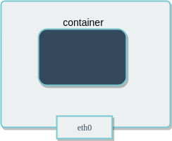

If you run the command `ip addr` on a host (or `ifconfig -a` if your host doesn’t have the `ip` command available), you will see information about the network interfaces.

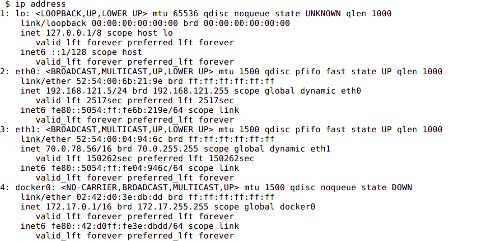

If you run the same command from a container using host networking, you will see *the same information*.

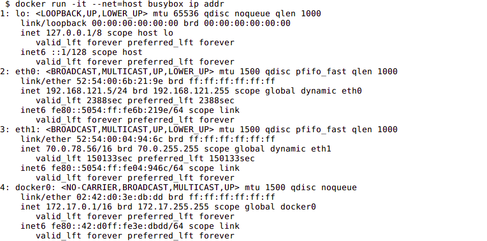

### Bridge Networking

In a standard Docker installation, the Docker daemon creates a bridge on the host with the name of `docker0`. When a container is launched, it then creates a virtual ethernet device for every container that runs on the host. This device appears within the container as `eth0` and on the host with a name like `vethxxx` where xxx is a unique identifier for the interface. The `vethxxx` interface is added to the `docker0` bridge, and this enables communication with other containers on the same host that also use the default bridge.

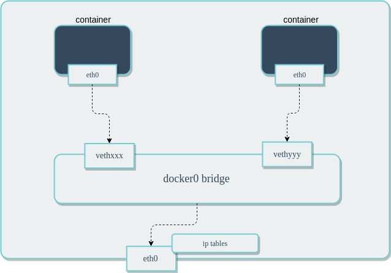

To demonstrate using the default bridge, run the following commands on a host with Docker installed. Since we are not specifying the network - the container will connect to the default bridge when it launches.

Next, run the `ip addr` and `ip route` commands inside of the container. You will see the IP address of the container with the `eth0` interface:

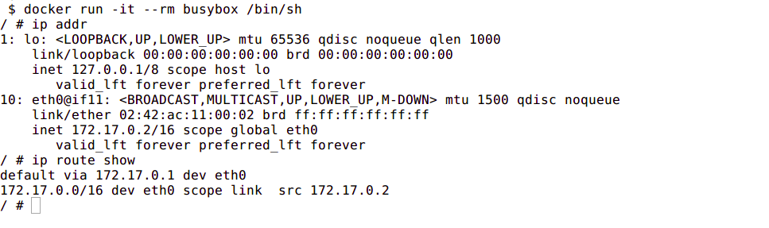

In another terminal that is connected to the host, run the `ip addr` command. You will see the corresponding interface created for the container. In the image below it is named `veth5dd2b68@if9`. Yours will be different.

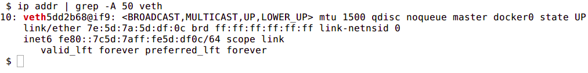

Although Docker mapped the container IPs on the bridge, network services running inside of the container are not visible outside of the host. To enable this, the Docker Engine must be told when launching a container to map ports from that container to ports on the host. This process is called *publishing*. For example, if you want to map port 80 of a container to port 8080 on the host, then you would have to publish the port as shown in the following command:

```
docker run --name nginx -p 8080:80 nginx
```

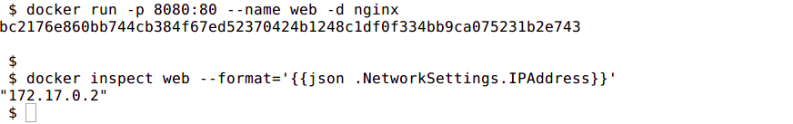

By default, the Docker container can send traffic to any destination. The Docker daemon creates a rule within `iptables` that modifies outbound packets and changes the source address to be the address of the host itself . The `iptables` configuration allows inbound traffic via the rules that Docker creates when initially publishing the container’s ports.

The output included below shows the `iptables` rules created by Docker when it publishes a container’s ports.

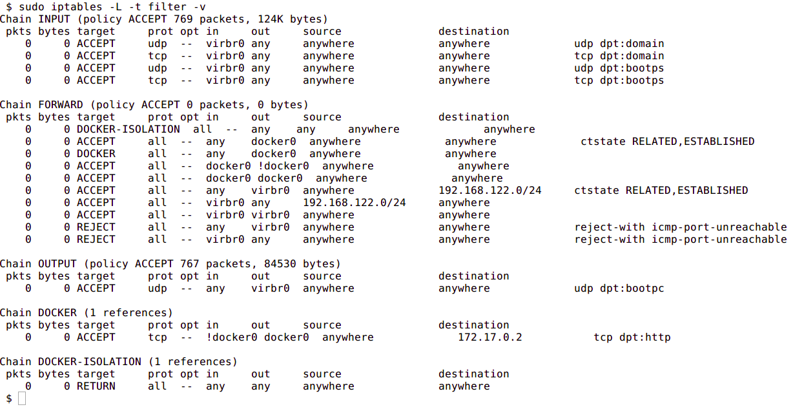

The next image shows the NAT table within `iptables`:

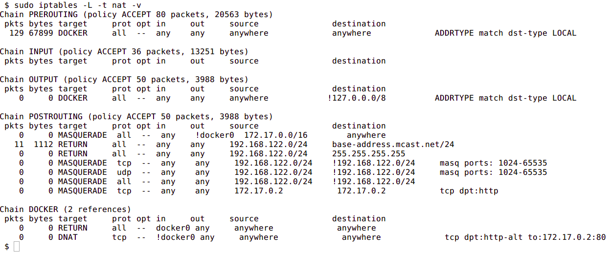

### Custom Bridge network

There is no requirement to use the default bridge on the host; it’s easy to create a new bridge network and attach containers to it. This provides better isolation and interoperability between containers, and custom bridge networks have better security and features than the default bridge.

All containers in a custom bridge can communicate with the ports of other containers on that bridge. This means that you do not need to explicitly publish the ports. It also ensures that the communication between them is secure. For example, imagine an application in which a backend container and a database container need to communicate. We also want to make sure that no external entity can talk to the database. We do this with a custom bridge network in which only the database container and the backend containers are deployed. You can explicitly expose the backend API to rest of world using port publishing.

The same is true with environment variables - environment variables in a bridge network are shared by all containers on that bridge.

Network configuration options such as MTU can differ between applications. By creating a bridge, you can configure the network to best suit the applications running inside of it.

To create a custom bridge network and create two containers which will join it, run following commands:

```
docker network create mynetwork
docker run -it --rm --name=container-a --network=mynetwork registry.suse.com/bci/bci-busybox /bin/sh
docker run -it --rm --name=container-b --network=mynetwork registry.suse.com/bci/bci-busybox /bin/sh
```

### Container Defined Network

A specialized case of custom networking is when a container joins the network of another container.

The following commands will launch two containers that share the same network namespace and thus share the same IP address. Services running on one container can talk to services running on the other via the `localhost` address.

```
docker run -it --rm --name=container-a registry.suse.com/bci/bci-busybox /bin/sh
docker run -it --rm --name=container-b --network=container:container-a registry.suse.com/bci/bci-busybox /bin/sh
```

### No Networking

This mode is useful when the container does not need to communicate with other containers or with the outside world. No IP address will be assigned to it, nor can it publish any ports.

```
docker run --net=none --name busybox registry.suse.com/bci/bci-busybox ip a
```

## Container to Container Communication

How do two containers on the same bridge network talk to one another?

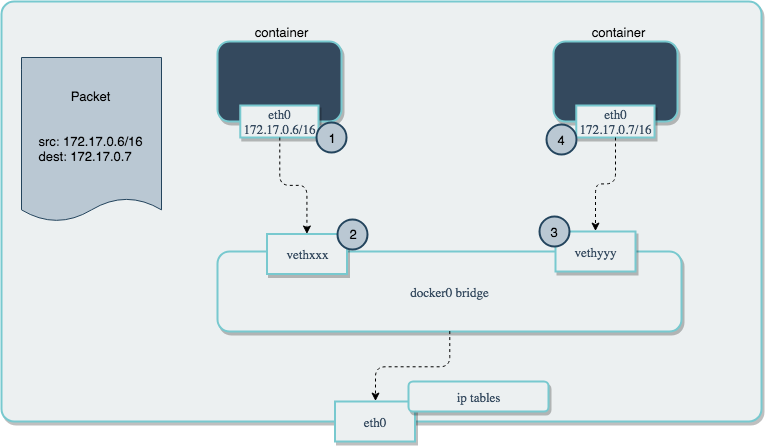

In the above diagram, two containers running on the same host are connected via the `docker0` bridge. If `172.17.0.6` (on the left hand side) wants to send a request to `172.17.0.7` (the one on the right hand side), the packets will move as follows:

1. A packet leaves the container via `eth0` and lands on the corresponding `vethxxx` interface.
2. The `vethxxx` interface is connected to the `vethyyy` interface via the `docker0` bridge.
3. 3: The `docker0` bridge forwards the packet to the `vethyyy` interface.
4. 4: The packet moves to the `eth0` interface within the destination container.

We can see this in action by using `ping` and `tcpdump`. Create two containers and inspect their network configuration with `ip addr` and `ip route`. The default route for each container is via the `eth0` interface:

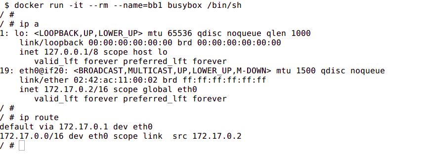

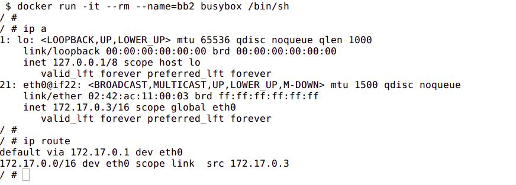

Ping one container from the other, and let it run so that we can inspect the traffic. Run `tcpdump` on the `docker0` bridge from the host machine. You will see in the output that the traffic moves between the two containers via the `docker0` bridge.

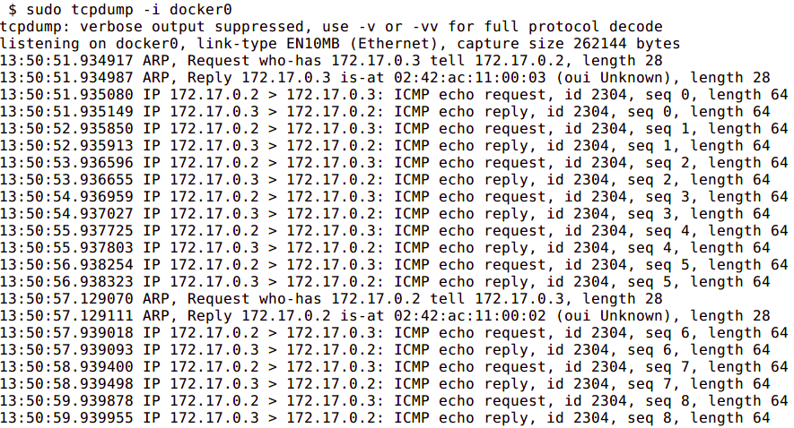

## Conclusion

Container networking within Docker provides a lot of flexibility in how the containers you deploy can communicate with each other, the host, and the outside world. In this guide, we saw how Docker controls the networking of containers using Linux kernel namespaces. We then explored the various options for defining networking between containers to achieve different connectivity properties. While there is plenty more to learn about networking through experimentation, this should give you a solid foundation to understand how your containers can communicate.
