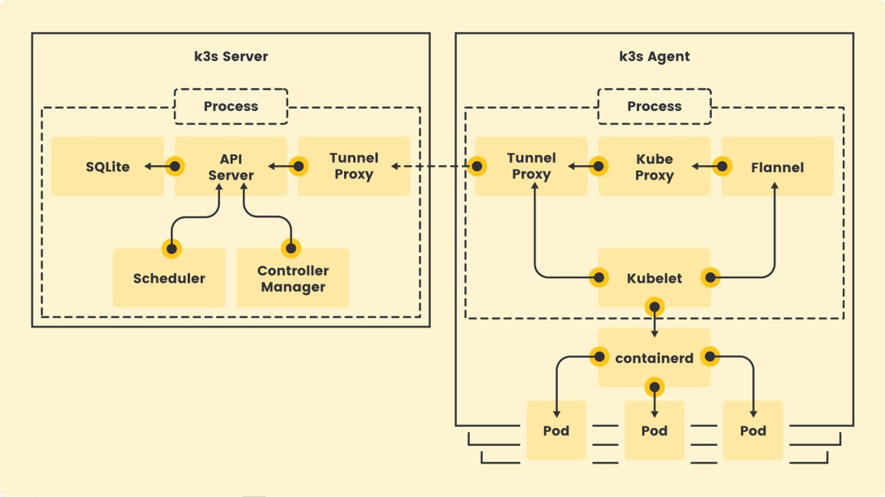
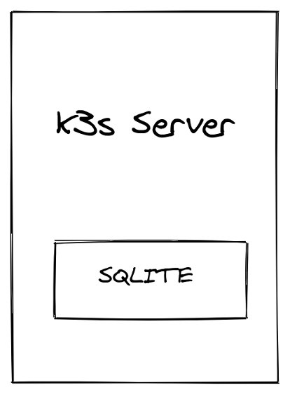
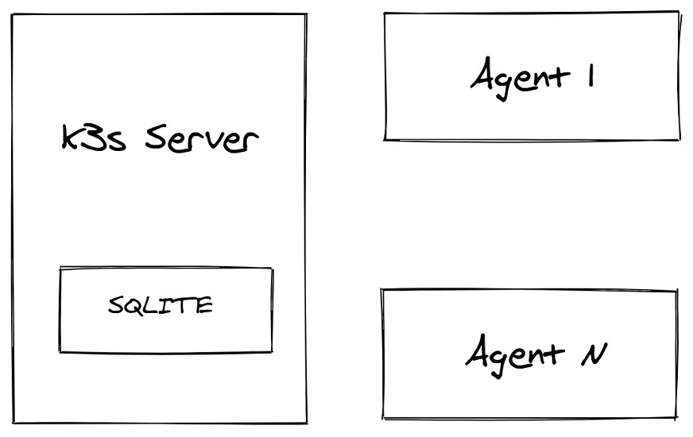
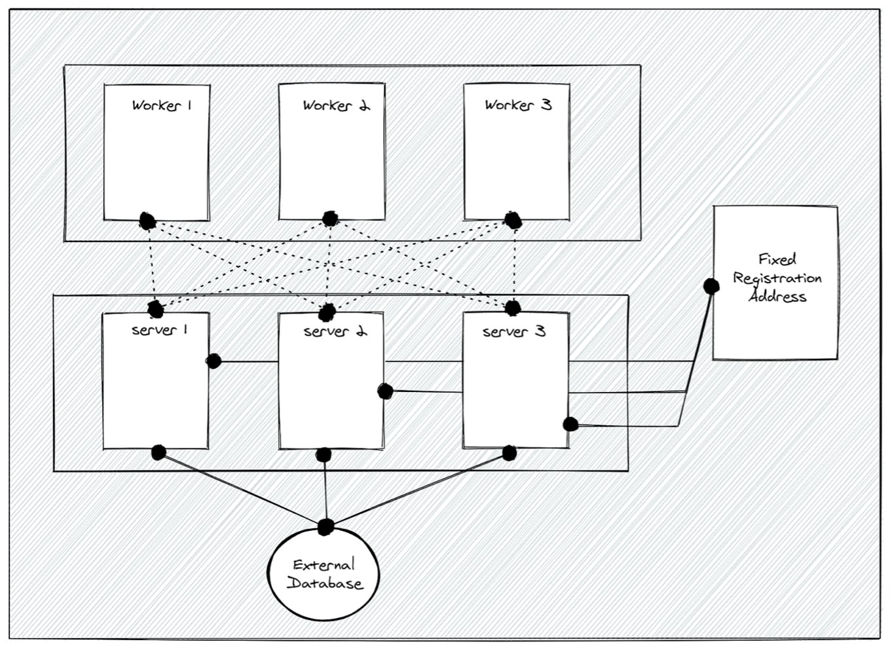
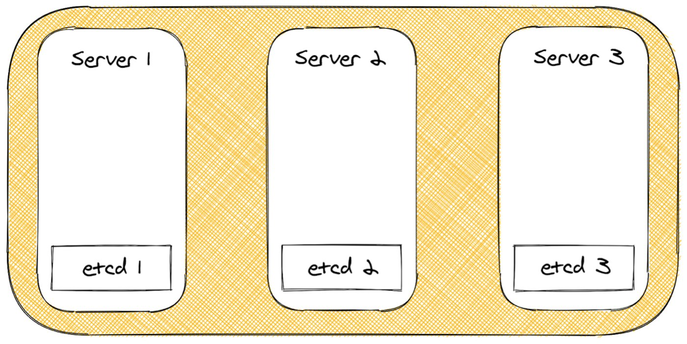
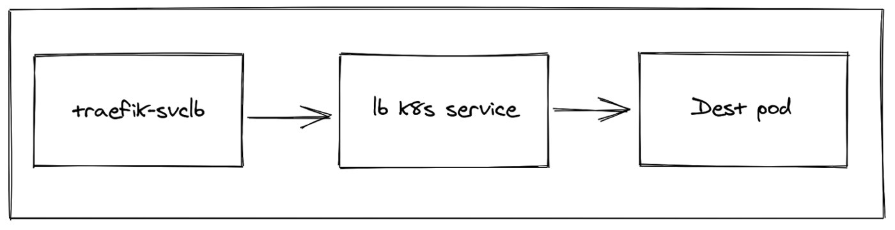

Whether you're new to the cloud native space or an accomplished practitioner, you're probably aware of many Kubernetes distributions. Maybe you've heard about the challenges of getting up and running with Kubernetes. Guess what? It doesn't have to be hard. This blog provides an introduction to K3s, a lightweight CNCF-certified Kubernetes distribution. We'll look at what makes K3s different from other Kubernetes distributions. Built for resource-constrained environments like network edge devices, K3s is lightweight and simple yet ready for production from day one. Do I have your attention? Let's take a look.

## What is K3s?

K3s is lightweight Kubernetes distribution (or distro). In the Kubernetes world, a distro is simply a way to get Kubernetes up and running (this is different than how we think of distros in Linux). Distros provide a preconfigured version of Kubernetes and tools for installing and working with it. Many Kubernetes distros are available today – kubeadm, Minikube and RKE to name just a few. What's so special about K3s? Here are the key things that make K3s stand out.

- It's **lightweight.** K3s is packaged as a single binary that's 54 megabytes. This single binary includes everything you need to get your Kubernetes master and worker components running.
- It has a **low memory/CPU footprint.** A single-node configuration (datastore, control plane, and kubelet in a single process) requires about 512 megabytes of RAM; a worker node's footprint is half that.
- **It's a CNCF-certified distro.** That means it passed the [conformance tests](https://www.cncf.io/certification/software-conformance/) used by the CNCF to certify Kubernetes distros.
- **It's a CNCF Sandbox project.** In August 2020, Rancher Labs donated K3s to the CNCF, where it became a Sandbox project. In fact, it's the first Kubernetes distro to achieve that distinction.
- **More than 1 million downloads.** Since February 2019, K3s have been downloaded more than 1 million times, with an average of 20,000 installs a week.
- **Designed for production.** A major distinction between K3s and other small Kubernetes distros like Minikube and microk8s is that it was designed from day one to work in production. **That means it follows standards-compliant Kubernetes distro guidelines** and is secure by default. We set up authentication between components using unique TLS certificates.

Lightweight and production-ready, K3s is ideal for edge devices, remote locations, or IoT appliances. And with support for AMD64, ARM64 and ARMv7l, K3s has a wide variety of use cases, from factory floors to retail stores to home assistants running on a Raspberry Pi – and many more.

## Why K3s is Different

Let's explore further what makes K3s different from other lightweight Kubernetes distros. First, K3s has no external dependencies. That means you don't need to install anything to get it running. It can run on any Linux box with empty root and /proc, /sys and /dev mounted. K3s is packaged with everything you need in a full busybox userspace with all the dependencies, such as iptables, du, find and other tools required by the Kubernetes runtime. K3s is a self-extracting archive – a data directory is created on startup with all the necessary host binaries to get Kubernetes up and running. We use Buildroot to compile dependencies for each different architecture.

A second differentiator is its support for database options. Kubernetes only supports one storage backend - etcd. We created a revolutionary project called [Kine](https://github.com/k3s-io/kine), which stands for "Kine is not etcd." Kine provides an etcd API shim that lets K3s support different database backends, including MySQL, Postgres and SQLite. It accepts etcd v3 requests from Kubernetes, translates these to SQL queries, and sends them to your database backend.

Another differentiator is K3s' value-added functionality. It includes controllers that support various functions, such as installing or updating helm charts, auto-deploying manifests from the filesystem, providing DNS resolution for cluster nodes, providing basic LoadBalancer functionality, and maintaining the embedded etcd cluster. These controllers run inside the server process, which we'll discuss next.

Finally, everything developed in k3s can be replaced or disabled. This means you can swap out the default container network plugin, ingress controller, or service lb functions.

In summary, K3s minimally include:

- A fully functional Kubernetes cluster
- Sqlite as storage backend instead of etcd
- Containerd as default container runtime (not Docker)
- Flannel as container network plugin by default
- Traefik as Ingress controller
- Local storage provisioner as default StorageClass for persistent volumes

## K3s Architecture

Now let's take a look at the K3s architecture. K3s supports two processes, the server and the agent. They can run separately, but by default, K3s runs one process that includes both.

**The K3s server** process runs several components that include:

- Kubernetes API, controller, and scheduler – the basic control-plane components for Kubernetes
- Sqlite as is the default storage backend without HA control plane
- Reverse tunnel proxy, which eliminates the need for bidirectional communication between server and agent, which means you don't have to punch holes in firewalls for servers to talk to agents

**The K3s agent** is responsible for running the kubelet and kube-proxy. In addition:

- Flannel as an embedded process
- Containerd as the container runtime
- An internal load balancer that load-balances connections between all API servers in HA configurations
- Network policy controller to enforce network policies

## Deployment Architecture

Now that we understand the architecture let's see how you can actually deploy K3s. K3s has four deployment architectures: a single-node, a single-node with multiple agents, HA with external DB and HA with embedded DB. Let's see how those work.

**Single node**

The simplest way to deploy K3s is as a single node cluster, which runs one server with the embedded agent enabled. This simplified method is optimized for edge devices because you just run the curl command and it will deploy a complete Kubernetes cluster. Note that this deployment architecture doesn't provide high availability.

**Single server with multiple agents**

This method also uses one server and doesn't provide HA support. However, you can add agents (workers) to the cluster. The agents connect securely using a token that the server generates on startup. Alternatively, you can specify your own custom token when starting the server.

**HA with External DB**

The third deployment architecture installs K3s in a HA fashion. This doesn't work with Sqlite because it needs multiple servers. However, we can use Kine to support different external databases, including mysql, postgres and etcd.

The benefits of this method are that you have multiple database options and an embedded client load balancer. In addition, there's no quorum requirement since the database server handles data integrity. This means you can start with two servers; if one fails, the cluster will still work.

The only downside with this architecture is that you need to manually set up the external database, so it's not optimized for edge devices. It is most frequently used in cloud environments with a managed database service as the backend. However, we solved this issue with our fourth deployment architecture. Read on…

**HA with Embedded DB**

The fourth method uses a true embedded etcd server, with no extra steps to set up a database. It is also ridiculously simple to set up. These benefits make it perfect for edge devices. The only downside to this method is that it is quorum-based, so you need three servers to maintain quorum. If the quorum is lost, you can always reset the etcd cluster back to a single-node and expand the cluster from there. While you still have to maintain a quorum during normal operation, you won't lose your cluster in the case of quorum loss.

## Bonus Controllers

As promised, let's see what some of those value-added controllers are all about. These controllers run inside the server process, each responsible for a single job.

**Manifest Controller**

This controller allows you to deploy anything placed in the /var/lib/rancher/k3s/server/manifests directory on the server node. The Manifest Controller simply watches for .yaml or .json files and then applies them to the server. If these files change it reapplies them.

By default, K3s provides manifests for:

- Coredns
- Metrics server
- Local storage provisioner
- Traefik Ingress controller

**Helm Controller**

The Helm Controller lets you deploy Helm charts without installing a helm tool or tiller. That means all you need to do is add a .yaml file with the type HelmChart and the Helm Controller takes care of the installation.

**Service Load Balancer**

As you may know, Kubernetes has different types of Services. One popular type is called LoadBalancer service, which creates a load balancer on the cloud. Load balancers are cloud provider specific, so with upstream Kubernetes, you need a cloud provider to get a load balancer. But guess what? We created a workaround for this in K3s - are you seeing a pattern here?

We created a Service Load Balancer Controller, also known as Klipper-LB, which is a NodePort-based load balancer. When you run a service with a load balancer type, you will get a daemonset of pods that are set up to proxy service from one pod to another. This controller supports the packaged Traefik Ingress Controller on small clusters. It has a lot of options, including letting you exclude or include nodes.

