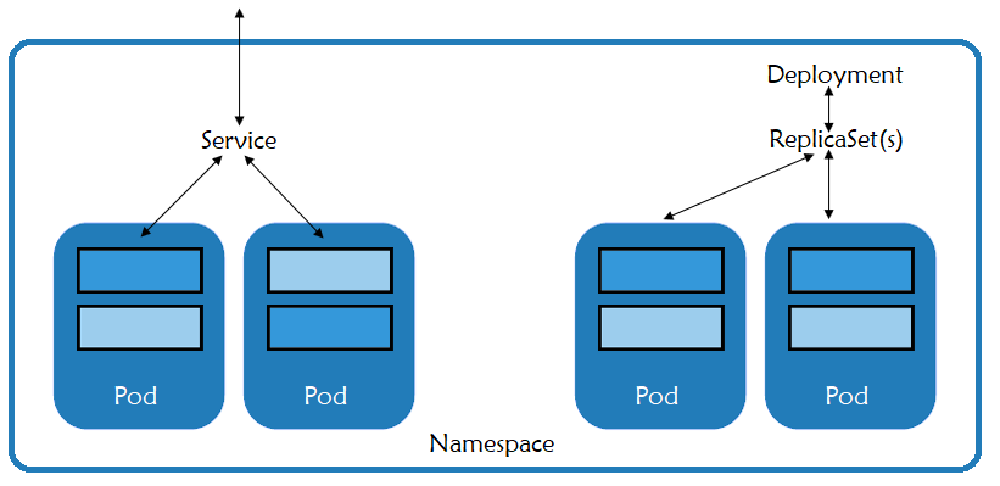
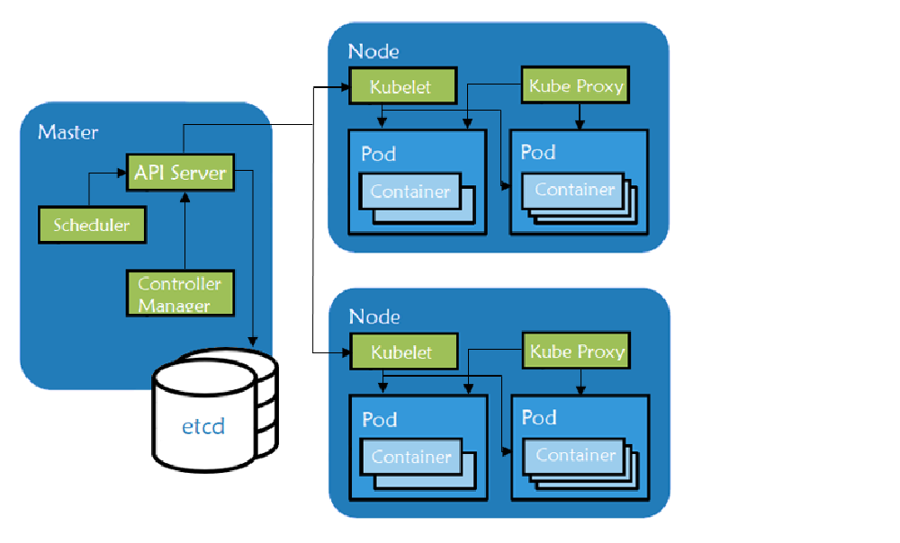

Expert Training in Kubernetes and RancherJoin our free online training sessions to learn more about Kubernetes, containers, and Rancher. [Sign up here](https://rancher.com/training/)

Kubernetes monitoring is an essential part of the smooth running of microservices and applications in containerized architecture. With over 40,000 stars on Github, more than 70,000 commits, and major contributors like Google and Redhat, [Kubernetes](https://www.suse.com/suse-defines/definition/kubernetes/) has rapidly taken over the container ecosystem to become the true leader of container orchestration platforms.

Effective Kubernetes performance monitoring allows users to identify issues like bottlenecks, insufficient resources, and pods or nodes that aren’t working correctly. To build a solid understanding of Kubernetes monitoring, let’s start with a review of how Kubernetes works.

## Understanding Kubernetes and its abstractions

At the infrastructure level, Kubernetes also known as K8s use clusters as a set of physical or virtual machines acting in a specific role. The machines acting in the role of Master act as the brain of all operations and are charged with orchestrating containers that run on all of the Nodes.

From a logical perspective, a Kubernetes deployment is comprised of various components, each serving a specific purpose within the cluster.

- [Pods](https://kubernetes.io/docs/concepts/workloads/pods/pod/) are the basic unit of deployment within Kubernetes. A pod consists of one or more containers that share the same network namespace and IP address. Best practices recommend that you create one pod per application component so you can scale and control them separately.
- [Services](https://kubernetes.io/docs/concepts/services-networking/service/) provide a consistent IP address in front of a set of pods and a policy that controls access to them. The set of pods targeted by a service is often determined by a [label selector](https://kubernetes.io/docs/concepts/overview/working-with-objects/labels/). This makes it easy to point the service to a different set of pods during upgrades or blue/green deployments.
- [ReplicaSets](https://kubernetes.io/docs/concepts/workloads/controllers/replicaset/) are controlled by deployments and ensure that the desired number of pods for that deployment are running.
- [Namespaces](https://kubernetes.io/docs/concepts/overview/working-with-objects/namespaces/) define a logical namespace for resources such as pods and services. They enable resources to use the same names, whereas resources in a single namespace must have unique names. Rancher uses namespaces with its role-based access control to provide a secure separation between namespaces and the resources running inside of them.
- Metadata marks containers based on their deployment characteristics.

## What is Kubernetes monitoring?

Multiple services and namespaces can be spread across the infrastructure. As seen above, each of the services are made of pods, which can have one or more containers inside. With so many moving parts, monitoring even a small Kubernetes cluster can present a challenge. Monitoring Kubernetes requires a deep understanding of the application architecture and functionality in order to design and manage an effective solution.

Kubernetes has tremendous capability for automatically recovering from failures. It can restart pods if a process crashes, and it will redistribute pods if a node fails. However, for all of its power, there are times when it cannot fix a problem. In order to detect those situations, we need additional monitoring.

## Why is Kubernetes monitoring important?

Kubernetes monitoring is crucial for maintaining the health and performance of containerized applications running in dynamic environments. As businesses increasingly adopt Kubernetes for its scalability and flexibility, the complexity of managing and troubleshooting these applications also grows.

Without proper monitoring, organizations risk facing issues such as system downtime, resource inefficiencies, and security vulnerabilities. Kubernetes monitoring allows teams to identify and resolve performance bottlenecks, reduce the risk of outages and optimize resource allocation, ensuring smooth and reliable application delivery. Additionally, monitoring helps organizations meet compliance requirements and improve visibility across various clusters, making it a vital component of any Kubernetes-based infrastructure.

By tracking critical metrics, logs and events, Kubernetes monitoring provides teams with the insights needed to proactively manage applications, leading to increased operational efficiency and reduced risks.

## How can you monitor kubernetes?

In this section, we'll explore Kubernetes monitoring metrics and the key components of Kubernetes architecture that need to be continuously observed. Effective monitoring involves tracking metrics related to the performance of nodes, containers, clusters and the underlying infrastructure.

Kubernetes consists of several interconnected components, including the control plane, worker nodes and containerized applications, all of which require monitoring to ensure optimal performance and early detection of issues.

Monitoring Kubernetes metrics like CPU usage, memory usage, pod status and network performance is essential for maintaining a healthy cluster and providing the visibility needed for troubleshooting and scaling applications effectively.

### Kubernetes infrastructure monitoring

All clusters should have monitoring of the underlying server components because problems at the server level will show up in the workloads.

##### What to monitor?

- *CPU utilization*. Monitoring the CPU will reveal both system and user consumption, and it will also show iowait. When running clusters in the cloud or with any network storage, iowait will indicate bottlenecks waiting for storage reads and writes (i/o processes). An oversubscribed storage framework can impact performance.
- *Memory usage.* Monitoring memory will show how much memory is in use and how much is available, either as free memory or as cache. Systems that run up against memory limits will begin to swap (if swap is available on the system), and swapping will rapidly degrade performance.
- *Disk pressure.* If a system is running write-intensive services like etcd or any datastore, running out of disk space can be catastrophic. The inability to write data will result in corruption, and that corruption can transfer to real-world losses. Technologies like LVM make it trivial to grow disk space as needed, but keeping an eye on it is imperative.
- *Network bandwidth.* In today’s era of gigabit interfaces, it might seem like you can never run out of bandwidth. However, it doesn’t take more than a few aberrant services, a data breach, system compromise, or DOS attack to eat up all of the bandwidth and cause an outage. Keeping awareness of your normal data consumption and the patterns of your application will help you keep costs down and also aid in capacity planning.
- *Pod resources.* The Kubernetes scheduler works best when it knows what resources a pod needs. It can then assure that it places pods on nodes where the resources are available. When designing your network, consider how many nodes can fail before the remaining nodes can no longer run all of the desired resources. Using a service such as a cloud autoscaling group will make recovery quick, but be sure that the remaining nodes can handle the increased load for the time that it takes to bring the failed node back online.

### Kubernetes cluster monitoring

Kubernetes ships with tools for monitoring the cluster:

- [Probes](https://kubernetes.io/docs/tasks/configure-pod-container/configure-liveness-readiness-probes/) actively monitor the health of a container. If the probe determines that a container is no longer healthy, the probe will restart it.
- [cAdvisor](https://github.com/google/cadvisor) is an open source agent that monitors resource usage and analyzes the performance of containers. Originally created by Google, cAdvisor is now integrated with the Kubelet. It collects, aggregates, processes and exports metrics such as CPU, memory, file and network usage for all containers running on a given node.

The [kubernetes dashboard](https://kubernetes.io/docs/tasks/access-application-cluster/web-ui-dashboard/) is an add-on which gives an overview of the resources running on your cluster. It also gives a very basic means of deploying and interacting with those resources.

### Kubernetes pod monitoring

[Master components](https://kubernetes.io/docs/concepts/overview/components/#master-components) manage the lifecycle of a pod, the base unit of deployment within a Kubernetes cluster. If a pod dies, the Controller creates a new one. If you scale the number of pod replicas up or down, the Controller creates or destroys pods to satisfy your request. The Master role includes the following components:**What to monitor?**

- - `kube-apiserver` - exposes APIs for the other master components.
  - `etcd` - a consistent and highly-available key/value store used for storing all internal cluster data.
  - `kube-scheduler` - uses information in the Pod spec to decide on which Node to run a Pod.
  - `kube-controller-manager` - responsible for Node management (detecting if a Node fails), pod replication, and endpoint creation.
  - `cloud-controller-manager` - runs controllers that interact with the underlying cloud providers.

### Kubernetes nod monitoring

[Node components](https://kubernetes.io/docs/concepts/architecture/nodes/#what-is-a-node) are worker machines in Kubernetes and are managed by the Master. A node may be a virtual machine (VM) or physical machine, and Kubernetes runs equally well on both types of systems. Each node contains the necessary components to run pods:

**What to monitor?**

- - [`kubelet`](https://kubernetes.io/docs/reference/command-line-tools-reference/kubelet/): handles all communication between the Master and the node on which it is running. It interfaces with the container runtime to deploy and monitor containers.
  - [`kube-proxy`](https://kubernetes.io/docs/reference/command-line-tools-reference/kube-proxy/): maintains the network rules on the host and handles transmission of packets between pods, the host, and the outside world.
  - container runtime: responsible for running containers on the host. The most popular engine is [Docker](https://www.docker.com), although Kubernetes supports container runtimes from [rkt](https://coreos.com/rkt/), [runc](https://github.com/opencontainers/runc) and [others](https://github.com/opencontainers/runtime-spec).

All of the components that make up a Kubernetes Master or Worker, including etcd, are critical to the health of your applications. If any of these fail, the monitoring system needs to detect the failure and either fix it or send an alert.

The final layer is that of the Kubernetes resources themselves. Kubernetes exposes metrics about the resources, and we can also monitor the applications directly. Although we can trust that Kubernetes will work to maintain the desired state, if it’s unable to do so, we need a way for a human to intervene and fix the issue.

### Kubernetes performance monitoring

Kubernetes performance monitoring is essential for ensuring the smooth operation of your containerized applications and clusters. It involves tracking key metrics that reflect the overall health and efficiency of your Kubernetes environment. These metrics typically include:

- **Resource Utilization:** Monitoring CPU, memory, and disk usage across nodes and containers helps prevent resource bottlenecks.
- **Pod and Node Health:** Ensuring that pods and nodes are in the desired state and quickly identifying when they are not.
- **Application Performance:** Monitoring how your applications behave under different loads to ensure optimal performance.
- **Network Metrics:** Keeping track of network traffic and bandwidth to avoid slowdowns or disruptions.

By continuously monitoring these performance indicators, Kubernetes performance monitoring helps you stay ahead of potential issues, optimize resource allocation, and ensure the high availability of your applications.

### **What Are the Benefits of Kubernetes Monitoring?**

Kubernetes monitoring provides several key benefits that are essential for maintaining a healthy, efficient, and reliable infrastructure:

- **Proactive Issue Detection:** Enables teams to identify problems before they affect users, preventing downtime.
- **Improved Resource Management:** Helps optimize resource allocation by tracking resource usage and identifying underutilized or overutilized resources.
- **Enhanced Application Performance:** Provides visibility into application performance, allowing for faster troubleshooting and optimization.
- **Increased Reliability:** Continuous monitoring helps maintain the desired state of applications and clusters, improving system uptime and reliability.
- **Better Security Posture:** Monitoring helps detect anomalies and unauthorized access, enhancing the security of Kubernetes environments.

### **Kubernetes Monitoring Challenges**

While Kubernetes monitoring is essential, it comes with its own set of challenges that organizations must address:

- **Complexity of Kubernetes Architecture:** The dynamic and distributed nature of Kubernetes makes it difficult to track all components and their interactions.
- **Large Volumes of Metrics:** Kubernetes generates a vast amount of data, which can be overwhelming to manage and analyze without the right tools.
- **Managing Multi-Cluster Environments:** Monitoring multiple clusters adds another layer of complexity, as data needs to be aggregated and analyzed across all clusters.
- **Maintaining Real-Time Monitoring:** Ensuring that monitoring data is collected and acted upon in real time can be challenging, especially when dealing with large-scale environments.
- **Alert Fatigue:** With frequent alerts, teams may become desensitized, risking the failure to respond to critical issues.

### **Kubernetes Monitoring Best Practices**

To overcome these challenges, implementing best practices for Kubernetes monitoring is essential:

- **Use a Centralized Monitoring Tool:** Implement a centralized platform to aggregate and visualize metrics across all clusters, making it easier to detect and resolve issues.
- **Focus on Key Metrics:** Avoid data overload by focusing on critical performance indicators like CPU, memory usage, pod status, and application health.
- **Set Up Meaningful Alerts:** Define thresholds for alerts that are relevant and actionable, reducing alert fatigue and ensuring that important issues get attention.
- **Automate Incident Response:** Leverage automation to resolve common issues automatically, reducing downtime and human intervention.
- **Monitor Resource Utilization Across Nodes and Pods:** Continuously track resource usage across all nodes and containers to ensure efficient scaling and avoid over-provisioning or underutilization.
- **Implement Distributed Tracing for Applications:** Use distributed tracing to monitor application-level performance across microservices and identify performance bottlenecks.

By following these best practices, teams can tackle the challenges of Kubernetes monitoring and ensure that their environments run smoothly and securely.

## The tools you can use to monitor Kubernetes

There are several tools available to effectively monitor Kubernetes environments, offering capabilities such as real-time monitoring, logging, alerting, and visualization of key metrics. These tools allow teams to track the performance and health of their clusters, containers, and applications with ease.

### **Monitoring with Rancher**

Rancher provides a powerful and streamlined way to monitor Kubernetes clusters, helping organizations align with Kubernetes monitoring best practices while addressing common challenges. With Rancher, teams can easily manage, monitor and [troubleshoot Kubernetes clusters](https://www.suse.com/c/observability-the-total-kubernetes-troubleshooting-guide/) at scale.

Rancher simplifies monitoring by offering centralized control across multi-cluster environments, ensuring seamless integration and visibility into key metrics like CPU, memory, and network usage. The platform supports real-time monitoring, enabling teams to act swiftly on critical alerts and prevent issues from escalating.

By utilizing tools like [SUSE Observability](https://www.suse.com/solutions/observability/), part of SUSE Rancher Prime, and [SUSE Cloud Observability](https://www.suse.com/products/cloud/observability/),for Rancher community users, users can gain deeper insights into the performance and health of their clusters. These solutions provide built-in monitoring capabilities, making it easier to detect and resolve issues, reduce alert fatigue, and ensure high availability.

Rancher’s intuitive dashboard consolidates metrics and logs, enabling teams to identify performance bottlenecks and optimize resource allocation. By combining these tools with the best practices outlined earlier, Rancher not only addresses the complexities of Kubernetes monitoring and enhances [Kubernetes observability](https://www.suse.com/c/improving-your-applications-with-kubernetes-observability-the-total-guide/), but also ensures that Kubernetes environments are secure, reliable, and well-managed.

### **Use Prometheus for monitoring**

The information visible in the Rancher UI is useful for troubleshooting, but it’s not the best way to actively track the state of the cluster throughout every moment of its life. For that we’ll use Prometheus, a sibling project of Kubernetes under the care and guidance of the Cloud Native Computing Foundation. We’ll also use Grafana, a tool for converting time-series data into beautiful graphs and dashboards.

[Prometheus](https://prometheus.io) is an open-source application for monitoring systems and generating alerts. It can monitor almost anything, from servers to applications, databases, or even a single process. In the Prometheus lexicon it monitors *targets*, and each unit of a target is called a *metric*. The act of retrieving information about a target is known as *scraping*. Prometheus will scrape targets at designated intervals and store the information in a time-series database. Prometheus has its own scripting language called [PromQL](https://prometheus.io/docs/prometheus/latest/querying/basics/).

[Grafana](https://grafana.com) is also open source and runs as a web application. Although frequently used with Prometheus, it also supports backend datastores such as InfluxDB, Graphite, Elasticsearch, and others. Grafana makes it easy to create graphs and assemble those graphs into dashboards. Those dashboards can be protected by a strong authentication and authorization layer, and they can also be shared with others without giving them access to the server itself. Grafana makes heavy use of JSON for its object definitions, which makes its graphs and dashboards extremely portable and easy to use with version control.

## Stay on top of Kubernetes monitoring with SUSE

By implementing the best practices for Kubernetes monitoring and leveraging powerful tools like [SUSE Observability](https://www.suse.com/solutions/observability/) and [SUSE Cloud Observability](https://www.suse.com/products/cloud/observability/), you can effectively manage the health and performance of your Kubernetes clusters. 

Stay on top of your Kubernetes environment to prevent issues before they arise and maintain the scalability and reliability of your containerized applications.

Learn more about [overcoming troubleshooting obstacles](https://more.suse.com/SUSE_Cloud_Observability__Ebook_LP.html) with Kubernetes monitoring.Join our free online training sessions to learn more about Kubernetes, containers, and Rancher. [Sign up here](https://rancher.com/training/)
