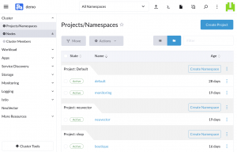

Expert Training in Kubernetes and RancherJoin our free online training sessions to learn more about Kubernetes, containers, and Rancher. [Sign up here](https://rancher.com/training/)

## Introduction

Kubernetes clusters can manage large numbers of unrelated workloads concurrently and organizations often choose to deploy projects created by separate teams to shared clusters. Even with relatively light use, the number of deployed objects can quickly become unmanageable, slowing down operational responsiveness and increasing the chance of dangerous mistakes.

Kubernetes uses a concept called **namespaces** to help address the complexity of organizing objects within a cluster. Namespaces allow you to group objects together so you can filter and control them as a unit. Whether applying customized access control policies or separating all of the components for a test environment, namespaces are a powerful and flexible concept for handling objects as a group.

In this article, we’ll discuss how namespaces work, introduce a few common use cases, and cover how to use namespaces to manage your Kubernetes objects. Towards the end, we’ll also take a look at a Rancher feature called **projects** that builds on and extends the namespaces concept.

## What are Namespaces and Why Are They Important?

**Namespaces** are the organizational mechanism that [Kubernetes](https://rancher.com/kubernetes) provides to categorize, filter by, and manage arbitrary groups of objects within a cluster. Each workload object added to a Kubernetes cluster must be placed within exactly one namespace.

Namespaces impart a scope for object names within a cluster. While names must be unique within a namespace, the same name can be used in different namespaces. This can have some important practical benefits for certain scenarios. For example, if you use namespaces to segment application life cycle environments — like development, staging, and production — you can maintain copies of the same objects, with the same names, in each environment.

Namespaces also allow you to easily apply policies to specific slices of your cluster. You can control resource usage by defining `ResourceQuota` objects, which set limits on consumption on a per-namespace basis. Similarly, when using a CNI (container network interface) that supports network policies on your cluster, like [Calico](https://docs.projectcalico.org/latest/introduction/) or [Canal (Calico for policy with flannel for networking)](https://docs.projectcalico.org/latest/getting-started/kubernetes/installation/flannel), you can apply a `NetworkPolicy` to the namespace with rules that dictate how pods can be communicate with one another. Different namespaces can be given different policies.

One of the greatest benefits of using namespaces is being able to take advantage of Kubernetes RBAC (role-based access control). RBAC allows you to develop roles, which group a list of permissions or abilities, under a single name. `ClusterRole` objects exist to define cluster-wide usage patterns, while the `Role` object type is applied to a specific namespace, giving greater control and granularity. Once a `Role` is created, a `RoleBinding` can grant the defined capabilities to a specific user or group of users within the context of a single namespace. In this way, namespaces let cluster operators map the same policies to organized sets of resources.

## Common Namespace Usage Patterns

Namespaces are an incredibly flexible feature that doesn’t impose a specific structure or organizational pattern. That being said, there are some common patterns that many teams find useful.

### Mapping Namespaces to Teams or Projects

One convention to use when setting up namespaces is to create one for each discrete project or team. This melds well with many of the namespace characteristics we mentioned earlier.

By giving a team a dedicated namespace, you can allow self-management and autonomy by delegating certain responsibilities with RBAC policies. Adding and removing members from the namespace’s `RoleBinding` objects is a simple way to control access to the team’s resources. It is also often useful to set resource quotas for teams and projects. This way, you can ensure equitable access to resources based the organization’s business requirements and priorities.

### Using Namespaces to Partition Life Cycle Environments

Namespaces are well suited for carving out development, staging, and production environments within cluster. While it recommended to deploy production workloads to an entirely separate cluster to ensure maximum isolation, for smaller teams and projects, namespaces can be a workable solution.

As with the previous use case, network policies, RBAC policies, and quotas are big factors in why this can be successful. The ability to isolate the network to control communication to your components is a fundamental requirement when managing environments. Likewise, namespace-scoped RBAC policies allow operators to set strict permissions for production environments. Quotas help you guarantee access to important resources for your most sensitive environments.

The ability to reuse object names is also helpful here. Objects can be rolled up to new environments as they they are tested and released while retaining their original name. This helps avoid confusion around which objects are analogous across environments and reduces cognitive overhead.

### Using Namespaces to Isolate Different Consumers

Another use case that namespaces can help with is segmenting workloads by their intended consumers. For instance, if your cluster provides infrastructure for multiple customers, segmenting by namespace allows you to manage each independently while keeping track of usage for billing purposes.

Once again, namespace features allow you to control network and access policies and define quotas for your consumers. In cases where the offering is fairly generic, namespaces allow you to develop and deploy a different instance of the same templated environment for each of your users. This consistency can make management and troubleshooting significantly easier.

## Understanding the Preconfigured Kubernetes Namespaces

Before we take a look at how to create your own namespaces, let’s discuss what Kubernetes sets up automatically. By default, three namespaces are available on new clusters:

- **default:** Adding an object to a cluster without providing a namespace will place it within the `default` namespace. This namespace acts as the main target for new user-added resources until alternative namespaces are established. It cannot be deleted.
- **kube-public:** The `kube-public` namespace is intended to be globally readable to all users with or without authentication. This is useful for exposing any cluster information necessary to bootstrap components. It is primarily managed by Kubernetes itself.
- **kube-system:** The `kube-system` namespace is used for Kubernetes components managed by Kubernetes. As a general rule, avoid adding normal workloads to this namespace. It is intended to be managed directly by the system and as such, it has fairly permissive policies.

While these namespaces effectively segregate user workloads the system-managed workloads, they do not impose any additional structure to help categorize and manage applications. Thankfully, creating and using additional namespaces is very straightforward.

## Working with Namespaces

Managing namespaces and the resources they contain is fairly straightforward with `kubectl`. In this section we will demonstrate some of the most common namespace operations so you can start effectively segmenting your resources.

### Viewing Existing Namespaces

To display all namespaces available on a cluster, use use the `kubectl get namespaces` command:

```
kubectl get namespaces
```

```
NAME            STATUS    AGE
default         Active    41d
kube-public     Active    41d
kube-system     Active    41d
```

The command will show all available namespaces, whether they are currently active, and the resource’s age.

To get more information about a specific namespace, use the `kubectl describe` command:

```
kubectl describe namespace default
```

```
Name:         default
Labels:       field.cattle.io/projectId=p-cmn9g
Annotations:  cattle.io/status={"Conditions":[{"Type":"ResourceQuotaInit","Status":"True","Message":"","LastUpdateTime":"2022-11-17T23:17:48Z"},{"Type":"InitialRolesPopulated","Status":"True","Message":"","LastUpda...
              field.cattle.io/projectId=c-7tf7d:p-cmn9g
              lifecycle.cattle.io/create.namespace-auth=true
Status:       Active

No resource quota.

No resource limits.
```

This command can be used to display the labels and annotations associated with the namespace, as well as any quotas or resource limits that have been applied.

### Creating a Namespace

To create a new namespace from the command line, use the `kubectl create namespace` command. Include the name of the new namespace as the argument for the command:

```
kubectl create namespace demo-namespace
```

```
namespace "demo-namespace" created
```

You can also create namespaces by applying a manifest from a file. For instance, here is a file that defines the same namespace that we created above:

```
# demo-namespace.yml
apiVersion: v1
kind: Namespace
metadata:
  name: demo-namespace
```

Assuming the spec above is saved to a file called `demo-namespace.yml`, you can apply it by typing:

```
kubectl apply -f demo-namespace.yml
```

Regardless of how we created the namespace, if we check our available namespaces again, the new namespace should be listed (we use `ns`, a shorthand for namespaces, the second time around):

```
kubectl get ns
```

```
NAME             STATUS    AGE
default          Active    41d
demo-namespace   Active    2m
kube-public      Active    41d
kube-system      Active    41d
```

Our namespace is available and ready to use.

### Filtering and Performing Actions by Namespace

If we deploy a workload object to the cluster without specifying a namespace, it will be added to the `default` namespace:

```
kubectl create deployment --image nginx demo-nginx
```

```
deployment.extensions "demo-nginx" created
```

We can verify the deployment was created in the `default` namespace with `kubectl describe`:

```
kubectl describe deployment demo-nginx | grep Namespace
```

```
Namespace:              default
```

If we try to create a deployment with the same name again, we will get an error because of the namespace collision:

```
kubectl create deployment --image nginx demo-nginx
```

```
Error from server (AlreadyExists): deployments.extensions "demo-nginx" already exists
```

To apply an action to a different namespace, we must include the `--namespace=` option in the command. Let’s create a deployment with the same name in the `demo-namespace` namespace:

```
kubectl create deployment --image nginx demo-nginx --namespace=demo-namespace
```

```
deployment.extensions "demo-nginx" created
```

This newest deployment was successful even though we’re still using the same deployment name. The namespace provided a different scope for the resource name, avoiding the naming collision we experienced earlier.

To see details about the new deployment, we need to specify the namespace with the `--namespace=` option again:

```
kubectl describe deployment demo-nginx --namespace=demo-namespace | grep Namespace
```

```
Namespace:              demo-namespace
```

This confirms that we have created another deployment called `demo-nginx` within our `demo-namespace` namespace.

### Selecting Namespace by Setting the Context

If you want to avoid providing the same namespace for each of your commands, you can change the default namespace that commands will apply to by configuring your `kubectl` [context](https://kubernetes.io/docs/tasks/access-application-cluster/configure-access-multiple-clusters/). This will modify the namespace that actions will apply to when that context is active.

To list your context configuration details, type:

```
kubectl config get-contexts
```

```
CURRENT   NAME      CLUSTER   AUTHINFO   NAMESPACE
*         Default   Default   Default
```

The above indicates that we have a single context called `Default` that is being used. No namespace is specified by the context, so the `default` namespace applies.

To change the namespace used by that context to our `demo-context`, we can type:

```
kubectl config set-context $(kubectl config current-context) --namespace=demo-namespace
```

```
Context "Default" modified.
```

We can verify that the `demo-namespace` is currently selected by viewing the context configuration again:

```
kubectl config get-contexts
```

```
CURRENT   NAME      CLUSTER   AUTHINFO   NAMESPACE
*         Default   Default   Default    demo-namespace
```

Validate that our `kubectl describe` command now uses `demo-namespace` by default by asking for our `demo-nginx` deployment without specifying a namespace:

```
kubectl describe deployment demo-nginx | grep Namespace
```

```
Namespace:              demo-namespace
```

### Deleting a Namespace and Cleaning Up

If you no longer require a namespace, you can delete it.

Deleting a namespace is very powerful because it not only removes the namespaces, but it also cleans up any resources deployed within it. This can be very convenient, but also incredibly dangerous if you are not careful.

It is always a good idea to list the resources associated with a namespace before deleting to verify the objects that will be removed:

```
kubectl get all --namespace=demo-namespace
```

```
NAME                              READY     STATUS    RESTARTS   AGE
pod/demo-nginx-676fc7d85d-gkdz2   1/1       Running   0          56m

NAME                         DESIRED   CURRENT   UP-TO-DATE   AVAILABLE   AGE
deployment.apps/demo-nginx   1         1         1            1           56m

NAME                                    DESIRED   CURRENT   READY     AGE
replicaset.apps/demo-nginx-676fc7d85d   1         1         1         56m
```

Once we are comfortable with the scope of the action, we can delete the `demo-namespace` namespace and all of the resources within it by typing:

```
kubectl delete namespace demo-namespace
```

The namespace and its resources will be removed from the cluster:

```
kubectl get namespaces
```

```
NAME            STATUS    AGE
default         Active    41d
kube-public     Active    41d
kube-system     Active    41d
```

If you previously changed the selected namespace in your `kubectl` context, you can clear the namespace selection by typing:

```
kubectl config set-context $(kubectl config current-context) --namespace=
```

```
Context "Default" modified.
```

While cleaning up demo resources, remember to remove the original `demo-nginx` deployment we initially provisioned to the `default` namespace:

```
kubectl delete deployment demo-nginx
```

Your cluster should now be in the state you began with.

## Extending Namespaces with Rancher Projects

If you are using Rancher to manage your Kubernetes clusters, you have access to the extended functionality provided by the [projects](https://rancher.com/docs/rancher/en/k8s-in-rancher/projects-and-namespaces/) feature. Rancher projects are an additional organizational layer used to bundle multiple namespaces together.

Rancher projects overlay a control structure on top of namespaces that allow you to group namespaces into logical units and apply policy to them. Projects mirror namespaces in most ways, but act as a container for namespaces instead of for individual workload resources. Each namespace in Rancher exists in exactly one project and namespaces inherit all of the policies applied to the project.

By default, Rancher clusters define two projects:

- **Default:** This project contains the `default` namespace.
- **System:** This project contains all of the other preconfigured namespaces, including `kube-public`, `kube-system`, and any namespaces provisioned by the system.

You can see the projects available within your cluster by visiting the **Projects/Namespaces** tab after selecting your cluster:



#### Fig. 1: Rancher projects/namespaces view

From here, you can add projects by clicking on the **Create Project** button. When creating a project, you can configure the project members and their access rights and can configure security policies and resource quotas.

You can add a namespace to an existing project by clicking the project’s **Create Namespace** button. To move a namespace to a different project, select the namespace and then click the **Move** button. Moving a namespace to a new project switches immediately modifies the permissions and policies applied to the namespace.

Rather than introducing new organizational models, Rancher projects simply apply the same abstractions to namespaces that namespaces apply to workload objects. They fill in some usability gaps if you appreciate namespaces functionality but need an additional layer of control.

## Conclusion

In this article, we introduced the concept of Kubernetes namespaces and how they can help organize cluster resources. We discussed how namespaces segment and scope resource names within a cluster and how policies applied at the namespace level can influence user permissions and resource allotment.

Afterwards, we covered some common patterns that teams employ to segment their clusters into logical pieces and we described Kubernetes’ preconfigured namespaces and their purpose. Then we took a look at how to create and work with namespaces within a cluster. We ended by taking a look at Rancher projects and how they extend the namespaces concept by grouping namespaces themselves.

Namespaces are an incredibly straightforward concept that help teams organize cluster resources and compartmentalize complexity. Taking a few minutes to get familiar with their benefits and characteristics can help you configure your clusters effectively and avoid trouble down the road.Expert Training in Kubernetes and RancherJoin our free online training sessions to learn more about Kubernetes, containers, and Rancher. [Sign up here](https://www.rancher.com/grow-your-skills)
