Read our free white paper: How to Build a Kubernetes Strategy[Download Now](https://more.suse.com/fy21-global-web-landing-page-how-to-build-enterprise-kubernetes-strategy)

For teams that deal with machine learning (ML), there comes a point in time where training a model on a single machine becomes untenable. This is often followed by the sudden realization that there is more to machine learning than simply model training.

There are a myriad of activities that have to happen before, during and after model training. This is especially true for teams that want to productionize their ML models.

This oft-cited image illustrates the situation:

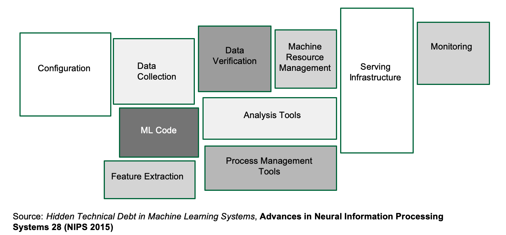

For many teams, dealing with the real-world implications of getting a machine learning model from a laptop to a deployment is overwhelming. To make things worse, there are a staggering amount of tools to handle one or more boxes that usually promise to solve all your machine learning woes.

Unfortunately, it is often time consuming for the team to learn a new tool. And integrating these tools into your current workflow is usually not straightforward.

Enter Kubeflow, a machine learning platform for teams that need to build machine learning pipelines. It also includes a host of other tools for things like model serving and hyper-parameter tuning. What Kubeflow tries to do is to bring together best-of-breed ML tools and integrate them into a single platform.

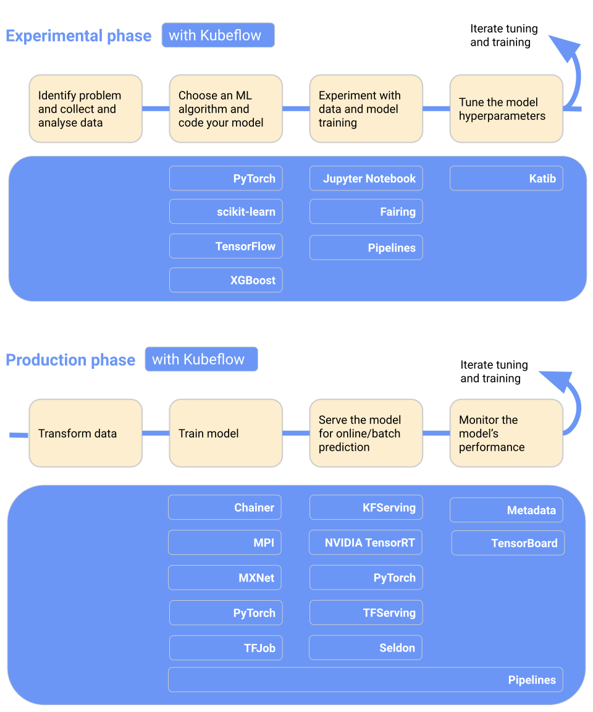
Source: https://www.kubeflow.org/docs/started/kubeflow-overview/

From its name, it should be pretty obvious that Kubeflow is meant to be deployed on Kubernetes. If you are reading this on the Rancher blog, chances are you already have a Kubernetes cluster deployed somewhere.

One important note: the “flow” in Kubeflow *doesn’t have to* mean TensorFlow. Kubeflow can easily work with PyTorch, and indeed, any ML framework (although TensorFlow and PyTorch are best supported).

## In This Blog: Installing Kubeflow

In this article, I’m going to show you how to install Kubeflow with as little fuss as possible. If you already have GPUs set up on your cluster, then great. Otherwise, you’ll need to perform some additional setup for GPUs, since a lot of machine learning happens to run on NVIDIA GPUs.

### Setting up GPU support on KubeFlow

This assumes that you’ve already installed Docker 19.x.

#### 1. Install the NVIDIA Container Runtime

On all the nodes with GPU(s):

```
% distribution=$(. /etc/os-release;echo $ID$VERSION_ID)
% curl -s -L https://nvidia.github.io/nvidia-docker/gpgkey | sudo apt-key add -
% curl -s -L https://nvidia.github.io/nvidia-docker/$distribution/nvidia-docker.list | sudo tee /etc/apt/sources.list.d/nvidia-docker.list
% sudo apt-get update && sudo apt-get install -y nvidia-container-toolkit
% sudo apt-get install nvidia-container-runtime
```

Now, modify the Docker daemon runtime field:

```
% sudo vim /etc/docker/daemon.json
```

Paste the following contents:

```
{
  "default-runtime": "nvidia",
  "runtimes": {
    "nvidia": {
      "path": "/usr/bin/nvidia-container-runtime",
      "runtimeArgs": []
    }
  }
}
```

Now restart the Docker daemon:

```
% sudo systemctl restart docker
```

#### 2. Install the NVIDIA Device Plugin

On the master node, create the NVIDIA device plugin:

```
% kubectl create -f https://raw.githubusercontent.com/NVIDIA/k8s-device-plugin/1.0.0-beta/nvidia-device-plugin.yml
```

With that out of the way, let’s get right on to Kubeflow.

## Installing Kubeflow

- Note: As of this time of writing, the latest version of Kubeflow is `1.0`. It is compatible with Kubernetes versions `1.14` and `1.15`.

### Step 0: Set up Dynamic Volume provisioning

Before we install Kubeflow, we need to set up dynamical provisioning.

One way is to use Rancher’s [`local-path-provisioner`](https://github.com/rancher/local-path-provisioner), where a `hostPath` based persistent volume of the node is used. The set up is straightforward: Point it to a path on the node and deploy the YAML file. However, the tradeoff is that you have no control over the volume capacity limit.

Another way is to use the Network File System (NFS), which I will show here.

#### Setting up the Network File System on the Master node

Assuming that you are going to store data mostly on-premises, then you need to set up NFS. Here, I’m assuming that the NFS server is going to be on the master node, `10.64.1.163`.

First, install the dependencies for NFS:

```
% sudo apt install -y nfs-common nfs-kernel-server
```

Then, create a root directory:

```
% sudo mkdir /nfsroot
```

Add the following entry to `/etc/exports`:

```
/full/path/to/nfsroot 10.64.0.0/16(rw,no_root_squash,no_subtree_check)
```

Note that `10.64.0.0` is the node’s CIDR, *not* the Kubernetes Pod CIDR.

Next, export the shared directory through the following command as `sudo`:

```
% sudo exportfs -a
```

Finally, to make all the configurations take effect, restart the NFS kernel server as follows:

```
% sudo systemctl restart nfs-kernel-server
```

Also, make sure the `nfs-kernel-server` starts up on (re)boot:

```
% sudo update-rc.d nfs-kernel-server enable
```

#### Setting up the Network File System (NFS) on the worker node(s)

Install the dependencies for NFS:

```
% sudo apt install -y nfs-common
```

#### Installing the NFS Client Provisioner

Now we can install the NFS Client Provisioner – and a perfect time to show you one of my favorite Rancher features: Catalogs!

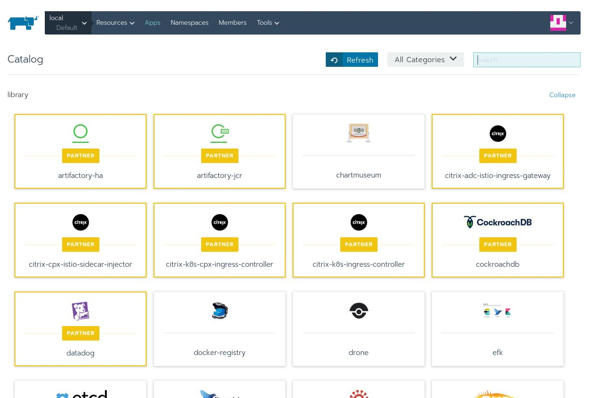

By default, Rancher comes with a bunch of supported apps that have been tried and tested. However, we can add the *entire* Helm chart catalog.

To do this, click of `Apps`, and `Manage Catalog`:

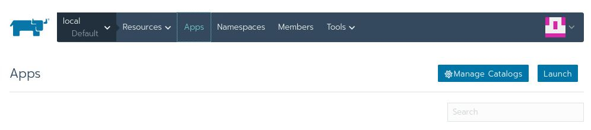

Then select `Add Catalog`:

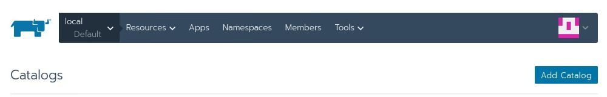

Fill in the following values:

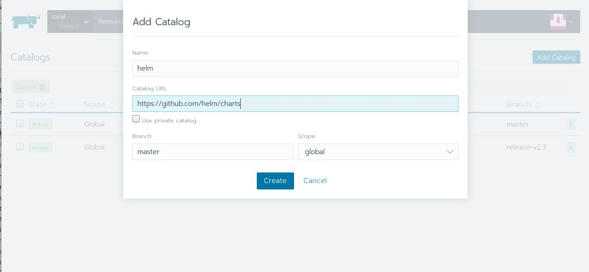

Hit `Create` and head back to the `Apps` page. Give it a little time, and you’ll see the `helm` section being populated with *lots* of apps. You can press `Refresh` to check the progress:

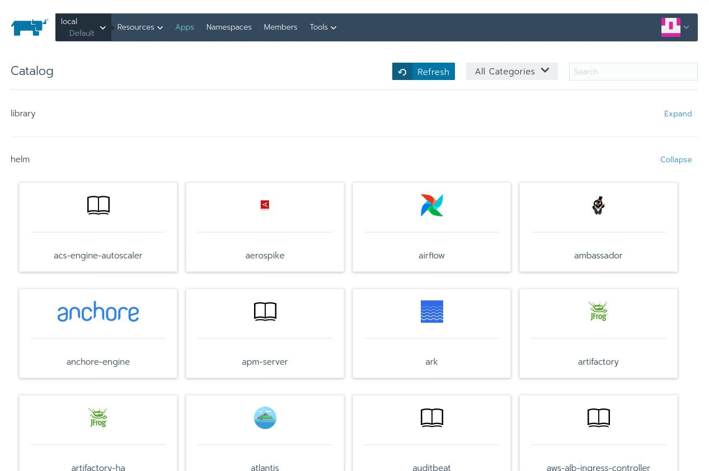

Now, type in `nfs` in the search bar and you’ll see two entries:

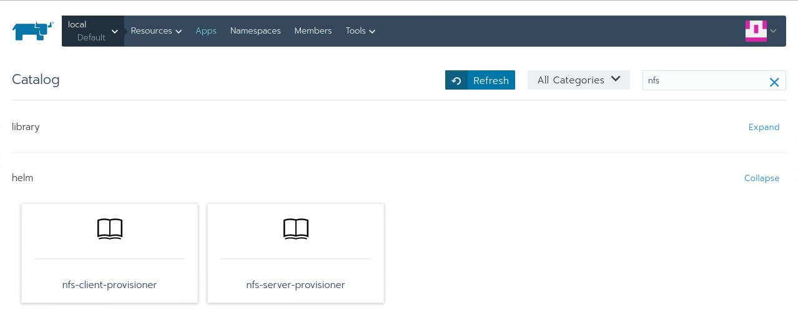

The one that we’re interested in is the `nfs-client-provisioner`. Click on that and this is what you’ll see:

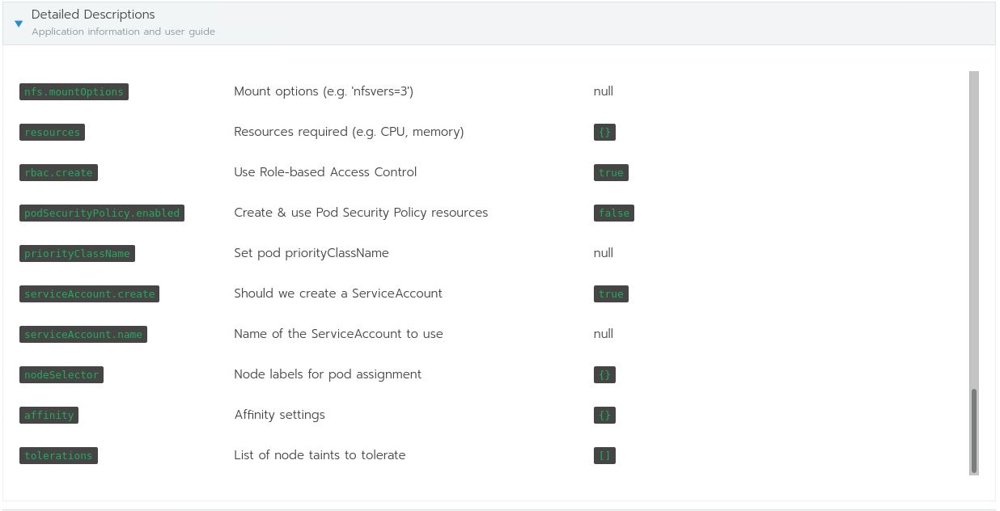

Here are all the options available for the `nfs-client-provisioner` chart. You will need them to fill out the following:

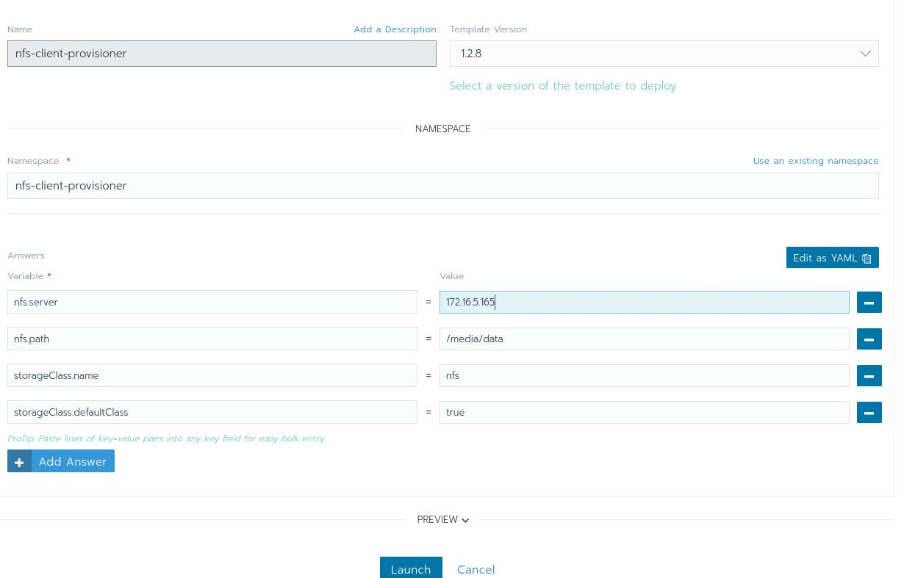

With that, you can hit the `Launch` button. Give Kubernetes some time to download the Docker image and set everything up. Once that’s done, you should see the following:

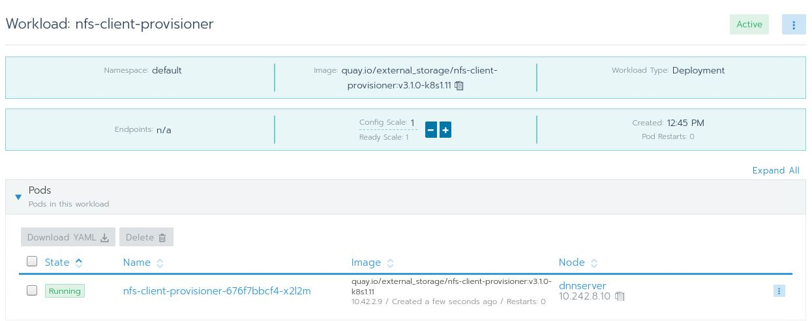

I *really* like Catalogs, and this is easily one of my favorite features of Rancher because it makes installing and monitoring apps on the cluster easy and convenient.

### Step 1: Download and install `kfctl`

This is the Kubeflow control tool, similar to `kubectl`. Download it from the [Kubeflow releases page](https://github.com/kubeflow/kfctl/releases/tag/v1.0.2).

Then unpack the file and place the binary in your `$PATH`.

### Step 2: Install Kubeflow

First specify a folder to store all the YAML files for Kubeflow.

```
$ export KFAPP=~/kfapp
```

Download the `kfctl` config file:

```
wget https://raw.githubusercontent.com/kubeflow/manifests/v1.0-branch/kfdef/kfctl_k8s_istio.v1.0.2.yaml
```

- Note: If you already have Istio installed, then you would want to edit `kfctl_k8s_istio.v1.0.2.yaml` and remove the `istio-crds` and `istio-install` application entries.

Then, export `CONFIG_URI`:

```
$ export CONFIG_URI="/path/to/kfctl_k8s_istio.v1.0.2.yaml"
```

Next, you need to specify the bunch of environment variables that indicate where the Kubeflow configurations files are to be downloaded:

```
export KF_NAME=kubeflow-deployment
export BASE_DIR=/opt
export KF_DIR=${BASE_DIR}/${KF_NAME}
```

Install Kubeflow:

```
% mkdir -p ${KF_DIR}
% cd ${KF_DIR}
% kfctl apply -V -f ${CONFIG_URI}
```

It takes a while for everything to get set up.

### Accessing the Kubeflow UI

To access the UI, we need to know the port where the web UI is located:

```
% kubectl -n istio-system get svc istio-ingressgateway
```

Returns:

```
NAME                   TYPE       CLUSTER-IP     EXTERNAL-IP   PORT(S)                                                                                                                                      AGE
istio-ingressgateway   NodePort   10.43.197.63   <none>        15020:30585/TCP,**80:31380/TCP**,443:31390/TCP,31400:31400/TCP,15029:32613/TCP,15030:32445/TCP,15031:30765/TCP,15032:32496/TCP,15443:30576/TCP   61m
```

In this case, it’s `80:31380`, which means that you can access the Kubeflow UI at `http://localhost:31380`:


If you managed to see this, congratulations! You have successfully set up Kubeflow.

## Conclusion

In this article, we explored the need for a tool like Kubeflow to control the inherent complexity of machine learning.

Next, we went through steps to prepare your cluster for serious machine learning work, in particular making sure that the cluster can make use of available NVIDIA GPUs.

In setting up NFS, we explored Rancher’s Catalog, and added the Helm chart repository to the catalog. This gives us the full range of Kubernetes apps that are available to install on your Kubernetes cluster.

Finally, we went through steps to install Kubeflow on the cluster.

In the next article, we will take a machine learning project and turn it into a Kubeflow pipeline.

Read our free white paper: How to Build a Kubernetes Strategy[Download Now](https://more.suse.com/fy21-global-web-landing-page-how-to-build-enterprise-kubernetes-strategy)
