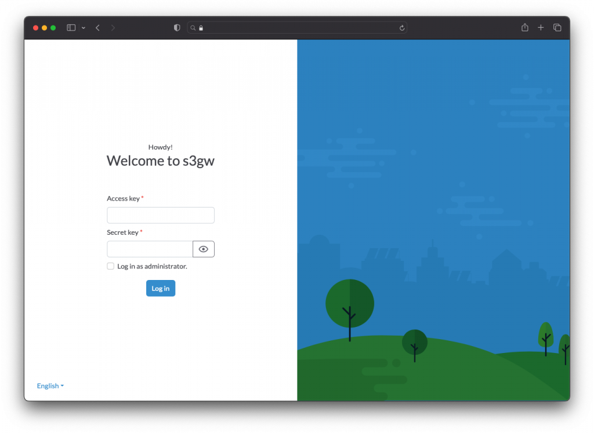
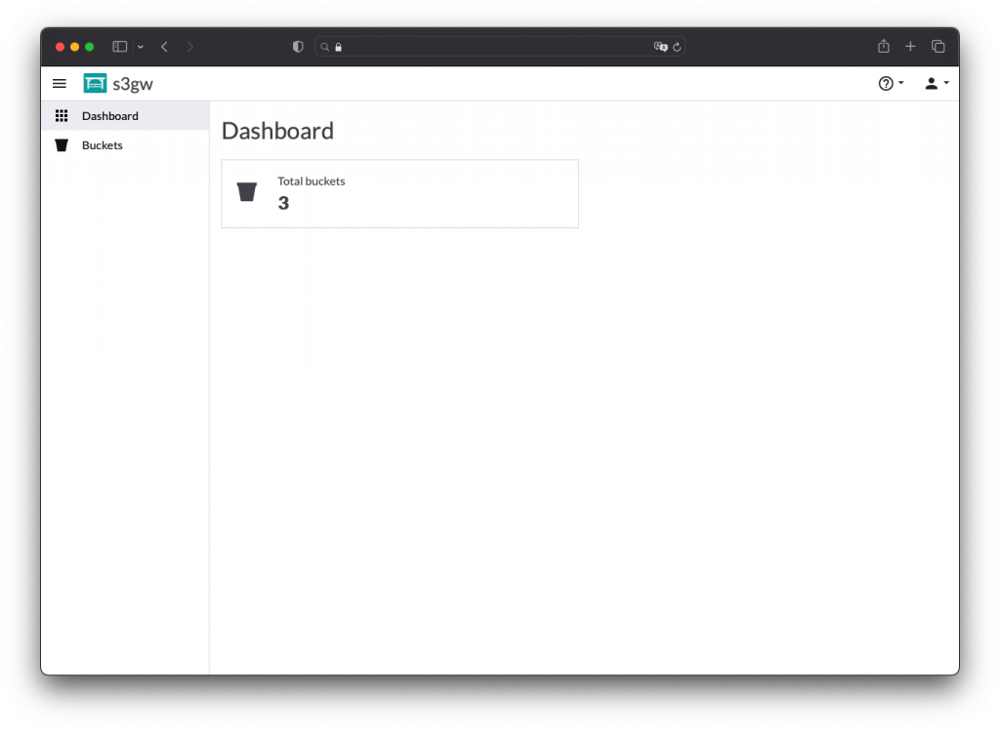
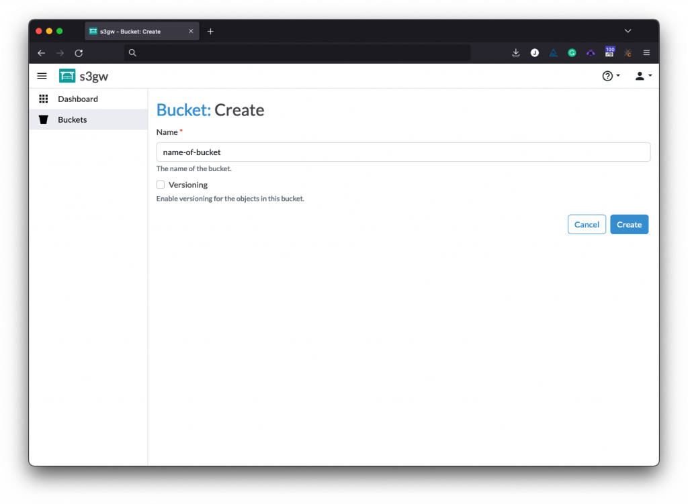
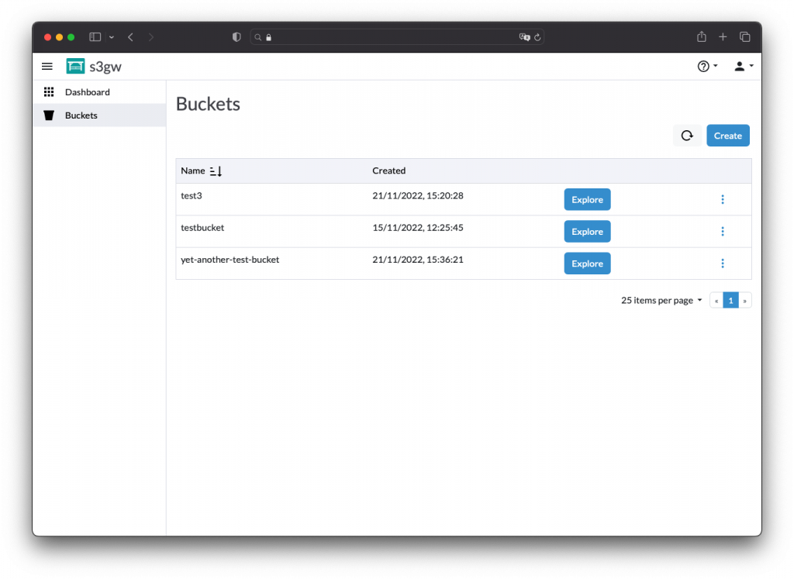
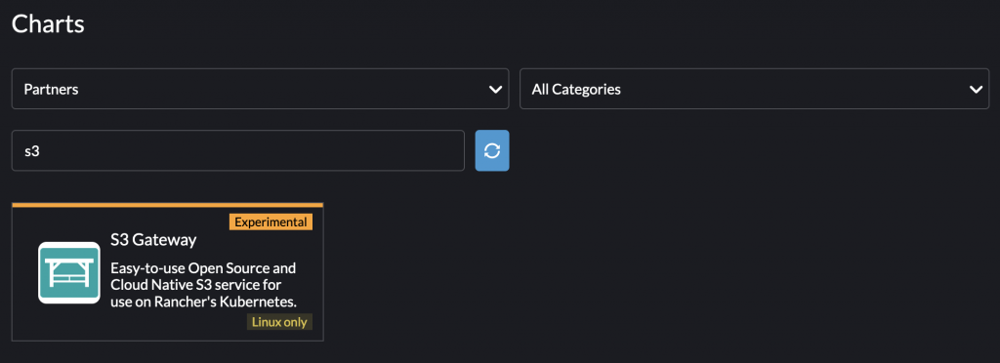

*The content of this article has been written by Joao Luis, Lead Developer in the s3gw team.*

## What is s3gw?

s3gw is an S3-compatible service focused on deployments in a Kubernetes environment backed by any PVC, including [Longhorn](https://longhorn.io/). Since its inception, the primary focus has been on cloud native deployments. However, the s3gw can be deployed in a myriad of scenarios, provided some form of storage is attached. 

s3gw is based on Ceph’s RADOSGW (RGW) but runs as a stand-alone service without the RADOS cluster and relies on a storage backend still under heavy development by the storage team at SUSE. The s3gw team is also developing a web-based UI for management and an object explorer. 

## The s3gw service

Distributed as a small container, the s3gw service runs RGW and exposes an S3-compatible API. Instead of requiring a full Ceph cluster deployment, we leverage RGW’s standalone capabilities and keep data on a local storage volume. Although the focus is on running within a Kubernetes environment with on-premise storage provided to the container, s3gw can consume any storage type with a filesystem on it. This can be PVC in Kubernetes or a local directory on a development machine. 

As the container consumes the storage volume, the object data is kept in a hash tree of directories and the metadata is kept in an SQLite database. This allows us to leverage the ACID properties of SQLite to ensure the state is committed atomically while keeping large blobs of data on the filesystem and away from SQLite’s path. 

In the future, we will release a blog post describing the s3gw service’s data store in more depth. 

However, it should be noted that we don’t support all RGW’s S3 APIs. Some components are still under development and other features not yet included that are required for proper operation. 

For example, while deleting objects and buckets is currently supported, we don’t support lifecycle management. Lifecycle policies and IAM are some of the things that we will be working on shortly. 

## The s3gw web UI

Also distributed as a small container, the s3gw web UI provides an intuitive way of interacting with the s3gw service. This includes user and bucket management, as well as an object explorer. 

We have a few screenshots of the current UI version below, but please keep in mind that we are still actively developing it and it is not feature-complete.

            

## Installing

You may find our Helm chart helpful if you have a Kubernetes cluster, whichever flavor that might be. You’ll be able to find it on [ArtifactHub](https://artifacthub.io/packages/helm/s3gw/s3gw), and our [documentation](https://s3gw-docs.readthedocs.io/en/latest/helm-charts/) can provide important insights as to available configuration values. 

Alternatively, if you are using Rancher, you may find s3gw available in the Partner repository, as depicted below:

## Call for action

We would love to hear from you about what you’d like to see on our roadmap. What would enable you best to use s3gw in your environment? 

Reach out to us at [s3gw@suse.com](mailto:s3gw@suse.com) or our [Slack channel](https://aquaristlabs.slack.com/archives/C03RFG0BES0). You can also join [our mailing list](https://lists.suse.com/mailman/listinfo/s3gw) or have a look at our [GitHub repository](https://github.com/aquarist-labs/s3gw) – feature requests are welcome! 🙂
