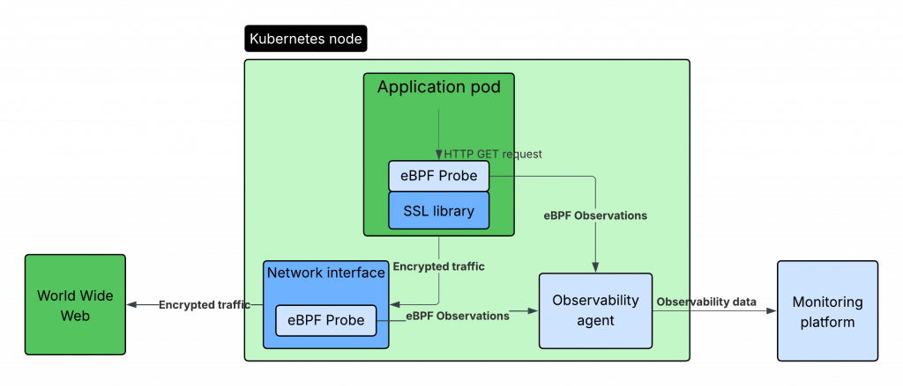

###

### Why observing TLS traffic with eBPF isn’t a risk

Monitoring deployed applications with eBPF is quickly becoming the standard for good reasons, [eBPF: Revolutionizing Observability for DevOps and SRE Teams](https://www.suse.com/c/ebpf-revolutionizing-observability-for-devops-and-sre-teams/). Not in the least because it allows monitoring to be a purely operations affair, instead of having to instrument each and every application individually. The security-conscious SRE and SRE manager will immediately ask the question: is this secure? And how about this claim that [HTTPS traffic can be monitored](https://www.suse.com/c/ebpf-revolutionizing-observability-for-devops-and-sre-teams/)? Is that not breaching encryption and thus security?

In short: yes, observing TLS traffic via eBPF can be done securely—if it’s implemented correctly. So how can HTTPS encrypted traffic be observed without actually breaking encryption? Let’s take a closer look.

### Where eBPF hooks into Application Data

As a quick refresher, eBPF can be used to retrieve application data by injecting small (eBPF) programs into the kernel at various points (probes). Depending on the point of injection, the program will be able to observe data and function calls pass by, and report this to user space, where an auxiliary program can forward the data to a central location, like [SUSE Observability](https://www.suse.com/products/rancher/observability/).

### How eBPF sees encrypted application data without decryption

eBPF can observe network traffic going through the system. However, because HTTPS traffic is encrypted, eBPF cannot get any information out of the encrypted stream. It is impossible to decrypt encrypted traffic.

The way eBPF is used to capture HTTPS traffic is by injecting an eBPF probe **before** the data is encrypted. This can be either by hooking into the userspace library call, like [openSSL](http://documentation) or [gnuTLS](https://www.gnutls.org/) or in the kernel HTTPS stack. The below image shows a diagram of this.

### 

### eBPF and HTTPS: Secure by Design

HTTPS was invented, among other things, to avoid ISPs and network hubs snooping the traffic that they are forwarding as infrastructure providers. With eBPF this stays the same, data will be encrypted on the wire. eBPF can capture data before it is encrypted, at the place that is deemed secure and DevOPS is in control, inside the application deployment itself. This is not different from instrumenting an application with metrics, only in an automated way.

Trust has to be put into your observability vendor or open-source eBPF product that is used, because that software runs with elevated rights to inspect traffic, be it HTTPS, HTTP or other technologies. Just like with any infrastructure tool, trust matters. That’s why it’s essential to choose a vendor or open-source project with a clear, auditable security model—especially when elevated kernel access is involved.and makes their eBPF code open source, to know that software that is deployed in your infrastructure can be trusted.

### Ready to See eBPF in Action on Amazon EKS?

[Explore how **SUSE Cloud Observability**](https://aws.amazon.com/marketplace/pp/prodview-w36cds3q4i2hc?trk=3cb03459-ec7e-4863-8cfa-9d04dd26709a&sc_channel=el&source=suse) SaaS uses eBPF to deliver real-time, code-free insights for encrypted workloads.

Gain visibility into service performance and application behavior without modifying code, breaking compliance, or decrypting traffic.

### **Need a Platform-Wide View?**

[**SUSE Rancher Prime**](https://www.suse.com/products/rancher/) includes [Observability](https://www.suse.com/products/rancher/observability/)—so you can monitor Kubernetes, VMs, and applications from a single, secure control plane.
