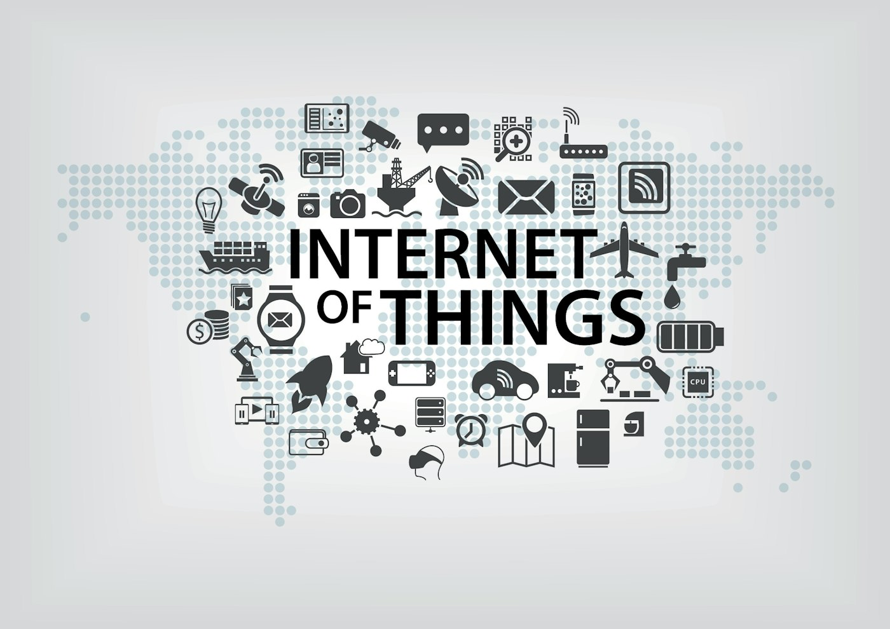

Internet of Things (IoT) is a network of physical objects embedded with electronics, software, sensors, and connectivity. These things interoperate in the existing internet infrastructure.

They achieve greater value and service by exchanging data with the manufacturer, operator, and/or connected devices. [Beaglebone](https://beagleboard.org/bone) is a great IoT device based upon arm architecture and is very portable and affordable.

[K3s](https://k3s.io/), developed by Rancher, and now an open source CNCF sandbox project, makes running lightweight Kubernetes on these devices a real possibility and opens a world of potential new applications. In this blog post, we'll explore how Beaglebone boards and K3s work together.

## IoT: What are these Things?

The properties of *things* involved in IoT are as follows:

- They are physical objects with input (sensors) and/or output (actuators). They interact with the physical world.
- They have connectivity to the internet or local connectivity via ethernet, Bluetooth, GSM, Wi-Fi, or any RF transceiver.
- They exchange data with websites, a cloud, or other *things*. Often, this data is available to the end-user via a smartphone, tablet, or PC.
- They have a kind of unique ID, such as IP addresses, RFID, or QR code.
- They have a small software logic that they follow. Once set up, almost no physical human interaction is involved.

A set of interrelated things form a system. For example, a traffic control system gets formed by smart traffic cameras, smart road notice boards, and servers that collect data from traffic cameras to display the traffic information on smart road notice boards. IoT is a system of such systems.

A [Beaglebone Black board](https://beagleboard.org/black/) is an [arm-based](https://www.arm.com/) development board designed to develop IoT concepts and test them. [You can read about Beagle boards here.](https://beagleboard.org/black/)

K3s is a lightweight Kubernetes distribution. It has been specifically optimized for arm architecture and perfectly matches the Beaglebone Black. You can read [the whitepaper](https://more.suse.com/rs/937-DCH-261/images/ARM-White-Paper-V3.pdf) from Mark Abrams and Bhumik Patel for more detail. 

## Concept

There are as many uses for a lightweight IoT board as the imagination will allow, from very simple to highly complex. For this article, I've come up with a relatable and simple real-world potential application.

#### “PUSH” Food and Beverage Ordering at a Football Stadium

Ordering food and beverages during halftime at a football game can be a slow process. You get in line, wait your turn to talk to the cashier, place your order, and pay. Then you (eventually) get your food, move out of line, and return to your seat.

This inefficient process wastes a lot of time and is unnecessary. I am proposing an IoT application that allows game patrons to place their orders simultaneously as they get near the counter, pay on their smart devices, and then pick their food up when ready, thereby avoiding the inefficient “line.”

#### Design

Many Beaglebone Black-based IoT devices are placed near the order counter. These devices are accessible through an HTTPS port at an address that patrons can access with their smartphones when within NFC range. [They can receive an NFC notification](https://www.androidauthority.com/what-is-nfc-270730/) when a consumer arrives, or a [QR code](https://scanova.io/blog/blog/2015/02/19/how-qr-codes-work/) is also displayed for the consumer without NFC to open the application.

Therefore, the Beaglebone will need to be configured with an NFC sensor input (sensors) to detect the smartphones and an output (actuators) to push the application open on the phones.

Consumers nearby open a microservices-based app on their phone browsers hosted on K3s nodes, allowing them to quickly place their order and pay without getting in line.

As many patrons that show up can place their order simultaneously without bogging down the server. The app is hosted on lightweight K3s, so it can also take advantage of the self-healing nature of Kubernetes and remain reliable at peak times.

Ordering in this fashion reduces the workload on staff as they do not have to take orders and payments. They can give their full attention to efficiently producing the food and beverage orders for counter pick up.

There are additional marketing benefits to this approach. You can also request patrons to sign up for text messages, post to social media, and place a tracking cookie in their browser. This will increase marketing outreach.

This approach is a win-win for the stadium and the patrons. The patrons get their food faster and waste less time, and the stadium (and team) get better customer satisfaction, more data, and more marketing outreach.

## Application Development Overview

Overview of how such an application could be built:

#### **Real-Time Stadium Ordering with NFC Sensor or QR Code Running on BeagleBone Black, Running k3s, and Pushing a Microservices-Based App**

1. Code the ‘App’ that will be served via HTTPS and hosted in a code repository. This will be microservices-based and include an ordering ‘front-end’ service for patrons, a payment gateway service, and a portal service for the staff to receive and acknowledge orders. A marketing ‘back-end’ service will also ask for social media posts and other marketing opt-ins.
2. Install all necessary hardware drivers on Beagle Bone and harden the software for updates and security.
3. Build a container image using modern CI/CD practices.
4. Run the container in a pod in K3.

## Detailed Development

#### Beaglebone Hardware Setup

- Perhaps simply using a QR Code to launch the app will be adequate. If you want to use an NFC feature, [here is a great article on how to hack NFC onto the Beaglebone boards using TI DLP chipsets from Auton Blackstone Engineering](https://austinblackstoneengineering.com/nfc-and-tivaware-on-the-trf790x0/).
- A second option for setting up NFC is the [Beaglebone Black RFID Adaptor Cape](https://elinux.org/BeagleBone_Black_RFID_Adaptor_Cape).

#### Beaglebone Linux OS

- The Beaglebone can be configured with Debian, Ubuntu, or Android flavors of Linux. Choose the flavor you are most comfortable with and get it configured. There are also options to run it as Node.js or with a Java VM, but these options aren’t better since we are running K3s.
- Configure network connection to the internet.
- Update using your package manager to make sure you are up to date.
- Quick Install K3s using: *sudo curl -sfL https://get.k3s.io | sh –*

Note: K3s defaults to *containered*. Please refer to Rancher Docs: Advanced Options and Configuration for complete installation and configuration details.

## Software Application Development

1. Set up GitHub or another code source repository to host your code.
2. Write the application as a microservices.
3. Create the container image using modern CI/CD practices.
4. Set up GitHub Actions to push the container image to your clusters when ready.

## Configuring K3s Clusters

The kubeconfig file stored at /etc/rancher/k3s/k3s.yaml is used to configure access to the Kubernetes cluster.

If you have installed upstream Kubernetes command line tools such as kubectl or helm, you will need to configure them with the correct kubeconfig path.

This can be done by either exporting the KUBECONFIG environment variable or invoking the --kubeconfig command line flag. Refer to the examples below for details.

## Operation

Copy /etc/rancher/k3s/k3s.yaml on your machine located outside the cluster as ~/.kube/config. Then replace “localhost” with the IP or name of your K3s server. Kubectl can now manage your K3s cluster.

## Conclusion

This blog post outlines a basic idea for an IoT project using  K3s and an inexpensive arm-based board. The fun thing with IoT is that the possibilities can go on as far as your imagination will take you.

How about adding RFID tags to the food cups and bins for easy real-time tracking? An alerting mechanism could let the counter workers know when food is ready or more food needs to be prepared. How about an alerting system to the food vendors with real-time inventory of food and drinks for supply chain optimization?

IoT solutions like this can be used for real-time diagnosis, image processing, facial recognition, label tracking, environmental sensors, etc.

In the age of IoT, hardware has become powerful and feature-rich, yet also more accessible and affordable than ever. Open source software products like K3s, developed by Rancher, bring the elasticity, redundancy, and reliability of Kubernetes to edge IoT devices. This expands their capabilities even further.

This will allow our tiny yet powerful IoT devices to take advantage of the elastic scalability, redundancy, and self-healing features of Kubernetes in a minimal package.

#### Want to make sure you don't miss any of the action? [Join the SUSE & Rancher Community](https://community.suse.com/sign_up?space_id=3669174&from=https%3A%2F%2Fcommunity.suse.com%2Ffeed%3Fautojoin%3D1%26autojoin_space_id%3D3669174) to get updates on new content coming your way!
