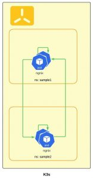
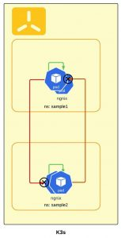

In this post we want to give a simple introduction for using network policies in a sample project and explaining how it works in K3s to help improving the security of your deployments.

There is a common misunderstanding about K3s support for network policies, as K3s is using flannel CNI by default, and the Flannel CNI doesn't support network polices. However, K3s is using [Kube-router](https://www.kube-router.io/), Network Policy Controller for providing support for network policies so network policies can also be used with K3s as within other Kubernetes distributions.

## Normal Pod inter-communications

In K3s by default, all services / pods in a given namespace are accessible from all other Pods in any other namespaces.



To give an example how Pods can communicate with each other, lets try this with simple nginx deployments and services in two different namespaces (sample1 and sample2) which we will use for our testing as follows:

*nginx.yaml*

```
apiVersion: apps/v1
kind: Deployment
metadata:
  name: nginx
  labels:
    app: nginx
spec:
  replicas: 1
  selector:
    matchLabels:
      app: nginx
  template:
    metadata:
      labels:
        app: nginx
    spec:
      containers:
      - name: nginx
        image: nginx
        ports:
        - containerPort: 80
---
apiVersion: v1
kind: Service
metadata:
  name: ngnix-service
spec:
  selector:
    app: nginx
  type: ClusterIP
  ports:
  - protocol: TCP
    port: 80
        targetPort: 80
```

Create the test namespaces and deploy nginx to both of them

```
# create first sample application
kubectl create ns sample1
kubectl apply -f nginx.yaml -n sample1

# create Second sample application
kubectl create ns sample2
kubectl apply -f nginx.yaml -n sample2
```

Now let’s try to play with curl within the Pods to check communication accessibility.

Client in sample1 -> service in sample2 namespace:

```
# From sample1 call sample2
kubectl exec -n sample1 $(kubectl get po -n sample1 -l app=nginx -o name) -- curl --max-time 2 http://ngnix-service.sample2.svc.cluster.local

# From sample1 call sample1
kubectl exec -n sample1 $(kubectl get po -n sample1 -l app=nginx -o name) -- curl --max-time 2 http://ngnix-service.sample1.svc.cluster.local:80
```

Client in sample2 à service in sample1 namespace:

```
# From sample2 call sample1
kubectl exec -n sample2 $(kubectl get po -n sample2 -l app=nginx -o name) -- curl --max-time 2 http://ngnix-service.sample1.svc.cluster.local:80

# From sample2 call sample2
kubectl exec -n sample2 $(kubectl get po -n sample2 -l app=nginx -o name) -- curl --max-time 2 http://ngnix-service.sample2.svc.cluster.local:80
```

You can see that I can reach from anywhere to anywhere.

## Restrict Pod inter-communications with NetworkPolicy

There is a nice UI tool for generating Networkploicy, [NetworkPolicy Editor](https://editor.cilium.io/). Which you can use to create or start with your NetworkPolicy

A sample NetworkPolicy looks as :

```
apiVersion: networking.k8s.io/v1
kind: NetworkPolicy
metadata:
  name: test-network-policy
  namespace: my-namespace
spec:
  podSelector:
    matchLabels:
      role: db <1>
  policyTypes:
  - Ingress
  ingress: <2>
  - from:
    - namespaceSelector:
        matchLabels:
          project: myproject
    - podSelector:
        matchLabels:
          role: frontend
    ports:
    - protocol: TCP
      port: 6379
```

<1> This selects particular Pods in the "current" namespace, to apply the policy on.

<2> List of whitelist ingress rules. Each rule allows traffic which matches the from sections.

There are four kind of selectors that can be specified in an ingress from section:

**ipBlock**: This selects particular IP CIDR ranges to allow as ingress sources. Normally this is cluster-external IPs, since Pod IPs are ephemeral || **podSelector**: | This selects particular Pods in the same namespace as the NetworkPolicy which should be allowed as ingress sources or egress destinations. |
| **namespaceSelector**: | This selects particular namespaces for which all Pods should be allowed as ingress sources or egress destinations. |
| **namespaceSelector and podSelector**: | A single from entry that specifies both namespaceSelector and podSelector selects particular Pods within particular namespaces.Configuring multitenant isolation using NetworkPolicyNow let’s configure isolation using NetworkPolicy definitions.      The following yaml will create isolation between services in different namespaces, so Pods within same namespace only are allowed to communicate with each other, and also allow incoming communication from ingress and monitoring Pods:   *networkPolicy.yaml*    ``` # Block all incoming traffic kind: NetworkPolicy apiVersion: networking.k8s.io/v1 metadata:   name: deny-by-default spec:   podSelector: {}   ingress: [] --- # Allow all traffic within the same namespace for all Pods apiVersion: networking.k8s.io/v1 kind: NetworkPolicy apiVersion: networking.k8s.io/v1 metadata:   name: allow-same-namespace spec:   podSelector: {}   ingress:   - from:     - podSelector: {} --- # Allow the ingress Pod “traefic” to communicate to all Pods in this namespace apiVersion: networking.k8s.io/v1 kind: NetworkPolicy metadata:   name: allow-all-svclbtraefik-ingress spec:   podSelector:      matchLabels:       svccontroller.k3s.cattle.io/svcname: traefik   ingress:   - {}   policyTypes:   - Ingress --- # Allow the ingress Pod “traefic” to communicate to all Pods in this namespace apiVersion: networking.k8s.io/v1 kind: NetworkPolicy metadata:   name: allow-all-traefik-v121-ingress spec:   podSelector:     matchLabels:       app.kubernetes.io/name: traefik   ingress:   - {}   policyTypes:   - Ingress --- # Allow the monitoring system Pods to communicate with all Pods in this namespace (to allow scraping the metrics) apiVersion: networking.k8s.io/v1 kind: NetworkPolicy metadata:   name: allow-from-cattle-monitoring-system spec:   ingress:     - from:       - namespaceSelector:           matchLabels:             kubernetes.io/metadata.name: cattle-monitoring-system   podSelector: {}   policyTypes:   - Ingress ```     Now apply the policies to the two sample namespaces:    ``` kubectl apply -f networkPolicy.yaml -n sample1 kubectl apply -f networkPolicy.yaml -n sample2 ```     After applying the above networkPolicy.yaml, you will need to explicitly whitelist any incoming communication (ingress). This includes the communication from ingress Pods or any other observability component deployed in another namespace.   Now let’s try again previous curl to check communication accessibility.    ``` # From sample1 call sample2 kubectl exec -n sample1 $(kubectl get po -n sample1 -l app=nginx -o name) -- curl --max-time 2 http://ngnix-service.sample2.svc.cluster.local  # From sample1 call sample1 kubectl exec -n sample1 $(kubectl get po -n sample1 -l app=nginx -o name) -- curl --max-time 2 http://ngnix-service.sample1.svc.cluster.local:80  # From sample2 call sample1 kubectl exec -n sample2 $(kubectl get po -n sample2 -l app=nginx -o name) -- curl --max-time 2 http://ngnix-service.sample1.svc.cluster.local:80  # From sample2 call sample2 kubectl exec -n sample2 $(kubectl get po -n sample2 -l app=nginx -o name) -- curl --max-time 2 http://ngnix-service.sample2.svc.cluster.local:80 ```     you should see now that communication between different namespace is blocked but the communication within the same namespace works well.Log & Debug NetworkPolicy CommunicationAnother aspect in NetworkPolicy is to be able to see the dropped packet due to the applied NetworkPolicy.   As the network rules are deployed via iptables in the KUBE-BWPLCY chain we can see them on the node that is currently hosting the Pod we want to analyze.   So let’s examine the generated iptables.   First, we need to check where the Pod is running, so we can know the node.    ``` kubectl get po -o wide -n sample1 NAMESPACE             NAME                                                  READY   STATUS    RESTARTS      AGE    IP              NODE       NOMINATED NODE   READINESS GATES sample1               nginx-6c8b449b8f-hhwhv                                1/1     Running   0             3d6h   192.168.248.2   node2 ```     go to node2, and get the KUBE-NWPLCY chains of iptables    ``` node2# iptables -L | grep KUBE-NWPLCY -B 2  iptables -L | grep KUBE-NWPLCY -B 2 target     prot opt source               destination  Chain KUBE-NWPLCY-6MLFY7WSIVQ6X74S (1 references) target     prot opt source               destination  Chain KUBE-NWPLCY-6ZMDCAWFW6IG7Y65 (0 references) -- RETURN     all  --  anywhere             anywhere             /* rule to ACCEPT traffic from all sources to dest pods selected by policy name: allow-all-svclbtraefik-ingress namespace sample1 */ match-set KUBE-DST-AZLS65URBWHIM4LV dst mark match 0x10000/0x10000  Chain KUBE-NWPLCY-CMW66LXPRKANGCCT (1 references) -- RETURN     all  --  anywhere             anywhere             /* rule to ACCEPT traffic from specified ipBlocks to dest pods selected by policy name: allow-from-cattle-monitoring-system namespace sample1 */ match-set KUBE-SRC-RCIDLRVZOORE5IEC src match-set KUBE-DST-T5UTRUNREWDWGD44 dst mark match 0x10000/0x10000  Chain KUBE-NWPLCY-DEFAULT (2 references) -- MARK       all  --  anywhere             anywhere             /* rule to mark traffic matching a network policy */ MARK or 0x10000  Chain KUBE-NWPLCY-EM64V3NXOUG2TAJZ (1 references) -- RETURN     all  --  anywhere             anywhere             /* rule to ACCEPT traffic from specified ipBlocks to dest pods selected by policy name: allow-same-namespace namespace sample1 */ match-set KUBE-SRC-DSEC5V52VOYVVZ4H src match-set KUBE-DST-5TPLTTXGTPDHQ2AH dst mark match 0x10000/0x10000  Chain KUBE-NWPLCY-IF5LSB2QJ2HY5MD6 (0 references) -- RETURN     all  --  anywhere             anywhere             /* rule to ACCEPT traffic from all sources to dest pods selected by policy name: allow-all-metrics-server namespace sample2 */ match-set KUBE-DST-SLTMPYMXLDXEGN2N dst mark match 0x10000/0x10000  Chain KUBE-NWPLCY-JLWJCN3BZPDM2H2S (0 references) -- RETURN     all  --  anywhere             anywhere             /* rule to ACCEPT traffic from all sources to dest pods selected by policy name: allow-all-traefik-v121-ingress namespace sample2 */ match-set KUBE-DST-Z5YXSV5A3HW7QEMX dst mark match 0x10000/0x10000  Chain KUBE-NWPLCY-KPPTNODTCDOZKNDG (1 references) -- RETURN     all  --  anywhere             anywhere             /* rule to ACCEPT traffic from specified ipBlocks to dest pods selected by policy name: allow-same-namespace namespace sample2 */ match-set KUBE-SRC-PPKM45TJKI5WPLEO src match-set KUBE-DST-OH37RT6TQZFFFG4U dst mark match 0x10000/0x10000  Chain KUBE-NWPLCY-LC5K2MMOQPHUDAFL (0 references) -- RETURN     all  --  anywhere             anywhere             /* rule to ACCEPT traffic from all sources to dest pods selected by policy name: allow-all-metrics-server namespace sample1 */ match-set KUBE-DST-OS7MZYVUHTNBW4D3 dst mark match 0x10000/0x10000  Chain KUBE-NWPLCY-LITCOYC5GR43MINT (1 references) -- RETURN     all  --  anywhere             anywhere             /* rule to ACCEPT traffic from specified ipBlocks to dest pods selected by policy name: allow-from-cattle-monitoring-system namespace sample2 */ match-set KUBE-SRC-TG364RXZIZFBYMO4 src match-set KUBE-DST-2CMQQKUI4WHO4LO2 dst mark match 0x10000/0x10000  Chain KUBE-NWPLCY-LRJI53H5EAIJQPB3 (0 references) -- RETURN     all  --  anywhere             anywhere             /* rule to ACCEPT traffic from all sources to dest pods selected by policy name: allow-all-svclbtraefik-ingress namespace sample2 */ match-set KUBE-DST-J3FS6JPAPN6WYKQ3 dst mark match 0x10000/0x10000  Chain KUBE-NWPLCY-OAOLJMET76F4DFR2 (0 references) -- RETURN     all  --  anywhere             anywhere             /* rule to ACCEPT traffic from source pods to all destinations selected by policy name: default-allow-all namespace cattle-fleet-system */ match-set KUBE-SRC-ZG5DZU6W3SRJLEIO src mark match 0x10000/0x10000  Chain KUBE-NWPLCY-RJITOIYNFGLSMNHT (1 references) target     prot opt source               destination  Chain KUBE-NWPLCY-SKPLSSRNIO2OF3IY (0 references) -- ACCEPT     all  --  anywhere             anywhere             /* rule for stateful firewall for pod */ ctstate RELATED,ESTABLISHED ACCEPT     all  --  anywhere             192.168.248.3        /* rule to permit the traffic traffic to pods when source is the pod's local node */ ADDRTYPE match src-type LOCAL KUBE-NWPLCY-DEFAULT  all  --  192.168.248.3        anywhere             /* run through default egress network policy  chain */ KUBE-NWPLCY-6MLFY7WSIVQ6X74S  all  --  anywhere             192.168.248.3        /* run through nw policy deny-by-default */ KUBE-NWPLCY-LITCOYC5GR43MINT  all  --  anywhere             192.168.248.3        /* run through nw policy allow-from-cattle-monitoring-system */ KUBE-NWPLCY-KPPTNODTCDOZKNDG  all  --  anywhere             192.168.248.3        /* run through nw policy allow-same-namespace */ -- ACCEPT     all  --  anywhere             anywhere             /* rule for stateful firewall for pod */ ctstate RELATED,ESTABLISHED ACCEPT     all  --  anywhere             192.168.248.2        /* rule to permit the traffic traffic to pods when source is the pod's local node */ ADDRTYPE match src-type LOCAL KUBE-NWPLCY-DEFAULT  all  --  192.168.248.2        anywhere             /* run through default egress network policy  chain */ KUBE-NWPLCY-CMW66LXPRKANGCCT  all  --  anywhere             192.168.248.2        /* run through nw policy allow-from-cattle-monitoring-system */ KUBE-NWPLCY-EM64V3NXOUG2TAJZ  all  --  anywhere             192.168.248.2        /* run through nw policy allow-same-namespace */ KUBE-NWPLCY-RJITOIYNFGLSMNHT  all  --  anywhere             192.168.248.2        /* run through nw policy deny-by-default */ ```     Now we will watch the chain KUBE-NWPLCY-EM64V3NXOUG2TAJZ (will have a different name in your deployment) which is allow-same-namespace namespace sample1, at the same time we will run again our curl test:    ``` watch -n 2 -d iptables -L KUBE-NWPLCY-EM64V3NXOUG2TAJZ -nv  Every 2.0s: iptables -L KUBE-NWPLCY-EM64V3NXOUG2TAJZ -nv                                                                                                                         node2: Mon Mar  6 20:18:38 2023 Chain KUBE-NWPLCY-EM64V3NXOUG2TAJZ (1 references)  pkts bytes target     prot opt in     out     source               destination     4   240 MARK       all  --  *      *       0.0.0.0/0            0.0.0.0/0            /* rule to ACCEPT traffic from source pods to dest pods selected by policy name allow-same-namespace namespace sample1 */ match-set KUBE-SRC-OPGXQ4TCHJJUUOWB src match-set KUBE-DST-5TPLTTXGTPDHQ2AH dst MARK or 0x10000     4   240 RETURN     all  --  *      *       0.0.0.0/0            0.0.0.0/0            /* rule to ACCEPT traffic from source pods to dest pods selected by policy name allow-same-namespace namespace sample1 */ match-set KUBE-SRC-OPGXQ4TCHJJUUOWB src match-set KUBE-DST-5TPLTTXGTPDHQ2AH dst mark match 0x10000/0x10000     0     0 MARK       all  --  *      *       0.0.0.0/0            0.0.0.0/0            /* rule to ACCEPT traffic from specified ipBlocks to dest pods selected by policy name: allow-same-namespace namespace sample1 */ match-set KUBE-SRC-DSEC5V52VOYVVZ4H src match-set KUBE-DST-5TPLTTXGTPDHQ2AH dst MARK or 0x10000     0     0 RETURN     all  --  *      *       0.0.0.0/0            0.0.0.0/0            /* rule to ACCEPT traffic from specified ipBlocks to dest pods selected by policy name: allow-same-namespace namespace sample1 */ match-set KUBE-SRC-DSEC5V52VOYVVZ4H src match-set KUBE-DST-5TPLTTXGTPDHQ2AH dst mark match 0x10000/0x10000 ```     You see that during running the curl test the **counter** is keep changing showing the accepted and dropped packets.   Packets dropped by network policies can also be logged. The dropped packet is sent to the iptables NFLOG action, which shows the packet details, including the network policy that blocked it.   To convert NFLOG to log entries, one can install ulogd2 / ulogd package and configure [log1] to read on group=100. Then, restart the ulogd2 service for the new config to be committed.   To log all those packets to a file, ulogd2 requires the following configuration at /etc/ulogd.conf, already there a sample file created but following is the one we used for this exercise:    ``` [global]                                                                                                                 logfile="syslog" loglevel=3                                                                                                               plugin="/usr/lib/x86_64-linux-gnu/ulogd/ulogd_inppkt_NFLOG.so" plugin="/usr/lib/x86_64-linux-gnu/ulogd/ulogd_filter_IFINDEX.so" plugin="/usr/lib/x86_64-linux-gnu/ulogd/ulogd_filter_IP2STR.so" plugin="/usr/lib/x86_64-linux-gnu/ulogd/ulogd_filter_IP2BIN.so" plugin="/usr/lib/x86_64-linux-gnu/ulogd/ulogd_filter_PRINTPKT.so" plugin="/usr/lib/x86_64-linux-gnu/ulogd/ulogd_filter_HWHDR.so" plugin="/usr/lib/x86_64-linux-gnu/ulogd/ulogd_raw2packet_BASE.so" plugin="/usr/lib/x86_64-linux-gnu/ulogd/ulogd_output_LOGEMU.so"   # this is a stack for logging packet send by system via LOGEMU stack=log1:NFLOG,base1:BASE,ifi1:IFINDEX,ip2str1:IP2STR,print1:PRINTPKT,emu1:LOGEMU  [log1] group=100  [emu1] file="/var/log/ulog/syslogemu.log" sync=1 ```     After modification of the configuration file, ensure that ulogd is restarted    ``` systemctl restart ulogd2.service ```     In case a packet is blocked by network policy rules, a log message will appear in /var/log/ulog/syslogemu.log.    ``` # cat /var/log/ulog/syslogemu.log  Mar  7 09:35:43 cluster-k3s-masters-a3620efa-5qgpt  IN=cni0 OUT=cni0 MAC=da:f6:6e:6e:f9:ce:ae:66:8d:d5:f8:d1:08:00 SRC=10.42.0.59 DST=10.42.0.60 LEN=60 TOS=00 PREC=0x00 TTL=64 ID=50378 DF PROTO=TCP SPT=47750 DPT=80 SEQ=3773744693 ACK=0 WINDOW=62377 SYN URGP=0 MARK=20000 ```         NOTE | Don't forget you need to check the iptables and ulogd on the node hosting the Pod container where your NetworkPolicy ingress rule apply.   Hint: a central logging system can make this easier.       If there is a lot of traffic, the logging file could grow very fast. To control that, set the "limit" and "limit-burst" iptables parameters appropriately by adding the following annotations to the network policy in question:  - kube-router.io/netpol-nflog-limit=<LIMIT-VALUE>  - kube-router.io.io/netpol-nflog-limit-burst=<LIMIT-BURST-VALUE>  Default values are limit=10/minute and limit-burst=10.References :  - [Kubernetes Network Policies](https://kubernetes.io/docs/concepts/services-networking/network-policies) - [K3s - Lightweight Kubernetes](https://github.com/k3s-io/k3s/blob/master/README.md) - [Hardening Guide - NetworkPolicies](https://docs.k3s.io/security/hardening-guide#networkpolicies) - [Additional Network Policy Logging](https://docs.k3s.io/advanced#additional-network-policy-logging) |
