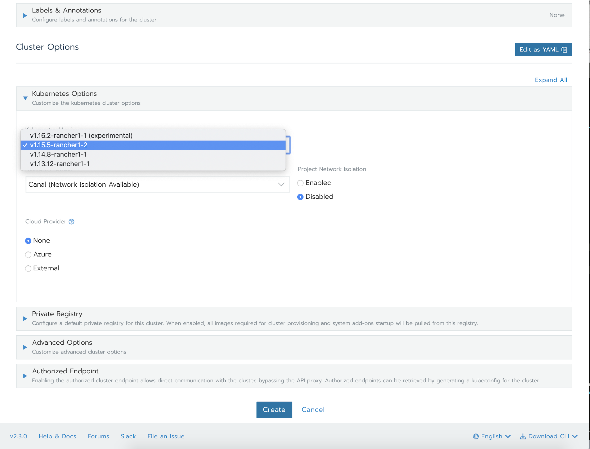
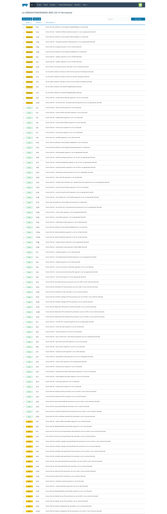
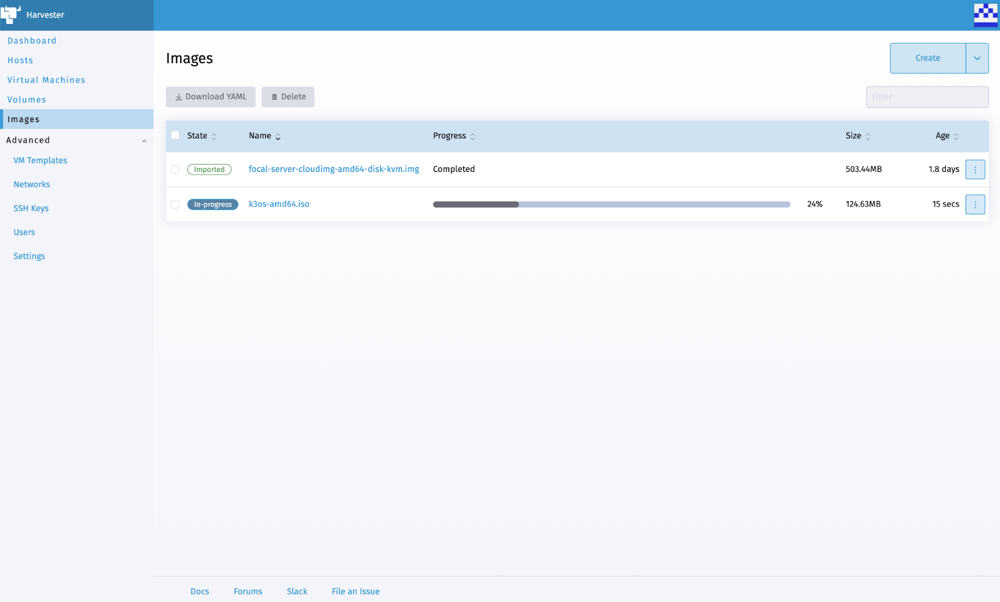

Read the Guide to Kubernetes with RancherThis guide shows the challenges in running Kubernetes in production and how Rancher helps.[Get the whitepaper](https://more.suse.com/fy21-global-web-landing-page-guide-to-kubernetes)

Kubeflow v1.0 was released on March 2, 2020 Kubeflow and there was much rejoicing. The [banner announcement](https://medium.com/kubeflow/kubeflow-1-0-cloud-native-ml-for-everyone-a3950202751), “Cloud-Native ML for Everyone,” while clearly hyperbole, is evidenced by the streamlined command-line interface (CLI), informative and intuitive dashboard and comprehensive cloud provider documentation. Compounded with a best-in-class product suite supporting each phase in the machine learning (ML) lifecycle, Kubeflow stands unrivaled in the arena of ML standardization. So will Kubeflow radically change the landscape of Kubernetes/machine learning workloads in a few short months? Ideally yes, but probably not.

## Machine Learning Meets Kubernetes

Kubernetes and Machine Learning are undeniably complex concepts and few practitioners have a comprehensive understanding of both. For Kubeflow to approach Kubernetes levels of ubiquity, Kubernetes engineers must work their way up the stack while machine learning engineers work their way down. The distance most Kubernetes engineers have to go is best illustrated in the subsequent installation of Kubeflow on vanilla Kubernetes.

As previously stated, the documentation for Kubeflow is excellent and the [Getting Started](https://www.kubeflow.org/docs/started/) section is no exception. From the perspective of a machine learning practitioner, the document gives a comprehensive introduction to the domain, toolset and their correlations. However, from an operations perspective it seems kubernetes is already being ‘swept under the carpet.’

A relational depiction of the components underpinning Kubeflow

Image 1 does not give any misinformation, but it does not appropriately represent the “scaffolding” as it relates to Kubernetes – particularly Istio, Argo, Prometheus and Spartakus. Also, there is no mention of the many other significant components on which this project depends (Knative, tektoncd, etc.). The following image, found in this subsequent section of the documentation, more accurately depicts the dependency relation:

A relational depiction of the components underpinning KFServing (a component of Kubeflow)

This bias aligns directly with Kubeflow’s mission, “to customize the stack based on user requirements (within reason) and let the system take care of the ‘boring stuff.’” Doing so creates a trojan horse most Kubernetes engineers will reject on sight. Where then, do we lose the everyman Kubernetes engineer?

## Installing Kubeflow into a Kubernetes Cluster

Here are the basic Kubernetes requirements for installing Kubeflow into a pre-existing cluster:

1. A Kubernetes cluster…
   a. with a version between 1.11 and 1.15
   b. with at least one worker node having 4CPU, 50GB storage, and 12GB memory
   c. with the ability to use some amount of dynamic storage provisioning
2. kubectl (with kustomize)
3. kfctl

Kustomize has been a feature of the kubectl cli since version 1.14, and storage classes long before that. These are table stakes.

For the price of:

…a docker run command:

`docker run -d --restart=unless-stopped -p 80:80 -p 443:443 rancher/rancher:2.3.5`

…credentials (Azure, AWS, GCP respectively)

…and a few clicks (the astute observer will notice an SSH Key and Resource Group are required for AKS)

Rancher gives you all that in a matter of moments – for each of the major cloud providers. As such, the prerequisites are not daunting. However, proceeding through the entire installation as outlined [here, for instance,](https://www.kubeflow.org/docs/started/k8s/kfctl-k8s-istio/) is trivialized by the kfctl client. Assuming everything has gone smoothly up to this point, then you’ve arrived at the crucial juncture. You’ve deployed Kubeflow! Immediately to your left you’ll see the golden path paved with [component overviews](https://www.kubeflow.org/docs/components/), [samples](https://www.kubeflow.org/docs/examples/kubeflow-samples/) and [tutorials](https://www.kubeflow.org/docs/examples/codelabs-tutorials/). And to your right you’ll see an imposing wall composed of service mesh, eventing, pipelining and policy enforcement windowed only by each project’s documentation. (One slight exception to this rule happens when Istio is discussed [briefly](https://www.kubeflow.org/docs/other-guides/istio-in-kubeflow/).)

In truth, there is nothing inherently wrong with this split. Kubeflow aims to abstract the infrastructure components and focus on the ease of use for machine learning workflows. In practice, however, day two operations are inevitable, and some person/team/organization will ultimately be responsible for understanding the configuration options, flows and attack vectors of each deployed service. Using the basic install ([v1.0.1](https://raw.githubusercontent.com/kubeflow/manifests/v1.0-branch/kfdef/kfctl_k8s_istio.v1.0.1.yaml) to be specific) results in 51 services and 58 workloads of which only half are strictly machine learning components.

Istio Workloads

Knative Workloads

Kubeflow Workloads

## What’s Next for Machine Learning and Kubernetes

With so many moving parts, operations become a Herculean feat, but there is hope. The Kubernetes community continues to expand and mature. Sophisticated practices, once obscure and obtuse, are becoming more and more ubiquitous. We’re using infrastructure as code, declarative operations through GitOps, incremental deployment strategies such as canary rollouts and controller/operator patterns with increasing frequency. You could even claim that the service mesh concept has bridged the gap from hyper-scalers and tech giants to general practice. Don’t believe me? If you’re still running the Rancher instance above, then try it out and see for yourself!

The remaining hurdles from an operational perspective are the Knative eventing and serving components, the building/pipelining components of tektoncd/argocd and to a small degree, the policy and rules enforcement of OPA/gatekeeper. Combined with a knowledge of Istio, these constitute the scaffolding on which to structure the machine learning components themselves. Only through a basic understanding of these projects can a Kubernetes operator start to comprehend the flows and relationships of Kubeflow.

Not all organizations/individuals have the same appetite for the expansive and somewhat volatile ecosystem surrounding Kubernetes. Thankfully there’s Rancher. Rancher flattens the learning curve for Kubernetes and related technologies by allowing even the most conservative teams to take advantage of complex technologies safely within the bounds of an intuitive experience and community-proven best practice configuration.

For the operators in the audience, keep climbing. Kubernetes is complex but rewarding. It’ll soon be everywhere.

For the machine learning engineers, be patient. Kubeflow installation may be quick and painless, but a stable platform comes through a deep understanding of the entire stack.

And for the Kubeflow community, thank you. We’re closer than ever to bridging the gap between Kubernetes and ML/AI. It’s clear that user experience is critical to your mission, and that soon enough there may be “cloud-native ML for everyone”– developers, scientists and operators alike.

Read the Guide to Kubernetes with RancherThis guide shows the challenges in running Kubernetes in production and how Rancher helps.[Get the whitepaper](https://more.suse.com/fy21-global-web-landing-page-guide-to-kubernetes)
