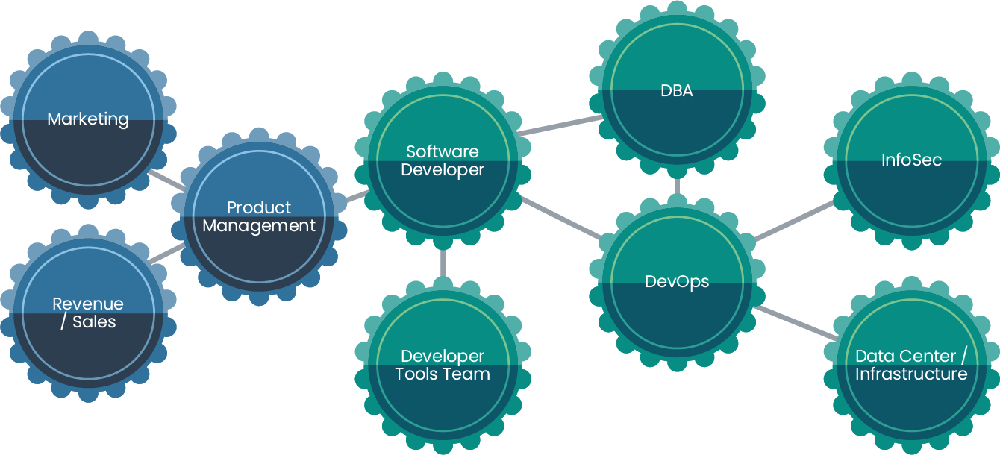
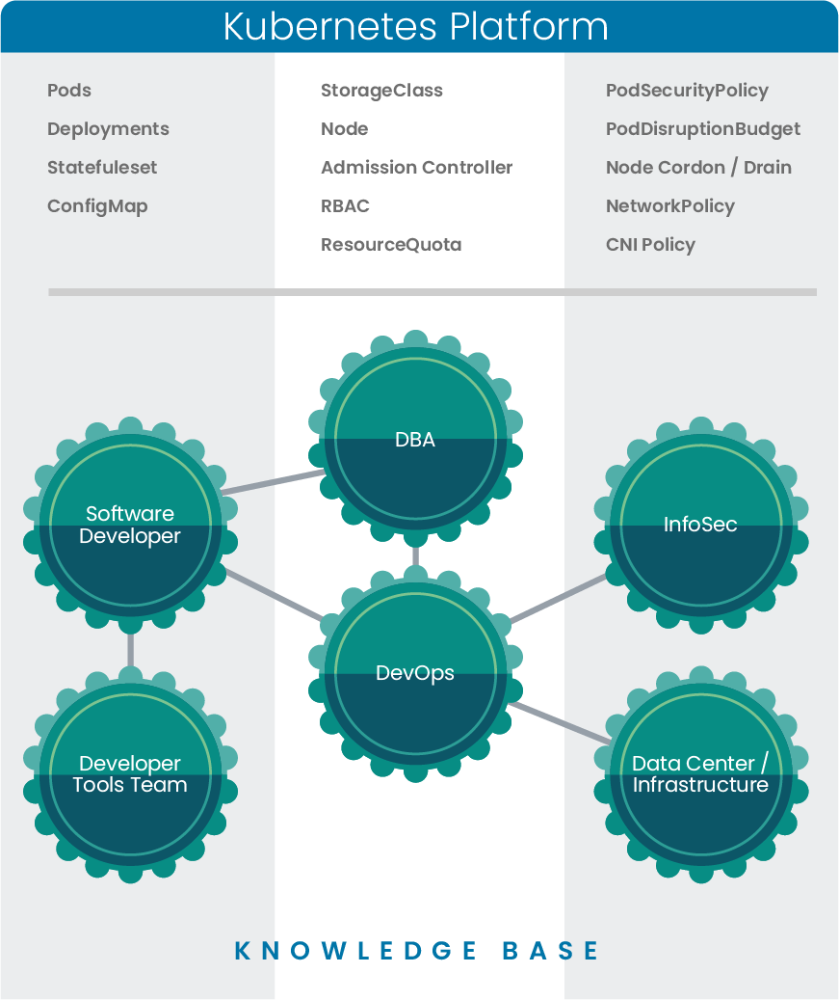

Read our free white paper: How to Build a Kubernetes Strategy[Download Now](https://more.suse.com/fy21-global-web-landing-page-how-to-build-enterprise-kubernetes-strategy)

In today’s enterprises, we spend much of our time dealing with information, whether it’s data, knowledge or analytics. Just like the assembly line workers of last century, today’s knowledge workers deal with similar logistics of taking raw materials as an input and producing a finished product as an output. Only in this case, the raw material is all the unorganized and sometimes random information at our disposal, and the finished product is structured information. Yet we still sit in a proverbial production line of workers.

The Ford assembly line in 1913. (Wikimedia Commons/public domain)

Think about the amount of time you spend reading email, checking Slack or sitting in meetings. All of this is about receiving information to better fulfill your job duties – and sharing information to help others do the same. Knowledge within today’s enterprise is often a highly distributed property: individuals possess a portion of company’s collective knowledge. In this article, we’ll explore the connection between enterprise knowledge and Kubernetes.

## The Enterprise Knowledge Graph

Let’s explore enterprise knowledge in terms of a “knowledge graph.” The graph consists of many connected nodes in a system, with different degrees of separation depending on our role in the organization. On one end of the graph, a node (person) understands much less about what goes on at the far end of the graph. Connections between nodes (people) are created as those nodes require more collaboration with one another. And finally, we have the basic system in which information flows throughout an organization.

Let’s say you’re a developer responsible for an API. You know a lot about the API’s design. However, you need to interact with a database, so you work with a DBA team. You also need to know how this API will run in production, so you consult with a DevOps team. Finally, this will require network services, so you’ll have to ask another team how you can get traffic to the API. In this example, four “nodes” are interacting and exchanging knowledge. And why do you need so much information? Well, often it’s because we need to make decisions in software that require us to consider the interactions of the change with many components of the system.

As this API developer, you’d likely get the information you needed through Slack, meetings and wikis. What if you could build your API so that you only had to provide the information for which you’re responsible? Other teams would handle the concerns of the other systems supporting your API independently and without human coordination. This is the vision behind Kubernetes.

## Kubernetes and Organizational Knowledge

Kubernetes was designed by engineers who dealt with organizational knowledge graphs of massive scale. Consider that Google has almost 100,000 employees, who all have to coordinate with one another. Efficiency is improved through a system that intersects the knowledge graph in such a way where each “node” can work within their expertise without having to understand the details of the greater system. Allowing engineers to focus on their core competency and not spend their energy learning someone else’s expertise strengthens their unique contribution to the organization. Read the research paper [Large Scale Cluster Management at Google with Borg](https://research.google/pubs/pub43438/) if you are curious about Google’s findings.

## Amazon.com and Knowledge Exchange

We should acknowledge that this pattern existed at Amazon.com early on as well. In 2002, Jeff Bezos issued an internal memo that some call “[The API Mandate](https://api-university.com/blog/the-api-mandate/).” A couple of its key points are:

1. All teams will henceforth expose their data and functionality through service interfaces.
2. Teams must communicate with each other through these interfaces.
3. There will be no other form of inter-process communication allowed: no direct linking, no direct reads of another team’s data store, no shared-memory model, no back-doors whatsoever. The only communication allowed is via service interface calls over the network.

As Amazon.com scaled, the company was protecting itself from the knowledge graph collapsing under its weight. They put patterns and interfaces in place that made it clear where and how people could exchange information. Kubernetes takes this pattern to the next level by addressing the systems beyond the API layer.

## Pod Disruption Budget in Kubernetes

Let’s look at the [pod disruption budget](https://kubernetes.io/docs/concepts/workloads/pods/disruptions/#how-disruption-budgets-work), a construct in Kubernetes that allows teams managing the infrastructure or data center to calculate the impact of maintenance activities on the applications they support. Traditionally, removing servers from a cluster requires careful coordination with the application teams to understand how the applications are distributed, how they handle failure, the level of redundancy they have, etc. This process could easily require a week or two of meetings, emails and discussions before performing said task. With a PodDisruptionBudget (PDB), application teams can articulate the tolerances of their application in code and infrastructure teams can use the Kubernetes API to remove a node while ensuring that doing so won’t violate any of the tolerances of the applications running on that node. All this requires zero human coordination.

Notice how Kubernetes is the continous thread that intersects the different parts of the graph. Kubernetes becomes an asynchornous conduit of information flow.

## Realize the Potential of Kubernetes

Every enterprise today has the choice of embracing this way of thinking. It is quite possible to use Kubernetes in such a way where it requires lots of human coordination and doesn’t realize its benefits. Don’t mistake Kubernetes capabilities for a free pass on rethinking your software engineering process. The reality is that many companies may never realize the potential of Kubernetes simply because of how they use it. Optimal use of Kubernetes benefits the organization by reducing the friction and interdependency of all of the parts. As a company scales and adds more teams, it can still maintain efficiency because teams can coordinate through the platform’s structured framework. Fortunately, there are many resources available for companies that want to take a different approach to software engineering and use cloud-native design principles to their fullest.

## Improve Your Knowledge Graph with Kubernetes

So, what can you do to make your knowledge graph more efficient? Start by looking at the high trafficked workflows in your software engineering org. For instance, if a developer wants to build a new API, what tasks do they have to take? How do they allocate compute, storage and networking to develop it? How will they do this once it moves into a production capacity? Who are all the people and teams that a developer would need to interact with to accomplish those tasks? Can any of those tasks be handled in a self-service or asynchronous way? Can they build an internal API for handling any of those tasks?

Where do you begin? Start with a whiteboarding session with the key team members and discuss the way the you work with each other. Couple that with a holistic understanding of the Kubernetes features and APIs so that you might find creative ways to apply Kubernetes to this problem. The Kubernentes documentation is a great place to start. Discuss ideas for Kuberenetes implementation with the community can be helpful. Spend time in the Rancher Users slack where hundreds of other engineers like you are discovering new and more useful ways to apply cloud native design to their environments.

And most importantly, remember it’s a journey. Take it one step at a time and have some fun solving problems along the way.

Read our free white paper: How to Build a Kubernetes Strategy[Download Now](https://more.suse.com/fy21-global-web-landing-page-how-to-build-enterprise-kubernetes-strategy)
