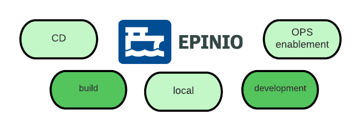
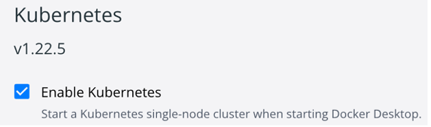
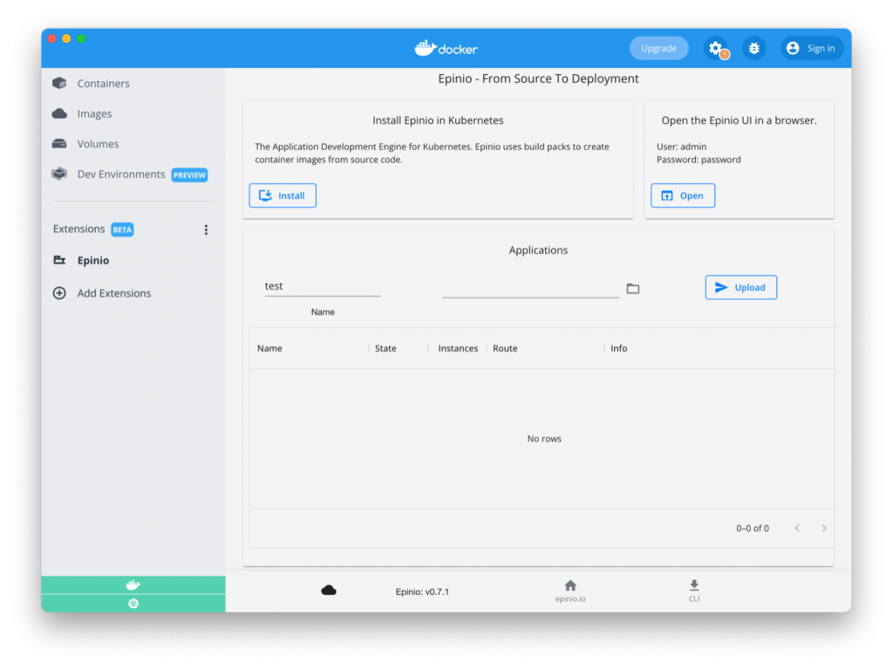
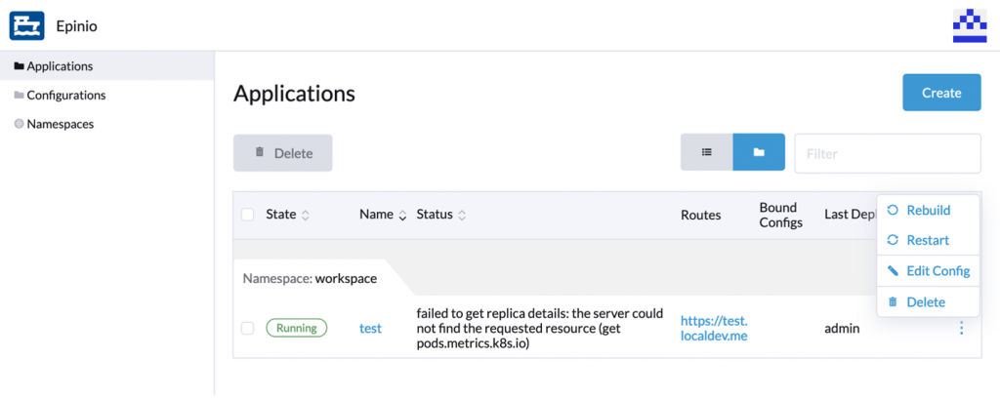

[Epinio](https://epinio.io/) takes developers from application to URL in one step. In this blog post, I’m going to tell you about the new Epinio extension for Docker Desktop, that allows you to run Epinio on your laptop. DevOps are very interested in the details of containerized workloads and Kubernetes especially, but for developers, the abstraction layer provided by Kubernetes might not be too relevant to their daily work. And managing a Kubernetes cluster certainly is above and beyond for most application developers.

However, deploying an application with Epinio is possible with very little Kubernetes knowledge. On a real cluster, Epinio also offers several advantages to operators, but that is a story for another post.

Figure 1: Where Epinio is useful

The above image illustrates that Epinio can be used as part of continuous delivery workflows, enable operators to manage applications better and help to build self-service platforms. Developers run Kubernetes clusters locally to stay close to the production environment. Epinio builds and deploys workloads, just like it would on a real cluster.

 

The feedback we get on Epinio shows that even running Kubernetes locally is not a one-liner. For example, the networking differs significantly between [K3s](https://github.com/k3s-io/k3s), [k3d](https://github.com/k3d-io/k3d), [KinD](https://kind.sigs.k8s.io/), [minikube](https://minikube.sigs.k8s.io/), [Rancher Desktop](https://rancherdesktop.io/) and others.

Figure 2: Install Kubernetes in Docker Desktop first

That's why a Docker Desktop Extension is such a great opportunity for Epinio. The user can create a Kubernetes cluster by just clicking on a single checkbox. The result is always the same, which makes the Epinio installation predictable.

After choosing the Epinio extension from the marketplace (as shown in the above image), you can press the "Install" button, shown in the screenshot below, to add Epinio to Docker’s Kubernetes.

Figure 3: Epinio Extension

From here you can choose a folder, with an application inside, and send it off to Epinio. Epinio will run [Cloud-Native-Buildpacks](https://buildpacks.io/) and create a deployment. The application can then be visited via the generated URL.

The extension UI is in an early stage and compared to the Epinio UI a bit limited. However, the Epinio UI has been installed alongside and you can click the "Open" button to access it with the default credentials.

The screenshot below shows the standalone UI, where you can delete and edit applications, configure environment variables and more.

Figure 4: Epinio's UI

There are several next steps you can take:

- Star [Epinio on Github](https://github.com/epinio/epinio) to show that you like the project.
- Try out Epinio in Docker Desktop or [install it onto your cluster](https://docs.epinio.io/installation).
- Let us know if Buildpacks work for you, as they do not support all kinds of applications yet.
- Get in touch with us, you can find us on [GitHub](https://github.com/epinio/epinio) and [Slack](https://rancher-users.slack.com/?redir=%2Fmessages%2Fepinio).
