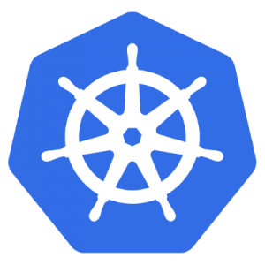
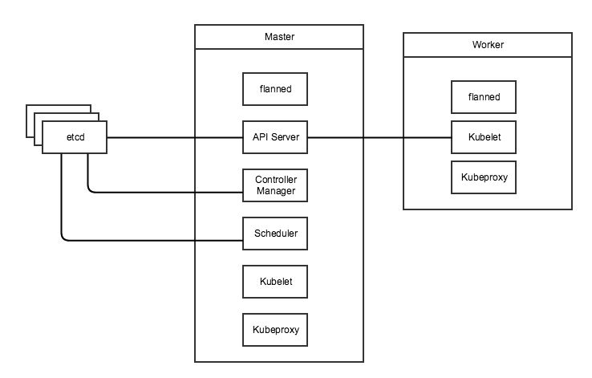

A Detailed Overview of Rancher's ArchitectureThis newly-updated, in-depth guidebook provides a detailed overview of the features and functionality of the new Rancher: an open-source enterprise Kubernetes platform.[Get the eBook](https://more.suse.com/fy21-global-web-landing-page-rancher2-technical-architecture)

[](https://cdn.rancher.com/wp-content/uploads/2016/10/20100519/Kubernetes_Mesos_Swarm.png)

*Note: You can find an updated comparison of Kubernetes vs. Docker Swarm
in a recent blog post
[here](https://rancher.com/comparing-kubernetes-and-docker-swarm/).*

Recent versions of Rancher have added support for several common
orchestration engines in addition to the standard Cattle. The three
newly supported engines, Swarm (soon to be Docker Native Orchestration),
Kubernetes and Mesos are the most widely used orchestration systems in
the Docker community and provide a gradient of usability versus feature
sets. Although Docker is the defacto standard for containerization,
there are no clear winners in the orchestration space. In this article,
we go over the features and characteristics of the three systems and
make recommendations of use cases where they may be suitable.

Docker Native Orchestration is fairly bare bones at the moment but is
getting new features at a rapid clip. Since it is part of the official
Docker system, it will be the default choice for many developers and
hence will have likely have good tooling and community support.
Kubernetes is among the most widely used container orchestration systems
today and has the support of Google. Lastly, Mesos with Mesosphere (or
Marathon, its open source version) takes a much more compartmentalized
approach to service managements where a lot of features are left to
independent plug-ins and applications. This makes it easier to customize
the deployment as individual parts can be swapped out or customized.
However, this also means more tinkering is required to get a working
setup. Kubernetes is more opinionated about how to build clusters and
ships with integrated systems for many common use cases.

## Docker Native Orchestration[](images/rancher_blog_Docker-swarm.png)

### Basic Architecture

Docker Engine 1.12 shipped with Native Orchestration, which is a
replacement for stand alone Docker Swarm. The Docker native cluster
(Swarm) consists of a set of nodes (Docker Engines/ Daemons) which can
either be managers or workers. Workers run the containers you launch and
managers maintain cluster state. You can have multiple managers for
high-availability, but no more than seven are recommended. The masters
maintain consensus using an internal implementation of the the
[RAFT](https://raft.github.io/) algorithm. As with all consensus
algorithms, having more managers has a performance implication. The fact
that managers maintain consensus internally means that there are no
external dependencies for Docker native orchestration which makes
cluster management much easier.

###

### Usability

Docker native uses concepts from single-node Docker and extends them to
the Swarm. If you are up to date on Docker concepts, the learning curve
is fairly gradual. The setup for a swarm is trivial once you have Docker
running on the various nodes you want to add to your swarm: you just
call *docker swarm init* on one node and *docker swarm join* on any
other nodes you want to add. You can use the same Docker Compose
templates and the same Docker CLI command set as with standalone Docker.

### Feature Set

Docker native orchestration uses the same primitives as Docker Engine
and Docker Compose to support orchestrations. You can still link
services, create volumes and define expose ports. All of these
operations apply on a single node. In addition to these, there are two
new concepts, services and networks.

A docker service is a set of containers that are launched on your nodes
and a certain number of containers are kept running at all times. If one
of the the containers dies it is replaced automatically. There are two
types of services, replicated or global. Replicated services maintain a
specified number of containers across the cluster where as global
services run one instance of a container on each of your swarm nodes. To
create a replicated service use the command shown below.

```
docker service create          
   –name frontend              
   –replicas 5                 
   -network my-network         
   -p 80:80/tcp nginx:latest.
```

You can create named overlay networks using *docker network
create --driver overlay NETWORK\_NAME.* Using the named overlay network
you can create isolated, flat, encrypted virtual networks across your
set of nodes to launch your containers into.

You can use constraints and labels to do some very basic scheduling of
containers. Using constraints you can add an affinity to a service and
it will try to launch containers only on nodes which have the specified
labels.

```
docker service create                        
   –name frontend                            
   –replicas 5                               
   -network my-network                       
   --constraint engine.labels.cloud==aws     
   --constraint node.role==manager           
   -p 80:80/tcp nginx:latest.
```

Furthermore, you can use the reserve CPU and reserve memory flags to
define the resources consumed by each container of the service so that
when multiple services are launched on a swarm the containers can be
placed to minimize resource contention.

You can do rudimentary rolling deployments using the command below.
This will update container image for the service but do so 2 containers
at a time with a 10s interval between each set of two. However,
health-checks and automatic rollbacks are not supported.

```
docker service update        
   –name frontend            
   –replicas 5               
   -network my-network       
   --update-delay 10s        
   --update-parallelism 2    
   -p 80:80/tcp nginx:other-version.
```

Docker supports persistent external volumes using volume drivers, and
Native orchestration extends these using the mount option to service
create command. Adding the following snippet to the command above will
mount a NFS mount into your container. Note this requires NFS to be
setup on your underlying host external to docker, some of the other
drivers which add support for Amazon EBS volume drivers or Google
container engine volume drivers have the ability to work without host
support. Also this feature is not yet well documented and may require a
bit of testing creating github issues on the docker project to get
working.

```
    --mount type=volume,src=/path/on/host,volume-driver=local,
    dst=/path/in/container,volume-opt=type=nfs,
    volume-opt=device=192.168.1.1:/your/nfs/path
```

## Kubernetes[](https://cdn.rancher.com/wp-content/uploads/2016/10/19142832/K8S.png)

### Basic Architecture

Conceptually, Kubernetes is somewhat similar to Swarm in that it uses a
manager (master) node with RAFT for consensus. However, that is where
the similarities end. Kubernetes uses an external
[etcd](https://github.com/coreos/etcd) cluster for this purpose. In
addition you will need a network layer external to Kubernetes, this can
be an overlay network like flannel, weave etc. With these external tools
in place, you can launch the Kubernetes master components; API Server,
Controller Manager and Scheduler. These normally run as a Kubernetes pod
on the master node. In addition to these you would also need to run the
kubelet and kubeproxy on each node. Worker nodes only run the Kubelet
and Kubeproxy as well as a network layer provider such as flanneld if
needed.

[](https://cdn.rancher.com/wp-content/uploads/2016/10/19143154/KubeDiagram.png)

In this setup, the kubelet will control the containers (or pods) on the
given node in conjunction with the Controller manager on the master. The
scheduler on the master takes care of resource allocation and balancing
and will help place containers on the worker node with the most
available resources. The API Controller is where your local kubectl CLI
will issue commands to the cluster. Lastly, the kubeproxy is used to
provide load balancing and high availability for services defined in
Kubernetes.

### Usability

Setting up Kubernetes from scratch is a non-trivial endeavor as it
requires setting up etcd, networking plugins, DNS servers and
certificate authorities. Details of setting up Kubernetes from scratch
are available [here](http://kubernetes.io/docs/getting-started-guides)
but luckily Rancher does all of this setup for us. We have covered how
to setup a Kubernetes cluster in an [earlier
article](https://rancher.com/getting-micro-services-production-kubernetes/).

Beyond initial setup, Kubernetes still has somewhat of a steep learning
curve as it uses its own terminology and concepts. Kubernetes uses
resource types such as Pods, Deployments, Replication Controllers,
Services, Daemon sets and so on to define deployments. These concepts
are not part of the Docker lexicon and hence you will need to get
familiar with them before your start creating your first deployment. In
addition some of the nomenclature conflicts with Docker. For example,
Kubernetes services are not Docker services and are also conceptually
different (Docker services map more closely to Deployments in the
Kubernetes world). Furthermore, you interact with the cluster using
kubectl instead of the docker CLI and you must use Kubernetes
configuration files instead of docker compose files.

The fact that Kubernetes has such a detailed set of concepts independent
of core Docker is not in itself a bad thing. Kubernetes offers a much
richer feature set than core Docker. However, Docker will add more
features to compete with Kubernetes with divergent implementations and
divergent or conflicting concepts. This will almost surely repeat the
CoreOS/rkt situation with large portions of the community working on
similar but competing solutions. Today, Docker Swarm and Kubernetes
target very different use cases (Kubernetes is much more suitable for
large production deployments of service-oriented architectures with
dedicated cluster-management teams) however as Docker Native
Orchestration matures it will move into this space.

### Feature Set

The full feature set of Kubernetes is much too large to cover in this
article, but we will go over some basic concepts and some interesting
differentiators. Firstly, Kubernetes uses the concept of Pods as its
basic unit of scaling instead of single containers. Each pod is a set of
containers (set may be size one) which are always launched on the same
node, share the same volumes and are assigned a Virtual IP (VIP) so they
can be addressed in the cluster. A Kubernetes spec file for a single pod
may look like the following.

```
kind: Pod
metadata:
  name: mywebservice
spec:
  containers:
  - name: web-1-10
    image: nginx:1.10
    ports:
    - containerPort: 80
```

Next you have deployments; these loosely map to what services are in
Docker Native orchestration. You can scale the deployment much like
services in Docker Native and a deployment will ensure the requite
number of containers is running. It is important to note that
deployments only analogous to replicated service in docker native as
Kubernetes uses the Daemon Set concept to support its equivalent of
globally scheduled services. Deployments also support Health checks
which use HTTP or TCP reachability or custom exec commands to determine
if a container/pod is healthy. Deployments also support rolling
deployments with automatic rollback using the health check to determine
if each pod deployment is successful.

```
kind: Deployment
metadata:
  name: mywebservice-deployment
spec:
  replicas: 2 # We want two pods for this deployment
  template:
    metadata:
      labels:
        app: mywebservice
    spec:
      containers:
      - name: web-1-10
        image: nginx:1.10
        ports:
        - containerPort: 80
```

Next you have Kubernetes Services which provide simple load balancing to
a deployment. All pods in a deployment will be registered with a service
as they come and go, and services also abstract away multiple
deployments so that if you want to run rolling deployments you will
register two Kubernetes deployments with the same service, then
gradually add pods to one while reducing pods from the other. You can
even do blue-green deployments where you point the service at a new
Kubernetes deployment in one go. Lastly, services are also useful for
service discovery within your Kubernetes cluster, all services in the
cluster get a VIP and are exposed to all pods in the cluster as docker
link style environment variables as well as through the integrated DNS
server.

In addition to basic services, Kubernetes supports
[Jobs](http://kubernetes.io/docs/user-guide/jobs/), [Scheduled
Jobs](http://kubernetes.io/docs/user-guide/scheduled-jobs/), and [Pet
Sets](http://blog.kubernetes.io/2016/07/thousand-instances-of-cassandra-using-kubernetes-pet-set.html).
Jobs create one or more pods and wait until they terminate. A job makes
sure that the specified number of pods terminate successfully. For
example, you may start a job to start processing business intelligence
data for 1 hour in the last day. You would launch a job with 24 pods for
the previous day and once they are all run to completion the job is
done. A scheduled job as the name suggests is a job that is
automatically run, on a given schedule. In our example, we would
probably make our BI processor a daily scheduled job. Jobs are great for
issuing batch style work loads to your cluster which are not services
that always need to be up but instead tasks that need to run to
completion and then be cleaned up.

Another extension that Kubernetes provides to basic services is Pet
Sets. Pet sets support stateful service workloads that are normally very
difficult to containerize. This includes databases and real-time
connected applications. Pet sets provide stable hostnames for each
“pet” in the set. Pets are indexed; for example, pet5 will be
addressable independently of pet3, and if the 3rd pet container/pod dies
it will be relaunched on a new host with the same index and hostname.

Pet Sets also provide stable storage using [persistent
volumes](http://kubernetes.io/docs/user-guide/persistent-volumes/), i.e
if pet1 dies and is relaunched on another node it will get its volumes
remounted with the original data. Furthermore you can also use NFS or
other network file systems to share volumes between containers, even if
they are launched on different hosts. This addressed one of the most
problematic issues when transitioning from single-host to distributed
docker environments.

Pet sets also provide peer-discovery, with normal services you can
discover other services (through Docker linking etc) however,
discovering other container within a service is not possible. This makes
gossip protocol based services such as Cassandra and Zookeeper very
difficult to launch.

Lastly, Pet Sets provide startup and tear down ordering which is
essential for persistent, scalable services such as Cassandra. Cassandra
relies on a set of seed nodes, and when you scale your service up and
down you must ensure the seed nodes are the first ones to be launched
and the last to be torn down. At the time of writing of this article,
Pet Sets are one of the big differentiators for Kubernetes, as
persistent stateful workloads are almost impossible to run at production
scale on Docker without this support.

Kubernetes also
provides [namespaces](http://kubernetes.io/docs/user-guide/namespaces/)
to isolate workloads on a cluster, [secrets
management](http://kubernetes.io/docs/user-guide/secrets/) and
[auto-scaling](http://kubernetes.io/docs/user-guide/horizontal-pod-autoscaling/)
support. All these features an more mean that Kubernetes is also to
support large, diverse workloads in a way that Docker Swarm is just not
ready for at the moment.

## Marathon[](images/rancher_blog_Marathon.png)

### Basic Architecture

Another common orchestration setup for large scale clusters is to run
Marathon on top of Apache Mesos. Mesos is an open source cluster
management system that supports a diverse arrays of workloads. Mesos is
composed of a Mesos agent running on each host in the cluster which
reports its available resources to the master. There can be one or more
Mesos masters which coordinate using a Zookeeper cluster. At any given
time one of the masters nodes is active using a master election process.
The master can issue tasks to any of the Mesos agents, and will report
on the status of those tasks. Although you can issue tasks through the
API, the normal approach is to use a framework on top of Mesos. Marathon
is one such framework which provides support for running Docker
containers (as well as native Mesos containers).

### Usability

Again compared to Swarm, Marathon has a fairly steep learning curve as
it does not share most of the concepts and terminology with Docker.
However, Marathon is not as feature rich, and is thus easier to learn
than Kubernetes. However, the complexity of managing a Marathon
deployment comes from the fact that it is layered on top of Mesos and
hence there are two layers of tools to manage. Furthermore, some of the
more advanced features of Marathon such as load balancing are only
available as additional frameworks that run on top of Marathon. Some
features such as authentication are only available if you run Marathon
on top of DC/OS, which in turns run on top of Mesos - adding yet another
layer of abstraction to the stack.

### Feature Set

To define services in Marathon, you need to use its internal JSON
format as shown below. A simple definition like the one below will
create a service with two instances each running the nginx container.

```
{
  "id": "MyService"
  "instances": 2,
  "container": {
    "type": "DOCKER",
    "docker": {
      "network": "BRIDGE",
      "image": "nginx:latest"
    }
  }
}
```

A slightly more complete version of the above definition is shown below,
we now add port mappings and the health check. In port mapping, we
specify a container port, which is the port exposed by the docker
container. The host port defines which port on the public interface of
the host is mapped to the container port. If you specify 0 for host
port, then a random port is assigned at run-time. Similarly, we may
optionally specify a service port. The service port is used for service
discovery and load balancing as described later in this section. Using
the health check we can now do both rolling (default) and [blue-green
deployments](https://mesosphere.github.io/marathon/docs/blue-green-deploy.html).

```
{
  "id": "MyService"
  "instances": 2,
  "container": {
    "type": "DOCKER",
    "docker": {
      "network": "BRIDGE",
      "image": "nginx:latest"
      "portMappings": [
        { "containerPort": 8080, "hostPort": 0, "servicePort": 9000, "protocol": "tcp" },
      ]
    }
  },
  "healthChecks": [
    {
      "protocol": "HTTP",
      "portIndex": 0,
      "path": "/",
      "gracePeriodSeconds": 5,
      "intervalSeconds": 20,
      "maxConsecutiveFailures": 3
    }
  ]
}
```

[[In addition to single services, you can define Marathon Application
Groups, with a nested tree structure of services. The benefit of
defining application in groups is the ability to scale the entire group
together. This can be very useful in microservice stacks where tuning
individual services can be difficult. As of now, the scaling assumes
that all services will scale at the same rate so if you require ‘n’
instances of one service, you will get ‘n’ instances of all services.
] ]

```
{
  "id": "/product",
  "groups": [
    {
      "id": "/product/database",
      "apps": [
         { "id": "/product/mongo", ... },
         { "id": "/product/mysql", ... }
       ]
    },{
      "id": "/product/service",
      "dependencies": ["/product/database"],
      "apps": [
         { "id": "/product/rails-app", ... },
         { "id": "/product/play-app", ... }
      ]
    }
  ]
}
```

In addition to being able to define basic services, Marathon can also do
scheduling of containers based on specified constraints as detailed
[here](https://mesosphere.github.io/marathon/docs/constraints.html),
including specifying that each instance of the service must be on a
different physical host *“constraints“: [[“hostname“,
“UNIQUE”]].* You can use the *cpus* and *mem* tags to specify the
resource utilization of that container. Each Mesos agent reports its
total resource availability hence the scheduler can place workloads on
hosts in an intelligent fashion.

By default, Mesos relies on the traditional Docker port mapping and
external service discover and load balancing mechanisms. However, recent
beta features add support for DNS based service discovery using [Mesos
DNS](http://mesosphere.github.io/mesos-dns/) or Load balancing using
[Marathon LB](https://github.com/mesosphere/marathon-lb). Mesos DNS is
an application that runs on top of Mesos and queries the Mesos API for a
list of all running tasks and applications. It then creates DNS records
for nodes running those tasks. All Mesos agents then manually need to be
updated to use Mesos DNS service as its primary DNS server. Mesos DNS
uses the hostname or IP address used to register Mesos agents with the
master; and Port mappings can be queried as SRV records. Since Marathon
DNS works on agent hostnames, and there for the host network ports must
be exposed and hence must not collide. Mesos DNS does provide a way to
refer to individual containers persistently for stateful workloads such
as we would be able to using Kubernetes pet sets. In addition, unlike
Kubernetes VIPs which are addressable on any container in the cluster,
we must manually update /etc/resolve.conf to the set of Mesos DNS
servers and update the configuration if the DNS servers change.
Marathon-lb uses the Marathon Event bus to keep track of all service
launches and tear-downs. It then launches a HAProxy instance on agent
nodes to relay traffic to the requisite service node.

Marathon also has beta support for [persistent
volumes](https://mesosphere.github.io/marathon/docs/persistent-volumes.html) as
well as [external persistent
volumes](https://mesosphere.github.io/marathon/docs/external-volumes.html).
However, both of these features are in a very raw state. Persistent
volumes are only persistent on a single node across container restarts,
volumes are deleted if the application using them is deleted however,
the actual data on disk is not deleted and must be removed manually.
External volumes require DC/OS and currently only allow your service to
scale to single instance.

### Final Verdict

Today we have looked at three options for Docker container
orchestration: Docker Native (Swarm), Kubernetes and Mesos/Marathon. It
is difficult to pick a system to recommend because the best system is
highly dependent on your use case, scale and history. Furthermore, all
three systems are under heavy development and some of the features
covered are in beta and may be changed, removed or replaced very soon.

Docker Native gives you the quickest ramp-up with little to no vendor
lock-in beyond dependence on Docker. The dependence on Docker is not a
big issue, since it has become the defacto container standard. Given the
lack of a clear winner in the orchestration wars and the fact that
Docker native is the most flexible approach, it is a good choice for
simple web/stateless applications. However, Docker Native is very bare
bones at the moment and if you need to get complicated, larger-scale
applications to production you need to choose one of Mesos/Marathon or
Kubernetes.

Between Mesos/Marathon and Kubernetes is also not an easy choice as both
have their pros and cons. Kubernetes is certainly the more feature rich
and mature of the two, but it is also a very opinionated piece of
software. We think a lot of those opinions make sense, but Kubernetes
does not have the flexibility of Marathon. This makes sense when you
consider the rich history of non-Docker, non-containerized applications
that can run on Mesos in addition to Marathon (e.g. Hadoop clusters). If
you are doing a green field implementation and either don’t have strong
opinions about how to layout clusters, or your opinions agree with those
of Google, then Kubernetes is a better choice. Conversely, if you have
large, complicated legacy workloads that will gradually shift over to
containers then Mesos/Marathon is the way to go.

Another concern is scale: Kubernetes has been tested to thousands of
nodes, whereas Mesos has been tested to tens of thousands of nodes. If
you are launching clusters with tens of thousands of nodes, you’ll want
to use Mesos for the scalability of the underlying infrastructure - but
note that scaling advanced features such as load balancing to that range
will still be left to you. However, at that scale, few (if any)
off-the-shelf solutions work as advertised without careful tuning and
monkey patching.

*Usman is a server and infrastructure engineer, with experience in
building large scale distributed services on top of various cloud
platforms. You can read more of his work at
[techtraits.com](http://techtraits.com/), or follow him on twitter
[@usman\_ismail](https://twitter.com/usman_ismail)or
on [GitHub](https://github.com/usmanismail).*

**You might also be interested in:**

- The October 2016 Online Meetup: The Great Container Monitoring
  Bake-off. Sign up at
  [rancher.com/meetup](https://rancher.com/online-meetups)
- [Deploying and Scaling Applications with Kubernetes and
  Rancher](https://info.rancher.com/deploying-scaling-kubernetes-ebook)
- If you’re headed to KubeCon 2016, Nov 8-9: [Automating
  Infrastructure Deployment for
  Kubernetes](https://cnkc16.sched.org/event/8K94/automating-infrastructure-deployment-for-kubernetes-alena-prokharchyk-rancher-labs-inc-brian-scott-the-walt-disney-company)
A Detailed Overview of Rancher's ArchitectureThis newly-updated, in-depth guidebook provides a detailed overview of the features and functionality of the new Rancher: an open-source enterprise Kubernetes platform.[Get the eBook](https://more.suse.com/fy21-global-web-landing-page-rancher2-technical-architecture)
