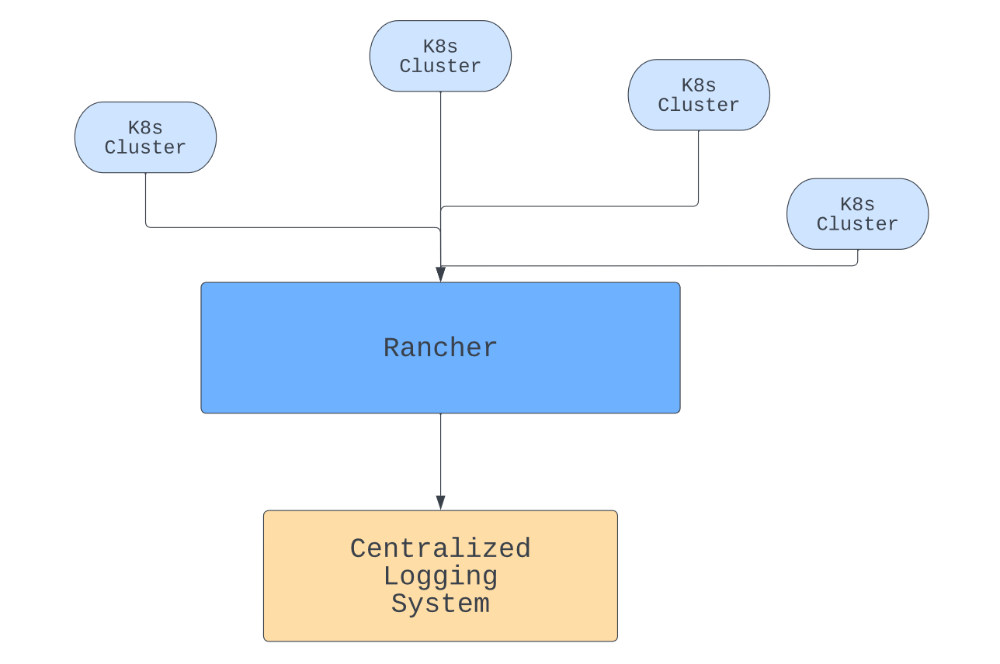

Cloud deployments and containerization let you provision infrastructure as needed, meaning your applications can grow in scope and complexity. The results can be impressive, but the ability to expand quickly and easily makes it harder to keep track of your system as it develops.

In this type of [Kubernetes](https://kubernetes.io/) deployment, it's essential to track your containers to understand what they're doing. You need to not only monitor your system but also ensure your monitoring delivers meaningful observability. The numbers you track need to give you actionable insights into your applications.

In this article, you'll learn why monitoring and observability matter and how you can best take advantage of them. That way, you can get all the information you need to maximize the performance of your deployments.

## Why you need monitoring and observability in Kubernetes

Monitoring and observability are often confused but worth clarifying for the purposes of this discussion. Monitoring is the means by which you gain information about what your system is doing.

Observability is a more holistic term, indicating the overall capacity to view and understand what is happening within your systems. Logs, metrics and traces are core elements. Essentially, observability is the goal, and monitoring is the means.

[Observability can include monitoring](https://landscape.cncf.io/) as well as logging, tracing, continuous integration and even chaos engineering. Focusing on each facet gets you as close as possible to full coverage. Correcting that can improve your observability if you've overlooked one of these areas.

In addition, using black boxes, such as third-party services, can limit observability by making monitoring harder. Increasing complexity can also add problems. Your metrics may not be consistent or relevant if collected from different services or regions.

You need to work to ensure the metrics you collect are taken in context and can be used to provide meaningful insights into where your systems are succeeding and failing.

At a higher level, there are several uses for monitoring and observability. Performance monitoring tells you whether your apps are delivering quickly and what resources they're consuming.

Issue tracking is also important. Observability can be focused on specific tasks, letting you see how well they're doing. This can be especially relevant when delivering a new feature or hunting a bug.

Improving your existing applications is also vital. Examining your metrics and looking for areas you can improve will help you stay competitive and minimize your costs. It can also prevent downtime if you identify and fix issues before they lead to performance drops or outages.

## Best practices and tips for monitoring and observability in Kubernetes

With distributed applications, collecting data from all your various nodes and containers is more involved than with a standard server-based application. Your tools need to handle the additional complexity.

The following tips will help you build a system that turns information into the elusive observability that you need. All that data needs to be tracked, stored and consolidated. After that, you can use it to gain the insights you need to make better decisions for the future of your application.

### Avoid vendor lock-in

The major Kubernetes management services, including [Amazon Elastic Kubernetes Service (EKS)](https://aws.amazon.com/eks/), [Azure Kubernetes Service (AKS)](https://azure.microsoft.com/en-us/products/kubernetes-service/) and [Google Kubernetes Engine (GKE)](https://cloud.google.com/kubernetes-engine/), provide their own monitoring tools. While these tools include useful features, you need to beware of becoming overdependent on any that belong to a particular platform, which can lead to vendor lock-in. Ideally, you should be able to change technologies and keep the majority of your metric-gathering system.

[Rancher](https://www.rancher.com/?utm_source=blog&utm_medium=rancher_blog&utm_campaign=Advanced_Monitoring_and_Observability), a complete software stack, lets you consolidate information from other platforms that can help solve issues arising when companies use different technologies without integrating them seamlessly. It lets you capture data from a wealth of tools and pipe your logs and data to external management platforms, such as [Grafana](https://grafana.com/) and [Prometheus](https://prometheus.io/), meaning your monitoring isn't tightly coupled to any other part of your infrastructure. This gives you the flexibility to swap parts of your system in and out without too much expense. With platform-agnostic monitoring tools, you can replace other parts of your system more easily.

### Pick the right metrics

Collecting metrics sounds straightforward, but it requires careful implementation. Which metrics do you choose? In a Kubernetes deployment, you need to ensure all layers of your system are monitored. That includes the application, the control plane components and everything in between.

CPU and memory usage are important but can be tricky to use across complex deployments. Other metrics, such as API response, request and error rates, along with latency, can be easier to track and give a more accurate picture of how your apps are performing. High disk utilization is a key indicator of problems with your system and should always be monitored.

At the cluster level, [you should track node availability](https://ranchermanager.docs.rancher.com/pages-for-subheaders/monitoring-and-alerting) and how many running pods you have and make sure you aren't in danger of running out of nodes. Nodes can sometimes fail, leaving you short.

Within individual pods, as well as resource utilization, you should check application-specific metrics, such as active users or parts of your app that are in use. You also need to track the metrics Kubernetes provides to verify pod health and availability.

### Centralize your logging

Kubernetes pods keep their own logs, but having logs in different places is hard to keep track of. In addition, if a pod crashes, you can lose them. To prevent the loss, make sure any logs or metrics you require for Kubernetes observability are stored in an independent, central repository.

Rancher can help with this by giving you a central management point for your containers. With logs in one place, you can view the data you need together. You can also make sure it is backed up if necessary.

In addition to piping logs from different clusters to the same place, Rancher can also help you centralize authorization and give you coordinated role-based access control (RBAC).

Transferring large volumes of data will have a performance impact, so you need to balance your requirements with cost. Critical information should be logged immediately, but other data can be transferred on a regular basis, perhaps using a queued operation or as a scheduled management task.

### Enforce data correlation

Once you have feature-rich tools in place and, therefore, an impressive range of metrics to monitor and elaborate methods for viewing them, it's easy to lose focus on the reason you're collecting the data.

Ultimately, your goal is to improve the user experience. To do that, you need to make sure the metrics you collect give you an accurate, detailed picture of what the user is experiencing and correctly identify any problems they may be having.

Lean toward this in the metrics you pick and in those you prioritize. For example, you might want to track how many people who use your app are [actually completing actions on it](https://qualaroo.com/blog/measure-user-experience/), such as sales or logins.

You can track these by monitoring task success rates as well as how long actions take to complete. If you see a drop in activity on a particular node, that can indicate a technical problem that your other metrics may not pick up.

You also need to think about your alerting systems and pick alerts that spot performance drops, preferably detecting issues before your customers.

With Kubernetes operating in a highly dynamic way, metrics in different pods may not directly correspond to one another. You need to [contextualize different results](https://www.simform.com/blog/kubernetes-observability/) and develop an understanding of how performance metrics correspond to the user's experience and business outcomes.

[Artificial intelligence (AI) driven observability tools](https://opni.io/) can help with that, tracking millions of data points and determining whether changes are caused by the dynamic fluctuations that happen in massive, scaling deployments or whether they represent issues that need to be addressed.

If you understand the implications of your metrics and what they mean for users, then you're best suited to optimize your approach.

### Favor scalable observability solutions

As your user base grows, you need to deal with scaling issues. Traffic spikes, resource usage and latency all need to be kept under control. Kubernetes can handle some of that for you, but you need to make sure your monitoring systems are scalable as well.

Implementing observability is especially complex in Kubernetes because Kubernetes itself is complicated, especially in multi-cloud deployments. The complexity has been [likened to an iceberg](https://www.youtube.com/watch?v=dc4LtErreVg).

It gets more difficult when you have to consider problems that arise when you have multiple servers duplicating functionality around the world. You need to ensure high availability and make your database available everywhere. As your deployment scales up, so do these problems.

Rancher's observability tools allow you to deploy new clusters and monitor them along with your existing clusters from the same location. You don't need to work to keep up as you deploy more widely. That allows you to focus on what your metrics are telling you and lets you spend your time adding more value to your product.

## Conclusion

Kubernetes enables complex deployments, but that means monitoring and observability aren't as straightforward as they would otherwise be. You need to take special care to ensure your solutions give you an accurate picture of what your software is doing.

Taking care to pick the right metrics makes your monitoring more helpful. Avoiding vendor lock-in gives you the agility to change your setup as needed. Centralizing your metrics brings efficiency and helps you make critical big-picture decisions.

Enforcing data correlation helps keep your results relevant, and thinking about scalability ahead of time stops your system from breaking down when things change.

Rancher can help and makes [managing Kubernetes clusters](https://www.rancher.com) easier. It provides a vast range of [Kubernetes monitoring](https://www.suse.com/c/rancher_blog/introduction-to-kubernetes-monitoring/) and observability features, ensuring you know what's going on throughout your deployments. [Check it out](https://www.rancher.com/quick-start) and learn how it can help you grow. You can also take advantage of free, community training for Kubernetes & Rancher at the [Rancher Academy.](https://www.rancher.academy/)
