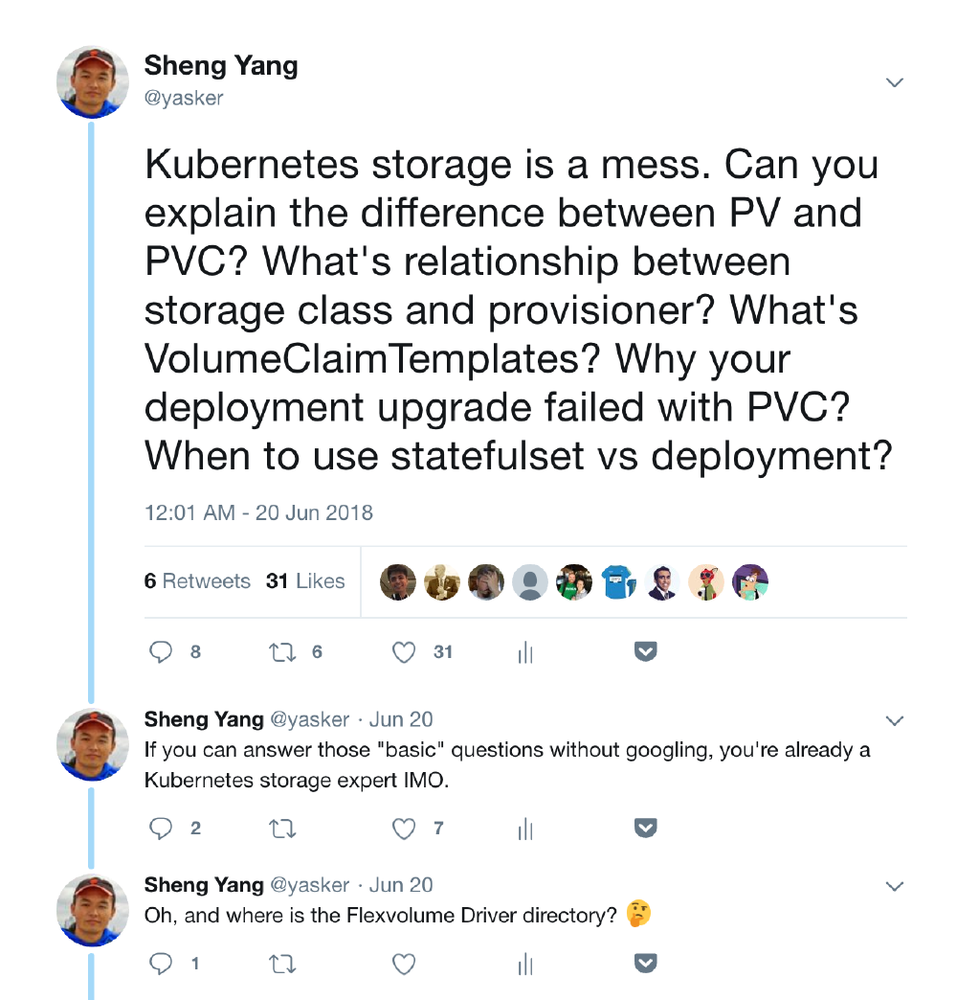
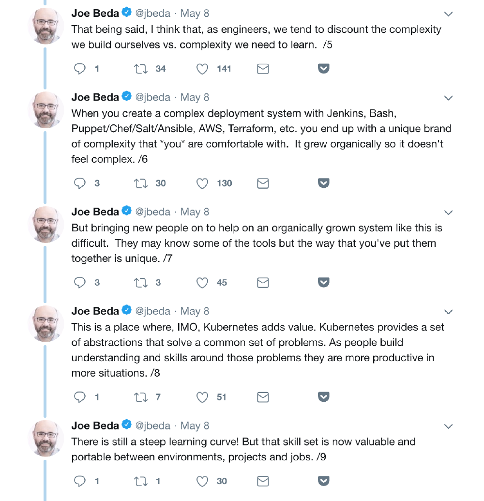

Take a deep dive into Best Practices in Kubernetes NetworkingFrom overlay networking and SSL to ingress controllers and network security
policies, we've seen many users get hung up on Kubernetes networking challenges. In this video
recording, we dive into Kubernetes networking, and discuss best practices for a wide variety of
deployment options.[Watch the video](https://rancher.com/events/2018/kubernetes-networking-masterclass-june-online-meetup/)

## Foreword

Anyone who has followed the cloud computing area in recent years would notice and probably get involved in
the rise of Docker and Kubernetes. Today, the Cloud’s Big Three (Google, Amazon, Microsoft) all offer
managed Kubernetes services on top of their traditional public cloud services. Powerful, scalable,
resilient, in many people’s mind, Kubernetes is becoming the ultimate answer to cloud computing.

And yet I am not so sure about Kubernetes, even though it builds upon [15 years of experience of running production
workloads at Google](https://queue.acm.org/detail.cfm?id=2898444)(btw, it’s a great paper, I’ve read it multiple times). Kubernetes is still very
complicated and full of caveats. And some design decisions always make me wonder “Why?”

First, about my experience. I’ve spent the last decade working in the cloud computing area. I started my
career at Intel Open Source Technology Center, writing code for KVM, Xen and Linux kernel. Later I joined
Cloud.COM (acquired by Citrix), working on the virtual router and network related areas in CloudStack. Four
years ago I joined Rancher Labs, working on the storage perspective of the container technology. Currently,
I am working on a new distributed storage system ([Longhorn](https://github.com/rancher/longhorn)), which heavily utilizes Kubernetes.

During the development of Longhorn, I started to notice some caveats and unexpected designs in Kubernetes.
One day around midnight, I got a question from a Longhorn user, about why Longhorn doesn’t work with his
Kubernetes Deployment’s rolling upgrade process. Probably because it’s late, and I am too tired after a day
of busy work, and I’ve run into this caveat numerous times, I became a bit frustrated. So I ranted on [Twitter](https://twitter.com/yasker/status/1009330385535135744):

Unexpectedly, this prompted a few more responses than my average tweets. I was posting in the rhetorical
question way, though some people were truly trying to answer it, and one guy even made a podcast about it.
Thanks for the effort, guys. But what I meant to ask is, **“Why is Kubernetes designed in such a
complicated and unexpected way?”** Sure, anyone who has spent enough time with Kubernetes can
figure out how to do certain things, just as with any other kind of special skill you want to acquire. But
the learning curve is steep even for the most experienced engineers because some of Kubernetes’s design is
not intuitive. Sometimes it doesn’t even make sense to me.

One of the original authors of Kubernetes, Joe Beda, once wrote this on [Twitter](https://twitter.com/jbeda/status/993978918196531200):

It’s well said. We don’t want Kubernetes to become another *language* which you need to memorize
*words* before you know how to speak. But in reality, I think it’s still heading that way. CNCF now
has a new program for [Certified Kubernetes
Administrator](https://www.cncf.io/certification/cka/)(CKA), which reminds me of CPA when the first time I’d heard about it. Maybe it’s
inevitable for large software, but I still think we should strive for a simple user experience, rather than
piling up features, introducing more caveats, and making comprises in usability.

Next, I will try to explain a few key concepts in Kubernetes, and what I think of them. I hope this will help
readers understand more about Kubernetes as well. There are many design choices and caveats that hit me as
unexpected while working with Kubernetes. The most impressive ones are PV and PVC.

## Part 1: PV, PVC, Storage Class, and Provisioner

### Volume in Docker

Before diving into the world of Kubernetes, let’s take a look at what Kubernetes was built on - Docker.

Docker is famous for its simplicity and ease of use. That’s what made Docker popular and became the
foundation of Kubernetes. A Docker container is stateless and fast. It can be destroyed and recreated
without paying much of a price. But it’s hard to live a meaningful life with amnesia. No matter if it’s your
database, your key-value store, or just some raw data. Everyone needs persistent storage.

It’s straightforward to create persistent storage in Docker. In the early versions, the user can use
`-v` to create either a new anonymous undetermined sized empty volume or a bind-mount to a
directory on the host. During those days, there was no third party interface allowing you to hook into
Docker directly, though it could be easily worked around by bind-mounting the directory which had already
been mounted by storage vendor on the host. In August 2015, Docker [released
v1.8](https://blog.docker.com/2015/08/docker-1-8-content-trust-toolbox-registry-orchestration/), which officially introduced the volume plugin to allow third-parties to hook up their storage
solutions. The installed volume plugin would be called by Docker to create/delete/mount/umount/get/list
related volumes. And each volume would have a name. That’s it. The framework of the volume plugin remains
largely the same till this day.

### Persistent Volume and Persistent Volume Claim

When you try to figure out how to create persistent storage in Kubernetes, the first two concepts you will
likely encounter are Persistent Volume (PV), and Persistent Volume Claim (PVC).

So, what are they? Which one of the two works like the volume in Docker?

In fact, neither works like the volume in Docker. In addition to PV and PVC, there is also a Volume concept
in Kubernetes, but it’s not like the one in Docker. We will talk about it later.

After you read a bit more about PV and PVC, you would likely realize that PV is the allocated storage and PVC
is the request to use that storage. If you have some experiences previously with cloud computing or storage,
you would likely think PV is a storage pool and PVC is a volume which would be carved out from the storage
pool.

But no, that’s not what PV and PVC are. In Kubernetes, one PV maps to one PVC, and vice versa. It’s one to
one mapping exclusively.

I’ve explained those multiple times to people with extensive experience with storage and cloud computing.
They almost always scratch their heads after, and cannot make sense of it.

I can’t make sense of it either when I encountered those two concepts for the first time.

Let’s quote the [definition](https://kubernetes.io/docs/concepts/storage/persistent-volumes/#introduction) of PV
and PVC here:

> A `PersistentVolume` (PV) is a piece of storage in the cluster that has been provisioned by an
> administrator. It is a resource in the cluster just like a node is a cluster resource. PVs are volume
> plugins like Volumes but have a lifecycle independent of any individual pod that uses the PV. This API
> object captures the details of the implementation of the storage, be that NFS, iSCSI, or a
> cloud-provider-specific storage system.
>
> A `PersistentVolumeClaim` (PVC) is a request for storage by a user. It is similar to a pod.
> Pods consume node resources and PVCs consume PV resources. Pods can request specific levels of resources
> (CPU and Memory). Claims can request specific size and access modes (e.g., can be mounted once
> read/write or many times read-only).

The keywords you need to pay attention to here are `by an administrator` and
`by a user`.

In short, Kubernetes separates the basic unit of storage into two concepts. PV is a piece of storage which
supposed to be pre-allocated by an admin. And PVC is a request for a piece of storage by a user.

It said that Kubernetes expects the admin to allocate various sized PVs beforehand. When the user creates PVC
to request a piece of storage, Kubernetes will try to match that PVC with a pre-allocated PV. If a match can
be found, the PVC will be `bound` to the PV, and the user will start to use that pre-allocated
piece of storage.

This is different from the traditional approach, in which the admin is **not** responsible for
allocating every piece of storage. The admin just needs to give the user permission to access a certain
storage pool, and decide what’s the quota for the user, then leave the user to carve out the needed pieces
of the storage from the storage pool.

But in Kubernetes’s design, PV has already been carved out from the storage pool, waiting to be matched with
PVC. The user can only request the pre-allocated, fixed-size pieces of storage. This results in two things:

1. If the user only needs a 1 GiB volume, but the smallest PV available is 1 TiB, the user would have to
   use that 1 TiB volume. Later, the 1 TiB volume won’t be available to any other users, who are probably
   going to need much more than 1 GiB. This would not only cause the waste of the storage space, but also
   would result in a situation where some workloads cannot be started due to the resource constraint, while
   other workloads are using excessive amounts of resources that they don’t need.
2. In order to alleviate the first issue, the administrator either needs to constantly communicate with the
   user regarding what size/performance of the storage the user needs at the time of the workload creation,
   or predict the demand and pre-allocate the PV accordingly.

As a result, it’s hard to enforce the separate of allocation (PV) and usage (PVC). In the real world, I don’t
see people using PV and PVC as the way they were designed for. Most likely admins quickly give up the power
of creating PV and delegate it to users. Since PV and PVC are still one to one binding, the existence of PVC
become unnecessary.

So in my opinion, the use case PV and PVC designed for is “uncommon”, to say the least.

I hope someone with more Kubernetes history background can chip in here, to help me understand why Kubernetes
is designed in this way.

### Storage Class and Provisioner

Probably because it’s too hard to use PV and PVC, on March 2017, along with the v1.6 release, Kubernetes [introduced](https://kubernetes.io/blog/2017/03/dynamic-provisioning-and-storage-classes-kubernetes/)
the concept of dynamic provisioning, Storage Class, and Provisioner. Dynamic provisioning works similar to
the traditional storage approach. Admins can use Storage Class to describe the “classes” of storage they
offer. Storage Classes can have different capacity limits, different IOPS, or any other parameters that the
Provisioner supported. The storage vendor specific Provisioner would be used along with the Storage Class to
allocate PV automatically, following the parameters set in the Storage Class object. Also, the Provisioner
now has the ability to enforce the quotes and permission requirements for users. In this design, admins have
been freed from the unnecessary work of predicting and allocating the PV. It makes much more sense in this
way.

As a side note, you can also use Storage Class without creating a Storage Class object in Kubernetes. Since
the Storage Class is also a field used to match PVC with PV (which doesn’t have to be created by a
Provisioner), you can create a PV manually with a custom Storage Class name, then create a PVC asking for
the same Storage Class name. Kubernetes would bound your PVC with your PV with the same Storage Class name,
even though the Storage Class object doesn’t exist.

The introduction of dynamic provisioning, Storage Class and Provisioner makes perfect sense to me. It has
fixed the biggest usability issue with the original PV and PVC design. But at the same time, those new
concepts exacerbated another issue of Kubernetes storage, namely the confusion caused by the various way of
handling persistent storage.

*[To be continued]*

*[You can join the discussion [here](https://medium.com/@yasker/the-unexpected-kubernetes-part-1-pv-pvc-storage-class-and-provisioner-e83d24a784b3)]*

Take a deep dive into Best Practices in Kubernetes NetworkingFrom overlay networking and SSL to ingress controllers and network security
policies, we've seen many users get hung up on Kubernetes networking challenges. In this video
recording, we dive into Kubernetes networking, and discuss best practices for a wide variety of
deployment options.[Watch the video](https://rancher.com/events/2018/kubernetes-networking-masterclass-june-online-meetup/)
