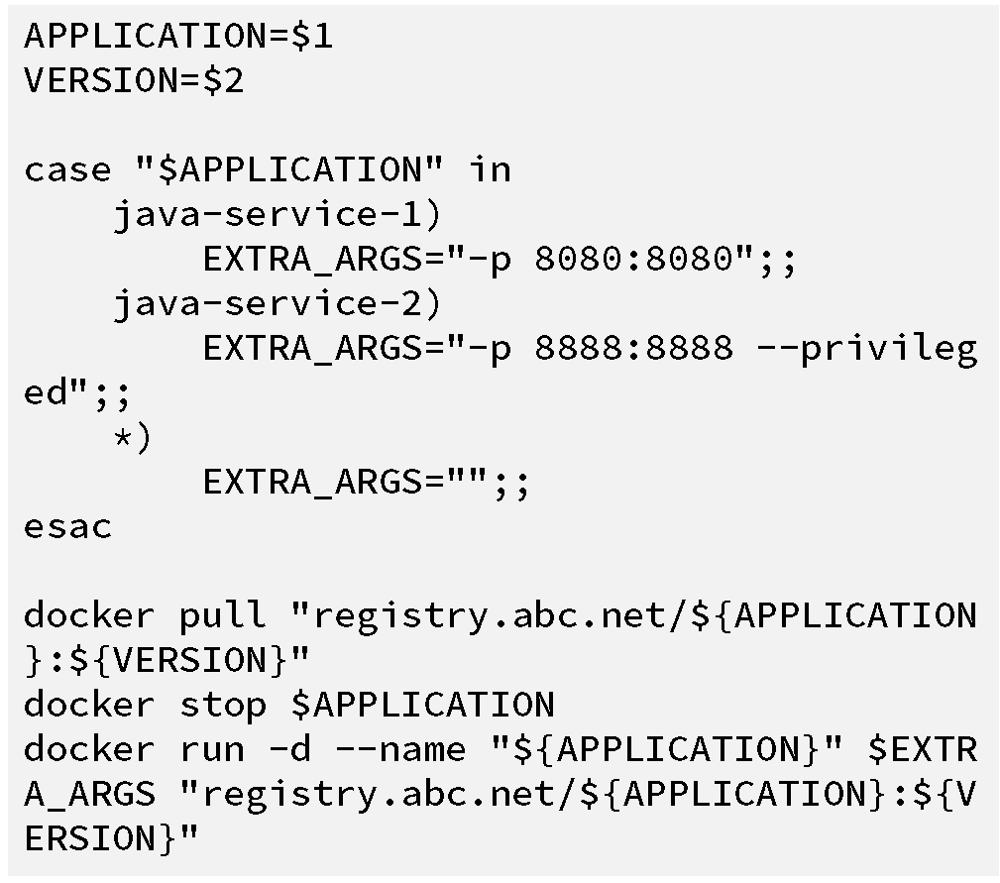
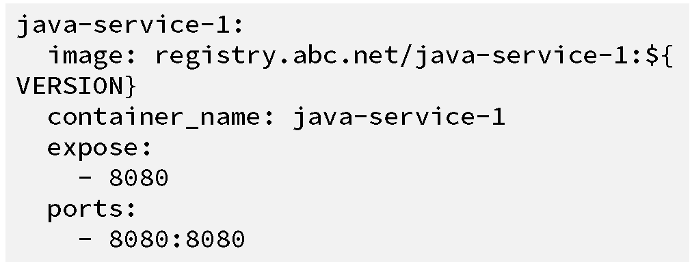
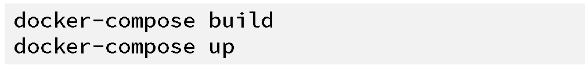
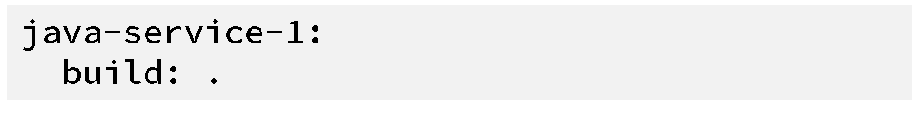
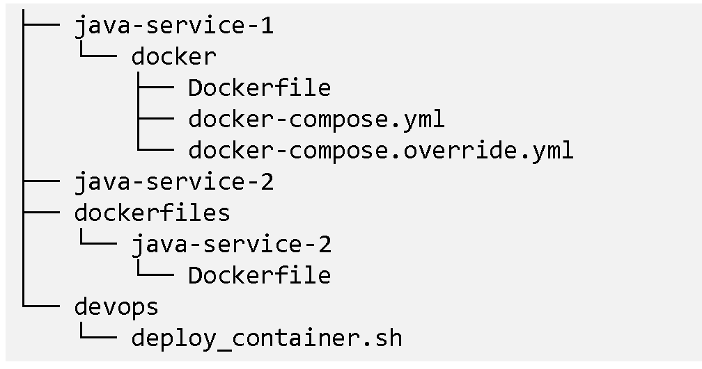
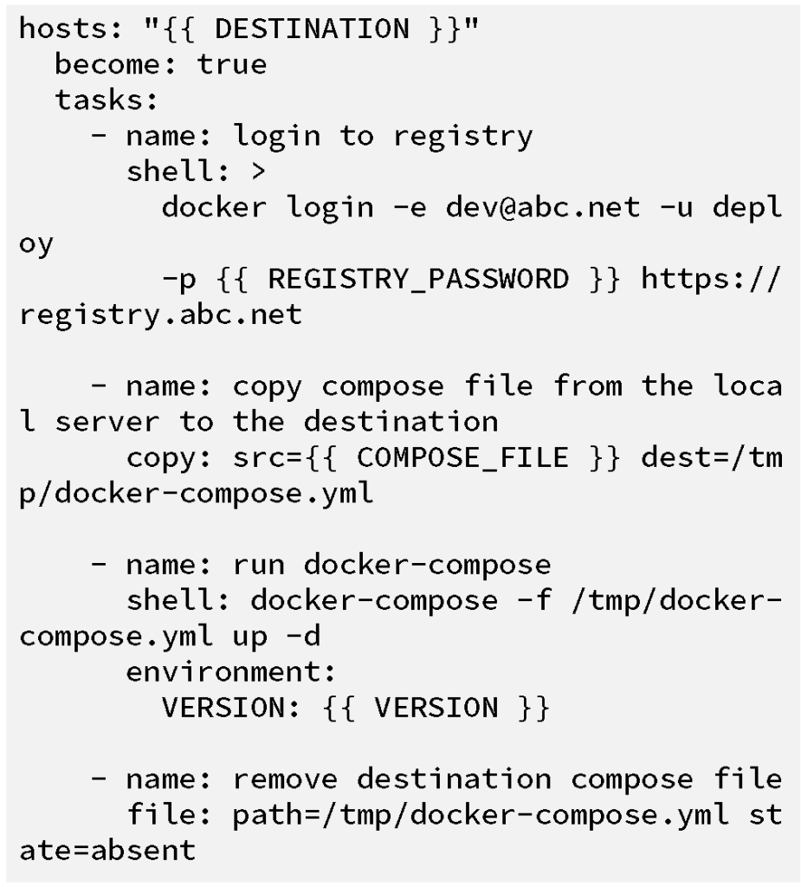
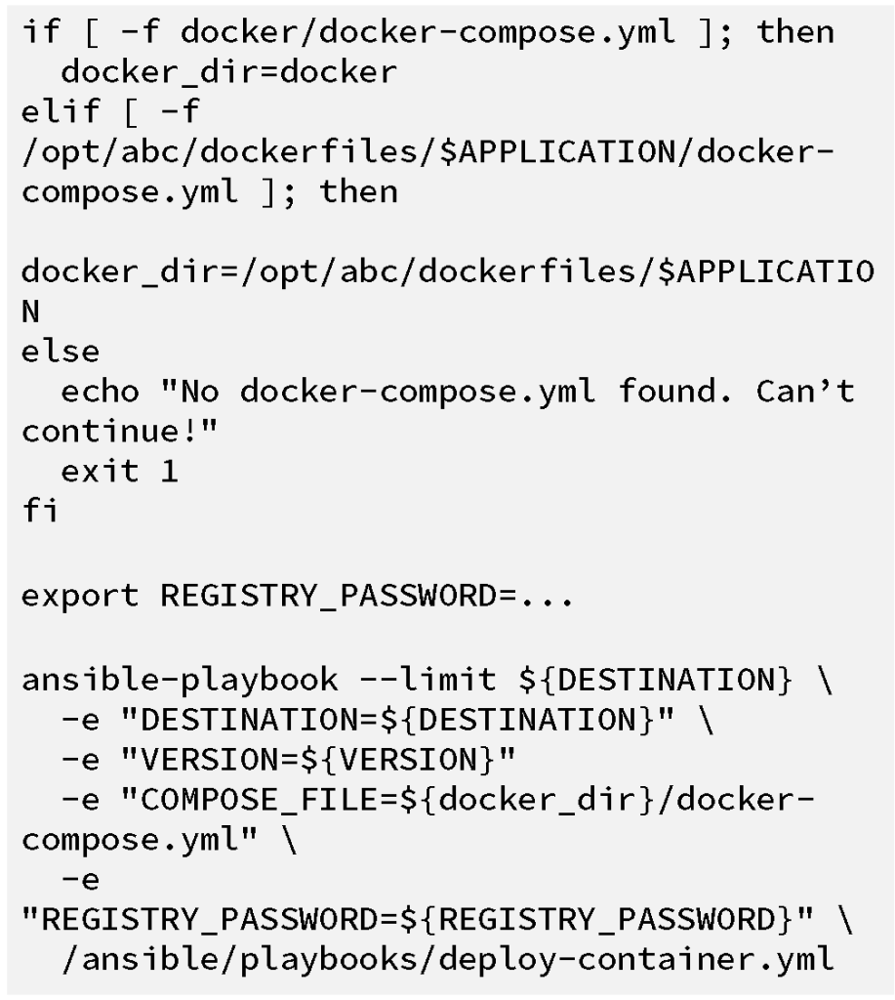

 *John Patterson
([@cantrobot](https://twitter.com/cantrobot)) and Chris Lunsford run
This End Out, an operations and infrastructure services company. You can
find them online at*
[*https://www.thisendout.com*](https://thisendout.com/) \*and follow them
on twitter [@thisendout](https://twitter.com/thisendout). \* *Update:
All four parts of the series are now live: [Part 1: Getting started with
CI/CD and
Docker](https://rancher.com/lessons-learned-building-a-deployment-pipeline-with-docker-docker-compose-and-rancher-part-1/)*
*[Part 2: Moving to Compose
blueprints](https://rancher.com/lessons-learned-building-a-continuous-deployment-pipeline-with-docker-docker-compose-and-rancher-part-2/)*
*[Part 3: Adding Rancher for
Orchestration](https://rancher.com/lessons-learned-building-a-deployment-pipeline-with-docker-docker-compose-and-rancher-part-3/)[Part
4: Completing the Cycle with Service
Discovery](https://rancher.com/lessons-learned-building-a-deployment-pipeline-with-docker-docker-compose-and-rancher-part-4/)*
In [part
one](https://rancher.com/lessons-learned-building-a-deployment-pipeline-with-docker-docker-compose-and-rancher-part-1/)
of our series, we left off with constructing a rudimentary build and
deployment pipeline. Containers are no longer deployed by typing Docker
commands from memory while logged into servers. Image builds have been
automated via our Jenkins server. We have wrapped the Docker commands
with a bash script, stored and versioned in GitHub. We are taking steps
towards continuous deployment by incrementally improving the existing
process. However, there are still some pain points we need to address,
in this post we’ll look at how we used Docker Compose and Ansible to
improve on this design. To deploy an image, an engineer is required to
log into a server and run our Docker wrapper script from the shell. This
isn’t good. It also requires the developers to wait. Neither party wins
this way (as an engineer, how many times have you been interrupted to do
something you know could easily be automated?). There is also no
visibility into the deployment process since each deployment is executed
from an SSH session on an operator laptop. If you remember, our
deployment script looks like the snippet below:
**[](images/rancher_blog_jpatterson2-0.png)**
What we’ve essentially done is abstracted away the Docker run command
so the engineer doesn’t need to know the exact parameters each image
requires to run successfully. While this is an improvement from
remembering and having to type all the docker parameters by hand, we
start to experience issues in a few areas:

- Logic for every container is stored in the same file, making changes
  to application deployment logic harder to track
- Developers looking to test and modify parameters are forced to
  untangle the logic in the script, rather than being able to easily
  read and modify parameters for a specific application

A more suitable tool to use in our workflow is Docker
[Compose](https://www.docker.com/products/docker-compose), which
similarly allows for codifying deployment parameters, enabling them to
be specified in a YAML file, called docker-compose.yml. Docker Compose
not only helps to resolve the pain points mentioned above, but we also
get to benefit from future work done by the community. Let’s untangle
our deployment script and create a Compose file for our example Java
application. To begin, we need to create a docker-compose.yml file based
on logic from our original deployment script:
**[](images/rancher_blog_jpatterson2-01.png)**
Deploying the container now just involves typing the following command
from the same directory as the docker-compose.yml file:

```
docker-compose up
```

This will launch a container with the parameters set in the compose
file. One thing that does stand out is the ${VERSION} variable in the
compose file. Docker Compose can interpolate variables listed in the
Compose file from the current shell environment. To set this parameter
we would simply run the following:

```
VERSION=1.0.0 docker-compose up
```

This will launch the java-service-1 application by pulling the image
with the tag 1.0.0 from our private registry. If the VERSION variable is
not set, Docker Compose will output a warning message and substitute in
a blank string, causing the latest tag to be pulled. Thus, it’s
important to set this variable correctly. As part of the development
process, we want developers to be able to build and test their services
locally. However, since the docker-compose.yml points to an image in the
private registry, running docker-compose up will launch the service from
a pre-built image instead of the local source. Ideally, the developer
could use the typical docker-compose workflow by running:
**[](images/rancher_blog_jpatterson2-2.png)**
Docker Compose gives us a way to do this without modifying the
“production” docker-compose.yml. We can utilize [multiple compose
files](https://docs.docker.com/compose/extends/#multiple-compose-files),
to override any parameters we wish to change for local testing. In a
docker-compose.override.yml, we specify a build key instead of an image,
also removing the requirement for the VERSION variable. Since this is an
override file, we don’t need to duplicate any additional settings like
ports:
**** By switching from our
deployment script to Docker Compose, we now are able to:

- Store each compose file with the source code, similar to the
  Dockerfile
- Eliminate the need for a complicated deployment script
- Allow developers to test easily and modify the application locally

Now that we have the compose file for the java-service-1 application, we
can remove it from our deployment script, causing our repos to look
roughly like:
**[](images/rancher_blog_jpatterson2-6.png)**
At this point, we still haven’t closed the gap between our image
creation and deployment. We have a docker-compose.yml file that contains
all of our deployment logic, but how does it end up in our environment?
This is a good time to take a tangent discussing a few security concerns
when running the Docker daemon related to UNIX and TCP sockets. In our
case, engineers were logging into servers running the deployment script
by hand for each server requiring the container. By default, when
locally running a docker command, it will use the UNIX socket
/var/run/docker.sock to connect to the Docker daemon. Alternatively, we
can have the daemon listen on a TCP socket. This allows clients to
connect remotely to each Docker daemon and run commands as if they were
logged into the host. This approach gives us a bit more flexibility with
how we connect but does come without some overhead and security
concerns:

- Increased security exposure by allowing connections from the network
- Added requirement for host-based and/or network-based ACLs
- Securing the daemon requires distributing CA and client certificates

An alternative approach is to leave the Docker daemon running over the
UNIX socket and use SSH for running our commands. We benefit from
already established ACLs protecting the SSH port and access to the
Docker daemon is allowed only by specific SSH authenticated users. While
perhaps not the cleanest approach, it does help to keep our operational
overhead low and security exposure to a minimum. This can count for a
lot, especially for thinly stretched teams. To help run our Docker
commands over SSH, we can use Ansible, a popular orchestration and
configuration management utility. Ansible is agentless and allows for
running playbooks (collections of server tasks) over SSH connections. A
simple playbook to run our docker-compose command could look like the
following:
**[](https://cdn.rancher.com/wp-content/uploads/2016/04/11085500/jpatterson2-4.png)**
Without knowing much about Ansible, you can probably get an idea of what
we are trying to accomplish in the playbook above. The steps execute
linearly and are described below:

1. Ansible connects over SSH to the destination server(s) (using the
   variable DESTINATION to allow for specifying those hosts)
2. On each server, Ansible executes a shell command to login to the
   company private registry
3. Ansible copies over the docker-compose.yml file from Jenkins (the
   server that is running the ansible playbook) to
   /tmp/docker-compose.yml on each destination server
4. The docker-compose command is run on the destination server(s)
5. A little cleanup occurs by removing the remote
   /tmp/docker-compose.yml file

A shell script could have been written to do just about the same thing.
However, we get parallel execution and well-tested modules for free with
Ansible. By incorporating Ansible and this new deployment playbook, we
are able to launch the containers remotely, a step up from having
engineers login to the end hosts and run commands manually. To provide
greater visibility into the process and status of a deployment, we will
set up a Jenkins job to execute our Ansible code. Using Jenkins, we also
get the added benefit of being able to easily tie together our build and
deployment jobs in the future. The Jenkins job will need two parameters:
the destination host(s) (to pass to the DESTINATION variable in the
playbook) and the version of the image to deploy (to interpolate the
VERSION variable in the docker-compose.yml file). The bulk of the job
build section is a shell builder which attempts to find the
docker-compose.yml file for the application, and then runs the
ansible-playbook command, passing in variables (with -e) to the
playbook:
**[](https://cdn.rancher.com/wp-content/uploads/2016/04/11085521/jpatterson2-5.png)**
Although it may seem like we made minimal changes to our workflow, we’re
taking good steps towards a continuous deployment model:

- Deploys can now be audited. We have a log of what went out, when it
  went out, and which hosts were targeted, all thanks to our Jenkins
  job.
- Application deployment logic has been decentralized from a single
  script to individual docker-compose.yml files stored along with the
  application source code. This means we can track changes to our
  application deployment logic easily via git. We also have the
  ability to easily trigger builds and deploys when either the
  application source or deployment files change.

While these improvements solve certain issues, they also allow new
issues to take center stage:

- Which containers are deployed where and at what version?
- What is the status of a container after it has been deployed?
- How do we determine which hosts should be the DESTINATION for an
  application?

In the [next
post](https://rancher.com/lessons-learned-building-a-deployment-pipeline-with-docker-docker-compose-and-rancher-part-3/),
we’ll explore how and why we came to Rancher, specifically how it
solved these issues. We’ll also discuss the unexpected bridge this made
between the operations and development teams. [Go to Part
3>>](https://rancher.com/lessons-learned-building-a-deployment-pipeline-with-docker-docker-compose-and-rancher-part-3/)
In the meantime, please download a free copy of “[Continuous Integration
and Deployment with Docker and
Rancher](https://info.rancher.com/cicd-with-docker-ebook)” a detailed
eBook that walks through leveraging containers throughout your CI/CD
process.
[]*John Patterson
([@cantrobot](https://twitter.com/cantrobot)) and Chris Lunsford run
This End Out, an operations and infrastructure services company. You
can find them online at [thisendout.com](http://www.thisendout.com/),
and follow them on [Twitter](https://twitter.com/thisendout).*
