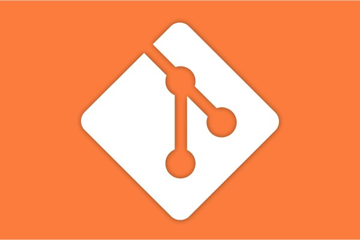
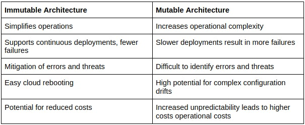
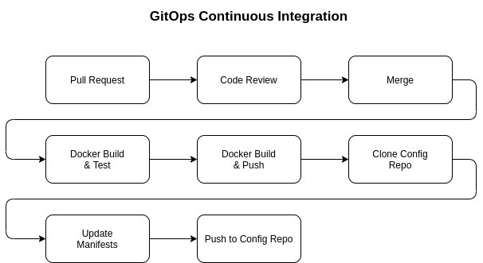
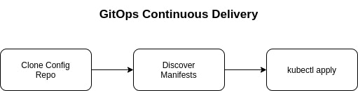
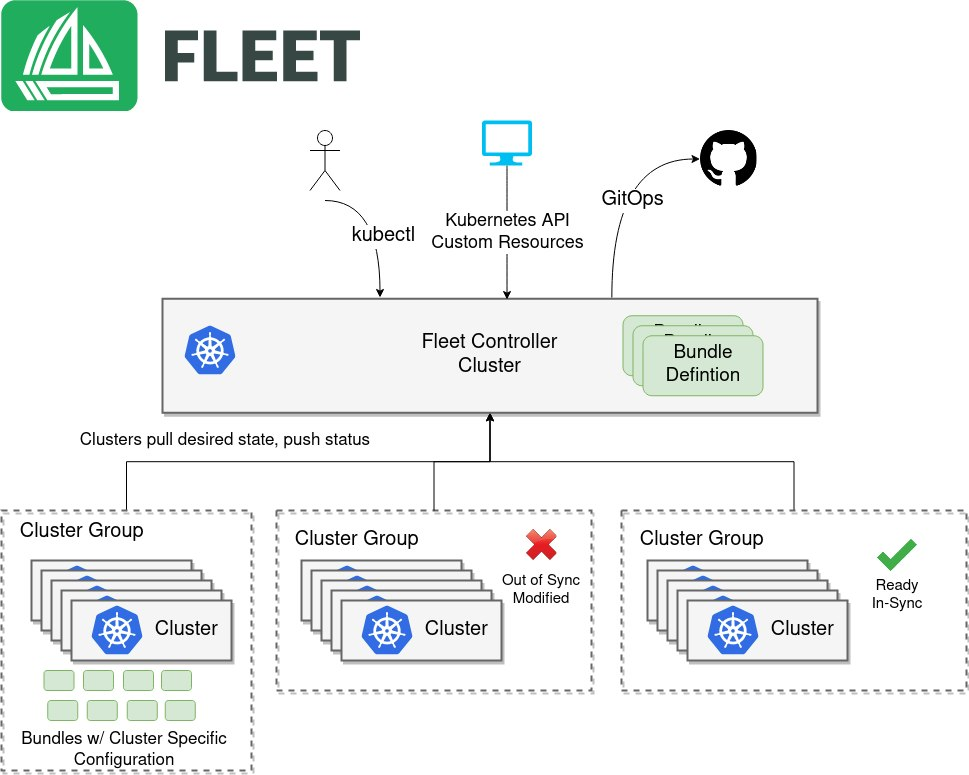
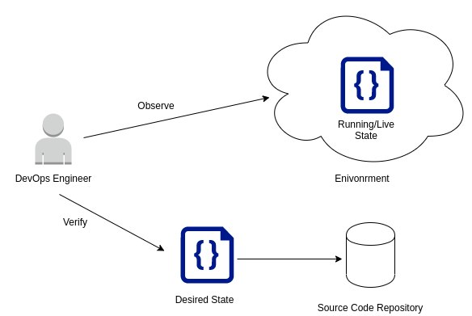

If you are new to the term ‘GitOps,’ it can be quite challenging to imagine how the two models, Git and Ops, come together to function as a single framework. Git is a source code management tool introduced in 2005 that has become the go-to standard for many software development teams. On the other hand, Ops is a term typically used to describe the functions and practices that fall under the purview of IT operations teams and the more modern DevOps philosophies and methods. GitOps is a paradigm that Alexis Richardson from the Weaveworks team coined to describe the deployment of immutable infrastructure with Git as the single source of truth.

In this article, I will cover GitOps as a deployment pattern and its components, benefits and challenges.

## **What is GitOps?**

GitOps requires you to describe and observe systems with declarative configurations that will form the basis of continuous integration, delivery and deployment of your infrastructure. The desired state of the infrastructure or application is stored as code, then associated platforms like Kubernetes (K8s) reconcile the differences and update the infrastructure or application state. Kubernetes is the choice ecosystem for GitOps providers and practitioners because of this declarative requirement. [Fleet](https://fleet.rancher.io/), [FluxCD](https://fluxcd.io/), [ArgoCD](https://argoproj.github.io/argo-cd/) and [Jenkins X](https://jenkins-x.io/) are examples of GitOps tools or operators.

## **Infrastructure as Code**

GitOps builds on DevOps practices surrounding version control, code review collaboration and CI/CD. These practices extend to the automation of infrastructure and application deployments, defined using Infrastructure as Code (IaC) techniques. The main idea behind IaC is to enable writing and executing code to define, deploy, update and destroy infrastructure. IaC presents a different way of thinking and treating all aspects of operations as software, even those that represent hardware.

There are five broad categories of tools used to configure and orchestrate infrastructure and application stacks:

- **Ad hoc scripts**: The most straightforward approach to automating anything is to write an ad hoc script. Take any manual task and break it down into discrete steps. Use scripting languages like Bash, Ruby and Python to define each step in code and execute that script on your server.
- **Configuration management tools**: Chef, Puppet, Ansible, and SaltStack are all configuration management tools designed to install and configure software on existing servers that perpetually exist.
- **Server templating tools**: An alternative to configuration management that’s growing in popularity is server templating tools such as [Docker](https://www.docker.com/), [Packer](https://www.packer.io/) and [Vagrant](https://www.vagrantup.com/). Instead of launching and then configuring servers, the idea behind server templating is to create an image of a server that captures a fully self-contained “snapshot” of the operating system (OS), the software, the files and all other relevant dependencies.
- **Orchestration tools**: [Kubernetes](https://kubernetes.io/) is an example of an orchestration tool. Kubernetes allows you to define how to manage containers as code. You first deploy the Kubernetes cluster, a group of servers that Kubernetes will manage and use to run your Docker containers. Most major cloud providers have native support for deploying managed Kubernetes clusters, such as Amazon Elastic Container Service for Kubernetes (Amazon EKS), Google Kubernetes Engine (GKE), and Azure Kubernetes Service (AKS).
- **IaC Provisioning tools**: Whereas configuration management, server templating, and orchestration tools define the code that runs on each server or container, IaC provisioning tools such as [Terraform](https://www.terraform.io/), [AWS CloudFormation](https://aws.amazon.com/cloudformation/) and [OpenStack Heat](https://wiki.openstack.org/wiki/Heat) define infrastructure configuration across public clouds and data centers. You use such tools to create servers, databases, caches, load balancers, queues, monitoring, subnet configurations, firewall settings, routing rules and Secure Sockets Layer (SSL) certificates.

Of the IaC tools listed above, **Kubernetes** is most associated with GitOps due to its declarative piece of infrastructure.

## **Immutable Infrastructure**

The term immutable infrastructure, also commonly known as immutable architecture, is a bit misleading. The concept does not mean that infrastructure never changes, but rather, once something is instantiated, it should never change. Instead, it should be replaced by another instance to ensure predictable behavior. Following this approach enables discrete versioning in an architecture. With discrete versioning, there is less risk and complexity because the infrastructure states are tested and have a greater degree of predictability. This is one of the main goals an immutable architecture tries to accomplish.

The GitOps model supports immutable architectures because all the infrastructure is declared as source code in a versioning system. In the context of Kubernetes, this approach allows software teams to produce more reliable cluster configurations that can be tested and versioned from a single source of truth in a Git repository.

### **Immutable vs. Mutable Architecture**

## The Declarative Deployment Model

Regarding automating deployments, there are two main DevOps approaches to consider: declarative and imperative. In an imperative (or procedural approach), a team is responsible for defining the main goal in a step-by-step process. These steps include instructions such as software installation, configuration, creation, etc. These steps will then be executed in an automated way. The state of the environment will result from the operations defined by the responsible DevOps team. This paradigm may work well with small workloads but doesn't scale well and may introduce several failures with large software environments.

In contrast, a declarative approach eliminates the need to define steps for the desired outcome. Instead, the final desired state is what is declared or defined. The relevant team will specify the number of Pods deployed for an application, how the Pods will be deployed, how they will scale, etc. The steps to achieve these goals don’t have to be defined. With the declarative approach, a lot of time is saved, and the complex steps are abstracted away. The focus shifts from the 'how' to the 'what.'

Most cloud infrastructures that existed before Kubernetes was released provided a procedural approach for automating deployment activities. Examples of these include scripting languages such as Ansible, Chef, and Puppet. Kubernetes, on the other hand, uses a declarative approach to describe what the desired state of the system should be. GitOps and K8s fit naturally. Common Git operations control the deployment of declarative Kubernetes manifest files.

## **GitOps CI/CD Sequence Example**

Below is a high-level sequence demonstrating what a GitOps CI/CD workflow would look like when deploying a containerized application to a Kubernetes environment. The diagrams below are a representation of this:

### **Pull Request & Code Review**

A CI/CD pipeline typically begins with a software developer creating a pull request, which will then be peer-reviewed to ensure it meets the agreed-upon standards. This collaborative effort is used to maintain good coding practices by the team and act as a first quality gate for the desired infrastructure deployment.

### **Build, Test and Push Docker Container Images**

The Continuous Integration (CI) stage will automatically be triggered if the pipeline is configured to initiate based on the source changes. This usually requires setting the pipeline to poll for any source changes in the relevant branch of the repository. Once the source has been pulled, the sequence will proceed as follows:

- **Build Image for Application Tests**: In this step, the relevant commands will be run to build and tag the Docker image. The image built in this step will be based on a Dockerfile with an execution command to run unit tests.
- **Build Production Imag**e: Assuming the application unit tests passed, the final Docker image can be built and tagged with the new version using the production-grade Dockerfile with an execution command to start the application.
- **Push Production Container Image to Registry**: Lastly, the Docker image will be pushed to the relevant Docker registry (i.e., Docker Hub) for Kubernetes to orchestrate the eventual deployment of the application.

### Clone Config Repository, Update Manifests and Push To Config Repository

Once the image has been successfully built and pushed to the appropriate registry, the application manifest files must be updated with the new Docker image tag.

- **Clone Config Repository**: In this step, the repository with the K8s resource definitions will be cloned. This will usually be a repository with Helm charts for the application resources and configurations.
- **Update Manifests**: Once the repository has been cloned, a configuration management tool like [Kustomize](https://kustomize.io/) can update the manifests with the new Docker image tag.
- **Push to Config Repository**: Lastly, these changes can be committed and pushed to the remote config repository with the new updates.

## **GitOps Continuous Delivery Process**

The Continuous Delivery (CD) process follows when the CI completes the config repository updates. As stated earlier, the GitOps framework and its stages are triggered by changes to the manifests in the Git repository. This is where the aforementioned GitOps tools come in. In this case, I will use **Fleet** as an example.

Fleet is essentially a set of K8s custom resource definitions (CRDs) and custom controllers that manage GitOps for a single or multiple Kubernetes clusters. Fleet consists of the following [core components in its architecture](https://fleet.rancher.io/concepts/):

- **Fleet Manager**: This is the central component that governs the deployments of K8s resources from the Git repository. When deploying resources to multiple clusters, this component will reside on a dedicated K8s cluster. In a single cluster setup, the Fleet manager will run on the same cluster being managed by GitOps.
- **Fleet Controller**: The Fleet controllers run on the Fleet manager that performs the GitOps actions.
- **Fleet Agent:** Each downstream cluster being managed by Fleet runs an agent that communicates with the Fleet manager.
- **GitRepo**: Git repositories being watched by Fleet are represented by the type GitRepo.
- **Bundle**: When the relevant Git repository is pulled, the sourced configuration files produce a unit referred to as a Bundle. Bundles are the deployment units used in Fleet.
- **Bundle Deployment:** A BundleDeployment represents the state of the deployed Bundle on a cluster with its specific customizations.

- **Scan Config Repository**: Based on polling configurations, Fleet detects the changes in the config repository before performing a Git pull (or scan) to fetch the latest manifests.
- **Discover Manifests**: Fleet determines any differences between the manifests in the Kubernetes cluster versus the latest manifests in the repository. The discovered manifests or Helm charts will be used to produce a Bundle.
- **Helm Release**: When the Fleet operator detects the differences, it will convert the new manifests into Helm charts (regardless of the source) and perform a Helm release to the downstream clusters.

## **The Benefits of GitOps**

### **Infrastructure as Code**

Infrastructure as Code is one of the main components of GitOps. Using IaC to automate the process of creating infrastructure in cloud environments has the following advantages:

- **Reliable outcomes**: When the correct process of creating infrastructure is saved in the form of code, software teams can have a reliable outcome whenever the same version of code is run.
- **Repeatable outcomes**: Manually creating infrastructure is time-consuming, inefficient, and prone to human error. Using IaC enables a reliable outcome and makes the process of deploying infrastructure easily repeatable across environments.
- **Infrastructure Documentation**: By defining the resources to be created using IaC, the code is a form of documentation for the environment’s infrastructure.

### **Code Reviews**

The quality gate that code reviews bring to software teams can be translated to DevOps practices with infrastructure. For instance, changes to a Kubernetes cluster through the use of manifests or Helm charts would go through a review and approval process to meet certain criteria before deployment.

### **Declarative Paradigm**

The declarative approach to programming in GitOps simplifies the process of creating the desired state for infrastructure. It produces a more predictable and reliable outcome in contrast to defining each step of the desired state procedurally.

### **Better Observability**

Observability is an important element when describing the running state of a system and triggering alerts and notifications whenever unexpected behavioral changes occur. On this basis, any deployed environment should be observed by DevOps engineers. With GitOps, engineers can more easily verify if the running state matches that of the desired state in the source code repository.

## **The Challenges with GitOps**

### **Collaboration Requirements**

Following a GitOps pattern requires a culture shift within teams. In the case of individuals who are used to making quick manual changes on an ad hoc basis, this transition will be disruptive. In practice, teams should not be able to log in to a Kubernetes cluster to modify resource definitions to initiate a change in the cluster state. Instead, desired changes to the cluster should get pushed to the appropriate source code repository. These changes to the infrastructure go through a collaborative approval process before being merged. Once merged, the changes are deployed. This workflow sequence introduces a “change by committee” to any infrastructure changes, which is more time-consuming for teams, even if it’s better to practice.

### **GitOps Tooling Limitations**

Today, GitOps tooling such as Fleet, FluxCD, ArgoCD and Jenkins X focuses on the Kubernetes ecosystem. This means that adopting GitOps practices with infrastructure platforms outside of Kubernetes will likely require additional work from DevOps teams. In-house tools may have to be developed to support the usage of this framework, which is less appealing for software teams because of the time it will take away from other core duties.

### **Declarative Infrastructure Limitations**

As highlighted above, embracing GitOps requires a declarative model for deploying the infrastructure. However, there may be use cases where the declared state cannot define some infrastructure requirements. For example, in Kubernetes, you can set the number of replicas, but if a scaling event needs to occur based on CPU and memory that surpasses that replica, you end up with a deviation. Also, declarative configurations can be harder to debug and understand when the results are unexpected because the underlying steps are abstracted away.

### **No Universal Best Practices**

Probably the most glaring issue with GitOps can be attributed to its novelty. At this point, there are no universal best practices that teams can follow when implementing this pattern. As a result, teams will have to implement a GitOps strategy based on their specific requirements and figure out what works best.

## **Conclusion**

GitOps may be in its infancy, but the pattern extends the good old benefits of discrete and immutable versioning from software applications to infrastructure. It introduces automation, reliability, and predictability to the underlying infrastructure deployed to cloud environments.

## **What’s Next?**

Get hands-on with GitOps. [Join our free Accelerate Dev Workflows class](https://community.suse.com/courses/4998685/feed). Week three is all about Continuous Deployment and GitOps. You can catch it **on demand.**
