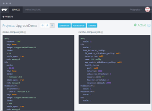

Yesterday I was really excited when Solomon Hykes from Docker announced
[libcompose](https://github.com/docker/libcompose)as an official
implementation of the Docker-compose multi-container file format. It is
a project our team has been working on with Docker for awhile, and I’m
very glad that Docker decided to adopt the code we’ve developed as the
starting point for the next version of Docker Compose. We’ve been big
fans of Compose for some time, even when it was still called Fig, and we
think it is critical to the long term adoption of containers. Today, I
wanted to talk about the impact of libcompose and how we got involved in
the project.

> Introducing libcompose: an official implementation of the
> Docker-compose multi-container file format. <https://t.co/gY1oAJIljm>
>
> — Solomon Hykes (@solomonstre) [August 5,
> 2015](https://twitter.com/solomonstre/status/629018782384566272)

### Why is Libcompose so Important?

Libcompose addresses an immediate need that many projects have--they
would like to support Docker Compose inside of applications such as IDE
or GUI applications, deployment tools, and orchestration frameworks. By
having a library available, it is now possible to have a richer and more
powerful integration into Docker Compose. The other major impact
of libcompose is that it allows us to create a pluggable framework to
address the growing needs of developing and deploying larger
applications. Docker Compose is about bringing together small parts to
form a bigger application. Right now it is focused on containers but
soon, it will address the need to manage volumes, networks, service
discovery, machines, and much more. By creating a pluggable framework,
we can not only manage Docker Project entities, but also other services
that may exist in your organization.

### Docker Compose in RancherOS

Our work with Docker Compose started with
[RancherOS](https://rancher.com/rancheros/). RancherOS is our micro
Linux distribution in which the entire operating system is ran as Docker
containers. When we first released RancherOS, we actually hard-coded in
the Go code, which containers were used to offer the core system
services (udev, DHCP, syslog, etc). We obviously wanted to make
this configurable so we started thinking about what would be the best
way to configure RancherOS. It occurred to me that Docker Compose,
which was originally designed to describe how containers come together
to form an application, could also be used to describe how system
services come together to form an operating system. As a result, Docker
Compose became the configuration mechanism for RancherOS.
Additionally, RancherOS weighs in at less than 25MB. We are very space
conscious and that led us to a technical challenge with Docker Compose.
RancherOS is written in Go and Docker Compose is written in Python. In
order to run Docker Compose, we would need to pull in the Python runtime
and that would add over 8MB to the distribution. We decided it would be
best to just implement Docker Compose in Go-- at least the parts we
needed at that time.

### Docker Compose in Rancher

On
the Rancher side, we are committed to supporting the native Docker
experience so that devops teams can use the same native Docker tools as
they move containers from dev, to test, to production. We do this by
supporting two ways that users can interact with Rancher and Docker.
The first one is through “docker run” and second is through Docker
Compose. In Docker 1.5, with the help of others, we added support for
[labels in Docker](https://rancher.com/docker-labels/). This approach
allows users to add labels to containers to indicate services they want
added to their containers. Through Rancher’s passive orchestration, we
discover and enhance containers launched by “docker run.” A great
example of this is leveraging the Rancher SDN from a “docker run”
command which we [blogged about a few weeks
ago](https://rancher.com/a-demo-of-ranchers-native-docker-integration/).
Docker Compose is the language we use to describe multi-container
application deployments. At Rancher, we specialize in providing
portable infrastructure services for containers, such as service
discovery, health checks, load balancing, SSL termination, SDN, etc. We
wanted to respect the native Docker Compose format but find a way in
which we could describe and manage these additional services. We had
already started a pure Go implementation of Docker Compose in RancherOS,
so we decided to continue with that code base as a way to experiment
with concepts of adding plugins or extensibility to Docker Compose. It
seems like this would be a huge task, but it ended up to be quite
doable. First, the Python implementation is very well written. It was
easy to comprehend and port the logic over to Go. The difficult parts
were related to all of the quirks of the Docker API and parsing logic.
The great thing about doing this in Go is that we were able to leverage
all of the same code used by the Docker Daemon/Client, Machine, Swarm,
Distribution, etc. There was plenty of code that we could just import.
(kudos to the Engine team for all the excellent work done in 1.7 and 1.8
release for making it so easy to reuse the runconfig package). In the
end we found ways to describe scalable services, service discovery,
sidekicks, load balancing, scheduling and upgrade strategies all using
the simple Docker Compose syntax implemented with a pluggable compose
library.

### The Creation of Libcompose

At DockerCon 2015 while talking to the the Docker, Inc. people, we
shared that we had (almost by accident) written a fairly complete
implementation of Docker Compose in Go. I was surprised to find out
that most of the teams at Docker, Inc. had some use case for this
library. They encouraged us to contribute the code so that more people
could collaborate on it. Thanks to Adrian Duermael, Aanand Prasad, Ben
Firshman, Gaëtan De Villèle, Sam Alba, and our friends at Codeship, we
were able to quickly put together the Docker libcompose project. We are
really excited to continue working in the community to see where we can
all take Docker Compose, as well as the ways in which people might embed
Docker Compose in their applications. Next week we’re having our
[August Rancher Online
Meetup](https://info.rancher.com/august-2015-online-meetup), and we’ll
carve out 10 minutes at the beginning to talk about libcompose and the
work we’ve done. I hope you can join us for it.
