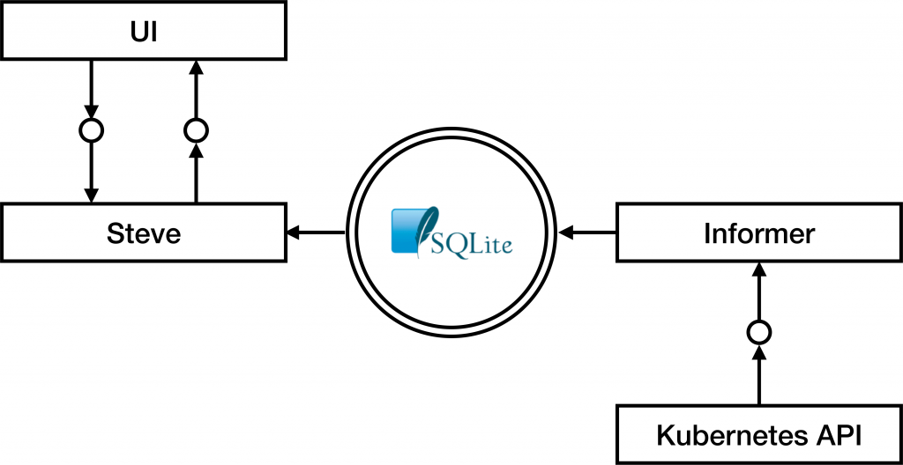
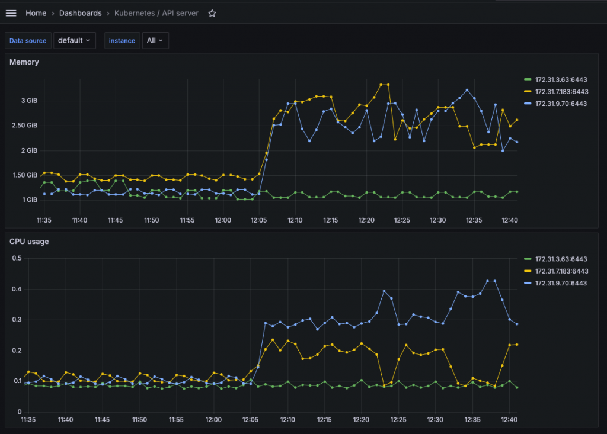

Additional credits to Eric Promislow, Tom Lebreux, Chad Roberts, Richard Cox, [Cody Jackson](mailto:cody.jackson@suse.com) for designing and implementing the feature described here and providing feedback on this post, and Michael Spencer for the QA support.
 
 
 
 
 
 
 
 
 
 
If you manage Kubernetes at scale with Rancher, you know that UI performance is not just a "nice-to-have"—it's crucial for productivity. The Rancher team is on a continuous journey to enhance our platform's ability to handle increasingly complex environments.
In this post take a deep dive into an exciting, evolving improvement we've been developing: a project codenamed "Vai" (also called UI Server-Side Pagination or SQLite-backed caching). The goal is to make your experience with Rancher smoother, faster, and more scalable, especially when you're dealing with a boatload of Kubernetes resources. That’s why the Rancher team built Project Vai, now a production-ready feature in [SUSE Rancher Prime](https://www.suse.com/products/rancher/).
Rancher Prime's Vai engine delivers faster, more reliable Kubernetes management by re-architecting how data flows to the UI. This ensures enterprises can manage large and complex environments smoothly while reducing costs and improving productivity.

- Faster and smoother Rancher UI  boosts productivity
- Reduced strain on Kubernetes API servers ensures healthier clusters and better performance
- Secure caching with encryption that protects sensitive data by default
- Scalable foundation that grows with your environment and unlocks future insights

## **The Problem, how scale affects UI Performance**

As Rancher deployments grow, managing a vast number of clusters, nodes, and the resources within them becomes the norm. We heard you loud and clear: performance, particularly in the Rancher Dashboard, was becoming a challenge for some of our users pushing the boundaries of scale.
To address this, we set some ambitious goals for Rancher's performance. For instance, to ensure the UI can handle extreme-scale scenarios, we set as a benchmark goal to be able to visualize and paginate through tens of thousands of a given resource type—using ConfigMaps with a 1MiB payload as a representative example. For this test case, paginated results should be returned from the API within half a second in the worst case, so that the rendering completes within one second.
These aren't just numbers; they represent real-world scenarios where a sluggish UI can hinder your ability to manage and monitor your Kubernetes environments effectively. As we noted internally, "When the Dashboard doesn't meet their expectations, users end up with a bad impression of Rancher and are less productive using it". This was a critical pain point we were determined to address.
The core issue often boils down to how the UI fetched and handled large lists of Kubernetes objects. Retrieving, caching, and then sorting and filtering thousands of items—be they Pods, Deployments, or any other resource—directly in the browser can strain network connections, browser memory and lead to frustrating delays. On top of that, the setup could create excessive load on the Kubernetes API Server, with detrimental effects on the target cluster.
We knew we needed a smarter, more efficient way to deliver data to the UI.

## **The Solution, how project Vai, delivers a faster & scalable UI**

Enter "Vai." This project isn't just a single tweak; it's a fundamental re-architecture of how the Rancher’s internal API, called Steve, delivers resources to the Rancher UI and how it interacts with Kubernetes data at scale.
The primary goal of Vai is to implement efficient server-side pagination, filtering, and sorting. Instead of pulling massive datasets into the browser and then trying to manage them, Vai processes these operations on the server side, sending only the necessary, already-processed data to the UI.
The core idea was to create a robust caching layer that sits between the Kubernetes API server and the Rancher UI. This cache, backed by SQLite, allows Steve (which acts as Rancher's API proxy for Kubernetes) to serve UI requests for lists of objects much more rapidly, as sorting, filtering and pagination are all computed server-side, minimizing data transfer.
The expected outcome? A significantly **more responsive UI**, reduced **load** on both the Kubernetes API server and Rancher itself, and a **better overall experience** when you're navigating through pages of any resource type, even in environments with tens of thousands of them.

## **Technical Deep Dive into the SQLite-backed architecture of Vai**

So, how does Vai actually work? The magic lies in its architecture, which combines Kubernetes-native Informers with the speed and low memory footprint of SQLite.
At its heart, Vai is a modification of Steve, Rancher's component that proxies API calls from the UI to Kubernetes. Vai is all about leveraging special Informers to cache information from the Kubernetes API.
If you're familiar with Kubernetes controller development, you know Informers are a standard way to watch for changes to resources and maintain a local, synchronized cache. When the UI requests a list of a particular resource type (say, Pods) for the first time, a Vai Informer for that resource kind is created. This Informer makes an initial LIST request to the Kubernetes API server and then establishes a WATCH to keep its cache up-to-date with any changes.
The crucial difference from typical in-memory Informer caches is that Vai Informers use SQLite as their backing store. This means the cached Kubernetes objects are persisted to disk (by default, within the Rancher pods or cattle-cluster-agent pods for downstream clusters).
This on-disk storage provides a much larger caching capacity compared to purely in-memory solutions. This is essential when dealing with the worst-case scenarios we tested against, such as the ~80 GiB of data from our 80,000 large ConfigMap benchmark case mentioned earlier.
Here's a simplified flow:

1. **UI Request:** Your browser (the Rancher Dashboard JavaScript code) makes a request to a Steve API endpoint for a specific page of, say, Pods sorted by age and filtered on name.
2. **Steve & Vai:** Steve receives this request. If the Vai cache for Pods is already warmed up, which is the most common case, Steve translates the request into an SQL query.
3. **SQLite Query:** This SQL query is executed against the SQLite database. SQLite’s engine efficiently handles the filtering, sorting, and pagination, selecting only the data needed for the requested page.
4. **Response to UI:** Steve sends the neatly packaged page of data back to the UI.

The beauty of this approach is that subsequent requests for different pages, or similar filtered/sorted views of the same resource type, can be served directly from the SQLite cache without hitting the Kubernetes API server again for a full LIST. This significantly reduces the load on kube-apiserver and etcd.
 

The database itself is structured with a set of tables for each resource type. Typically, this includes an "object table" storing the full resource object (as a blob) and a "fields table" containing indexed columns for properties that are frequently used for sorting and filtering, like name, namespace, creation timestamp, and other schema-defined attributes. This "fields of interest" concept is key. We can't index every single field of every object—that would be inefficient. Instead, we focus on the fields that matter most for UI interactions. This is a deliberate trade-off to optimize for common use cases while managing the overhead of indexing.

## **Evolution and alternatives on the path to Vai**

The development of Vai has been an iterative journey - beginning from a [HackWeek project](https://hackweek.opensuse.org/22/projects/vai-a-kubernetes-api-caching-layer), evolved through several design discussions, an RFC, and multiple rounds of implementation and refinement. Rancher 2.8 delivered the starting building blocks, with successive iterations building on top of them in 2.9, 2.10, 2.11, and now 2.12. Along the path we've gone through several EPIC GitHub issues to track progress, address bugs, and refine the implementation, ensuring we tackle challenges like cache warmup performance and ensure feature parity. This iterative approach allows us to deliver value incrementally and respond to feedback along the way.
Vai wasn't our first attempt at tackling UI performance through caching in Steve. It's the result of lessons learned and a systematic evaluation of different strategies. While designing Vai several alternatives that were considered and, in some cases, implemented and benchmarked before we landed on the current design.
**Alternative** **Initial Gain** | **Main Pain Point** | **How it Led to Vai's Design** || Original Steve In-Memory LRU Cache | Baseline for UI performance. | Memory inefficiency due to new cache entries for every query parameter change or RBAC permission variation, leading to data duplication. | Highlighted the need for a more efficient caching mechanism that avoids redundant data storage and can handle diverse UI requests without excessive memory consumption. |
| In-Memory Cache Post-Kube API Response | Improved by caching raw Kubernetes API responses before Steve's processing. | Struggled with cache churn as the Kubernetes API's resource version could change even without element modifications, causing new, redundant cache entries on each "latest" data request. | Showcased the necessity of a caching strategy that is resilient to frequent resource version changes and can maintain a stable cache without constant re-fetching of largely unchanged data. |
| Tracking ResourceVersion for In-Memory Cache | Substantial difference in memory use and improved response time consistency for infrequently changed lists. | Fell short for frequently updated resources (e.g., leader election leases), where the cache would almost always deem the list "stale," leading to constant re-fetching and new entries, making it impractical for dynamic, large-scale scenarios with tens of thousands of resources. | Directly informed Vai's use of Informers for efficient real-time updates.Table 1: Design alternatives attempted in Steve before Vai.This journey highlights a rigorous engineering process. We didn't just pick a solution; we identified limitations in existing ones and methodically worked towards a more robust architecture. The specific challenge of frequently updated resources causing cache churn was a significant driver.  Vai was chosen because it directly addresses these shortcomings. By using Informers, we get efficient, real-time updates to our cache. By backing it with SQLite, we gain a larger, disk-based persistent store that's less susceptible to memory pressure and offers powerful SQL querying for server-side sorting, filtering, and pagination. This combination effectively offloads work from both the Kubernetes API server and the user's browser.**What Vai means for you, the engineer**So, what does all this mean for you, the tech-savvy engineer using Rancher?  - **Seriously Snappy UI:** The most immediate benefit is a much more responsive Rancher UI, especially when you're navigating pages with thousands of resources like Pods, Secrets, ConfigMaps, or any other type in the Cluster Explorer. Sorting, filtering, and clicking through pages feels fast and fluid because the heavy lifting is done on the server. - **Lighter Load on Kubernetes API Servers:** By serving many UI data requests from its own cache, Vai significantly reduces the number of direct LIST and GET requests that Rancher makes to your downstream Kubernetes API servers. This isn't just good for Rancher; it's good for the health and performance of your managed clusters, freeing up API server resources for your actual workloads.  *Image 1: kubapiserver load on Rancher 2.11.1 as part of one of the QA tests. Heavy Steve “list” load is generated via k6, and Steve in turn loads the Kubernetes API Server, here monitored via Rancher Monitoring.**Image 2: kubapiserver load on Rancher 2.12.1 (with Vai enabled) as part of one of the QA tests. Heavier Steve “list” load is generated via k6 (10x more than the previous image), and the Kubernetes API Server is unaffected.**Image 2: kubapiserver load on Rancher 2.12.1 (with Vai enabled) as part of one of the QA tests. Heavier Steve “list” load is generated via k6 (10x more than the previous image), and the Kubernetes API Server is unaffected.*  - **Foundation for Richer Data Insights:** The use of SQLite opens the door to the power and flexibility of SQL in future Rancher versions. This allows for more complex queries, such as creating summarized views by JOINing data from multiple Kubernetes resource types directly on the server. In the pre-Vai world, this was extremely resource-intensive, requiring multiple large LIST operations followed by mapping and joining the data entirely within the browser. - **More Scalable Rancher:** These efficiencies mean Rancher itself can manage larger and more numerous clusters more effectively. Its own control plane components, like Steve, become more resource-efficient. - **Boosted Productivity:** A faster, more reliable UI directly translates to less time waiting and more time getting things done. This was a key driver for us, addressing the concern that a slow dashboard can lead to a bad impression of Rancher and are less productive using it.  Ultimately, Vai is a foundational piece that helps Rancher scale alongside your needs. It’s about ensuring that as your Kubernetes footprint grows, Rancher remains a powerful and *performant* tool in your arsenal. This kind of improvement also paves the way for future enhancements in Rancher, as a responsive data access layer is often a prerequisite for more advanced features.**Security considerations to protect your data**Whenever we talk about managing data, especially from your Kubernetes clusters, security is paramount. Since Vai caches copies of Kubernetes objects to disk within the Rancher server pods (for the local cluster) or cattle-cluster-agent pods (for downstream clusters) we built encryption-at-rest directly into its design. Specifically, we've built in two safeguards:  - **Optional Full-Cache Encryption:** If you're concerned about the data at rest in these SQLite caches, you can enable encryption for *all* cached objects. This is done by setting the environment variable CATTLE\_ENCRYPT\_CACHE\_ALL to true in the relevant Rancher or agent pods. - **Secrets and Tokens Always Encrypted:** Critically, Kubernetes Secrets and Rancher Tokens are *always* encrypted in the cache, regardless of whether you've enabled the full-cache encryption. This provides a baseline level of protection for your most sensitive information.  The encryption mechanism itself uses AES GCM, employing a Key-Encryption Key (KEK) stored in memory to encrypt and decrypt Data Encryption Keys (DEKs). These DEKs are used to encrypt the actual resource data and are rotated periodically to enhance security. This shows that security was a proactive consideration in "Vai's" design, not an afterthought. Another important security aspect is access control - because we changed the caching logic, we had to make sure that policies and permissions continue to be respected as they were before. To that end, we worked with our Security Team for in-depth reviews and automated testsuites running with and without Vai enabled, to ensure consistency.**The road ahead for Rancher performance**Vai represents a significant leap forward in how Rancher handles data at scale, but our work isn't done. This feature is on a path to becoming a core part of the Rancher experience. In Rancher versions up to 2.11, Vai is considered **experimental** and is turned off by default. However, we're excited to announce that with the new **Rancher 2.12 release, Vai is considered production ready and is therefore fully supported by SUSE and activated by default**. This is a major milestone, and we'll continue to enhance it based on real-world use and feedback. Furthermore, we are only just beginning to tap into the extra flexibility that the underlying SQL engine provides. We expect to leverage this foundation to enrich Rancher with more complex data summaries and insights in the future. Our ultimate goal is to make this powerful performance engine enabled by default in a future version of Rancher, making a highly-scalable UI the standard experience for everyone.**Help Us Test and Refine Vai!****Your Feedback Matters!** To learn more, read the ["UI Server-Side Pagination" feature page in the Rancher manual](https://ranchermanager.docs.rancher.com/how-to-guides/advanced-user-guides/ui-server-side-pagination). Then, let us know about your experience! Help shape the future of Rancher performance by [opening an issue on GitHub](https://www.google.com/search?q=link-to-github) to share your findings and suggestions.   Thanks for reading, and we look forward to hearing about your experiences as we work together to build a faster, more scalable Rancher! |
