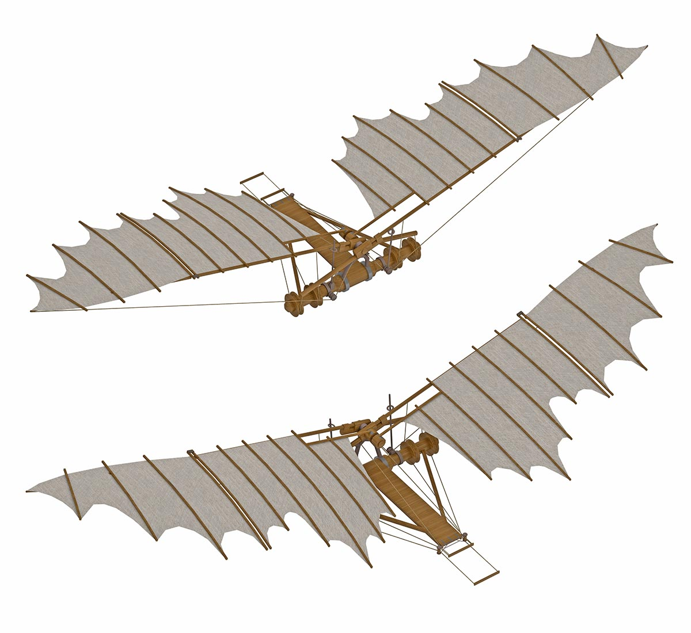
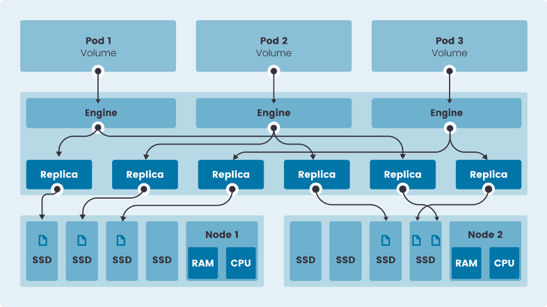

Learn more about Longhorn, an enterprise-grade, cloud-native container storage solution.[Learn More](https://rancher.com/products/longhorn)

When Frodo was commissioned on a seemingly straightforward journey to retrieve the One Ring, I doubt he realized the adventure and commitment he was embarking on. Rancher Labs started on a similarly daring journey almost four years ago. It didn’t take a wizard showing up uninvited at dinner to convince us of this. From the beginning of Rancher Labs, our founding team had a deep conviction about the importance of storage in the future of cloud-first computing. But as it turned out, rethinking the way distributed storage worked and challenging industry assumptions was going to be no small feat.

## A New Way of Thinking about Storage: Cloud-Native, Container-First

It is natural to address a new storage system by regurgitating existing patterns of distributed storage. Leonardi da Vinci’s early drawings for an airplane emulated a bat wing as the basis for the design. And rightfully so – bats were excellent fliers to model. Yet in any design, when we remove our preconceived notions of what is required, we often find there are more innovative ways to solve a problem. In the same way, today’s modern airplanes look a lot less like bats because many of the requirements of a bat’s flight (short takeoff, tight maneuverability) don’t apply to the type of flight we need.

[Longhorn](/blog/longhorn-simplifies-distributed-block-storage-in-kubernetes/) is built on the principle that distributed storage should be cloud-native and container-first in its design. If applications can now be described entirely in containers, why should storage be any different? Now we can bring all the benefits of containers into the storage world. This mitigates many of the pain points of [traditional storage systems](/blog/why-kubernetes-is-changing-storage/).

Examples of this include system and library dependency management. Storage engines typically have tight dependencies on specific libraries and binaries that need to be satisfied for different operating systems and their unique package managers. Longhorn’s distribution is all containers, so except for an iSCSI library, everything is self contained and agnostic to RHEL, Ubuntu, SUSE, etc.

Additionally, the nature of distributed storage means that you have to orchestrate the engine and related runtimes all over a cluster of servers. This problem is often poorly solved by a bespoke orchestrator or deployment tool. In Longhorn’s case, we use the best-in-class orchestration capabilities of Kubernetes.

## Longhorn Leverages the Linux Kernel

Another design principle in Longhorn is how it leverages the Linux kernel. Rather than reinvent the wheel of managing block storage, Longhorn leverages stable code that has been put through decades of use. So instead of creating a block storage engine, we leverage sparse file, which is part of the Linux kernel. For network transport, we also leverage iSCSI, which is a tried-and-true network transport mechanism. The benefits of this are obvious: we don’t risk making new mistakes by rewriting well-understood components, and we can devote more time to writing quality code that connects these components in a distributed fashion.

## Diving into the Longhorn Architecture

Let’s take a look at the Longhorn architecture. Longhorn is made up of volumes, which are just traditional block devices. They each have N number of replicas depending on the tolerance the user defines. The goal is to provide storage to a pod in a cluster, no matter where it lives. To achieve this, we run an engine on each node that can orchestrate a connection to a replica if a pod on that node needs it. This engine runs itself as a container. To coordinate the engines’ activities across all the nodes, the Longhorn manager acts as a central supervisor. However, the data path is entirely distributed, meaning a central point is not required for data to flow.

The data for each Longhorn volume lives on the local storage of each node that is provided to the Longhorn engine. This means Longhorn can use any type of storage, whether it’s a commodity local disk, enterprise SAN or Amazon Elastic Block Storage. Longhorn manages block-level storage that is written to the local filesystem using Linux sparse files.

Each Longhorn volume can be snapshotted at any point in time, allowing you to restore a copy from a point in time. Additionally, we can back up any volume to S3 or NFS, which we have found is readily available in most environments. This backup and recovery feature is extended in Longhorn’s Disaster Recovery Volumes, which provide a standby volume in another cluster/datacenter that is continually fetching the latest backup to be pre-warmed for a failover should the primary cluster copy fail.

## Longhorn and Rancher Work Together

Longhorn can be deployed from one click inside a Rancher deployment through the App Catalog. Users familiar with Rancher’s ability to run Kubernetes anywhere will be pleased to discover that Longhorn runs equally well in a various environments, clouds and hardware types. In the cloud-native world, all you should need is Kubernetes, and Rancher makes that possible.

You’ll notice the Longhorn UI is already integrated with the Rancher UI. For instance, it uses the Rancher session as an authentication proxy for login. In coming releases, you will see tighter UI integration, including more fine-grained RBAC support. Monitoring of your storage will also be integrated tightly with Rancher’s first-class support for Prometheus and Grafana. Longhorn’s backup strategy will expand to think about the application as a whole, not just the volumes it uses. With this in mind, expect to see Longhorn become an indispensable component of the Rancher story.

Learn more about Longhorn, an enterprise-grade, cloud-native container storage solution.[Learn More](https://rancher.com/products/longhorn)
