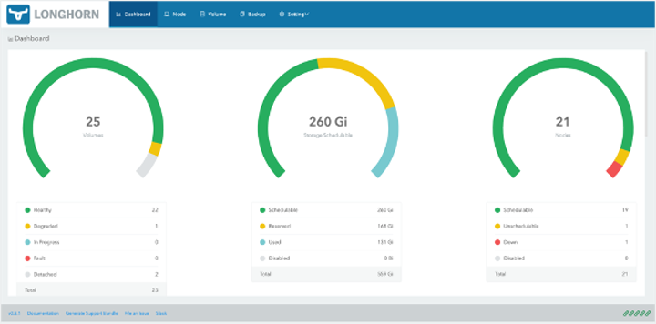
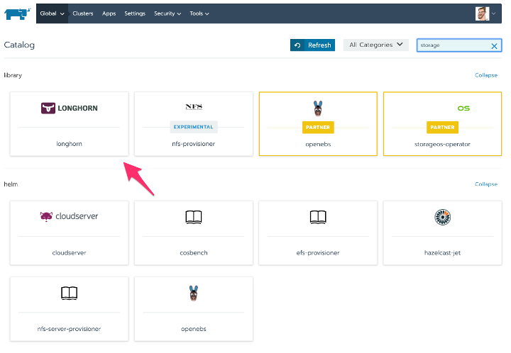

Learn more about Longhorn, an enterprise-grade, cloud-native container storage solution.[Learn More](https://rancher.com/products/longhorn)

Today we’re announcing the general availability of our persistent storage solution built with [Longhorn](https://rancher.com/products/longhorn), a Cloud Native Computing Foundation (CNCF) Sandbox project. This cloud-native container storage solution directly answers the need for enterprise-grade, vendor-neutral persistent storage that supports the easy development of stateful applications within Kubernetes.

We’ve been working on persistent container storage for almost as long as we’ve been around as a company. We launched the Longhorn project in 2017, and then in 2019, we contributed it to the CNCF as a sandbox project. So it’s that CNCF open source project that is now generally available.

Dashboard in Longhorn 1.0’s standalone UI

## The Need for Persistent Container Storage

As enterprises deploy more production applications in containers, the need for persistent container storage [is growing rapidly](/blog/2020/kubernetes-changing-storage). As Kubernetes workloads become stateful, they need an enterprise-grade persistent storage solution supporting them. Rancher Labs works closely with leading storage vendors, including NetApp, EMC and Pure Storage, whose solutions work well with Kubernetes. We also partner with container-native storage providers like Portworxs, StorageOS and OpenEBS. Yet there’s still demand for an open source, low-cost, easy-to-deploy storage solution that works with Rancher right out of the box. And that’s the role we envision for Longhorn – for organizations using Kubernetes, it’s an easy-to-use solution for getting started with persistent storage.

With Longhorn, we took a fresh look at what’s required for stateful workloads in Kubernetes. We found that it comes down to reliable, fast block storage support. Since its beta release in 2019, thousands of users have stress-tested Longhorn. Today’s GA version includes a rich set of enterprise storage features, including

- Thin-provisioning, snapshots, backup and restore
- Non-disruptive volume expansion
- Cross-cluster disaster recovery volume with defined RTO and RPO
- Live upgrade of Longhorn software without impacting running volumes
- Full-featured Kubernetes CLI integration and standalone UI

With Longhorn, you can create distributed block storage mirrored across local disks. Longhorn also serves as a bridge to integrate enterprise-grade storage with Kubernetes by enabling users to deploy Longhorn on existing NFS, iSCSI and Fibre Channel storage arrays and on cloud storage systems like AWS EBS, all the while adding useful features such as application-aware snapshots, backups and remote replication.

## Built for Lean Engineering Teams

Longhorn makes persistent storage as easy to deploy as a single click – so it’s really efficient for developers and ITOps. With built-in multi-cluster back up to external storage and disaster recovery, Longhorn eliminates the need for ITOps, DevOps, storage Admins and developers to invest time and resources provisioning dedicated third-party storage infrastructure. What’s more, you don’t have the cost overhead of proprietary solutions.

## The Longhorn and Rancher Connection

[When combined with Rancher](/blog/2020/longhorn-journey-to-ga), our Kubernetes management platform, Longhorn makes the deployment of highly available persistent block storage in your Kubernetes environment easy, fast and reliable.

Longhorn remains an open source CNCF project, and it’s free to download and use. If you’re an existing Rancher user, you can easily install Longhorn from our app catalog.

Deploy Longhorn from Rancher’s app catalog

Customers looking for additional support can purchase premium support as an add-on to their Rancher enterprise subscription. There are no software licensing fees, so our node-based pricing keeps costs to a minimum.

Hear more about our Rancher’s vision for Longhorn in CEO and Co-Founder Sheng Liang’s interview with TFiR.

Learn more about Longhorn, an enterprise-grade, cloud-native container storage solution.[Learn More](https://rancher.com/products/longhorn)
