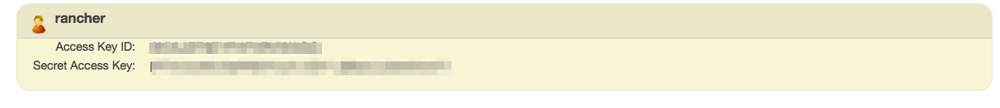
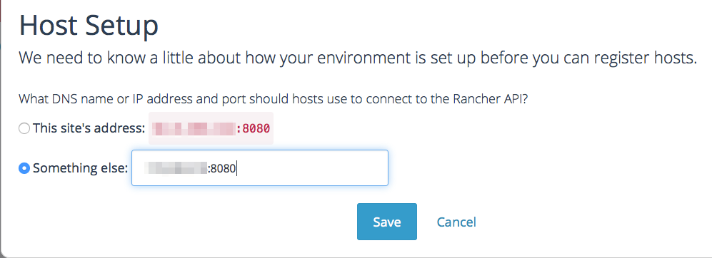
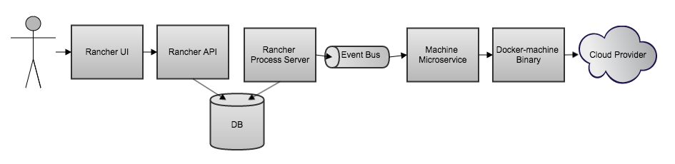
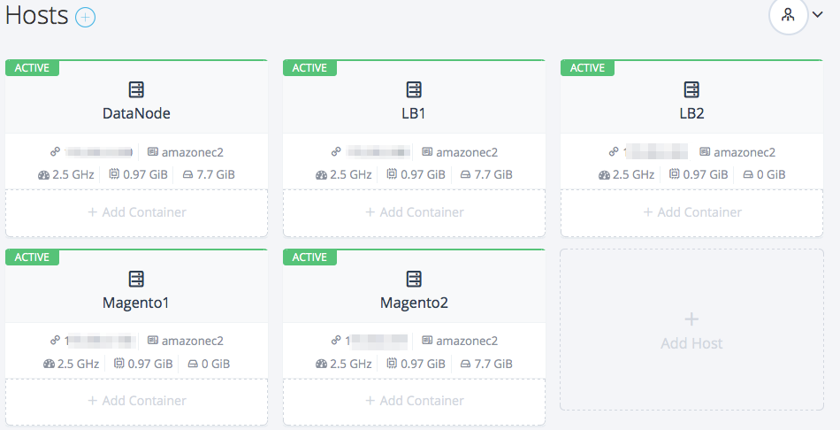
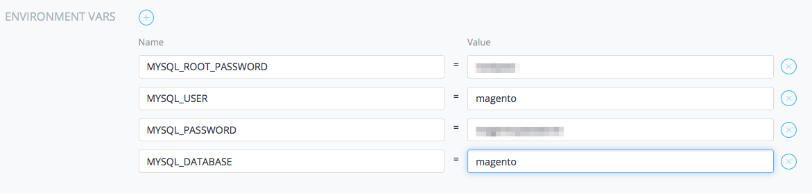
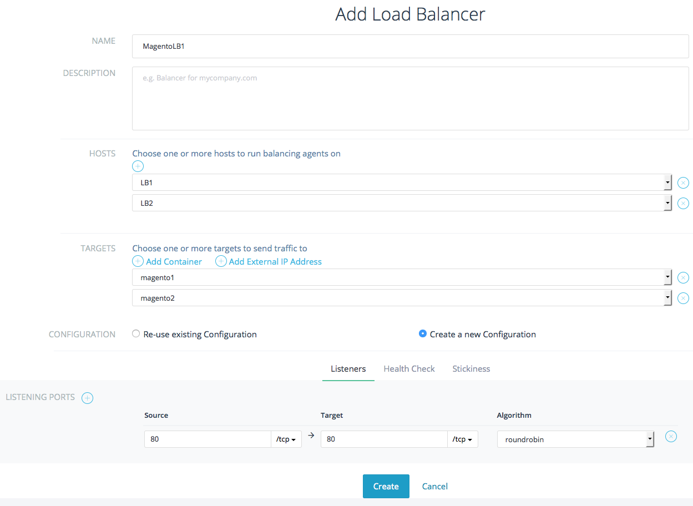
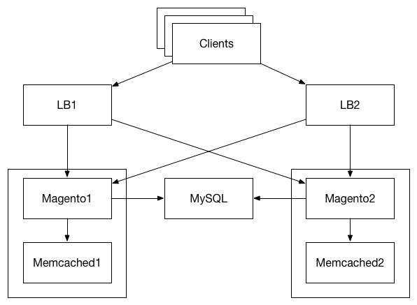

A
little over a month ago I [wrote
about](https://rancher.com/creating-a-magento-cluster-docker-and-rancher-on-aws/)
setting up a Magento cluster on Docker using Rancher. At the I
identified some short comings of Rancher such as its lack of support fot
load-balancing. Rancher released support for [load
balancing](https://rancher.com/load-balancing-support-for-docker-in-rancher/) and [docker
machine](https://rancher.com/rancher-adds-support-for-docker-machine-provisioning/) with
0.16, and I would like to revisit our Magento deployment to cover the
use of load balancers for scalability as well as availability.
Furthermore, I would also like to cover how the docker machine
integration makes it easier to launch Rancher compute nodes directly
from the Rancher UI.

### Amazon Setup

As before we will be running our cluster on top of AWS hence if you have
not already done so follow the steps outlined in the *Amazon Environment
Setup* section of the earlier tutorial to setup an ssh key pair and a
security group. However, unlike earlier we will be using the Rancher UI
to launch compute nodes and will require an *Access Key ID* and *Secret
Access Key*. To create your key and secret click through to the *IAM*
service and select *Users* from the menu on the left. Click the *Create
User* button and specify *rancher* as the user name in the subsequent
screen and click *Create*. You will be given the Access Key ID and
Secret Access Key in the dialogue shown below, keep the information safe
as there is no way to recover the secret and you will need this later.

Once
you have created the IAM user you will also need to give it permissions
to create Amazon Ec2 Instances. To do so select rancher from the user
list and click *Attach Policy* in the *Managed Policies* section*.* Add
the *AmazonEC2FullAccess* policy to the Rancher user so that we are able
to create the required resources from the Rancher UI when creating
compute nodes. Full access is a little more permissive tan required
however, for the sake of brevity we are not creating custom policy.

### Rancher Setup

After setting up the AWS environment, follow the steps outlined in the
*Rancher Server Launch* section of the earlier [Magento
tutorial](https://rancher.com/creating-a-magento-cluster-docker-and-rancher-on-aws/)
to bring up your Rancher server and browse to
http://RANCHER\_SERVER\_IP:8080/. \***Be sure you are using a version of
Rancher after 0.16**.\* Load the *Hosts* tab using the respective option
in the left-side menu and click *+ Add Host* to add rancher compute
nodes. The first time you launch a compute node you will be prompted to
confirm the IP address at which Rancher server is available to your
compute nodes. Specify the Private IP address of the Amazon node on
which Rancher server is running and hit save.

In the *Add Host* screen select the Amzon EC2 Icon and specify the
required information in order to launch a compute node. The required
information is shown below. Enter the access key and secret key that you
created earlier for the rancher IAM user. We are using a t2.micro
instance for our tutorial however you would probably use a larger
instance for your nodes. Select the same VPC as your Rancher server
instance and specify *Rancher* as the security group to match the
security group that you created earlier in the Environment Setup
section. The compute nodes must be launched in a different availability
zone from the rancher server hence we select Zone c (Our Rancher Server
was in Zone a) . This requirement is due to the fact that Docker Machine
uses the Public IP of compute agents to ssh into them from the Server.
However, a nodes public IP is not addressable from within its own
subnet.

Repeat the steps above to launch five compute nodes; one for the MySQL
database, two for the load-balanced Magento nodes and two for the load
balancers themselves. I have labeled the nodes as DataNode, Magento1,
Magento2, LB1 and LB2. When all nodes come up you should be able to see
them in the Rancher Server UI as shown below.

### Magento Container Setup

Now that we have our Rancher deployment launched we can setup our
Magento containers. However before we launch our Magento containers we
must first launch a MySQL container to serve as our database and
Memcached containers for caching. Let’s launch our MySQL container first
on one of the compute nodes. We do this by clicking the *+ Add
Container* on the DataNode host. In the pop up menu we need to specify a
name for our container and *mysql* as the source image. Select *Advanced
Options > Command* > *Environment Vars +* to add the four required
variables: mysql root password, mysql user, mysql password, and mysql
database. You may choose any values for these the root password and user
password, however, the mysql user and database must be magento. After
adding all of these environment variables, hit create to create the
container. Note that mysql is official Docker mysql image and details
of what is inside this container can be found on
its [dockerhub](https://registry.hub.docker.com/_/mysql/) page.

Next we will create the Memcached containers on the two magento compute
nodes, one on each of the Magento nodes. We again give the containers a
name (memcached1 and memcached2) and specify their source images
as *memcached.* The Memcached containers do not require any further
configuration and therefore we can just click create to setup the
containers. Details of the memcached official container we use can be
found on
its [dockerhub](https://registry.hub.docker.com/_/memcached/) page.

Now we are ready to create the magento containers, On the Magento1 host
create a container named *magento1* using the image
[usman/magento:multinode](https://github.com/usmanismail/docker-magento/tree/multi-node).
You need to specify the *MYSQL\_HOST* and *MEMCACHED\_HOST* environment
variables using the container IPs that are listed in the Rancher UI.
Note that for Magento1 you should specify the IP of Memcached1.
Similarly launch a second container called magento2 on the Magento2 host
and specify the mysql host and memcached host environment variables. In
a few moments both your magento hosts should be up and ready. Note that
unlike before we did not have to link the mysql and memcached containers
to our magento containers. This is because Rancher now gives all
containers access to each other over a Virtual Private Network (VPN)
without the need for exposing ports or linking containers. Furthermore
we will not need to expose ports on the Magento containers as we will
use the same VPN to allow the load balancers to communicate with our
nodes.

### Load balancer Setup

Now that your containers are up we can setup load balancers to split
traffic onto the Magento containers. Select the *Balancing* tab in the
left side menu then click *Balancers* and *+ Add Load Balancer*. In the
subsequent screen you can specify a name and description for your load
balancer. Next you can select the hosts on which to run balancer
containers run. in our case we can select both LB1 and LB2. We then need
to select the two Magento containers as targets. In the *Listening
Ports* section we need to specify that our Magento containers are
listening for HTTP traffic on port 80 and that we want load balancers to
also listen to http traffic on port 80.

### 

Lastly, click on the *Health Check* tab and specify that the load
balancers should send a *GET* request to the root URI every 2000 ms to
check that the container is still healthy. If three consecutive health
checks fail then the container will be marked as unhealthy and no
further traffic will be routed to it until it can respond successfully
to two consecutive health checks. In a few moments your load balancers
will be ready and you can load Magento on the public IP of either load
balancer host. You will need to look for the IP in the Amazon EC2
console as the Rancher UI only shows the private IP of the nodes. Once
you load the Magento UI follow the steps outlined in the previous
tutorial to setup your connection the MySQL and to setup a magento
account.

###

### DNS Round-robin Setup using Amazon Route 53

Now that we have our load balancers up and running we can split traffic
onto our two Magento contianers but we still must send our requests to
one balancer or the other. To enable routing to both load balancers
transparently we need to setup DNS round-robin. For this you may use any
DNS provider of your choice but since we are using Amazon EC2 we will
use Amazon’s Route 53 service. Use the Top menu to select the *Route
53* service and select *Hosted Zones* from the left menu. If you don’t
already have a registered domain and hosted zone you may have to create
one. We are using the *rancher-magento.com* domain and hosted zone. In
your hosted zone click the *Create Record Set* button and specify a
subdomain such as *lb.rancher-magento.com* in the form which loads to
the right of the screen\*. S\*elect type *A - IPv4 address* and specify
the public IP address of one of your load balancer hosts. In the
*Routing Policy* section select *Weighted*, and enter 10 as the weight.
Enter 1 as the Set ID and click *Save Record Set.* Repeat exactly the
same process once more but use the public IP of the second load-balancer
host. This pair of DNS entries is specifying that we want to route
clients who ask for *lb.rancher-magento.com* to the two specified IPs.
Since the IPs records have the same weight the traffic will be split
evenly between the two load balancers. We can now load up our Magento UI
using http://*lb.rancher-magento.com* instead of having to specify the
IP.

### Wrapping up

### 

Putting it all together we get a cluster setup as shown above. Using the
DNS entries our web browsers are directed to one of the load balancers
LB1, or LB2. By having two load balancers we have split traffic and
hence reduced the load on each of our load balancer instances. The load
balancers will then proxy traffic to either Magento1 or Magento2. This
again allows us to spread the load to the separate containers running on
their own hosts. We have setup only two Magento containers but your
could setup as many as you need. Furthermore, the health check setup
ensures that if one of the Magento containers fails the traffic will
quickly be diverted to the remaining container without human
intervention. Each of the Magento containers has a Memcached server
running on its own host to provide fast access to frequently used data.
However, both magento containers use the same MySQL container to ensure
consistency between the two containers. By using Rancher’s docker
machine support we were able to launch all hosts (other than Rancher
Server) directly from the Rancher UI. In addition, due to Rancher’s VPN
we did not have to expose ports on any of our containers nor did we have
to link containers. This greatly simplifies the Magento container setup
logic. With support for load balancers and machine (as well as docker
compose coming soon), Rancher is becoming a much more viable option for
running large scale user facing deployments.

To learn more about Rancher, please join us for one of our monthly
online meetups. You can register for an upcoming meetup by following the
link below.
