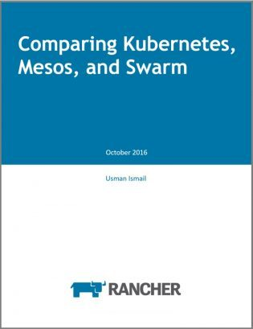
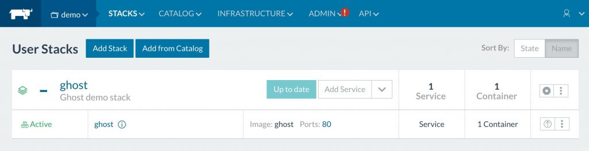

Infrastructure as code is a practice of codifying and automating the
deployment and management of infrastructure with tooling. This allows
for testing, reviewing, approving, and deploying infrastructure changes
with the same processes and tools as application code. In this blog
post, we’ll walk through using Rancher and
[Terraform](http://terraform.io)to implement infrastructure as code,
using the recently built-in [Rancher Terraform
provider](https://www.terraform.io/docs/providers/rancher/).

Terraform from [Hashicorp](http://hashicorp.com) is a tool for
abstracting service and provider APIs into declarative configuration
files. It then tracks the state of the infrastructure and converges it
to match the specified configuration. Terraform ships with built-in
support for a variety of cloud providers (AWS, CenturyLink Cloud, Google
Cloud, Microsoft Azure, OpenStack, VMware vSphere, etc.) and other
services such as BitBucket, GitHub, Fastly, Heroku DNSimple, and
Rancher. The full list of providers can be found at [online in the
Terraform docs](https://www.terraform.io/docs/providers/index.html).

[](https://info.rancher.com/comparing-kubernetes-mesos-swarm)
2a6ca22242b1fde0341dd182d195f70cdc1759b9
[Free eBook: Compare architecture, usability, and feature sets for
Kubernetes, Mesos/Marathon, and Docker
Swarm](https://info.rancher.com/comparing-kubernetes-mesos-swarm)
Beginning with version 0.8.0, Terraform is able to manage resources
within a Rancher cluster using the built-in provider. The full list of
supported resources for Rancher can be found
[here](https://www.terraform.io/docs/providers/rancher/index.html). Any
issues should be reported at
[Github](https://github.com/hashicorp/terraform/issues).

### Setting up

This post assumes that a Rancher
server is available for testing, and the latest version of Terraform is installed.
If a Rancher server is not available, one can be started locally using
the following Docker command:

```
$ docker run -d -p 8080:8080 rancher/server:v1.3.3
```

### Configuring the Rancher provider

The first step to managing a Rancher server with Terraform is to
configure the `rancher` provider for Terraform. Create a working
directory for this example and place the following code in the
`rancher.tf` within the directory:

```
provider "rancher" {
  api_url = "http://localhost:8080" //
  access_key = "" //
  secret_key = ""
}
```

The only **required** configuration for the `rancher` provider is
`api_key`. This should be configured to point to the Rancher server
location. Optionally, the API access and secret keys can be configured
with the `access_key` and `secret_key` properties as shown. If Rancher
server does not have access control configured, then these settings can
be omitted. If access control is enabled, then API credentials are
required. Credentials can be created by following the
instructions [here](https://docs.rancher.com/rancher/v1.3/en/api/v1/api-keys/).
Rancher is also able to access these properties using the environment
variables `RANCHER_URL`, `RANCHER_ACCESS_KEY`, and `RANCHER_SECRET_KEY`
respectively. For security purposes, it is advisable to use the
environment variables or Terraform
[variables](https://www.terraform.io/docs/configuration/variables.html) to
provide credentials.

### Creating environments

Now that the provider is configured, Terraform can create new resources.
Start by creating a new `Environment` within Rancher by placing the
following code in the `demo.tf` file in the working directory.

```
resource "rancher_environment" "demo" {
  name = "blog-demo"
  description = "Demonstration environment"
  orchestration = "cattle"
}
```

First, a new resource is declared with the type of `rancher_environment`
and a logical name of `demo`. This is used for referencing this resource
within the Terraform configuration. The `name` property is required for
the environment and specifies the name of the environment in Rancher.
Optionally, a description can be provided. Finally, the orchestration
engine to use for the environment is specified. This value can be
`cattle`, `kubernetes`, `swarm`, or `mesos`. If omitted, the value
will default to `cattle`. Once specified, Terraform can dry-run and
apply the configurations by executing `terraform plan` and
`terraform apply` respectively:

```
$ terraform plan
Refreshing Terraform state in-memory prior to plan...
The refreshed state will be used to calculate this plan, but will not be persisted to local or remote state storage.
+ rancher_environment.demo
    description:   "Demonstration environment"
    name:          "demo"
    orchestration: "cattle"

Plan: 1 to add, 0 to change, 0 to destroy.
$ terraform apply
rancher_environment.demo: Creating...
  description:   "" => "Demonstration environment"
  name:          "" => "demo"
  orchestration: "" => "cattle"
rancher_environment.demo: Creation complete

Apply complete! Resources: 1 added, 0 changed, 0 destroyed.

The state of your infrastructure has been saved to the path below. This state is required to modify and destroy your infrastructure, so keep it safe. To inspect the complete state use the terraform show command.

State path: terraform.tfstate
```

### Getting host configuration information

Terraform can create the registration token information for a host to
join and environment using the `rancher_registration_token` resource.
Add the following to the `demo.tf` file:

```
resource "rancher_registration_token" "demo-token" {
  environment_id = "${rancher_environment.demo.id}"
  name = "demo-token"
  description = "Host registration token for Demo environment"
}
```

The environment is declared by creating a new
`rancher_registration_token` resource with the logical name of
`demo-token`. The token is declared to be created in the `demo`
environment by populating the `environment_id` property with the `id`
property from the previously created environment. This uses Terraform’s
built in
[interpolation](https://www.terraform.io/docs/configuration/interpolation.html).
and resource dependency system. Finally, the `name` is a required
property and an optional `description` can be provided. Run
`terraform plan` and `terraform apply` to view and apply the changes
once again. Note that any IDs in the sample output may be different.

```
$ terraform plan
Refreshing Terraform state in-memory prior to plan...
The refreshed state will be used to calculate this plan, but will not be
persisted to local or remote state storage.

rancher_environment.demo: Refreshing state... (ID: 1a7)
...

+ rancher_registration_token.demo-token
    command:          ""
    description:      "Host registration token for Demo environment"
    environment_id:   "1a7"
    name:             "demo-token"
    registration_url: ""
    token:            ""

Plan: 1 to add, 0 to change, 0 to destroy.
$ terraform apply
rancher_environment.demo: Refreshing state... (ID: 1a7)
rancher_registration_token.demo-token: Creating...
  command:          "" => ""
  description:      "" => "Host registration token for Demo environment"
  environment_id:   "" => "1a7"
  name:             "" => "demo-token"
  registration_url: "" => ""
  token:            "" => ""
rancher_registration_token.demo-token: Creation complete

Apply complete! Resources: 1 added, 0 changed, 0 destroyed.

The state of your infrastructure has been saved to the path
below. This state is required to modify and destroy your
infrastructure, so keep it safe. To inspect the complete state
use the `terraform show` command.

State path: terraform.tfstate
```

The `rancher_registration_token` resource outputs a few useful
properties. First, it captures the entire `command` value. This is the
value that is visible in the Rancher UI when adding a Custom Host. It
contains the entire command for staring the Rancher agent on a machine
with Docker to join this environment. Additionally, the
`registration_url` and `token` properties are captured. These contain
the full URL for the Rancher agent to connect to as specified in the
`command` property and the environment specific path token from that URL
respectively. To view the host command, an `output` can be configured in
Terraform to capture the value and write it to the console. Add the
following block to the `demo.tf` file.

```
output "rancher_agent_command" {
  value = "${rancher_registration_token.demo-token.command}"
}
```

Now run a `terraform apply` to configure the `output` value:

```
$ terraform apply
rancher_environment.demo: Refreshing state... (ID: 1a7)
rancher_registration_token.demo-token: Refreshing state... (ID: 1c2)

Apply complete! Resources: 0 added, 0 changed, 0 destroyed.

Outputs:

rancher_agent_command = sudo docker run -d --privileged -v /var/run/docker.sock:/var/run/docker.sock -v /var/lib/rancher:/var/lib/rancher rancher/agent:v1.1.3 http://localhost:8080/v1/scripts/A17BDBB62228B4B18B4A:1485619200000:undsWydVkrYSHqd2NNU5fVDdx7s
```

The `rancher_registration_token` outputs can be used to configure the
launch parameters for other resources. For example, if Amazon Web
Services is being used to create an autoscaling group of instances to
join the cluster, the registration command can be added to the user data
like so:

```
resource "aws_launch_configuration" "demo-hosts" {
  name = "demo_hosts"
  image_id = "ami-6edd3078"
  instance_type = "t2.micro"
  root_block_device {
    volume_type = "gp2"
    volume_size = 8
    delete_on_termination = true
  }
  user_data = <
    permissions: "0755"
    content: |
      #!/bin/bash
      DOCKER_VERSION=$1
      apt-key adv --keyserver hkp://p80.pool.sks-keyservers.net:80 --recv-keys 58118E89F3A912897C070ADBF76221572C52609D
      mkdir -p /etc/apt/sources.list.d/
      echo "deb https://apt.dockerproject.org/repo ubuntu-xenial main" > /etc/apt/sources.list.d/docker.list
      apt-get update
      apt-get install -y linux-image-extra-virtual linux-image-extra-$(uname -r) docker-engine=$DOCKER_VERSION

  - path: /opt/rancher/rancher.sh
    permissions: "0755"
    content: |
      #!/bin/sh
      set -e
      umask 077

      ${rancher_registration_token.demo-token.command}

runcmd:
  - [ cloud-init-per, once, docker, /opt/docker/install.sh, "1.13.0-0~ubuntu-xenial" ]
  - [ cloud-init-per, once, rancher, /opt/rancher/rancher.sh ]
EOF
}
```

This block creates a launch configuration for an Ubuntu Xenial image in
the `us-east-1` region in AWS. It adds boot time scripts to install
Docker, and to start the Rancher agent using the command string from the
registration token. Notice that the command property is interpolated
into the user data as part of a script file that is written out. This
block is an example and the same pattern can be used for various
operating systems or cloud providers.

### Controlling Rancher Stacks with Terraform

Terraform can additionally create and manage stacks within a Rancher
environment. The entire `docker-compose.yml` and `rancher-compose.yml`
can be specified for the stack, or the Rancher catalog can be used to
specify the entry and answers to create a stack. Add the following block
to the `demo.tf` file to create a new stack from the community catalog
entry for the Ghost blogging platform.

```
resource "rancher_stack" "ghost" {
  environment_id = "${rancher_environment.demo.id}"
  name = "ghost"
  description = "Ghost demo stack"
  catalog_id = "community:ghost:0"
  scope = "user"
  start_on_create = true
  environment {
    public_port = "80"
  }
}
```

The block adds a new `rancher_stack` resource with the logical name of
`ghost` within the `demo` environment previously created. It specifies
the name and description (optional) for the stack. It then configures
the stack to be created from the entry named `ghost` in the `community`
catalog using the version `0` of the template. These values can be
discovered by utilizing the “View in API” feature of Rancher. Finally,
it configures the answers to the questions defined in the catalog
template using the `environment` block. Run `terraform apply` to create
the stack in Rancher:

```
$ terraform apply
rancher_environment.demo: Refreshing state... (ID: 1a7)
rancher_registration_token.demo-token: Refreshing state... (ID: 1c2)
rancher_stack.ghost: Creating...
  catalog_id:               "" => "community:ghost:0"
  description:              "" => "Ghost demo stack"
  environment.%:            "" => "1"
  environment.public_port:  "" => "80"
  environment_id:           "" => "1a7"
  name:                     "" => "ghost"
  rendered_docker_compose:  "" => ""
  rendered_rancher_compose: "" => ""
  scope:                    "" => "user"
  start_on_create:          "" => "true"
rancher_stack.ghost: Creation complete
Apply complete! Resources: 1 added, 0 changed, 0 destroyed.

The state of your infrastructure has been saved to the path
below. This state is required to modify and destroy your
infrastructure, so keep it safe. To inspect the complete state
use the `terraform show` command.

State path: terraform.tfstate

Outputs:

rancher_agent_command = sudo docker run -d --privileged -v /var/run/docker.sock:/var/run/docker.sock -v /var/lib/rancher:/var/lib/rancher rancher/agent:v1.1.3 http://localhost:8080/v1/scripts/A17BDBB62228B4B18B4A:1485622800000:E0L4yrjYajfxbg7mKSNxLZGup0
```

Open your Rancher dashboard, switch the `demo` environment, and note
that the `ghost` stack is created and active:

### [](https://cdn.rancher.com/wp-content/uploads/2017/02/01131747/Terraform-Rancher-Ghost-Stack.jpg)

### Summary

Terraform can be used to codify infrastructure across many platforms
including Rancher. Using a tool like Terraform allows for easily
repeating configuration and setup of infrastructure. It also allows for
incorporating infrastructure changes into standard development practices
and processes such as versioning, reviews, and promotions.

*John Engelman ([@johnrengelman](http://twitter.com/johnrengelman)) is the
Chief Technologist for devops and cloud activities at [Object
Partners](http://www.objectpartners.com)([@objectpartners](http://twitter.com/objectpartners)) in Minneapolis, MN. He is an active contributor to the Terraform project
and one of the authors of the Rancher provider. With over 120 employees
in the Minneapolis, Omaha, and Chicago regions, Object Partners has been
building custom software solutions for clients in the US and Europe
since 1996. Learn more at
[objectpartners.com](http://www.objectpartners.com).*
