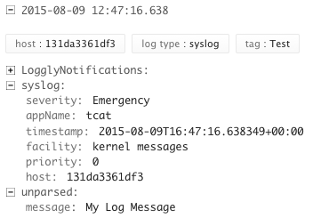
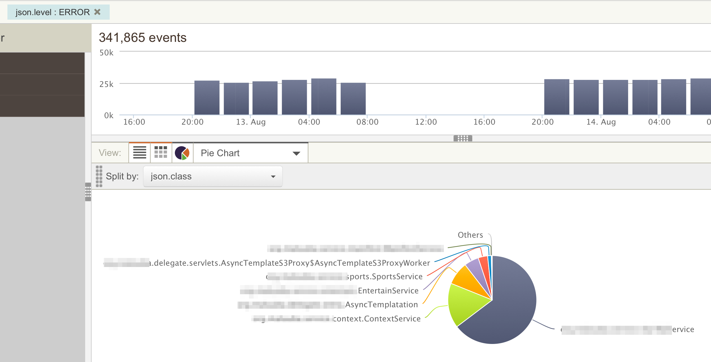
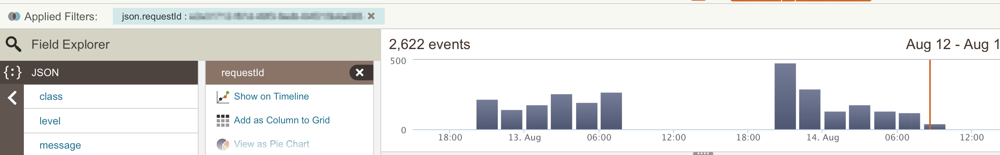
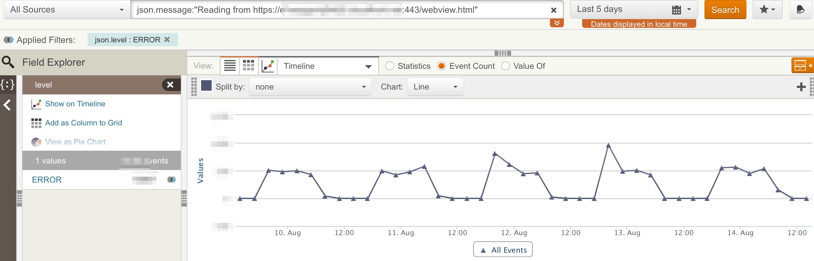

[](https://cdn.rancher.com/wp-content/uploads/2015/08/24184730/loggly1.png)Once
any application, dockerized or otherwise, reaches production, log
aggregation becomes one of the biggest concerns. We will be looking at a
number of solutions for gathering and parsing application logs from
docker containers running on multiple hosts. This will include using a
third-party service such as [Loggly](https://www.loggly.com/) for
getting setup quickly as well as bringing up an ELK stack ([Elastic
Search](https://www.elastic.co/products/elasticsearch), [Log
Stash](https://www.elastic.co/products/logstash),
[Kibana](https://www.elastic.co/products/kibana)) stack. We will look at
using middleware such as [FluentD](http://www.fluentd.org/) to gather
logs from Docker containers which can then be routed to one of the
hundreds of consumers supported by fluentd. In this article we focus on
using third party tools for Docker Logging, specifically using Loggly as
an example. We will highlight how to get application logs to Loggly
using both Docker and Rancher.

If you want to get setup aggregating logs quickly the best option is to
use a hosted third-party solution. There are many such solutions for
example [Paper Trail](https://papertrailapp.com/), [Splunk
Cloud](http://www.splunk.com/en_us/products/splunk-cloud.html)and
[Loggly](https://www.loggly.com). We will be using Loggly as an example,
however all three platforms support similar ingestion interfaces. One
option is to implement loggly integration directly into your
application. For example if you are using Java you can use
[Logback](https://www.loggly.com/docs/java-logback/). However, for a
more general solution we can setup integration through the
[rsyslog](http://www.rsyslog.com/doc/master/index.html) daemon. This
allows you to use the same setup regardless of application and language
as syslog support is available in the vast majority of languages and
platforms. Further, syslog allows you to configure local filtering and
sampling to reduce the amount of logs you will send on to Loggly. This
is important as Logging services tend to get very expensive for large
volumes. Lastly, syslog integration can be used with many other logging
solutions, so if you choose to switch from loggly to another option at a
later point your application code does not have to change.

Before we get started with the actual integration lets sign up for a
free Loggly trial account from the [sign up
page](https://www.loggly.com/signup/). Once you have logged into an
account browse to *Source Setup* > *Customer* Token
(https://YOUR\_DOMAIN.loggly.com/tokens) to find your customer token.
With this token we can send logs to Loggly for indexing and storage. In
order to actually send logs we will be using the
[loggly-docker](https://github.com/rancher/loggly-docker) container.
This container will setup and run a rsyslog daemon using your customer
token and send them to Loggly. The container accepts incoming logs both
from a unix domain socket as well as a UDP network port. If you are
going to run the container on docker you can use the command shown
below:

```
docker run --name loggly           
    -e TOKEN=[YOUR_LOGGLY_TOKEN]   
    -e TAG=[ANY_TAG]               
    -v /tmp/:/var/run/loggly       
    -p 524:524/udp                 
    rancher/loggly-docker
```

From Rancher, use the Rancher compose and Docker compose templates
shown below to bring up a stack with a logging service. This setup will
launch a Loggly container on each Rancher compute agent connected to
your environment.

```
# docker-compose.yaml
logging:
  environment:
    TOKEN: [YOUR_LOGGLY_TOKEN]
    TAG: [ANY_TAG]
  labels: io.rancher.scheduler.global: 'true'
  tty: true
  image: rancher/loggly-docker
  volumes: - /tmp:/var/run/loggly
  ports:
  - 514:514/udp
  stdin_open: true

# rancher-compose.yaml
logging:
  scale: 1
```

Once you container(s) are up and running your can test your logging
setup by using the following command:

```
# Test Unix Socket
ls -l /tmp/socket/log
echo netcat:"Docker-Test My Log Message" | nc -u -w 1 -U /tmp/socket/log
```

In a few seconds your log messages should be visible in the loggly
console. Note that the TAG you specified in the docker command or
compose template should be parsed out as well as the application name.

[](images/rancher_blog_loggly.png)

Now that we have the unix socket and the network socket setup we can use
it from other containers. To do so we can volume mount our unix socket
into the container and setup the application running inside to use
syslog based logging. To serve as an example for this setup we will use
our golang based sample application
[go-auth](https://github.com/usmanismail/go-messenger/tree/master/go-auth).
We will run the go-auth container, mount the syslog socket into it and
configure the application to write to the socket. To run the go-auth
container using Docker use the following command. This will run the
[usman/go-auth](https://hub.docker.com/r/usman/go-auth/) container which
is defined
[here](https://github.com/usmanismail/go-messenger/blob/master/go-auth/Dockerfile),
and specify that it should run with syslog based logging, with debug
level logs, on port 9000 with the database running at MYSQL\_HOSTNAME.

Note that we mount the directory containing the socket on the host
machine instead of the socket itself. Due to issues in the way Docker
volumes are mapped you cannot mount the socket itself. Further we must
mount the socket into a location like /tmp and then symlink it to the
correct place, */dev/log,* (The container already handles this) because
mounting the directly to /dev will overwrite other systems files which
are needed. Our earlier setup ensures that there is a loggly-docker
container running on every compute node hence regardless of where our
sample app launches containers the /tmp/socket directory will be
available for volume mounting.

```
docker run                      
  -v /tmp/socket/:/tmp/         
  -p 9000:9000                  
  usman/go-auth                 
  -t syslog -l debug run -p 9000 --db-host MYSQL_HOSTNAME
```

The sample application requires a running instance of MySQL which can
be setup inside a Docker container with the following command. If you do
use the containerized MySQL you would need to link it to the go-auth
container listed above.

```
docker run -d --name mysql -e MYSQL_ROOT_PASSWORD=SOME_PASSWORD 
    -e MYSQL_DATABASE=messenger                                 
    -e MYSQL_USER=messenger                                     
    -e MYSQL_PASSWORD=messenger                                 
    -p 3306:3306 mysql
```

Once you have setup the go-auth container you can register a new user
and generate an authentication token for the user with the following two
commands.

```
# Add new User
curl -i -X PUT -d userid=USERNAME -d password=PASSWORD http://GO-AUTH-HOSTNAME:9000/user

# Generate Auth Token
curl 'http://GO-AUTH-HOSTNAME:9000/token?userid=USERNAME&password=PASSWORD'
```

You can also create an instance of the sample application and requisite
MySQL container using the following docker compose template with a
trivial rancher-compose.yaml to specify a scale of one for both mysql
and go-auth services.

```
# docker-compose.yaml
GoAuth:
  command:
    - -t
    - syslog
    - -l
    - debug
    - run
    - -p
    - '9000'
    - --db-host
    - mysql
  image: usman/go-auth
  links
    - mysql:mysql
  volumes:
    - /tmp/socket:/tmp/
 stdin_open: true
 tty: true

mysql:
  restart: 'no'
  environment:
    MYSQL_ROOT_PASSWORD:rootpass
    MYSQL_DATABASE:messenger
    MYSQL_USER:messenger
    MYSQL_PASSWORD:messenger
  image: mysql
  stdin_open: true
  tty: true

# rancher-compose.yaml
GoAuth:
  scale: 1
mysql:
  scale: 1
```

Regardless of how you launch your linked container after a few seconds
you should start seeing logs like the one shown below in the Loggly
console. Note that the same socket can be bound to multiple containers.
Furthermore since we used Rancher global scheduling to launch a Loggly
container on each host we can rely on the /tmp/socket/log file being
setup regardless of which host your go-auth container gets launched on.
This setup will keep the configuration for syslog in one place (inside
container image and launched using a single Rancher service)
while distributing the load of logging across all hosts in the cluster.

[](images/rancher_blog_Screen-Shot-2015-08-09-at-11.48.07-PM.png)

Once you have your data in a log aggregation system we can do several
interesting types of analysis. First we can see the distribution of
events across our code base. For example the search below shows the
distribution of error logs across various classes in our code base. This
will help us target efforts to fix bugs as rare bugs can be prioritized
lower. In most of my projects we send several properties with each log
message including Service Name, Class Name, Method Name as well as some
client side properties such as Platform (iOS, Android etc) so that we
can target development team effort according to real need.

[](images/rancher_blog_loggly-error.png)

Another common use case for log parsing is the ability to isolate all
logs for a given request. We tag all our log events with the Request ID
regardless of which server or service is logging the message. This way
when we come across a bug we can see the entire life-cycle of the
problematic interaction across various services. This is even more
important in dockerized applications which are likely to be micro
services. To get an idea of what the user-flow was, getting logs from
all the containers and services in a form that we can correlate is
essential.

[](images/rancher_blog_requestid.png)

Lastly, another common question that comes up when we find a bug is “Is
this a new problem?” Hence having a record going back in time is
essential. With this kind of log aggregation we can see trends of how
often specific events were happening. This information can be correlated
with releases to find out which code change caused the issue. For
example in the screen shot below, the error retrieving the webview page
seems to have been around for at least since August 10th.

[](images/rancher_blog_timeseries.png)

Although it is not the primary motivator we can even use such trends to
setup automated alerts. For example the setup below will trigger an
alert if logs tagged with the Level Error happen at a frequency of more
than 10 in a given 5 minute period. This is a very coarse grained alert
which could probably have been setup more easily in a traditional
monitoring setup however more detailed search such as “a specific error
messages happening for the same user at a certain rate” can be very
difficult to emulate in a metrics system.

[](images/rancher_blog_Screen-Shot-2015-08-14-at-3.24.23-PM.png)

We have seen how easy it is to get Docker Logging and aggregation up and
running with a third party solution such as Loggly. For most small scale
projects and teams this is the ideal solution as it provides a full
featured log aggregation and indexing system with little investment of
time and team resources. For your effort you get much deeper
understanding of how your system is performing under real load and an
invaluable tool in debugging problems. Reading logs from individual
servers separately would make it impossible to find or analyze issues in
a distributed system especially if you use micro-services architecture.

However, as your setup grows Loggly and similar tools can get expensive.
In the next article we will look at the use of in-house solutions using
Elastic Search and Kiabana. This can be cheaper for large volumes of
logs but requires expertise and resources to setup and maintain a the
system. We will present a proof of concept setup however, setting up and
maintaining a large scale distributed log aggregation system is a
non-trivial exercise.

If you’d like to learn more about Docker Logging best practices with Rancher, please
view a
[recording](https://rancher.com/container-logging-with-docker-and-elk-september-2015-recorded-online-meetup/)of
our recent online meetup discussing how to deploy an ELK stack on
Rancher for monitoring containers. Also, please join us for our next
meetup in October, where we will be demonstrating best practices
for monitoring Docker containers.

*Usman is a server and infrastructure engineer, with experience in
building large scale distributed services on top of various cloud
platforms. You can read more of his work at
[techtraits.com](http://techtraits.com/), or follow him on twitter
[@usman\_ismail](https://twitter.com/usman_ismail)or on
[GitHub](https://github.com/usmanismail).*
