Today, automation and configuration management tools are critical for operation teams in IT. Infrastructure as Code (IaC) is the way to go for both Kubernetes and more traditional infrastructure. IaC mixes the great capabilities of these tools with the excellent control and flexibility that git offers to developers. In such a landscape, tools like Ansible, Salt, or Terraform become a facilitator for operations teams since they can manage cloud native infrastructure and traditional infrastructure using the IaC paradigm. 

Harvester is an HCI solution based on Linux, KubeVirt, Kubernetes and Longhorn. It mixes the cloud native and traditional infrastructure worlds, providing virtualization inside Kubernetes, which eases the integration of containerized workloads and VMs. Harvester can benefit from IaC using tools like Terraform or, since it is based in Kubernetes, using methodologies such as GitOps with solutions like Fleet or ArgoCD. In this post, we will focus on the [Terraform provider for Harvester](https://github.com/harvester/terraform-provider-harvester) and how to manage Harvester with Terraform.  

If you are unfamiliar with Harvester and want to know the basics of setting up a lab, read this blog post: [Getting Hands-on with Harvester HCI](/blog/getting-hands-on-with-harvester-hci/). 

## **Environment setup**

To help you follow this post, I built [a code repository on GitHub](https://github.com/SUSE-Technical-Marketing/harvester-terraform.git) where you can find all that is needed to start using the Harvester Terraform provider. Let’s start with what’s required: a Harvester cluster and a KubeConfig file, along with a Terraform CLI installed on your computer, and finally, a git CLI. In the git repo, you can find all the links and information needed to install all the software and the steps to start using it. 

## **Code repository structure and contents**

When your environment is ready, it is time to review the repository structure and its contents and review why we created it that way and how to use it. 

 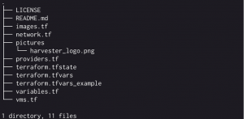

**Fig. 1 – Directory structure**

The first file you should check is **versions.tf.** It contains the Harvester provider definition, which version we want to use and the required parameters. It also describes the Terraform version needed for the provider to work correctly. 

 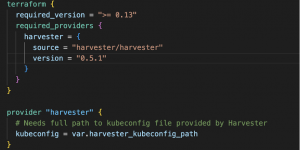

**Fig. 2 - versions.tf**

The `versions.tf` file is also where you should provide the local path to the KubeConfig file you use to access Harvester. Please note that the release of the Harvester module might have changed over time; check the module documentation first and update it accordingly. In case you don’t know how to obtain the KubeConfig, you can download it easily from the UI in Harvester.  

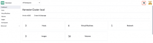 

**Fig. 3 – Download Harvester KubeConfig**

At this point, I suggest checking [the Harvester Terraform git repo](https://github.com/harvester/terraform-provider-harvester.git) and reviewing the example files before continuing. Part of the code you are going to find below comes from there.  

The rest of the .tf files we are using could be merged into one single file since Terraform will parse them together. However, having separate files, or even folders, for all the different actions or components to be created is a good practice. It makes it easier to understand what Terraform will create. 

The files **variables.tf** and **terraform.tfvars** are present in git as an example in case you want to develop or create your own repo and keep working with Terraform and Harvester. Most of the variables defined contain default values, so feel free to stick to them or provide your own in the **tfvars file**. 

The following image shows all the files in my local repo and the ones Terraform created. I suggest rechecking the **.gitignore file** now that you understand better what to exclude. 

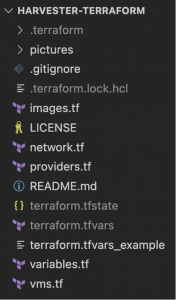 

**Fig. 4 – Terraform repo files**

## **The Terraform code**

We first need an image or an ISO to provision a VM, which the VM will use as a base. In **images.tf**, we will set up the code to download an image for the VM and in **variables.tf** we’ll define the parameter values; in this case, an openSUSE cloud-init ready image in qcow2 format. 

 

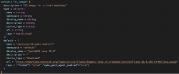

**Fig. 5 – images.tf and variables.tf**

Now it’s time to check **networks.tf**, which defines a standard Harvester network without further configuration. As I already had networks created in my Harvester lab, I’ll use a `data` block to reference the existing network; if a new network is needed, a `resource` block can be used instead. 

 

**Fig. 6 – network.tf and variables.tf**

This is starting to look like something, isn’t it? But the most important part is still missing... Let’s analyze the **vms.tf file**.  

There we define the VM that we want to create on Harvester and all that is needed to use the VM. In this case, we will also use cloud-init to perform the initial OS configuration, setting up some users and modifying the default user password. 

Let’s review **vms.tf file** content. The first code block we find starts calling the `harvester_virtualmachine` function from the Terraform module. Using this function, we assign a name to this concrete instantiation as openSUSE-dev and define the name and tags for the VM we want to provision. 

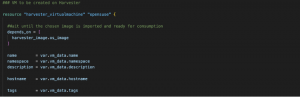 

**Fig. 7 – VM name**

Note the `depends_on` block at the beginning of the virtual machine resource definition. As we have defined our image to be downloaded, that process may take some time. With that block, we instruct Terraform to put the VM creation on hold until the OS Image is downloaded and added to the Images Catalog within Harvester. 

Right after this block, you can find the basic definition for the VM, like CPU, memory and hostname. Following it, we can see the definition of the network interface inside the VM and the network it should connect to. 

 

 

**Fig. 8 –CPU, memory, network definition and network variables**

In the `network_name` parameter, we see how we call the module and the network defined in the **networks.tf file**. Please, remember that Harvester is based in KubeVirt and runs in Kubernetes, so all the standard namespace isolation rules apply here and that’s why a namespace attribute is needed for all the objects we’ll be creating (images, VMs, networks, etc.)

Now it’s time for storage. We define two disks, one for the OS image and one for empty storage. In the first one, we will use the image depicted in **images.tf**, and in the second one, we will create a standard virtio disk. 

 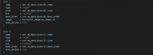

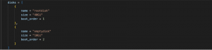 

**Fig. 9 – VM disks and disk variables**

These disks will end up being Persistent Volumes in the Kubernetes cluster deployed inside a Storage Class defined in Longhorn. 

 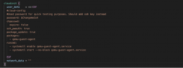

**Fig. 10 – Cloud-init configuration**

Lastly, we find a cloud-init definition that will perform configurations in the OS once the VM is booted. There’s nothing new in this last block; it’s a standard cloud-init configuration. 

## **The VM creation process**

Once all the setup of the .tf files is done, it is time to run the Terraform commands. Remember to be in the path where all the files have been created before executing the commands. In case you are new to Terraform like I was, it is a good idea to investigate the documentation or go through the tutorials on the Hashicorp website before starting this step.  

The first command is `terraform init`. This command will check the dependencies defined in **versions.tf**, download the necessary modules and review the syntaxis of the .tf files. If you receive no errors, you can continue creating an execution plan. The plan will be compared to the actual situation and to previous states, if any, to ensure that only the missing pieces compared with what we defined in the .tf files are created or modified as needed. Terraform, like other tools, use an idempotent approach, so we want to reach a concrete state.  

My advice for creating the execution plan is to use the command `terraform plan -out FILENAME` so the plan will be recorded in that file, and you can review it. At this point, nothing has been created or modified yet. When the plan is ready, the last command will be `terraform apply FILENAME`; FILENAME is the plan file previously created. This command will start making all the changes defined in the plan. In this case, it downloads the OS image and then creates the VM. 

 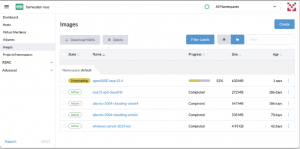

**Fig. 11 – Image download process**

 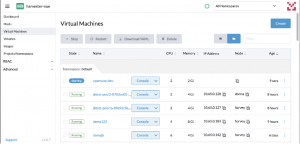

**Fig. 12 – VM starting**

Remember that I used an existing network, otherwise, creating a network resource would have been necessary. We wait for a couple of minutes, and voila! Our VM is up and running. 

 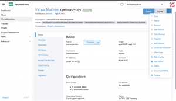

**Fig. 13 – VM details**

In the picture above, we can see that the VM is running and has an IP, the CPU and memory are as we defined and the OS image is the one specified in the **images.tf file**. Also, the VM has the tag defined in **vms.tf** and a label describing that the VM was provisioned using Terraform. Moving down to the Volumes tab, we’ll find the two disks we defined, created as PVs in the Kubernetes cluster. 

 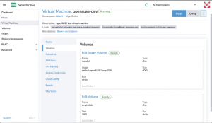

**Fig. 14 – VM volumes**

 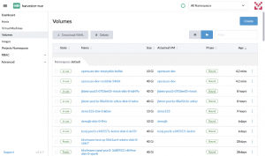

**Fig. 16 – VM disks (PVC)**

Now the openSUSE VM is ready to use it! 

 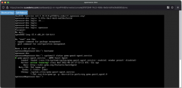

**Fig. 17 – openSUSE console screen**

If you want to destroy what we have created, run `terraform destroy`. Terraform will show the list of all the resources that will be destroyed. Write `yes` to start the deletion process. 

## **Summary**

In this post, we have covered the basics of the Harvester Terraform provider. Hopefully, by now, you understand better how to use Terraform to manage Harvester, and you are ready to start making your own tests.  

If you liked the post, please check the [SUSE](https://www.suse.com/c/blog/) and [Rancher](https://www.suse.com/c/rancherblog/) blogs, the [YouTube channel](https://www.youtube.com/c/Rancher) and [SUSE & Rancher Community](https://community.suse.com/). There is a lot of content, classes and videos to improve your cloud native skills. 

## **What's Next:**

Want to learn more about how Harvester and Rancher are helping enterprises modernize their stack speed? Sign up [here](https://more.suse.com/FY22Q4_CY_GLB_ECM_ALL_CLDNTV_WEB_Global_Online_Meetup_Harvester_RegistrationPage.html) to join our Global Online Meetup: Harvester on October 26th, 2022, at 11 AM EST.
