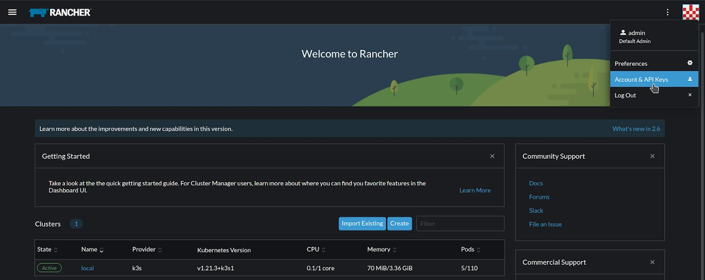
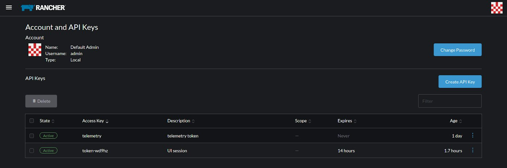
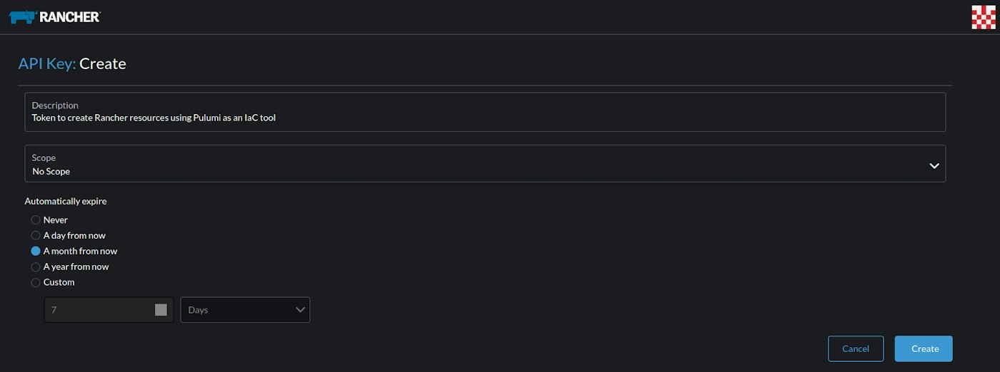
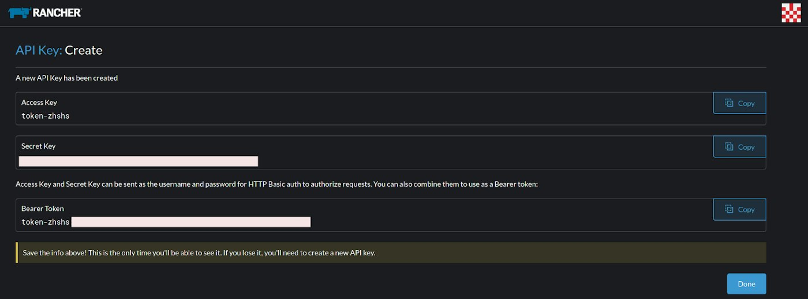
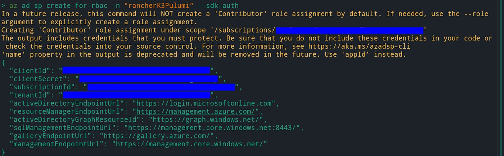
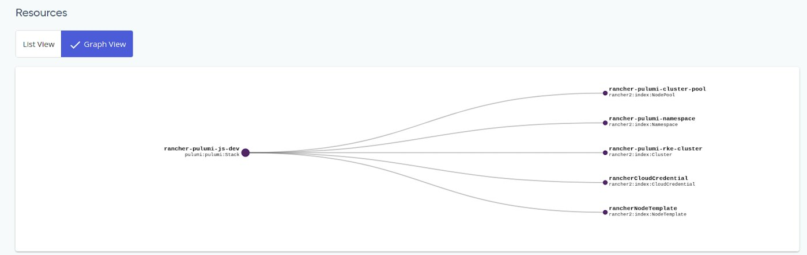
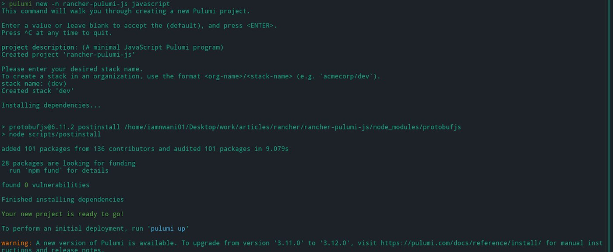
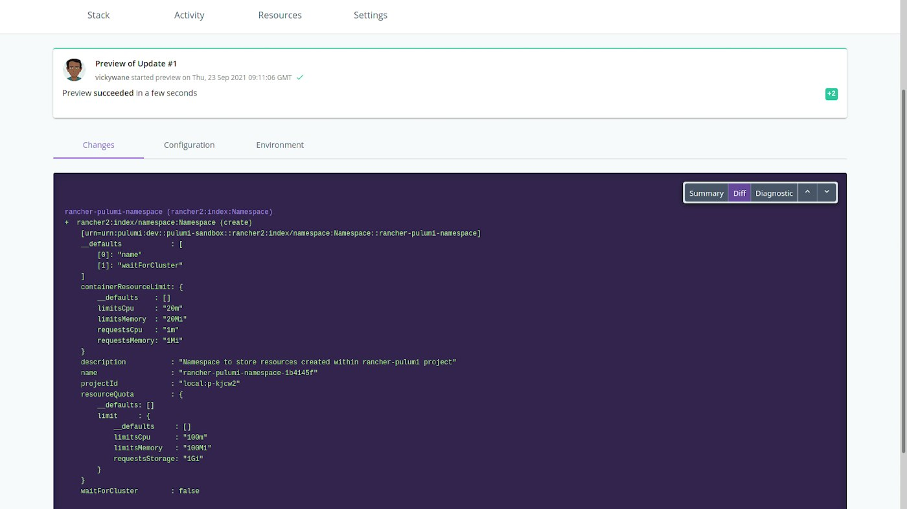
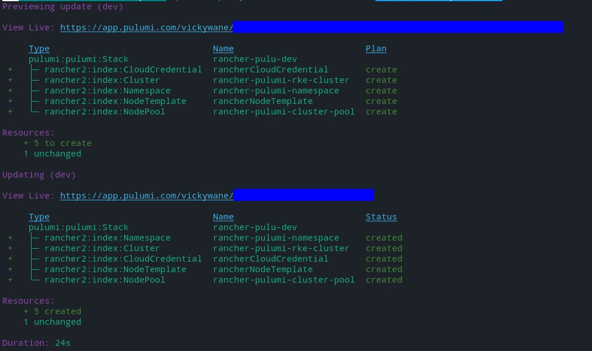

[](https://media1-production-mightynetworks.imgix.net/asset/30127408/pulumi.png?ixlib=rails-0.3.0&fm=jpg&q=75&auto=format)

Using an Infrastructure as Code (IaC) solution to automate the management of your cloud resources is one of the recommended ways to reduce the toil that results from repetitive operations to manage your infrastructure.

In this article, you will learn about Infrastructure as Code and how to reduce toil by using IaC to provision your Rancher resources.

## **Prerequisites**

This article contains a demo where Rancher resources were provisioned using Pulumi. You will need the following tools installed on your computer to follow along with the demo:

- [Pulumi CLI](https://www.pulumi.com/docs/reference/cli/) must be installed and authenticated on your local computer.
- A running [Rancher Server](https://rancher.com/docs/rancher/v1.6/en/installing-rancher/installing-server/).
- An [Azure CLI](https://docs.microsoft.com/en-us/cli/azure/) should be installed and configured to enable you to create a [Service Principal](https://docs.microsoft.com/en-us/azure/active-directory/develop/app-objects-and-service-principals#service-principal-object) for Rancher on Azure.

## **Introduction To Infrastructure As Code**

Infrastructure as code (IaC) refers to managing resources within an infrastructure through a reusable definition file. Resources managed can include virtual machines, networks and storage units.

With IaC, your cloud resources are defined within a configuration file, and you can use an IaC tool to create the defined resources on your behalf.

IaC tools are split into two categories: Native IaC tools for tools built and used with public cloud providers such as ARM Template on Azure, and multi-cloud IaC tools that provision resources across different infrastructure providers (such as [Terraform](https://www.terraform.io/) and [Pulumi](https://www.pulumi.com/)) for creating resources on [Google Cloud](https://cloud.google.com/gcp?utm_source=google&utm_medium=cpc&utm_campaign=emea-ng-all-en-bkws-all-all-trial-e-gcp-1010042&utm_content=text-ad-none-any-DEV_t-CRE_501794636575-ADGP_Hybrid+%7C+BKWS+-+EXA+%7C+Txt+~+GCP+~+General%23v1-KWID_43700061569959218-aud-304040939401:kwd-6458750523-userloc_9076650&utm_term=KW_google%20cloud-NET_g-PLAC_&gclid=CjwKCAjw7rWKBhAtEiwAJ3CWLMAmVqzHVOL7C5ActLOwMoFAsebeuRIJsfSU0h-IEHOCTPKLvgLuXBoCTnQQAvD_BwE&gclsrc=aw.ds), [AWS](https://www.google.com/search?gs_ssp=eJzj4tLP1TcoqsqrKjFUYDRgdGDwYk4sLwYAQnkFsw&q=aws&rlz=1C9BKJA_enNG942NG942&oq=aws&aqs=chrome.1.69i57j46i67i199i433i465j69i60l4.2857j0j4&hl=en-GB&sourceid=chrome-mobile&ie=UTF-8) and other platforms.

This article focuses on learning how to provision resources on a Rancher server using Pulumi.

## **Introducing Pulumi**

Pulumi is an open source project that provides an SDK for you to manage cloud resources using one of the four [supported programming languages](https://www.pulumi.com/docs/intro/languages/). Similar to Terraform, Pulumi provides the free Pulumi cloud service by default to better manage the state of your provisioned resources across a team.

**Note**: The [Windows Containers With Rancher and Terraform](https://rancher.com/blog/2019/2019-10-17-zero-to-windows-containers-with-rancher-2-3-and-terraform/) post on the rancher blog explains how to provision an RKE cluster using Terraform.

## **Used Pulumi Concepts**

Before you move further, it would be helpful to have a simplified understanding of the following Pulumi concepts that are frequently used within this article.

**Note**: The[Concepts & Architecture](https://www.pulumi.com/docs/intro/concepts/) section within the Pulumi documentation contains all explanations of Pulumi’s concepts.

- **Stack:** A [stack](https://www.pulumi.com/docs/intro/concepts/stack/) within Pulumi is an independent instance containing your project. You can also liken a Pulumi stack to environments. Similar to the way you have development and production environments for your projects, you can also have multiple stacks containing various phases of your Pulumi project. This tutorial will use the default stack created when you bootstrap a new Pulumi project.
- **I****nputs:** [Inputs](https://www.pulumi.com/docs/intro/concepts/inputs-outputs/#inputs-and-outputs) are the arguments passed into a resource before creation. These arguments can be of various data values such as strings, arrays, or even numbers.
- **Outputs:** Pulumi [outputs](https://www.pulumi.com/docs/reference/pkg/nodejs/pulumi/pulumi/#Output) are special values obtained from resources after they have been created. An example output could be the ID of the K3 cluster after it was created.

## **Creating Configuration Variables**

### **Rancher API Keys**

Your Rancher Management server will use an API token to authenticate the API requests made by Pulumi to create Rancher resources. API tokens are managed in the account page within the Rancher Management Console.

To create an API token, open your Rancher Management Console and click the profile avatar to reveal a dropdown. Click the Account & API Keys item from the dropdown to navigate to the account page.

[](https://media1-production-mightynetworks.imgix.net/asset/29683052/1633694224449.png?ixlib=rails-0.3.0&fm=jpg&q=75&auto=format)

From the account page, click the Create API Key button to create a new API Key.

[](https://media1-production-mightynetworks.imgix.net/asset/29683048/1633694224124.png?ixlib=rails-0.3.0&fm=jpg&q=75&auto=format)

Provide a preferred description for the API Key within the description text input on the next page. You can also set an expiry date for the API key by clicking the radio button for a preferred expiry period. Since the API key will create new resources, leave the scope dropdown at its default **No Scope** selection.

Click the Create button to save and exit the current page.

[](https://media1-production-mightynetworks.imgix.net/asset/29683047/1633694223425.png?ixlib=rails-0.3.0&fm=jpg&q=75&auto=format)

An Access Key, Secret Key, and Bearer Token will be displayed on the next page. Ensure you note the Bearer Token within a secure notepad as you will reference it when working with Pulumi.

[](https://media1-production-mightynetworks.imgix.net/asset/29683053/1633694224504.png?ixlib=rails-0.3.0&fm=jpg&q=75&auto=format)

### **Azure Service Principal Variables**

Execute the Azure Active Directory ( ad ) command below to create a service principal to be used with Rancher:

```
az ad sp create-for-rbac -n "rancherK3Pulumi" --sdk-auth
```

As shown in the image below, the az command above returns a JSON response containing Client ID, Subscription ID, and Client Secret fields. Note the value of these fields in a secure location, as you will use them in the next step when storing credentials with Pulumi.

[](https://media1-production-mightynetworks.imgix.net/asset/29683055/1633694224392.png?ixlib=rails-0.3.0&fm=jpg&q=75&auto=format)

## **Setting Configuration Secrets**

With the configuration variables created from the last section, let’s store them using [Pulumi Secrets](https://www.pulumi.com/docs/intro/concepts/secrets/). The secret feature of Pulumi enables you to encrypt sensitive values used within your stack without the value into the stack’s state file.

**Note:** Replace the placeholders with the corresponding values obtained from the previous section.

Execute the series of commands below to store the environment variables used by Pulumi to provision Rancher resources.

The "--secret flag" passed to some of the commands below will ensure the values are hashed before being stored in the pulumi.dev.yaml file.

```
# Rancher API Keys
pulumi config set rancher2:apiUrl <RANCEHR_API_URL>
pulumi config set rancher2:accessToken <RANCHER_ACCESS_TOKEN> --secret
pulumi config set PROJECT_ID <PROJECT_ID_TEXT>

# Azure Service Principal Credentials
pulumi config set SUBSCRIPTION_ID <SUBSCRIPTION_ID_TEXT>
pulumi config set --secret CLIENT_ID <CLIENT_ID_TEXT>
pulumi config set --secret CLIENT_SECRET <CLIENT_SECRET_TEXT>
```

## **Creating A Pulumi Project**

Now that you understand what Pulumi is, we will use Pulumi to provision a Rancher Kubernetes cluster on a Rancher management server.

At a bird’s eye view, the image below shows a graph of all Rancher resources that will be provisioned within a Pulumi stack in this article.

[](https://media1-production-mightynetworks.imgix.net/asset/29683050/1633694224266.png?ixlib=rails-0.3.0&fm=jpg&q=75&auto=format)

Within the steps listed out below, you will gradually put together the resources for an RKE cluster.

1. Execute the two commands below from your local terminal to create an empty directory (rancher-pulumi) and change your working directory into the new directory.

```
# create new directory
mkdir rancher-pulumi-js

# move into new directory
cd rancher-pulumi-js
```

2. Execute the Pulumi command below to initialize a new Pulumi project using the javascript template within the empty directory.

The -n (name) flag passed to the command below will specify the Pulumi project name as rancher-pulumi-js.

```
pulumi new -n rancher-pulumi-js javascript
```

[](https://media1-production-mightynetworks.imgix.net/asset/29683049/1633694224165.png?ixlib=rails-0.3.0&fm=jpg&q=75&auto=format)

Using the JavaScript template specified in the command above, the Pulumi CLI will generate the boilerplate files needed to build a stack using the Node.js library for Pulumi.

Execute the NPM command below to install the [@pulumi/rancher2](https://www.npmjs.com/package/@pulumi/rancher2) Rancher resource provider.

```
npm install @pulumi/rancher2 dotenv
```

## **Provisioning Rancher Resources**

The code definition for the resources to be created will be stored in the generated index.js file. The steps below will guide you on creating a new Rancher namespace and provisioning an EKS cluster on AWS using Rancher.

1. Add the code block’s content below into the index.js file to create a namespace within your Rancher project. You can liken a namespace to an isolated environment that contains resources within your project.

The code block contains a *RANCHER\_PREFIX* variable that contains an identifier text. In the preceding code blocks, you will prefix this variable to the name of other resources created to indicate that they were created using Pulumi.

The Pulumi Config variable within the code block stores an instance of the Pulumi Config class. The required method is later executed to retrieve the configuration variables that were stored as secrets.

```
"use strict";
const pulumi = require("@pulumi/pulumi");
const rancher2 = require("@pulumi/rancher2");

const RANCHER_PREFIX = "rancher-pulumi"
const pulumiConfig = new pulumi.Config();

// Create a new rancher2 Namespace
new rancher2.Namespace(`${RANCHER_PREFIX}-namespace`, {
   containerResourceLimit: {
       limitsCpu: "20m",
       limitsMemory: "20Mi",
       requestsCpu: "1m",
       requestsMemory: "1Mi",
   },
   description: `Namespace to store resources created within ${RANCHER_PREFIX} project`,
   projectId: pulumiConfig.require('PROJECT_ID'),
   resourceQuota: {
       limit: {
           limitsCpu: "100m",
           limitsMemory: "100Mi",
           requestsStorage: "1Gi",
       }
   }
});
```

Similar to the [Terraform Plan](https://www.terraform.io/docs/cli/commands/plan.html) command, you can also use the[Pulumi preview](https://www.pulumi.com/docs/reference/cli/pulumi_preview/) command to view the changes to your stack before they are applied.

The image below shows the diff log of the changes caused by adding the Rancher namespace resource.

[](https://media1-production-mightynetworks.imgix.net/asset/29683054/1633694224332.png?ixlib=rails-0.3.0&fm=jpg&q=75&auto=format)

2. Next, add the cluster resource within the code block below into the index.js file to provision an RKE cluster within the new namespace.

```
const rkeCluster = new rancher2.Cluster(`${RANCHER_PREFIX}-rke-cluster`, {
   description: `RKE cluster created within ${RANCHER_PREFIX} project`,
   rkeConfig: {
       network: {
           plugin: "canal",
       },
   },

   clusterMonitoringInput: {
       answers: {
           "exporter-kubelets.https": true,
           "exporter-node.enabled": true,
           "exporter-node.ports.metrics.port": 9796,
           "exporter-node.resources.limits.cpu": "200m",
           "exporter-node.resources.limits.memory": "200Mi",
           "prometheus.persistence.enabled": "false",
           "prometheus.persistence.size": "50Gi",
           "prometheus.persistence.storageClass": "default",
           "prometheus.persistent.useReleaseName": "true",
           "prometheus.resources.core.limits.cpu": "1000m",
           "prometheus.resources.core.limits.memory": "1500Mi",
           "prometheus.resources.core.requests.cpu": "750m",
           "prometheus.resources.core.requests.memory": "750Mi",
           "prometheus.retention": "12h"
       },
       version: "0.1.0",
   }
})
```

The next step will be registering a node for the created cluster before it can be fully provisioned.

3. Next, add the [CloudCredential](https://www.pulumi.com/docs/reference/pkg/rancher2/cloudcredential/#cloudcredential) resource within the code block below to create a cloud credential containing your Azure [Service Principal](https://docs.microsoft.com/en-us/azure/active-directory/develop/app-objects-and-service-principals#service-principal-object) configuration. [Cloud Credentials](https://rancher.com/docs/rancher/v2.5/en/user-settings/cloud-credentials/) is a feature of Rancher that helps you securely store the credentials of an infrastructure needed to provision a cluster.

Without automation, you would need to use the Rancher Management dashboard to create a cloud credential. Visit the [Rancher Documentation](https://rancher.com/docs/rancher/v2.5/en/user-settings/cloud-credentials/#creating-a-cloud-credential-from-user-settings) on Cloud Credentials to learn how to manage the credentials from your Rancher Management dashboard.

```
// Create a new rancher2 Cloud Credential
const rancherCloudCredential = new rancher2.CloudCredential("rancherCloudCredential", {
   description: `Cloud credential for ${RANCHER_PREFIX} project.`,
   azureCredentialConfig: {
       subscriptionId: pulumiConfig.require('SUBSCRIPTION_ID'),
       clientId: pulumiConfig.require('CLIENT_ID'),
       clientSecret: pulumiConfig.require('CLIENT_SECRET')
   }
});
```

4. Add the NodeTemplate resource within the code block below into the index.js file to create a reusable NodeTemplate that uses Azure as an infrastructure provider. The Node Template resource will define the settings for the operating system running the nodes for the RKE cluster as a reusable template.

The Pulumi Rancher2 provider will specify most of the default settings for the NodeTemplate; however, the fields within the code block customize the NodeTemplate created.

```
// create a rancher node template
const rancherNodeTemplate = new rancher2.NodeTemplate("rancherNodeTemplate", {
   description: `NodeTemplate created by ${RANCHER_PREFIX} project using Azure`,
   cloudCredentialId: rancherCloudCredential.id,
   azureConfig: {
     storageType: "Standard_RAGRS",
       size: "Standard_B2s"
   }
});
```

5. Add the NodePool resource into the index.js file to create a node pool for the RKE cluster created in step two.

```
// Create a new rancher2 Node Pool
const rancherNodePool = new rancher2.NodePool(`${RANCHER_PREFIX}-cluster-pool`, {
   clusterId: rkeCluster.id,
   hostnamePrefix: `${RANCHER_PREFIX}-cluster-0`,
   nodeTemplateId: rancherNodeTemplate.id,
   quantity: 1,
   controlPlane: true,
   etcd: true,
   worker: true,
});
```

At this point, you have added all the Pulumi objects to build a Rancher Kubernetes Engine cluster using Azure as an infrastructure provider. Now we can proceed to build the resources that have been defined in the index.js file.

Execute the Pulumi up command to generate an interactive plan of the changes within the stack. Select the yes option to apply the changes and create the Rancher Kubernetes Cluster.

[](https://media1-production-mightynetworks.imgix.net/asset/29683051/1633694224217.png?ixlib=rails-0.3.0&fm=jpg&q=75&auto=format)

The RKE cluster will take some minutes before it is fully provisioned and active. In the meantime, you can view the underlying resources created by viewing them through your Rancher management dashboard and the Azure portal.

## **Summary**

Pulumi is a great tool that brings Infrastructure as Code a step closer to you by enabling the provisioning of resources using your preferred programming languages.

Within this blog post, we used the Rancher2 provider for Pulumi to provision a Kubernetes cluster using the Rancher Kubernetes Engine on Azure. The Rancher2 Provider API documentation for Pulumi provides details of other provider APIs you can use to create Rancher resources.

Overall, IaC helps you to build consistent cloud infrastructures across multiple environments. As long as the providers used by the IaC tools remain the same, you can always provision new resources executing a command.
